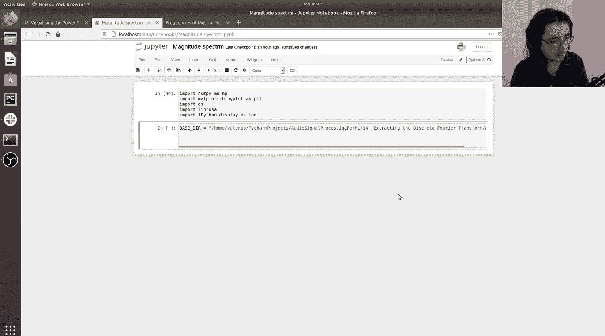
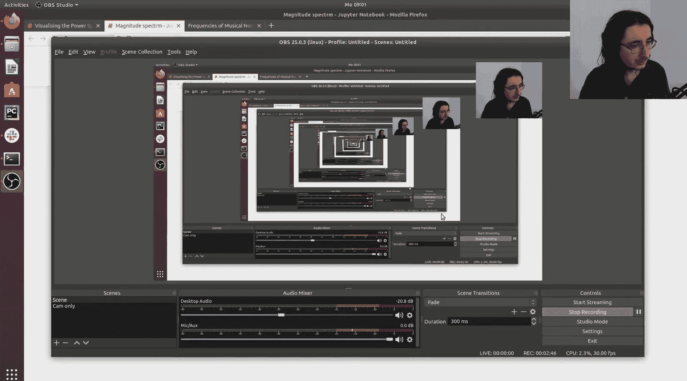
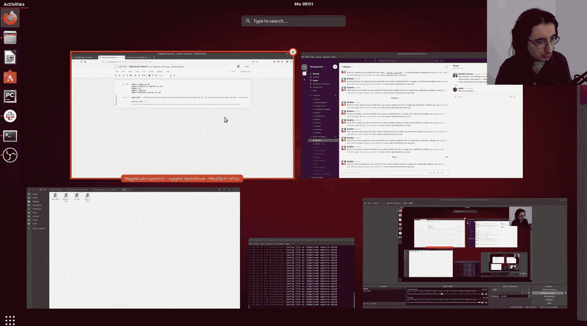
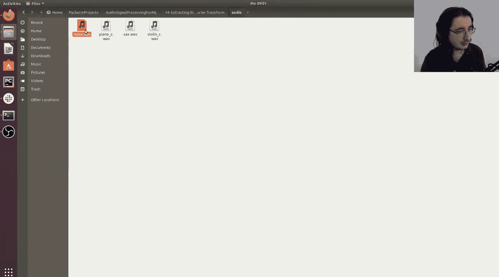
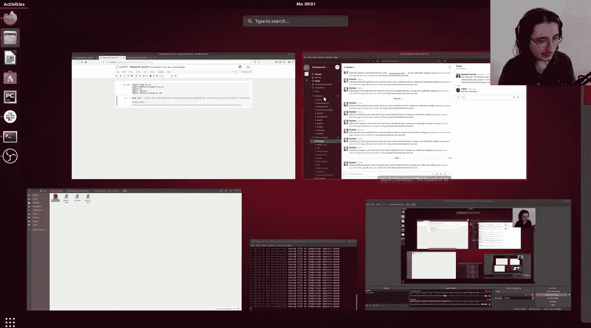
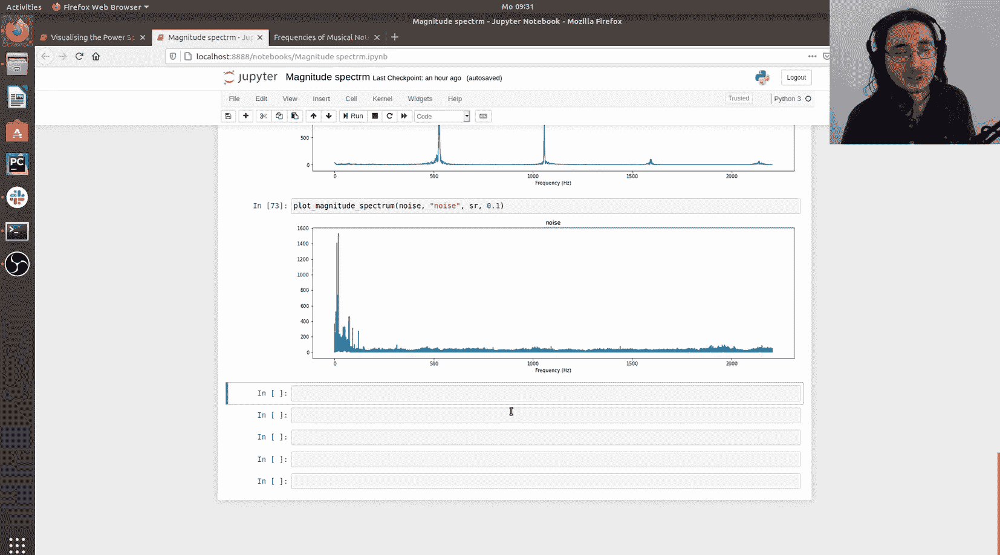

# Valerio Velardo【中英⚡面向机器学习的音频信号处理 Audio Signal Processing for Machine Learning】 p14 p13 How to Extract the Fourier Transform with Python [BV1ftPLeCEhX_p14]

🤧Hi， everybody and welcome to new exciting video in the audio signal processing for machine learning series。

 Last time， we looked at the theory behind the discrete Fourier transform and the fast Fourier transform。

 which is a flavor of discrete Fourier transform。 This time。

 I want to actually extract the Fourier transform coefficients using Python and specifically in nup beyond that。

 I'm going to show you also a bunch of different magnitude spectra for instruments which play the same note so that we can at least have a glance into why we perceive their timer differently。

 Okay， so let's get started with our gpypster notebook。 And here。

 first thing I want to import a few libraries that are going be useful for our purpose today。😊。

So I'll import NinP as MP and as I said we'll use NinPI to extract the Fast Per transform。

 then I'll import mat plot Le do pi plot as PLT， we'll use this library to plot the magnitude spectrums。

 and then I'll import or S。I'll import Lib browserser to load the audio files。 And finally。

 I want to import I Python Jot display play as IPD and will use this to listen to the audio files directly in and I' Jupyter notebook。

 Okay， so。Now what I want to do is just like un the audio files and show them and listen to them directly here in the Jupyter notebook and so first thing that I want to do is create a base De and that is going to point to the directory that contains all the different audio files that I want to show you guys and so I'll start with home and then Valerio。

Then pie charm projects。Or yes you processing for ML， and we are at the 14th。And finally。

 I'm going to have this audio directory here。 Okay， so this is the paster。

 And then I'm going to have this。 yeah， let's call it violin file。

And。

So you'll search here， where is it？Should be over here， right？ Okay， so here I'm in the base here。

 And as you can see， we have a bunch of different files。

So let me just go back to the Egyptianpyter notebook。 So the violin file is called violin C。

Viil in C。w。Then we have the suck file， and this is called。If you remember correctly， sax。wav。

And then we have this piano file。So it's equal to。Piano dot Wve。 And finally， we have the noise file。

 So we're also going to see the magnitude spectrum for some noise。 And this is called nice dot W。

Okay， but the piano one is called piano C dot1。 Okay， good。

 so now let's try to load this audio directly into Jupyter network so that we can listen to that。

 And so for doing this， we'll do an IPD dot audio and we need to pass the file path to like all of this different files。

 And so we'll do a O dot path dot join and we'll pass the base here as well as for the violin。

 the violin file。Over here。And yes， as you can see， we loaded that。

 I'm going to load all of these guys first and then we're going to quickly listen to them。

 but they're very， very short。Okay， so yeah， let me。Do this sat file so I'm going。

Pass in the where is it， the piano file。 And finally， I want to pass in the noise file over here。

Okay。🎼So yeah， let's listen to this first thing。 So here is a C4 note for the violin Okay。

 so the C4 note so think of like the piano keyboard。

 the C4 is the middle key so it's the C at the center of the keyboard then we have a C4 nu for the saxophone。

Okay， and then I see five notes for piano。So this is still the sea。

 but it's a oxted above and like the the middle C。 And finally， we have some noise。😊。

We are all used to this kind of。😊，No next， we want to load this files as an nu arrays。

 and for doing that， we are going to be using Libbrosa。 Okay。

 so I'll load the violin C for sound and I'm going to get back also the sample rate and I'm going to use a Libbrosa dot load and what I want to pass in is the。

This guy。 So basically the five path to the violin file。 Okay， so this is for violin。

 but we should do the very same thing for Ss and sax is gonna be s C4。 Now。

 the sample rate is gonna be default to 22050 Hz。 And we just need like the first one。 Then I mean。

 like here the sample rate is gonna be the same。 So I just gonna be using a underscore because I say。

 well， I really don't care about that。 variable。 Okay， so this is the same。

 but here it's not the violin file。 It's actually the S file。 Then we have the piano。

 but it's not C 4。 It's gonna be C 5。 once again， I'll put an underscore here。

 And this is gonna be piano file。 And finally， here we have our noise。Anch。

Let's pass in the noise file。 So yeah， so now we should have all of these guys with us。

 So let me show you that the sample rate is2 2050 Hz and you can search here and that's the default value for liberal。

 So that's fine。 Now let's take a look at the viol for it。 So this is an n array now。

 and this is basically like the waveform associated with this audio file。

 And if we take a look at the shape we're going to see that this is like an array which has like only like one dimension and the like I mean。

 like in in that one axis， we have around 60000 samples and this is the number of samples that we have like in the audio file。

 which is cool。 Okay so now let's try to extract the a Fourier transform coefficients。

And I'll call it for let's say the violin challenge。 So we'll do a FT。 or let's do violin FT。

 where FT stands for Fourier transform。 And so if we're doing that， we'll use a nu dot FftT dot Fft。

 Now， if you feel that this Fft dot Fft is redundant。

 I'll tell you that this first FftT is a module that contains a bunch of different implementations of the fast Fourier transform。

 one of which is the classical Fft。 So that's why you have like this double FftT thing here。 Okay。

 so here we need to pass the actual signal right， So this violin T4。 And now basically by doing so。

 we move from the time domain here to the frequency domain over there。 Okay。

 so now let's take a look at this Fourier coefficient。 So。Let's take a look at the shape。

Of this array and we'll take it over here and we'll do a violin FT dot shape。

 And as you can see here， so this is this has the same shape that we had for the signal itself Now。

 if you don't remember why that's the case， I really suggest you to go check out my previous video which should be here on the discrete。

 the theory behind the discrete Fourier transform。 but basically the idea in a nutshell is that we are going have like as many。

Frequency bins。As the number of samples that we have in the original time domain representation。

 So this checks out Okay， so now let's take a look at what we have for one frequency bin so we're going to take like the the first Fourier transform coefficient Fourier coefficient for violin FT and as you can see here。

 this is a complex number and you have the real part here and here you have the imaginary part of the of this complex number now once again。

 if you don't know what I'm talking about about like complex numbers。

 I suggest you like to go check out my video on complex numbers and it should be over here and then if can't remember why the Fourier transform。

Like produces complex numbers。 I suggest you to go check out this video that provides you with a lot of information about the Fourier transform itself。

 Okay， so here we have like this complex number。 And we know that this complex number provides information both about a face as well as the magnitude。

And now the thing is that for most applications in AI audio。

 we usually don't care that much about face。 So when we analyze signals。

 what we really care is to understand how much is each frequency is present in a in an audio signal。

 And for that， we just need the magnitude。 So what we do usually we we discard the information about phase and we only retain information about the magnitude。

 And so we move from the Fourier coefficients to the magnitude spectrum。 So how do we do that。 Well。

 that is very simple because we just like take the absolute value of the Fourier coefficients。

 In other words， we can take the magnitude spectrum of the violin。

Sound here by taking Ninpy dot apps， which stands for absolute value of the violin FT。

 So we pass the free transform coefficients to the absolute value function。

 and we get back to magnitudeur as spectrum。 Now this is not the violin。 It's just violin like this。

Oh， nope， sorry。 I just messed up everything。 So it's not the violion， but it's the violin， okay。

So now let's take a look at what happens here if we visualize like the first coefficients for the magnitude spectrum。

 Now， as you can see here， we don't have the a complex number anymore。

 We actually have one single like real number。 and that is indeed the magnitude associated with this initial frequency bin over here。

 Okay， so now you should have an idea of how to extract the Fourier transform and how to calculates the magnitude spectrum。

 But what we want to do here next is to actually visualize the magnitude spectra。😊。

For all of these different sounds that we have here so that we can compare them。 Okay， so for that。

 I'm going to create a a little function called a plot magnitude spectrum。😊。

So this function is going to accept a few parameters， so first of all。

 the signal itself in the time domain then it's going to take a title so that we can give a title to our plot and then it's going to accept a sample rate Okay yeah。

 why did I do that well。Okay。So now the first thing that we want to do is to calculate the Fourier transform。

 And we already say how to do that。 And we'll do a Npi dot FftT dot F FT and we'll pass the signal。

 then we'll calculate the magnitude spectrum。 and for that。

 we need to pass we need to create like this MP dot apps and we'll pass the Fourier transform。

 and then we want to plot the magnitude spectrum。And so how do we do that， Well， first of all。

 we need to initialize a figure。 and so we'll do a plot dot figure and we'll pass in a fixed size。

And this is a keyge argument， and here I'm going to pass in a10 for the width and5 for the height。

And then the next thing that we want to do is to kind of like create the X axis。

 And these are going to be like our frequency bins。 And so we can call this like frequency。

 And so how are' we going to do this。 So， we're going to be using this L space。😊，I function from Nim。

So let me just like write this。 And then I'll explain what it does。

 So we'll take this between 0 and the sample rate。 And then here I'm gonna pass in the length of magnitude spectrum。

 So what's I've done here is basically taking a range。 So we're gonna have like the frequency。

 which is between0 and the sample rate。 And then what I'm gonna to do is I'm gonna like create as many divisions。

 as many frequency bins as the number， as the length of the magnitude spectrum。

So this is for frequency， then what we'll do next is just like plotting。So we'll do a plot dot plot。

 We need to pass the X axis， and this is going to be frequency。

 Our Y axis is obviously the magnitude spectrum over here。

 And then what we want to do next is to pass the X label。

And here a as the label for our X axis will put in frequency， which is measured in Htz。

 and then we'll do the plot dot title and the title is going to be equal to title。And finally。

 we'll do a plot dot show so that we can't show our plots。 Okay。

 so now if I haven't made any mistakes， we should be able to visualize the magnitude spectrum here。

 So now let me pass the yeah， let's take the。Violin T4 over here。I'llPass that signal。

 then as the title， I'll just pass in violin and then the sample rate。

 It's gonna be equal to sample rate。 Let's see here we go。 nice， that we have our magnitude spectrum。

 And as expected on the X axis， we have the frequency all the different frequency bins expressed in Htz on the Y axis。

 we have the magnitude。 Now， if you remember from my previous video。

 you probably know that like what we're gonna get out of like this spectrum is some kind of like central symmetry。

 And indeed， you see that。We have like central symmetry。 So basically。

 we can kind of like consider only the frequencies up to like the the center point。

 which is the ni frequency。 Okay， so let's do that。

 And so I want to like make this like a little bit more flexible。

 So what I'll do is I'll change this function。 and I'll introduce like another argument called a frequency ratio。

 and I'll put like this as default equal to one。😊，Okay， but basically here。

 I want to calculate the number of frequency bins， right， using the frequency ratio。 Now。

 this is going be equal to。The frequency that we have， well， the length。

Of the frequency that we have here。 and then we'll multiply that by the frequency ratio。Obviously。

 like this number is going be a float。 So we need to cast it to an integer。

 So I'll do this like that。Okay， and so now like by doing so， we can only， we can take like only a。

A part of the original number of like frequency bins。

 And so now what we can do is just like go in here and slice the frequency and magnitude spectrum variables here arrays and only like consider from zero up to the number of frequency bins that we want to consider and I'll do the very same thing for the magnitude spectrum here。

 Okay， so now if I put the frequency ratio equal to1。 well， we still have the same thing。

 And as you can see， the frequency in hertz goes off to 22050 Hz Yeah let me just like remove this。

 Oh， by the way， given yeah， I say this。 So this is the sound of VI slack community。

 And so if you want to join。Here you can get like information about like all things like AI。

 audio and AI music and you can also like network with very， very cool people。

 know things about like the。Community like updates and new things。 you can ask for advice。

 or you can just， yeah， talk about papers and other cool stuff all around like AI audio。

 that if you're interested in joining the sound of VI community。

 I'll leave you the sign up link in the comment in the description below。

After this little teeter with the sound of the eyes isla community， let's go back to the plot here。

 And as we said， so when we have the frequency ratio。

 which is equal to 1 still we get all of our the frequency like has all the original frequency bins。

 and so it's up to the sample rate frequency， which is 22050 hs。 But if we change dates say to 0。5。

 we'll just have we'll just consider the frequency up to the ni frequency。

 which is half the sample rate， which in this case is 11000。😊。

Hs and but still here we see that most of the energy is contained in like lower frequencies。

 So Ill to zoom in， I'll just let put a 0。1 here。 And as you can see here like this is like nice because here we can actually see the different frequencies that are like involved in shaping this violin C 4 sound。

 And so here at around 2060 Hz。 We have a a first big。

 And this is the fundamental frequency of C 4 and indeed like this is the frequency of a C 4 note。😊。

Then we have like the first harmonic which should be around 520 Htz。

 which is very present and then we have the ver， the4， fifth harmonic and so forth。

 The interesting thing here is that the first harmonic of this violin T4 sound has more energy than the fundamental。

So which is kind of like interested in itself。Okay， so now let's compare this with the socks。

Sexophon sound。 says sex C  for。And here a Poant suck。And as you can see。

 we have a quite similar spectrum magnitude spectrum here。

 And this is to be expected because like both instruments are playing the very same note。

 which is this C4。 And so you see I pick here on around like the fundamental frequency and on the first harmonic。

 but on a closer look， you'll see that the relative presence of this harmonics and the fundamental is different for the violin and the saxophone。

 And so this is one of the reasons why we perceive this sounds as different in timer。

 So they still have like the same frequency because they're both playing the same C4ner。

 But they sound different and one of the reasons why that's the case it's because they their energy content。

 which we can see through this power spectrum， is different。 Okay， so now let's take a look at the。😊。

C five notes on the piano。😡，So I'll do a piano C5， and let's call this piano。Right。

 and now obviously like the fundamental here is not 260。

 but it's rather 520 Hz because we are aocive above C4 because we are in C5 and that basically doubles the frequency of the fundamental and but the cool thing here is that you can see that the peak is on the fundamental Then the first harmonic partial is kind of like less present than the fundamental and then like the other like harmonics just like fade away in their present。

 This is different from what happens with the violin and the saxophone where the first harmonic partial is more present than the fundamental。

😊，Okay， so now as a final thing， let's take a look at the noise signal。😊。

So we'll have noise here and I'll put in here and noise。 all right。 And as you can see here。

 what happens is that you have a lot of activity， a lot of energy in all the different frequency bins for sure we have some kind of like pick here towards like the lower frequencies。

 but then as you can see like all the frequency bins have a little bit of like of energy there And that's what a noisy signal looks like。

 Okay Co So I feel like we we did like some cool stuff like in this video because now you should be able like to extract the Fourier transform with python using Nmpp and then you should also be able to visualize the magnitude spectrum using mappl lip and finally。

 we also now know the difference between like different instruments and what。😊。

That means in terms of like perceptual。Coracter， lack of sound。 Okay。

 so now one thing that I want to draw your attention to before I dash off and I finish off like this video is that it。

 yeah， of this like magnitude spectra is I。kindind of like a snapshot that we take and it's a snapshot that provides us information across all the duration of a sound。

 it doesn't give give us any information about what happens。😊，With relation to the frequency。

 like second by second or like moment by moment。 we just lose that information because we average everything across all the duration of a sound。

 Would't it be fantastic if we could have information about the frequency and it as a function of time as well。

 Well， that would be fantastic indeed， and it's going to be the topic of my next video。

 which is going to introduce the theory behind the shorttime Fourier transform and the shorttime Fourier transform is going to enable us to extract spectrum spectrum。

 the spectrum from an audio signal。 And this is the main currency that we use in AI audio and music information retrieval to make sense of digital audio signals。

 So stay tuned for that。 That's all for today。 I hope you've enjoyed the video if that's the case。

 please leave a。😊，And if you haven't subscribed to the channel。

 please consider doing so if you have any questions as usual。

 feel free to leave them in the comment section below。😊。

See you next time， cheers。