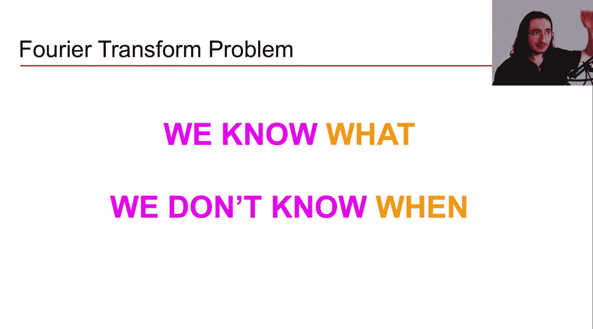
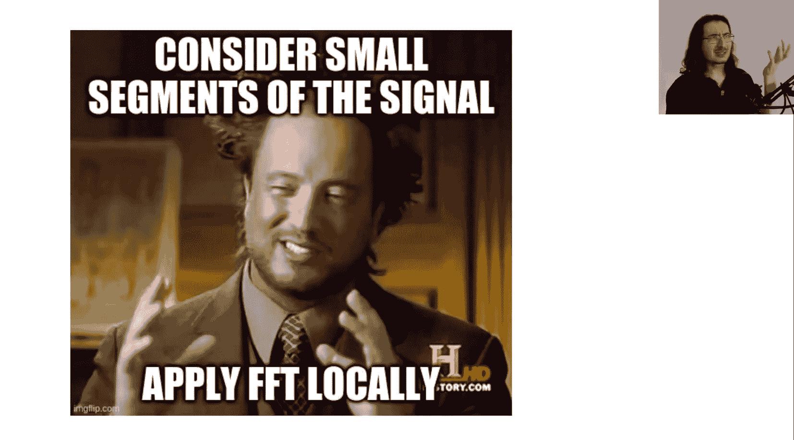
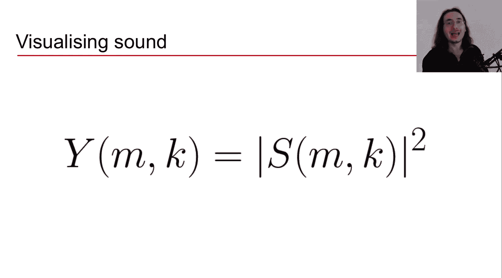
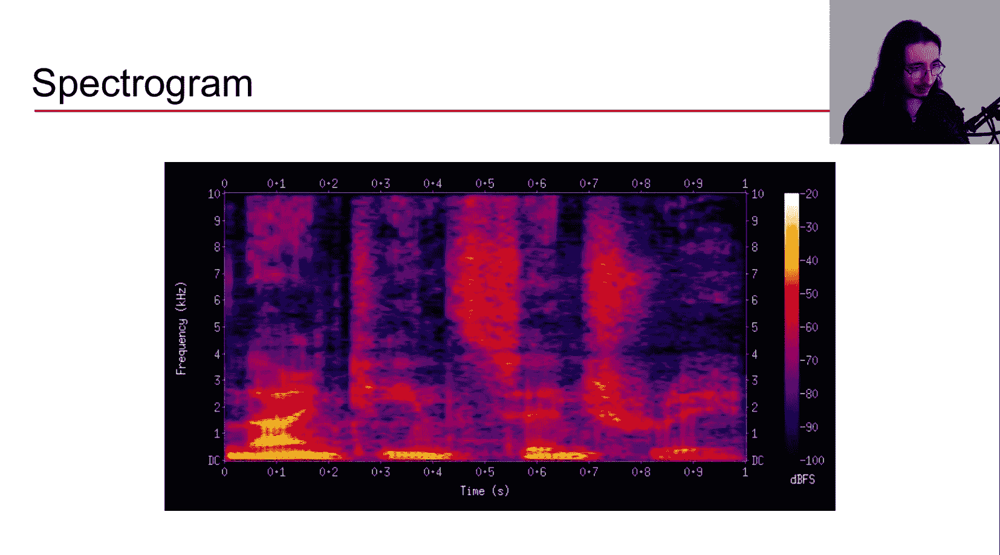
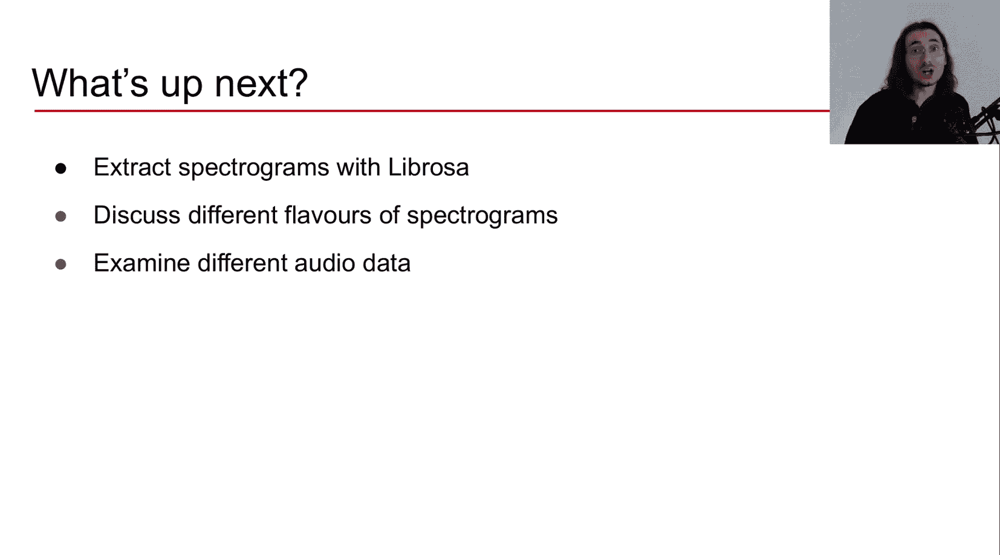

# Valerio Velardo【中英⚡面向机器学习的音频信号处理 Audio Signal Processing for Machine Learning】 p15 p14 Short-Time Fourier Transform Explained Easily [BV1ftPLeCEhX_p15]

Hi， everybody， and welcome to a new exciting video in the audio signal processing for machine learning series。

 Last time we extracted the discrete Fourier transform with Python and Libbrasa from a bunch of audio files。

 This time we're back to theory specifically will be addressing a key topic in AI audio。

 the short time Fourier transform。 So why is the short time Fourier transform so important。 Well。

 that's because it enables us to extract spectrograms and spectrograms are really the probably the most important feature that you can feed to deep learning audio models。

😊，But before we get into the in and out and of the shorttime Fourier transform。

 I want to remind you once again about the sound of AI slackla community on this community。

 you'll find people with interest in AI music audio audio digital signal processing And so if you're there。

 you can ask for feedback， you can share your project network with a bunch of very cool people。

 So if you're interested in joining， I'll leave you the signup link in the description section below。

 Okay， now onto the real cool stuff。 So before we get to the SDft。

 I want to remind you about the discrete Fourier transform。

 And here we have its mathematical formulation。 now I'm not gonna get too much into the details here。

 that's just because I have a whole video on the discrete Fourier transform。 So if you're interested。

 you can go and check that out。 But what。😊，Ne here is the high level intuition。

 So we start with our signal in the time domain， a waveform like this。

 Then we apply the discretescript Fourier transform。

 and what we get back is basically a picture of the presence of the different frequency components in the original signal and visual we get like a magnitude spectrum like this。

 but this is a still image。 What do I mean by that。 Well。

 it's a still image in the sense that it only provides us like one picture that averages the presence of the frequency components across the whole duration of the signal and here we actually have problem because we know what frequency components are present in a signal but we don't know when they are more or less present because all of them are average。

😊，Across the whole duration of the entire signal。 And this is a little bit of a problem because we know which audio data it's all about the evolution of frequency components like over time。

 And so audio data is very， very dynamic。 And we want to know how like this different frequency components evolve over time。

 And this is the whole point of the short time Fourier transform。

 So moving from a still image to a video that provides this information about the different frequency components across time。

 So how can we do that。 Well， that's the whole point of the short time Fourier transform。

 And the high level idea here is that we don't。😊。

Perform the Fourier transform across the whole duration of the signal。

 But rather we consider a small segments or chunks of the signal， which technically we call frames。

 And then we apply a discrete Fourier transform for each frame。 Now。

 I know this could sound a little bit like abstract。 So let's visualize this。

 So we start with a signal， audio signal like this。 Then we consider only like the first chunk。

 the first frame。 And at this point and only on this the samples belonging to this frame。

 we apply the discrete Fourier transform， and we gets back like our nice magnitude spectrum。

 Then we slide on to the next frame。 and once again， we apply to that frame。

 the discrete Fourier transform third frame， same thing until we burst through all the duration of the signal。

 One way we can use to derive the segments is through windowing。 In other words， we apply a window。😊。

Function to a signal。 What does that mean， Well， it means that we take the original signal。

 and then we multiply that by a window function， sample by sample。 And we obtain a windowed signal。

 Now this fields a little bit abstract doesn't it。 So let me give you an example。

 So we start from an audio signal。 And then here we're gonna to be applying a rectangle windowing function。

 And this is the result。 So the rectangle window function is this a red curve here。 And yeah。

 it has like a rectangle shape， right， And this function is0 everywhere apart from a segment where it is equal to one。

 So if we multiply the signal with the rectangle window， we obtain this windowed signal down here。

 Now I want to introduce a couple of parameters that are very important for what we are discussing today。

 now。So one is the window size。 The other one is the frame size。

 They're both measured in number of samples， but they refer to to slightly different things。

 So let's take a look at the window size first。 So the window size is basically the amount of samples we apply windowing to the frame size on the other hand is the kind of like the number of samples that we consider in each chunk of the signal when we segmented the signal and then we pass it to the shorttime Fourier transform for just like calculating the Fourier transform for each frame for each segment。

 okay， usually the window size and the frame size coin side they have the same value。

 the same number of samples。😊，But sometimes it happens that the frame size is larger than the window size。

 Now， this is like quite unusual， I would tell， and most of the time in most of your applications。

 the window size and the frame size will can。 and this is like so so true that， for example。

 in Libs when we extracted short and Foururier transform。

 we we are not forced to pass the window size， and the default value for the window size is the frame size。

 right？ Okay， But what happens if the window size is smaller than the frame size。 Well。

 still we the chunk。 So we we apply the Foururier transform to is the whole frame。

 but then the windowing happens only on the window size number of samples， right。

 and we apply the window function。On those samples。 and then the remaining samples。

 which are the difference between the frame size and the window size are going to be 0 padded。 Okay。

 but for the sake of this video， we'll assume that we have the window size。

 which is equal to the frame size。 So if that happens。

What this is at this point is already the window sorry we have like one frame here and we've also applied the window function here。

 and at this point is when we apply the Fourier the discrete Fourier transform so that we can get the frequency components out of this frame。

 Then we move on we slide to the right and we get like a second frame like this sliding also like the window function。

 and here once again we apply the discrete Fourier transform。 we move to the third frame。

 same thing until we get to the end of the signal， but this is a simplified version what usually happens in a shorttime Foururier transform because the frames are overlapping like this。

 So the second frame is overlapping with the first one as you can。😊。

From here now I need to introduce another parameter here that's called hop size or capital H。

 And it's given by this visually。 And this basically provides us it tells us how many samples we slide to the right when we take a new frame。

 Okay， if you want to know why。The hop size like is so important。 and we need overlapping frames。

 I really suggest you to go check out my video on audio feature extraction pipelines。 It's up here。

 and there you'll learn about a lot of topics about， for example。

 like spectral leakage and a bunch of other things that are related to like the points that I'm making here。

 and I'm not gonna get into the details here， because I've already done that。 Okay。

 moving on it's time to move from this kind of like visual intuition of the shorttime Fourier transform to its mathematical formulation。

 So what I want to do here and don't be scanned is to compare the digital Fourier transform or its mathematical form。

 which is this formula in the top with the formulation for mathematical formulation for the shorttime Fourier transform。

 which is this one down here。 Okay， so let's go item by item and see how they map。😊，To each other。

 Okay， the first one is just like the definition， right， the upper that we get。

 So in the case of the discrete Fourier transform， we guess like this as hat as a function of K。

 where K is a proxy for a frequency。 And so in other words。

 like the discrete Fourier transform depends on the frequency。

 And this means that each of these like formulas is gonna give us a complex Fourier coefficient for the K of。

😊，Frequency。And the complex Fourier coefficient provides this information to about two parameters。

 the face and the magnitude。 Now， if you want to really know what phase and magnitude mean in terms of the Fourier transform。

 I suggest you to go check out these video on the Fourier transform and there like you'll get like a better picture。

 but I hope like you've already watched that。 Okay， So this is for the discrete Fourier transform。

 what about the short time Fourier transform。 as we can see here。

 a capital S depends not only on K on frequency， but also on M。 So what's this M。 Well。

 M is a proxy for time So that the shorttime Fourier transform depends both on frequency and time。

 So now let's understand a little bit better， like what this M is。 And like nominally， is just like。

The， the frame， the the， the frame number we are currently in。 But let's visualize this。 Okay。

 so here we have like we are back again with our original signal and like the different frames here。

 and so。For the first frame， we have M， which is equal to one here。

 we have for the second frame M equal to2 and m equal to3。 you get the idea， right。

 So M is just like the frame number。 So in other words。

 the result that we get from the shorttime Fourier transform is the Fourier coefficient for the K of frequency at the n temporal bin or n frame。

 Okay， but still like the the Fourier coefficient that we get。

 It's still like a complex number that has information about phase and magnitude。 Okay， moving on。

 So the next step is to compare these two sums。 If you guys remember from the DFT。

 So what what was happening here is we were summing。😊，All across like all the samples。

 So basically we were summing across like all the time， all the duration of the signal。

 and we do like something similar also in the STF kind of like intuitively we are doing the same thing。

 we are summing like across time or given like we are in a discrete domain across like all the different samples but what's different between this two sums is capital n in the case of the discrete Fourier transform。

 we are summing across all of the samples in the signal。

 So n is equal to all the samples in the signal in the case of the short time Fourier transform。

 capital n over here， is equal to the frame size and that's because were not considering all of the signal but just one frame and in one frame。

 we have a number of samples that's equal to the frame size by definition right。😊。

So now you start to get the idea of how like this STFT works。

 But to see this like even more specifically， we need to move to the next element of this formulas。

 which is the signal itself。 So let's analyze the one in the top formula。

 So for the discrete Fourier transform x of n is just like the signal considered mean the whole signal。

 So all of the samples。😊，In the short time Koreaier transform， by contrast。

 we are only considering the signal。That's present， like in the current frame。 So in other words。

 we're considering all the samples that are present in the current M frame。

 And so why is that the case。 Well， that's the case， because first of all。

 this M multiplied by capital H is the starting sample of the current frame。

 because M is the current frame and H capital H is the hop size。 So if you multiply 2。

 you realize that this is like the starting sample of the current frame。 And then we add n。

 but this n moves like from 0 to the frame size -1。

 which basically means like that we are kind of like covering all the samples in that frame。 Okay。

 now， if we want to visualize this， we can just go back to the signal。 and here。

 like we have like this rectangle。 And here we have like all of the。😊，The signal， like for one frame。

 And here， like on the left of this rectangle， this vertical line here is the starting sample。

Of the frame， which is equal to n multiplied by capital H。Okay， so now we like the next step， though。

 in the case of the short time forier transform is that we should multiply this signal by the windowing function。

 and we do that with this like representation here。

 So we have like the signal where the signal for one frame and we multiply that by the windowing function。

 And again， so we already sold this， right， And so we are multiplying the original signal like for a specific frame by the windowing function and we obtain the windowed signal。

 Okay， for that one frame。Okay， so moving on， we have the last step and the last step is the same for both the discrete grid Fourier transform and the shorttime Fourier transform。

 In other words， we are multiplying by a pure turn that has frequency。

 given by K divided by capital N。 And so by doing so what we are doing is we are taking the the signal。

 and then we are decomposing it and projecting it onto the pure turn with frequency K divided by capital N。

 Okay， so here you have the comparison between the math behind the discrete grid Fourier transform and the math for the shorttime Fourier transform。

 But now you may be wondering， okay， now， more or less， like I get like the math here。

 But what are like the output。😊，So what， what do we get out of a DFT and a an SDFT。

 Let's take a look at that。Okay， so for DFT， we extract a spectral vector and which for a number of like frequency bins。

 In other words， like we， we get a Fourier coefficient for each of the frequency components with decomposed our original signal into。

 And this is a one dimensional array， It's just like a vector， right。

 and there's no dimension of time in here， because everything like is the average across the whole duration of a of a signal。

 but with the SFT， we have like something that's quite different。 In this case。

 we don't have a one dimensional value， one dimensional array， but rather a two dimensional array。

 or in other words， a spectral matrix。That has a number of frequency bins and a number of frames。

 And in other words， we get a complex Fourier coefficient for each frequency bin that we are considering for each frame。

 Okay， and so in other words， we have both a reference to frequency as we had with the discreted Fourier transform。

 But now we've gained also information about time through the different frames。

 which are proxies for time。 Okay， but you may be wondering。

 but can we calculate the actual number of frequency bins and number of frames that we get out of us and SF。

 Well， yes， of course， we can and we'll do that。 Okay， so how do we get the number of frequency bins。

 Well， this is quite easy to get。 And you have the formula here。 So you get the frame size。

 you divide the frame size by2 and。😊，you add up one and this gives us the number of frequency bins Now let's try to understand why this is the case if you guys remember from my earlier video on the discrete Fourier transform you should know that the number of frequency bins that we get out of a discrete Fourier transform is equal to the number of samples that we have in the on the whole signal。

 now in the case of an STF we don't average we don't consider the whole samples at once。

 but rather like a frame size number of samples， so we would expect that the number of frequency bins for each Fourier transform that we get is equal to the frame size。

Thoughts。We don't get that。 We get the frame size divided by2 plus one。 Was that the case。 Well。

 if you remember once again from the discrete Fourier transform video。

 we showed that the discrete Fourier transform is symmetrical。

 has a mirror symmetry around the center frequency， which is the niest frequency。

 And what happens there is that's basically like the first half has some information。

 And then that gets like mirrored in the second half。 And so in a short time Fourier transform。

 we we consider that。 And so we don't need to take information about all of those bins because it's just like redund。

 we only take the information about like the first half。 So frame size divided by two plus one。

 So that's the reason why。 Now， if you haven't fallen that completely。

 I highly suggest you to go check out my video on the discrete Fourier transform to understand what it meant more specifically there。

 Okay now let's move on to。The number of frames。 And so here we have another very nice。

 little formula and the number of frames is given by the total number of samples that we have in a signal minus the frame size divided by the hop size plus one。

 Now I'm not gonna get into to the details of explaining this visually。

 And I highly suggest you as an exercise to play around with this and understand why this formula gives us the number of frames。

 Okay， but I know this can feel a little bit abstract。 So let's go move on with an example。

 So here we have like a bunch of like SDft parameters， and we want to find the actual output shape。

 So we have a signal with 10000 samples。 We have frame size。

 which is equal to 1000 samples and we have a hop size of 500 samples。

 So for the number of frequency bins。 So we take the frame size。 We divided it by2。 We add one。

 and we get 5001。😊，Frequency bins。 Okay， but these are frequency bins。

 And we know that they divide a certain frequency range equally。

 And so we have like a frequency range that's divided in 501 bins in this case。

 now what what is that range。 Well， that range and the frequency ranges between0 Htz。

 and the sampling range divided by two Htz。 And that is the ni frequency once again。

 So if you want to know why that's the case once again。

 just go back to my video on discrete grid Fourier transform。 Okay， so moving on。

 the number of frames。 So here we have like a little formula。

 And so we have to take the number of samples in the signal。

 So 10000 minus the the frame size and this is gonna be divided by the hub size and all of this we have to all of this we have to。

😊，1 and the result is 19。 so we have 19 frames。 This signal is going to be divided into。

 So the overall output shape of the SDFT in this particular case is going to be 501 and 19。

 So it's a two dimensional array。 The first dimension provides us information about frequency。

 the second provides us information about the temporal bins or the number of frames。😊，Okay。

 so now I think like we should take a look at the shorttime Fourier transform and try to understand the different parameters。

 So the important thing that you should understand here is that really the shorttime Fourier transform depends on a bunch of parameters that we pass。

 So depending on the parameters that we pass， we're going to get an output that's going to be different。

 So one of these parameters and we've already encountered it is the frame size。 or in other words。

 how big are the chunks we divide our original signal into and this is measured in frames and the usual values that we have here are like like this like 51210241000192。

 as you can see， these are power of two numbers and as we already discussed in a previous video。

 it's important that the frame size is。power of two number。

 And that's because with that specific number， we can use the fast Fourier transform to calculate the discreted Fourier transform。

 which is a very quick and computationally efficient way of extracting the discrete Fourier transform。

Now， there's an interesting aspect in when we choose the frame size。

 and it's called the time frequency trade off。 So if we get like a larger， a large frame size。

 what usually what happens is that the frequency resolution is going increase and the time resolution is going to be degraded。

 so wheres that the case。 Well， So we know that if we enlarge， the frame size。

 So we take more samples。😊，We are going to be having like more frequency bins。

 And so if you have more frequency bins， it means that the frequency resolution overall improves。

 But if you take more more samples in one frame size。

 it means that you are taking like a larger you're considering a larger chunk of time because samples like a proxies for for time。

 and in other words， if you're taking like like a larger chunk of time。

 it means that the time resolution goes down， right， and the opposite is also true。 In other words。

 if you take a smaller frame size， then the frequency resolution is going to go down。

 and that's because you're going to have like a smaller number of frequency bins as output。

 but you're going to have a higher a better time resolution。

 just because you're considering less samples， which equates like to like。😊，Less amount of time。

 And so you're gonna be calculating like the fullyier transform like an un smaller chunk of time。

 So your time resolution is going to be better。 Now， this is like a time frequency tradeoff。

 as you can see here， say when when you try to improve the frequency resolution than the time resolution is going go down and vice versa。

 Now， how do we solve that。 Well， we don't really solve that。 we just have like some heuristics。

 Most of the time， you want to find a value of the frame size that's okay and it's a good tradeoff between frequency and time resolution。

 but this really depends on the type of application that you're a problem that you are interested in。

 So certain problems for certain problems。 it's more important that you have a higher frequency resolution。

 And in that case， you should take like a bigger frame size。 for other applications。 like。

 for example， onset。Detection， you're not really super interested in the frequency frequency resolution。

 Perhaps you're more interested in just like having like a very precise or like high。

 highly resolved like time so that you a very good like time resolution so that you can really know what happens like at each point in time。

 Okay， so I think like this is like very important to keep in mind when you decide like which frame size like to to take this I mean。

 the two things frequency time resolution are related together andversely related in a sense right。

 Okay， so now let's move on to the next short time Fourier transform parameter。

 and that's the hop size。 we already so that multiple times in this video and in earlier videos。

 And we know that's the number of samples that we slide to the right when we want to take a new。😊。

So usual values here， once again，256，512。 and then all power of twos must of the time。

 And we can also define this as a fraction of the frame size So a half of the frame size or a four for a eighth of the frame size。

 So you have like both definitions， absolute and relative。 Okay， now， moving on， a third。

 very important parameter is the windowing function And obviously。

 the shorttime Fourier transform is not only like a function of the signal itself。

 but it's a function also of the windowing function that we choose。

 because different windowing function are gonna kind of like modulate the original signal in different manners。

 And these is going to have like an effect on the short time Fourier transform results。😊，Okay。

 so we introduced the rectangle window function， but that's not really used at all in in digital signal processing。

 And that's because like it creates a discontinuities like on the edges。

 like all of the windows rather to avoid those， you want to use like a bell shaped curve。

 one of which the most important， probably is the hand window， So 90% of the time。

 probably you're gonna be using the hand window when you perform a short time transform。

 perhaps without even knowing that。 And so this function is is given like by this formula here。

 which is obviously like a periodic formula， a periodic like function over here。 And here。

 like you have visualization of this。So， so， let's say this like in action。

 So here we have like a signal。 here we have like our bell shaped hand window。

 So when we apply the hand window to the signal， you see that the signal gets modulated and towards the and the the values like of the of the samples tend to get quashed like towards0 so that we avoid these connuities on the edges。

 Once again， if you want to know why that is so important。

 you should go check out my video on audio feature extraction pipelines where I talk about spectral leakage。

😊，Okay， so now let's move on to the final topic of this video。

 And this is like what you probably came here for。 And that's the spectrumtrogram， so。

Through the spectrogram， we can visualize sound。 So， but how do we get to the spectrograms。

 Because up until now， we know that we have the shorttime Fourier transform。

 and that's a matrix that has like complex numbers or Fourier coefficients for each item in the matrix。

 So what we do is we take the squared magnitude of the shorttime Fourier transform。

 And what we get is a matrix， which has the same shape as the original shorttime Fourier transform。

 But the difference is that now we have all all of the items are not complex numbers anymore。

 But they are real numbers。 And now we can visualize them using a hitm。

 And the visualization is called a spectrogram。 And this is。

I mean， this is like so important for all applications in AI audio because like so many times we are gonna be using spectrograms as features that we feed into the algorithms。

 So now let's take a look at these spectrogram here。 So like the X axis， we have time。

 then these are like discrete times。 and you can see it here that you have like this tiny like discontinuities。

 And these are like all the frames， all the temporal bins。

 And on the y axis we have frequency which all of the different frequency bins。

 And so what we are seeing here is how the different frequency bins。

 how the different frequency components evolve over time across the different frames that we have in the original signal。

 And so and now this is actually the dream that we wanted to come true。

 So now not only we have information。😊，About the frequency components。

 which was something that we already had with the spectrum， the magnitude spectrum。

 but we also have information about the components evolving over time which is the information that we usually get from the time domain。

 And this is why a spectrogram is called a time frequency representation。

 And this is why spectrograms are so important in AI audio。

 Now I'm not going to get into the details of implementation and all of these things like for spectrograms。

 because that's the topic of the next video， So in the next video。

 we're going to be using python and liberals specifically for extracting spectrograms。

 we're going to be looking into different flavors of spectrograms and understand which ones to use。

 and then we're going to be examining like different audio samples and comparing them。

 perhaps like different musical genres and how there are spectrograms。😊。

Okay， so I hope like you found this video instructive and useful。 If that's the case。

 please consider leaving a like。 And if you haven't subscribed yet to the channel and you want to see more videos like this。

 please consider subscribing。 So if you have any questions。

 please leave them in the comment section below。 I think that's all for today。

 I'll see you next time cheers。😊。

