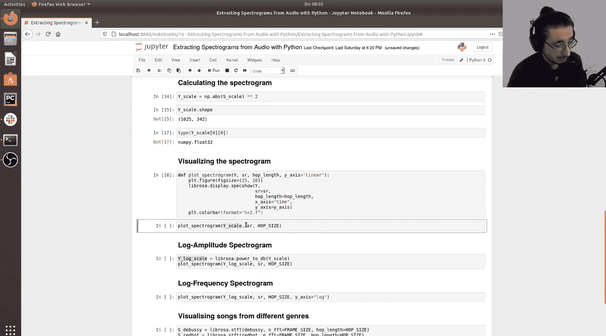
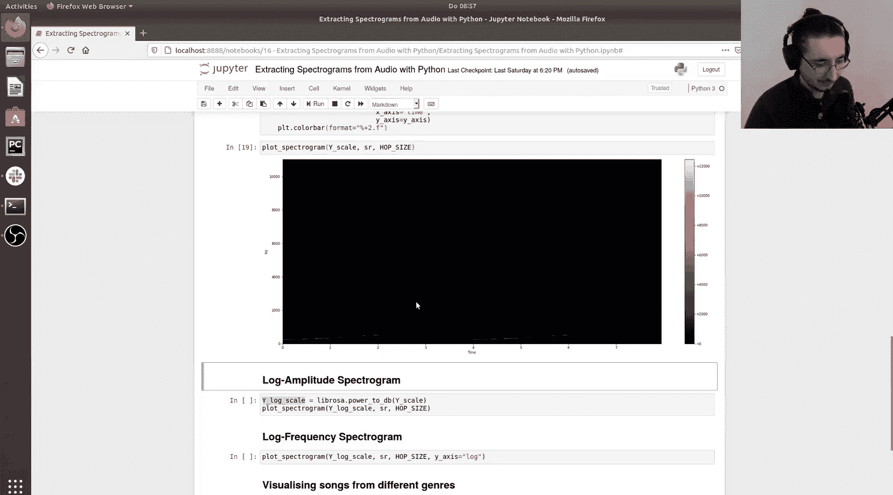
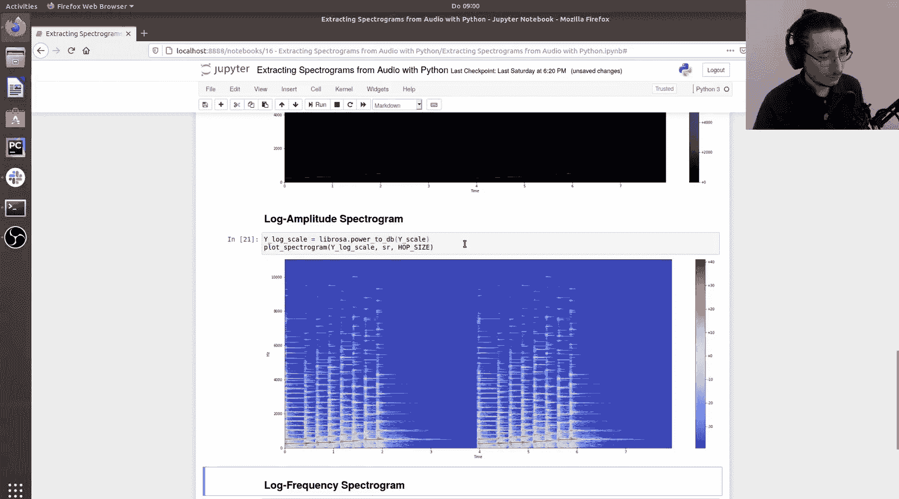
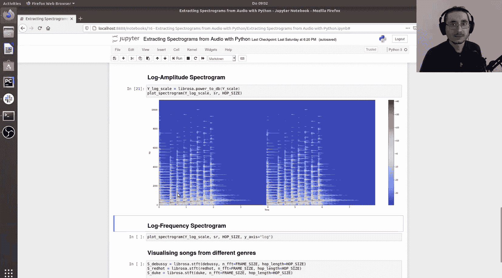
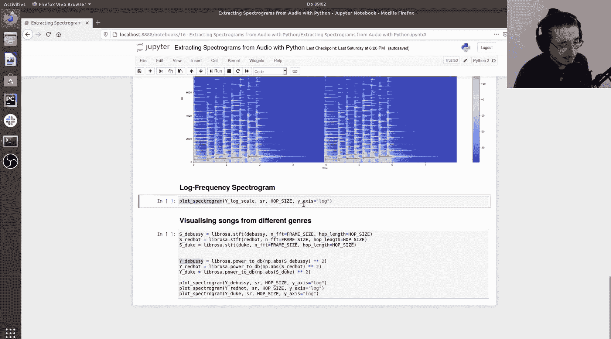
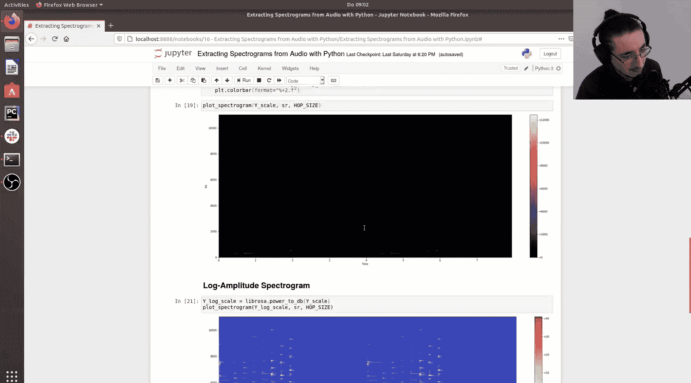
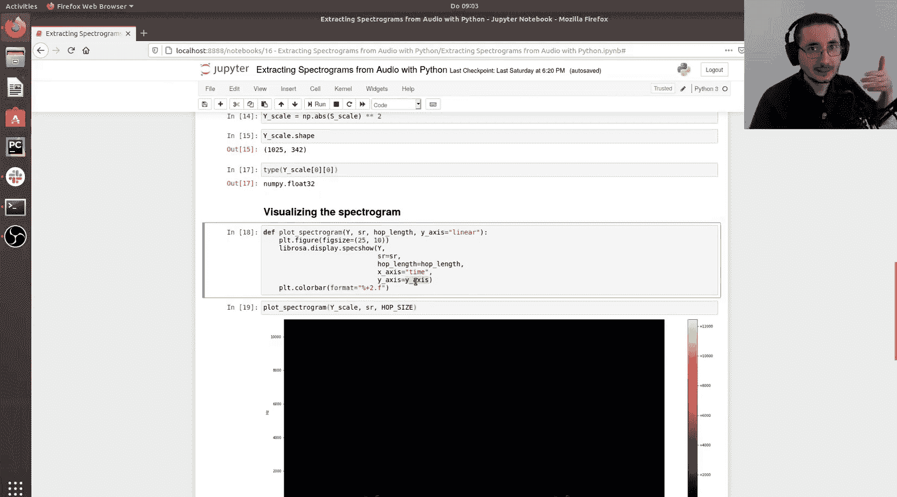
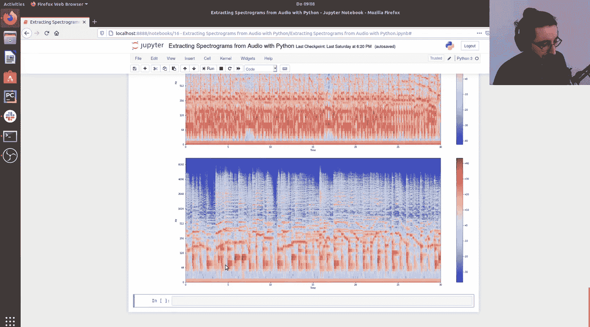

# Valerio Velardo【中英⚡面向机器学习的音频信号处理 Audio Signal Processing for Machine Learning】 p16 p15 How to Extract Spectrograms from Audio with Python [BV1ftPLeCEhX_p16]

Hey， everybody， and welcome to a new exciting video in the audio signal processing for machine learning series。

 Last time we learned about a short time Fourier transform and spectrograms in a theoretical way this time it's time to actually is python and the audio processing library Lib browsers to extract spectrograms from audio file。

 let's get started。 So I already wrote a Jupyter notebook here。

 And so I'm going to just like run through it and I'm going to tell you like what I'm doing and the different steps like to actually extract spectrograms。

 So the first thing that we want to do is just like import some like libraries so we import Os so that we can load audio like our audio files will import browserser Libbrosa do display for just like showing visualizing like spectrograms and we'll import like nuon and maplib do for actually doing。

😊，Or just like plotting the spectrograms like other results that we'll have。 Okay。

 so let import all of this。 And then we want to just like load audiophies with Libbroa。

 So we are gonna be working with four different audiophies。 So the first one is just like a scale。

 and yeah， it's just like a resides like at this path。

 Then we're gonna have kind of like a 3 second snippet from debui。

302 snippets from red hot chili peppers and 30 second snippet from Duke Eington。

 So we have like three different musical ju represented。

 some classical music with debui rock music with the red hot Chilip peppers and jazz with Duke Heington。

 Okay But first thing， let's try to。Listen to this music or so we get like an idea of what were dealing with。

🎼And so here we go。 So if you do IPD dot audio and you pass the file。

 then you're gonna be able to directly listen to to the audio files in a Jopiter notebook by the way。

 this IPD comes from this import over here。 So you just like import aPython dot display as IPD and then you can use it。

 Okay， so now let's listen to like this different audio files。

 So the first one is gonna be a scale plate on a piano。🎼Okay， so。

🎼Yeah it's just repeated a couple of times then we have the music from Debui from the Red Ho Chili Peppers and from Duke Elliton so let's listen。

🎼If you guys followed along so far with the series。

 you probably already recognize this space because we used that in the previous video。

🎼So here you have like a huge croceander right with all of this string entrance。🎼Right。

 you get the idea so very nices smooth like string driven orchestral piece and then we have a song from the Red Ho Chi Ps。

🎼Okay， you get the idea and probably you are all too familiar with that song that moving on to this jazz piece from Duke Kelly by Duke County。

😊，🎼。There is smooth， right？Okay， you get the idea。 So what we'll do is try to extract the spectrogram from this and visualize them and compare them。

 Okay so what we want to do first is just let you load the audio files with Libbrasa So we've done this multiple times in earlier videos So what we do is just like Libbroa do load and we pass like the name of the or the path to the file but we get back is a signal a Nie array and then we also get back the sample rate which when it's defaulted is going to be equal to 22050 Hz Okay so let's move on to this next step what we can do what we should do is extract the short time Fourier transform and this is very easy with Libbrosa because we have a function that does that super quickly So the first thing we want to do is just let's just set a couple of parameters So we'll set the frame size equal to 2048 H samples。

 sorry。And the hop size is gonna be equal to 512 samples。 Again。

 these are quite typical parameters for like the frame size and the hop size。

 If you don't know what I'm talking about， I highly suggest you to go check out my previous video on the theory behind the shorttime Fourier transform。

 I'm just like taking for granted that you've watched that video we are familiar with the shorttime Fourier transform。

 So I'm not going get into detailed what all of these parameters actually mean in this video。 Okay。

 so let's move on。 now I can extract the shorttime Fourier transform using this function。

 which is great。 Libsa do S F。😊，And then I should pass in the signal and the first thing that we'll see here and the spectrograms that we'll analyze this。

With regard with with the scale， just like to see how that is represented in a spectrogram。

 and it's going to be easier to visualize than like all the other music that we've listened earlier。

 then we should pass the frame size and we should pass it So with this keyword argument called N dash Fft and underscore FFT and then we pass the hop length keyword argument and we pass our hop size over here。

 Okay， so we do this。 And then now let's take a look at the shape of the shorttime Fourier transform one。

 So as we so in the previous video， this is going to be like a bydial array and specifically like the first dimension is relative to the frequency。

 And so here we have like all the frequency bins and these are equal So like this number is equal to half the frame。

Size plus one。 So it's basically a 2048 divide by 2， which is 1024 plus 1，1025。 Okay。

 so it checks out good。 And here like on the columns， the second dimension of this matrix。

 So we have the number of frames， it's basically like the temporal bins。 And in this case。

 we have like a 342 temporal bins。 And if you want to know how to。

Get from like a signal to like a certain number of frames。 Just like to make that calculation。

 I have like the formula in the previous video regarding shorttime Fourier transform。 Okay。

 so now the next thing that we want to see is the actual type of the different items that we have in the short time Fourier transform result or in the matrix。

 So here we just like take the item at row0 column0。 And as you can see。

 the type is a complex number。 And this doesn't come as a surprise because the output of a short time Fourier transform。

 is a series of like complex Fourier coefficients。 And so yeah， so we expect that each of the items。

 which is a Fourier coefficient for a given like frequency bin and a given frame is a complex nu。

 But now what we want to do is actually calculate these pettroogram。 So we need to。😊。

To move from the shorttime Fourier transform to the spectrogram。 So how do we do that， Well。

 that's easily done because we just like take the squared magnitude of the shorttime Fourier transform。

 So we just like use like this ninpy dot a absolute value and we pass in the shorttime Fourier transform result here and then we square the result。

 and this is gonna to be equal to the spectrogram。 Okay yeah， not that let me move on。

 let's take a look at the shape here and once again， not surprisingly we have like this shape。

 So 1025 number of bins and 340 to number of frames which is the same that we used to have like with the shorttime Fourier transform result and that checks out because all we're doing is just like taking the magnitude the squared magnitude。

 So the shape of the matrix of the original matrix。Doesn't change。

 but what does change is the type of the items In this case。

 we have floats and this makes sense because we are taking like the magnitude here。

 And so basically we are moving from the complex number to like a real number and this is the spectrogram。

 and this is like what we can actually visualize on a hitmap。

 and so let's see how we can easily visualize the spectrogram with libbrasa。

And so here I wrote like a little function。 And here， this is the signature。

 So you see why capital Y is just like the。It's the spectrogram then I pass in the sample rate。

 the hop length and the y axis and here like I'll default is led to linear we'll see what this means like in a second。

 but before let's just take a look at what they do here just like instantiiate a figure specifying like the figure size here using like maplib and then here comes the magic we can use Libera dot display dot spec show to visualize any type of spectrogram like signals and so here what like this function expects is y so basically like the spectrogram then the sampled rate。

 the hop length， the x axis which is going to be equal to time so we're going have like on the x axis we're going to have at time and on the y axis we're going to have like a type of representation that's linear and then。

I'm going to add a color bar here and you'll see what this does。

 It's basically like a legend that provides this information about like the how to map the colors into like the different like intensities of the signal of the amplitude so now let me run this and now we can plot the spectrogram and I'll pass in the spectrogram for like the scale and scale like audio file I'll pass in the sample rate and the hop size and so let's see what happens here。

 and here we go our first visualization of a spectrogram but this doesn't look great does it so。

Obviously， like the idea here is that's the。😊，The brighter the color and the more energy you have like in that frequency bin。

 right， and so we see a little bit of like activity down here and it's repeated。

 and so probably you can guess that this is like the two scale like the fundamental frequencies of the scales and indeed you see that these like tend to like run up。

😊，And it's repeated twice because if you remember like in that audiophi。

 we had the same scale repeated twice， but still like everything is black。

 So it means that it has like very， very little energy。 was that the case Well。

 it turns out that this is how sounds like work so but it's like the way we actually perceive like this energies and amplitude it's not really linear as is the case like in this representation here。

 but it's actually logarithmic and so to get like closer to the way we perceive a sound we need to do a kind of transformation of the intens like of all the amplitude here and so we need to to move like all of this like amplitude from the basically like linear representation to a logarithmic representation which is like more perceptually significant we can easily move。

😊。

from a linear representation of amplitude to logarithmic one using this handy function from Libbroa called power to DB and the B stands for a decibels now if you are not familiar with decibelts I suggest you to go check out this video where I talk about decibels and introduce them and explain like how they work but basically under the hood what happens is that decibels are actually applying some kind of like logarithmic transformation when you use this power to Db you're moving like from the power representation like of the intensity like to decibels and so we do this and we get back a log amplitude spectrogram here and so we can then just like plot that with our function so plot spectrogram instead of passing the actual spectrogram of scale we pass the log amplitude spectrogram and again we pass this am and the hopson so if we do that we get these results。

s way better than the one that we had before So here we start to see like some energy like burst like of energy like down here and as you can see here。

 probably like this is like a constant like notes then you move up you move up up up so this probably it's just like the fundamental frequencies for the scale that we played and if you're wondering about like all of this other kind of like burst like of energies like at a higher frequencies。

 those are the harmonic components of the original of the fundamental frequency for the scale now we have like twice the same thing because if you remember like yeah we had twice the scale like performed and so the same pattern is repeateded twice I bet like that just like copy pasted like the same scale like in in the audio file okay。

😊，But here there's still something that's like a little bit weird。

 which is like that on the frequency side。 I mean everything like is very squashed。

 and then the reason why that the case is because like we are using some kind of like a linear frequency of representation but if we follow along with the series in one of like the initial videos that we had in the series。

 I explained that the way we perceive frequency is a logarithmic is not a linear。

 So what we want to do probably to have a representation of the spectrogram that's more kind of like in line with the way that we perceive frequency is to actually apply some logarithmic transformation on the frequency as well as the amplitude。

😊。

So how do we do that， Well， that's extremely simple with Libbrosa。

 And so what we want to do is to create a log frequency log spectrogram representation。

 And so what we do like in the。😊，Function that I've wrote。

 you just like past this keyword argument of Y axis and you put it to log。

 but what this actually does under the hood。

えです。We are just like passing that in this like y axis in the libresa do displayplay do spec shell function。

 and we pass it here。 And so the default that we were using was like a y axis is equal to linear and in other words we are using like a linear representation of the frequency。

 but if we put it equal to log we're going to be using like a log representation of frequency so now let's take a look at this and see how it looks like okay good so as you can see here we have a log representation and now like this is like way more like spaced out and as you can see so this makes a lot of sense because like we start with a basically like the middle C or like C4 the central C on the keyboard which is like this node here。

 then we go up to a D So we do a C D then up to Efg A B and then back to C but at the octa of above and so。

can clearly see all of the scale going up here and it has also like some slightly like different duration like each notice played with a different duration I'll just like play you back let the the scale once again so you can notice that okay。

😊，🎼，Okay。And it's this， right？right，Good， so the next thing that I want to do is just like visualize all the other songs from yeah。

 the different genres。 So like the classical orchestral piece from debuy。

 the red hot chili pepper like rockxung and the jazz beade from Duke Elllington。 Okay。

 so I'll quickly go explain what I do here。 but it's basically what what we've already done in a more extended way with the with the scale。

 but basically what I do here is I extract a short time for a transform as a first thing。

 And then I just get the magnitude， the squared magnitude and then apply this power to decibels。

 And then we get this signals for debui for red and for Duke。 and these are the。😊。

Log spectrograms for this different early songs and then I just like passed those like into like this block spectrogram function and I ask to have a log representation of the frequency and so what we're going to see is a log frequency log amplitude spectrogram。

Okay， so let's take a look at this。Okay， so the first one is the spectrogram for the classical music piece。

 This is the redhot chili peppers one。 And this is like the jazz piece。 Okay。

 so is there any major difference yeah， we can see just like straight away。 Yes， there is。

 So in the case of classical music or this orchestral piece with a lot of like smooth string sounds。

 you see that the kind of like the distribution of the energy like in the different frequency。

 tends like to change quite a lot。 And obviously the redder in this spectrogram like the color and the more energy you have like in that frequency at that specific like moment in time right。

 And so here， as you see， like if you remember， we had like a huge croesceis kind of like increasing intensity towards like the center of like the snippet of that。

😊，The beauty orchestral piece and here you have it down here so you have like higher frequency that get like kind of like higher energies like this。

 And then if you listen to the end of the piece， it tends to kind of like fade away and you can kind of visualize that because like this colors tends to like kind of like fade out they are not as red as they used to be like in this central part。

 for example， Now let's compare kind of like the smooth Spectrogram to the red hot he pepper one right is this field of like way more kind of I would say like a pattern like that repeats itself like quite a lot and we have a lot of like activity in the lower like frequencies and this has altered to do with the presence of like a gig drum so you have like this base kind of like the snare like with the base。

😊，kind of creating like this typical like rock pattern and you can see it here like in with all of this activity here you have like a lot of repetition so take a look for example。

 this like patterns like here like in red。Like this。 Okay you see that with a rock piece。

 you have like a lot of energy like in the lower frequencies and you have like this patterns that you can kind of recognize And that's because the music is based off like patterns rhythmical as well as like melodic ones and then you have like the jazz piece by Jake Ellington。

 And here I could say that's a little bit like the two worlds， right。

 So you still have like certain patterns that you can clearly see and that's because we had like some kind of like basic like a groove with a drum kit and with bass but still like it's kind of like more fluid right it's not as strict as the rock piece by the Red Holey peppers right so here like at a glance you cant see that spectrograms can reveal a lot about different musical genres。

 obviously like this is just like a。😊。

In anecdotal example， but yeah， more often than not。

 these are like certain features that you actually see across different genres like when you like look at their spectrograms so you can have like a fair guess if you're experienced in visual spectrograms whether you're dealing with a classical music of like peas or you're dealing with a rock like ballad or whatever that's all for today I hope you enjoyed the video next time。

 we're gonna move on to another flavor of spectrograms called me spectrograms。

 which are more psychological perceptually relevant than the row spectrograms that we've seen here。

 So if you've enjoyed the video and found it useful please leave a like if you haven't subscribed and you would like to see more videos like this just subscribe to the channel and if you have any questions as always just like leave them in the comment section below I hope I'll an next。

😊，My cheers。