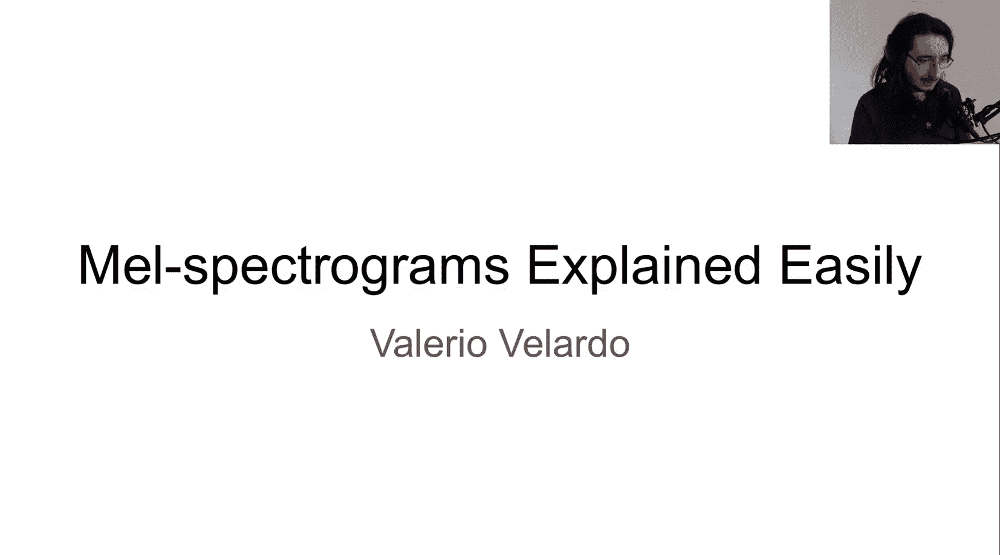
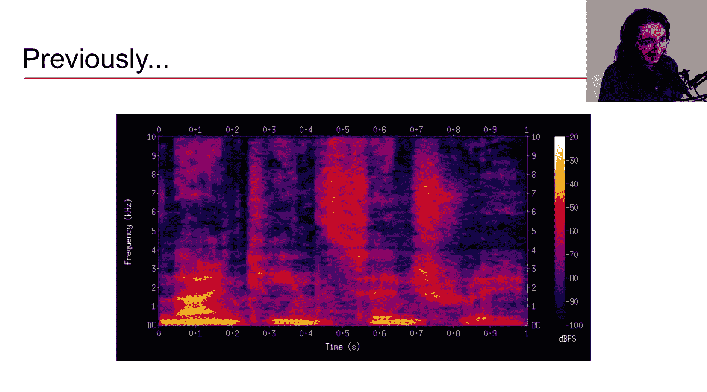
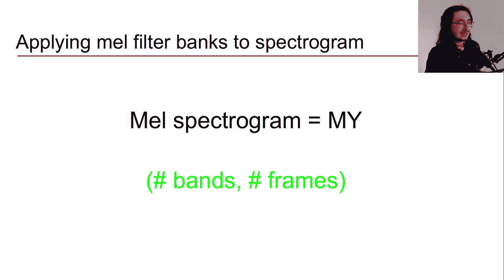
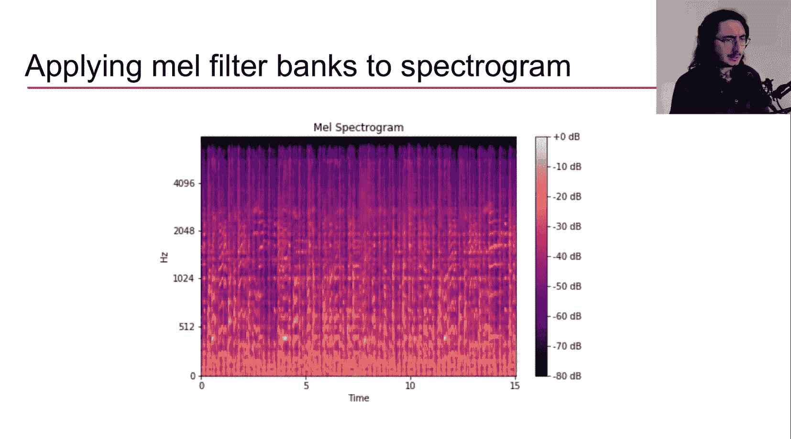

# Valerio Velardo【中英⚡面向机器学习的音频信号处理 Audio Signal Processing for Machine Learning】 p17 p16 Mel Spectrograms Explained Easily [BV1ftPLeCEhX_p17]

Hey， everybody and welcome to a new exciting video in the audioio signal processing for Ma learning series。

 This time， we'll be looking into mouse Spec Grs。😊。

This is a flavor of spectrograms that is extensively used in AI audio research and AI audio real world applications。

 but before we get started into multiple spectrograms。

 I want to give you overview of what we did over the last couple of videos and that is the short time Fourier transform and we also looked into extracting and visualizing spectrograms。

 Now， if you're not familiar with this concepts， I highly suggest you to go check out my previous two videos because what I'm going to say next in the video builds on top of those two notions extensively。

😊。

Now， without further ado， let's move on to this visualization of a spectro。

 and as you can see here on the X axis， we have time on the y axis， as usual。

 we have frequency and each point which is represented by a color in this 2D representation tells us how present a certain frequency is at each point in time。

 The thing that I want you to understand here is that the frequency representation with a normal vanilla spectrogram is linear and it uses h。

 And this is kind of problematic in terms of like the way we perceive frequency。

 Now I just I don't just want to tell you that。 I want to show you that And to show you that we're going do like a little psychochtic experiment。

 So we have a couple of audio samples。 So each of these has a pair of notes。

 So in the first one we have C2 that moves to C4 C4 being the middle C note。 So the C notes。😊。

cententer of a piano keyboard in the second sample， we have G6 that goes up to a6。 Now。

 if you take a look at the difference in the frequency mappings or in other words。

 in the frequency expressed in hertz between the two net in the two pairs。

 you'll notice that more or less like these two differences are the same or almost the same and that is around 200 Htz。

But will these two pair of notes like。Sound the same in terms of like their pitch distance。

 So this is my question to you。 Okay， so let's listen to this two pairs of notes。 The first one。

 So2 to C 4。🎼，Okay， the second one， G 6， T A 6。Okay。

 I'm sure you'll agree with me that the second sample has the two notes that are way closer in pitch than the first two notes。

 And this is a little bit weird， isn't it， right， So the difference in frequency as expressed in Htz is actually the same。

But that isn't true from a perceptual perspective， because like the second pair of notes sound way closer in pitch than the first two。

 This basically means that the way we perceive pitch is non linear。 And indeed。

 we have way better resolution at a lower frequencies than we have at higher frequencies。

 specifically what happens is that humans perceive frequency longer rhythm nily。

 And this is a little bit of a problem that we have which vanilla spectrograms。 And that's because。

 as I said， frequencies expressed a linearly in row like or vanilla spectrograms。

 And so we don't account for the weight。😊，We human beings。Perceive it。 Now。

 let's think about an ideal audio feature that we would like to have and would make like the most sense to feed to our own。

 like machine learning and deep learning algorithms。 Well， first of all。

 we want some kind of a time frequency representation because we want to know how the different frequencies in a signal evolve over time。

 Then we want for this feature to feature to have perceptually relevant amplitude representation。

 And it is once again is because amplitude。 And the way we perceive it is logith like it's not。😊。

linear right and both of these things we can achieve with vanilla spectrograms。

 and indeed we have like a lot amplitude spectrograms， as we said in the previous video。

 but what we can't achieve with vanilla spectrograms is the third aspect。

 which is perceptually relevant frequency representation and this is what mal spectrograms are all about right and they check out all of these three interesting conditions。

😊，But now male Spectrograms， so it's a term it's a concept with two words one is spectrograms and by now you should be more than familiar with it。

 the other one is me So what is this thing， What's a me right This concept is connected with the idea or concept of a me scale and the mouse scale is a perceptually relevant or perceptually informed scale for pitch。

😊，And here we have like a nicer representation。 So I suggest you like to focus in this graph right now on the x axis。

 we have frequency expressed in hertz on the y axis we have frequency expressed in melts。

 And this blue curve is just the mapping between hertz and melts。

 And as you can see it fall a logarithmic kind of like function curve。

 And indeed the melt scale is a logarithmic in nature。 And by being logarithmic。

 what it does is it becomes perly relevant， perceptly informed。 And what does this mean really， Well。

 it means that equal distances on the scale have the same perceptual distance。 Okay。

 let's try to to understand this with an example。 So let's say we have a couple of like pairs of notess。

 So the first one the first pair is 500 Htz and sorry，500 melts and 510 melts。

 The second one is 1000 melts and。😊，1 thousand10 mils。 Now。

 the perceptual difference and between this two， the two notes in the two pairs is the same。

 So the pitch distance is going to be the same。 And that's obviously not true for hertz as we demonstrated with our little experiment earlier。

Okay， now one thing that we did that like researchers did with the mouse scale is that they standardized their so debt at 1000 Hz we have。

1000 Hz， we have 1000 mes。 Now， you may be wondering。

 but how did we arrive at such a perceptual scale？ Well。

 we arrived it in an empirical way during psychological experiment。

 Now what and last question you may have regarding like the mouth scale is where does the term like me comes from。

 Well， me is an abbreviation for melody a melody， I mean。

 is very connected with the concept of pitch because pitch。 I mean。

 is the main thing that you have in a melody along with rhythm， I would say， and so like melody。

 me pitch。 So you get the idea， right。Okay， but now let's take a look at how we can move from the frequency expressed in Htz to the frequency expressed in melt。

 And it's this like empirical like formula here， as it said。

 like found by trial and error with experiments。 And the important thing here。

 apart from all of this like constant is， like the logarithm that we use。 and indeed。

 we have like this log logarithmic kind of relationship。

 Now we can take the inverse of this function and with this。

 we're going be able to move from melts back to Htz。 Now I want to just like to just like， yeah。

 keep in mind this two formulas because we're going be needing them like moving forward。 Okay。

 so now you should have like a basic idea of the melt scale and why it is important in terms of like the way we perceive music or not music。

 sorry， we perceive pitch in this case， okay。😊，But how does this relate to the me spectrograms， Okay。

 and here I'll give you a kind of recipe for extracting melt spectrograms。

 And this recipe has three steps。 So the first thing that we do is we extract the short time for transform。

 And the second thing is to convert the amplitude to decibelt In other words。

 like we take like some kind of like logariththmic representation of amplitude。 Now， as I said。

 this two steps are like the ones that we use for vanilla spectrogram。 So nothing new here。

 the new thing is the third step here， which is converting frequencies to the melt scale。

 So this is like the whole point of me spectrograms。 So we take a spectrogram。

 And then we convert the frequencies in that spectrogram to the me frequency representation。😊，Okay。

 so the next question is， how do we do that？ Well， we for converting like this frequency instance to the mal scale。

 we have a bunch of like steps。 And it's like this three steps here。

 So we choose the number of mal bands first。 we compute the mal filter banks。 Now。

 don't be scared about like this scary word mal filter banks because I'll show you what this is like in a few minutes。

 And finally， we want to apply the mal filter banks to the spectrograms。 Okay。

 so now I'm gonna break down each of these steps for you so that it becomes like super clear how to do this。

 Okay， so let's start with the first thing。 So choosing the number of mal bands。 well。😊，The。

 first of all， so melt bands。 So when you're just like reading some research， say in AI。

 audio or music information retrieval and researchers are using mouse spectrograms。

 One fundamental parameter that you have is the number of Mel bands， right。

 and that is like a parameter that can vary。 So the question is， like， how many melt bands。

 like should you pick。 Well。40， it totally fine。60 is fine。

 Sometimes you find numbers like close to 90 or even 128。

 The reality is it really depends on the problem， The reason like one single answer to this question。

 it's a little bit when you ask， okay， so what learning rate should you use。 Well。

 the isn't just like one answer， you have to try out some different stuff and see what works best。

 And indeed， the number of mail bands is a hyperparameter that you can vary and see the impact that it has on your algorithms on your deep learning algorithms。

 But all in all， you see that usually like the numbers that we have is between。

 I would say like 40 and 120130 like maximum。 And I mean。

 one thing like that a little heuristic here is that if you think about the number of notes。

 for example that we have on a piano keyboard。That is like 88， right？

 That is kind of like the way like， we tend to like resolve like frequencies and we represent them。

 Now， the idea of a melt band is like。Kind of like I。

range of frequencies like the are like perceptually relevant。 So I would expect like the dis number。

 like makes sense because like， they're kind of look close to like the notes that we usually experience。

 like， for example， like on， on our， like Western music， so。

These types of numbers like make sense for that because they are comparable。

 they have like the same order of magnitude as the number of nets that we usually experience。Okay。

Good， so now we know like what numbers of Mel bands like to to choose from more or less。

 Now the next step is to actually construct the me filter bands And here willll actually understand what these me bands are Okay。

 so how do we construct the mal filter bands。 Well， this is a kind of like a quite complex process。

 or it's not really that complex It's more or like it's a multistep process。

 it has like five different steps。 And so I'm going break down all of these five steps for you。

 I'm not going to get too much into sorry the math here nor am I going like implement it。

 but I highly suggest you to try to implement all of these steps that I'm just going talk about in a theoretical way because that is a very good exercise see whether like you understand all of these steps like precisely Okay。

 so how do we build like。This mal filter banks， well。First of all。

 we take a lowest and highest frequency， like in the frequency。

 like range and like in the short time Fourier transform that we've just kind of like extracted。

 And then we convert the lowest and highest frequency to a mal representation。 how do we do that。

 Well， we use like this little formula that we already encountered before when talking about to mouse scale。

 Okay， so now we have like the lowest and highest frequency that we want to consider expressed in mouse next step。

😊，So now， given like we've already chosen the number of melt bands that we want to use。

 like for our mouse spectrogram， the next step is to take like the。

The frequency range in terms of like me the lowest me， like over here， the highest me here。

 And then we want to create as many points， equally spaced points as the number of Mel bands that we want to use。

 In other words。 So this is going to be like very simple like to visualize。

 So let's say like we have like 6 Mel bands。 We want to use six Mel band。

 So what we'll do if this is like the lowest me frequency。 And this is the highest male frequency。

 We'll just like take this point here。 So we'll just create this six points。

 and they'll be equally spaced in this frequency range here。😊，Okay。

 now what we are going to do next is quite simple， really。

 is basically just like converting this points back to hertz by using this function here that we found when we were talking about the mouth scale。

 Now， if you're wondering about this。😊，Mel point this points。 So what are they。 Well。

 they are the center of the different Mel bands。 Okay。

 they are the center frequency of the different Mel bands that we are talking about here。 Okay。

 and we'll see those like with visualization in a couple of moments。 Okay， next step。

 so we've now converted back like this center frequency points where are like Mel bands back to Htz。

 And now what we want to do is we want to round this。Points to the nearest frequency bin。

 So why is this like important， or also say why do we need to do that？ Well。

 it's because we are dealing with discrete signals。

 And that means that we don't have like internet perfect resolution on the frequency and actually like a resolution is somewhat like constrained by the frame size of the short time Fourier transform。

 So what that basically means is that when we'll get back to this like center frequency points。We。

 we can just like take them like as they are。 We need to like bin them。

 and we need to just like round them to the nearest like frequency bin that we have available， right？

 And finally， we have the the last that， which probably the most important。

 which is like creating triangular filters。 And this triangular filters。

 are basically are the kind of like the building plot of a me filter bag。

 and they are connected with these idea of the different like Mel band。

 So I'll visual visualize what these things are。 And then I'll explain how gets like these visualization here。

 So don't be scared about like all of this complexity because it's weight than it looks like。 Okay。

 so here on the X axis， we have the frequency in the bottom is expressed in hs in the top here is expressed in melts。

 And here on the Y axis， we have weight and weight is between one and 0。😊。

Why do we have weights there， Well， Because these are filters， Basically。

 what they do is they just like tend to filter sound。 And when you have a weight equal to one。

 you're not touching like that signal。 but with a weight below one。

 What you are doing is just like dumbing down kind of like dumping。 the the the signal， right。

 because you're scaling it with a value that's below one， right。Okay， so now as you can see here， we。

 we have an example which like six Melbs， Okay， and here indeed you have like six。

Points like overall。 And so these are the center frequencies for our six Mel bands。 Okay。

 and so let's take， for example， like this second point here。 So this is。

 let's say like it's a 2000 Hz， which is 10526 mes。 Okay， so。

What you can notice here is that the difference between all the。

 the center points for the Mel bands is the same when it's calculated in Mel。

 So we basically have always like the same difference between like two subsequent。

Two subsequent like center frequency points。 but this is not true in the case of hertz and that's the whole point right that's the whole point because which like frequency expressed in hertz when we go like towards higher frequencies we have to just like spread out the frequencies to have like the same perceptual difference in terms of like a frequency distances。

 Okay so now let's focus only like on constructing a single triangular filter for one melt band。

 Okay so let's take like this point meltbank number two here。 So the center of this melt band。

 as we said， is 1000 or 1526 melt and then the lower end and the higher end to。

Taken by respectively taking the center of the previous mail band and the center frequency of the subsequent melt band。

 And for the lower end and the higher end of a male band。 we have a weight， which is like equal to 0。

 So in other words， like below this frequency， the lower end frequency like we are not going have。

 So the the signal is completely muted is put the zero。

 same thing here for the frequency above the higher end here。 Okay。

 and now what we do is we kind of like trace a line between the lower and the higher end。

 and we connect that with the center frequency where the weight is equal to one。

 And so if we do that， we actually build a triangular filter like this。Now。

 if you do the same thing again for the third Mel band，4， fifth and6。 Well。

 you just come up with the whole me filter bank right and these are triangular filters and so I hope lucky you' now have like an understanding of like what a me filter bank is and the whole purpose of this beast is that then we can just like apply this to like normal spectrogram and then we can filter out like the different frequencies and convert them like to normal like frequencies in htz to frequencies expressed in mes but here we have just like a visualization of a me filter bank but。

呃。Obviously， like in digital signal processing， as well as like in machine learning， we。

 we don't do operations with visualizations。 We， we actually use math and linear algebra like most of the time。

 right， And so what this means is that we can represent this mal filter bank using a metrics or a two dimensionmensal array and。

😊，The shape of this metrics is going to be like this。

 So like the number of rows that we're going to have like in a mal filter bank is equal to the number of bands that we chose in our example。

 it's going to be equal to6 so six rows and then the number of columns that will have it's equal to the nis frequency or in other words。

 frame size divided by two plus one。😊，And so this is like the metrics that we' be using for representing a Mel filter bank。

 okay？So I hope you now have an understanding like of this mal filter bank。

 and then now with all of this information， we need to go like to the final step in the conversion from frequencies to mouth scale for our spectrogram。

 In other words， we are actually moving from the spectrogram to the mouse spectrograms And how do we do that。

 Well， we have to apply the mal filter banks to the spectrogram。😊，And how do we do that And here。

 linearar algebras can help us quite a lot。 Okay， so here we have like the shape of the mal filterter bank matrix。

 And now here we have the shape of another matrix。 and this is the matrix associated to a spectrogram。

 So if you fold along like my last couple of videos。

 you know by now that the the shape of a spectrogram the shape of a matrix that represents the spectrogram is given like by this numbers here。

 So the number of columns that we have sorry， the number of rows that we have in the spectrogram is equal to the in frequency plus one。

 and the number of columns is given by the number of frames。 or in other words。

 like the temporal bins。😊，Now。So we said that the whole point here is to apply mal filterter banks to spectrogram。

 what does that mean， So that must mean something in a mathematical way。 Well。

 if you're familiar with linear algebra， you've probably noticed something interesting about these two mattresses。

 and that's that the number of columns of the first matrix or the mal filterter bank matrix is equal to the number of rows of the matrix that represent the spectrogram。

 So when this happens， it means that we can。Do apply like matrix multiplication。 Okay。

 so in other words， applying male filter banks to spectrograms from mathematical standpoint means multiplying doing like matrix multiplication between the mal filter banks and the spectrogram。

 the result of this multiplication。Is the me spectrogram。

 Now I'm not going get into the details of this matrix multiplication because it's outside the scope of this series。

 But if you're interested and you don't know that much about linearar algebra。

 I have a video over here you can check out where I talk about basic operations with like mattresses and one of those is actually matrix multiplication。

 Okay， so now let's take a look at the me spectrogram。 So the me spectrogram is a metric。

 a matrix itself。 and its shape is given by the number of bands。

 So we have like the as many number as many rows as the number of bands that we chose。

 and on the number of columns that we have is equal to the number of frames of the original spectrograms。

😊，Okay， so in other words， if you think about this like this multiplication here。

 So applying mal filter banks to the spectrum， What enabled us to do is basically to convert the frequencies just from Htz to。

😊，Mel bands， okay， and that's the whole point of a mouse Spectrogram。

 And the cool thing now is that we are， we are using mouse bands。

 which are kind of psychologically relevant in terms of the way we perceive pitch。 Okay。

 but now let's take a look at what this means in terms of like a visual representation。 And well。

 if you're familiar with Spectrograms。 Well， mouse Spectrograms are no different at all。

 So you still have a hipn。 And that's because we have like a。😊。

A matrix， right， And on the x axis， we have like time on the y axis， once again， we have frequency。

 But this time， like the different frequency bins are not like the linear bins that we used with the spectrum but rather the Mel bands each。

😊，Frequency being is a different Mel band， which is perceptually relevant。

 And then each point that we have here has an associated color that represents how present。

 a certain Mel band is at a certain point in time。 So basically the conceptual understanding or visualization of spectrograms is the same that we had for spectrograms。

 The only thing that really differs here is the way we represent a frequency。

 which is like pitch like psychological relevant this time， different differently from a spectrogram。

😊，Okay， so the last question that we might ask here is why should we better like learning about mouse spectrograms and the answer to this question is that they are extensively used in a lot of AI audio and AI music research So a lot of papers that you may be reading about like audio classification use mouse spectrograms。

 this is very， very true also for a lot of like music information， retrieval AI music papers。

 So for example， mouse spectrograms are overwhelmingly used like in automatic mood recognition。

 music genre classification， music instrument classification and way more applications we have like for this type of spectrograms。

 but this time we only focused on the theory of mouse spectrograms。

 and I hope that by now you have like a clear understanding of like what me mes are the mal representation and why like me spectrograms are different。

😊。

Then spectrograms。 And why they are very convenient， like。

To use in a lot of like the applications where we're talking about audio and music。

And so the next time we'll be moving to actually some kind of like implementation so we'll be trying we'll be extracting male spectrograms from audio files using Python and Lib browsersa and Lib Brasa has a lot of like very nice utility functions that we can use that will save us a lot of time and then we' visualize mouse spectrograms and then we'll also try to extract and visualize mal filter band so that you can actually understand and see how we can yeah。

 just like we represent them and what they actually represent okay before I dash off in a finish I want to remind you about the sound of your eyes like a community and there you have like any questions about like this stuff your projects and way more stuff regarding like AI audio in AI music you can just ask and there you'll have like a community of people interested in A audio AI music or your processing that are ready like to help you ready like to share like their ideas。

 the projects。😊，So I really suggest you to go check out this community and I'll leave you the link to sign up to this Slack community in the description below。

😊，It's up for today。 I hope you really enjoyed the video。 And I guess I'll see you next time， cheer。

😊。

