# Valerio Velardo【中英⚡面向机器学习的音频信号处理 Audio Signal Processing for Machine Learning】 p18 p17 Extracting Mel Spectrograms with Python [BV1ftPLeCEhX_p18]

🎼Hi， everybody， and welcome to a new exciting video。

 the audio signal processing for machine learning series。

 Last time we looked at the theory behind mousepattrograms。

 This time we'll be using that knowledge and we'll extract mouse Spectrograms using Python and Lib browserser。

 So without any further ado， let's get started。 So the first thing that we want to do is just like import a bunch of like packages So Lib browsers Libsa do display and map just like for visualizing stuff。

 Next， we want to actually load an audio file with Libbroser。

 So the first thing that we'll do is just get a reference to the path to the file and next we want to do is just like play you guys back like this audio file。

 and you should be familiar with this because it's the one that we use also when we actually extract it vanillapattrograms a couple of videos ago。

 So let's listen to this scale。😊，🎼And we have a second repetition of the same pattern。

Okay simple C major scale with a piano okay so next up what we want to do is just like actually yeah load this audio filele in Libbrosa and so for that and you should be familiar with this right now we do a Libbrosa。

t load and we pass in the path to the file what we get back is a signal which is just like an ni array and then the sample rate and the default sample rate with Libbrosa is strain 2050 Htz。

😊，Okay so moving on， I want to show you the mouth filter banks before we extract the me spectrogram from this audio file。

 So if you remember from my previous video on mouth spectrograms。

 mal filter banks are really the key to getting to mouse spectrograms because what we do is we extract the spectrogram。

 kind of like vanilla spectrogram and then we apply mal filter bank to it in other words。

 we do a matrixx multiplication between the mal filter banks and the vanilla spectrogram and what we get is the mal spectrogram。

 Okay so now let's take a look at at how we can extract this filter banks。

 well if you remember I gave you like all the five different steps we should put into place to create a mal filter bank。

 but the thing about libss that we have a utility function that does all of that for us so that we can then。

😊，get a a whole filter bank。 So we do。A librea do filters， do me。

 And then we should pass some parameters。 First of all， we pass the frame size。

 which I've put to 2048。 the sample rate and the number of melts that we want to use。

 and in other words， like this is like kind of like the number of like Mel bands that will see。 Okay。

 let's do that。 So nothing really like showed up really。

 but in all actuality what happened is that now we have the filter bands。

 So let's take a look at the shape here。 So if you remember from my previous video。

 I said that this is a metrics and on the row， like the dimension like the first dimension is equal to has a size of like 10 in this case。

 which is equal to the number of me bands and the second。dimensions has a size。

 which is equal to the nu frequency of the frame size plus one。 So in other words。

 it's this22048 divided by  two plus 1， which is equal to 1025。 So it checks out。 Okay。

 so now what I want to do next， is try to visualize these mal filter banks。

 Now from my previous video， you may remember。 sorry， wasn't that。 It's this one。

 You may remember that this is a way that we can visualize the mal filter banks。 So on the X axis。

 we have frequency on the Y axis over here。 we have the weights。

 and we have like all of the different Mel bands。 And here， like this points。

 which weight equal 1 are the centers of the。😊。

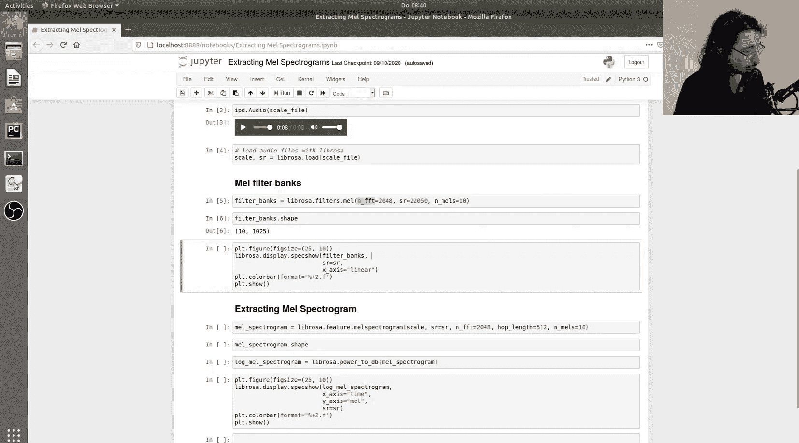

Of the filter of the mail bands right and then we have like this triangular filters like this。

 Okay so now let's try to visualize this in another way。

 so what we can do is we can use the Libbrasia dot display dot spec if you remember this spec function kind of like displays spectrogram like variables but we can use it really for any type of bydial array or matrix and so we know that filter banks like is an array。

 so well is it bydisal array or it is a matrix and so we can just like plot it using spectro Okay so now let's try to do this and let's see what's the result over here Co okay so on the x axis here。

 you have frequency expressed in hertz on the y axis you have the 10 different melt bands right and you can see that we have。

😊。

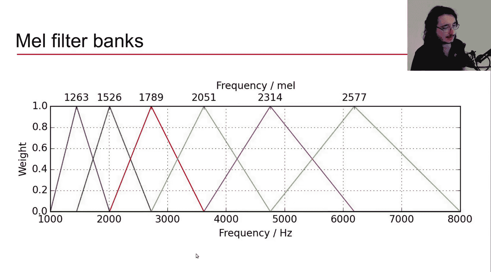

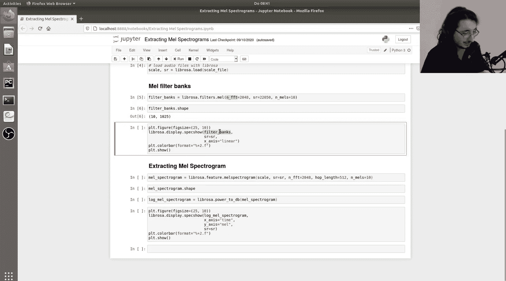

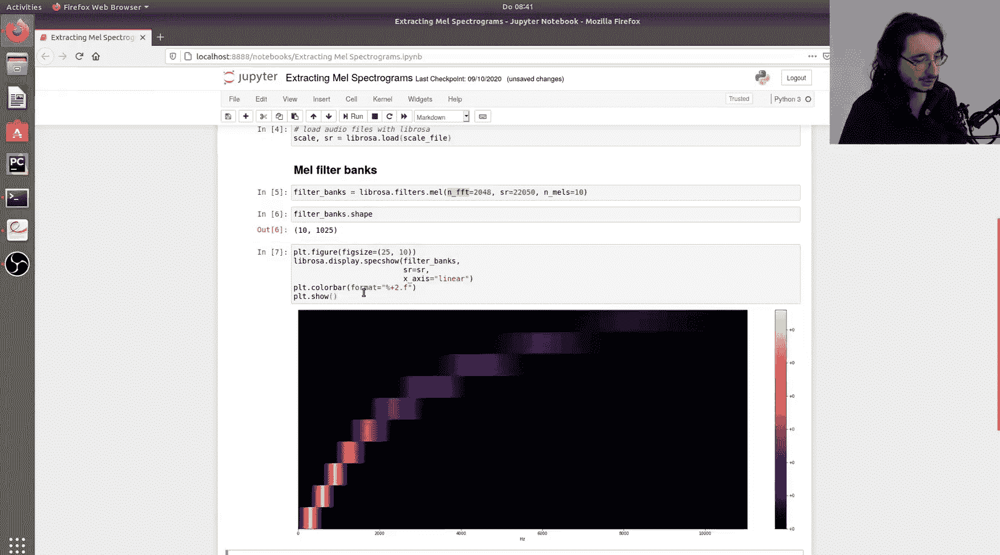

Like 1 Mel bends because you can see we can count like these blocks like this。 So 1，2，3，4，5，6，7， H 9。

 and then 10 over here。 and what also what we also see here is that we have like this kind of like bands over here and the color corresponds to the weight that we have for a melt bend at a certain frequency expressed in hertz and the bright of the color and the color we get to a weight equal to one。

 So for example， let's analyze like this second melt band over here。

 So this is like of the center point， the center frequency where we have weight that's equal to one。

 and then the farther we move from the center frequency of this melt bend and like the lower the weight which basically means like that the color stands to fade out and then outside of。

Extremities we have like pitch black， which basically means that weight is always like equal to0。

 And then here you can actually see induction like this filter triangular filters right for all of these different mouth bands。

 So yeah let's move on now to extracting mouth spectrograms now that we know yeah how to extract mouth filter banks and how to yeah。

 just visualize them Okay so extracting mouth spectrograms is as easy in libbrosa as running libbroa dot feature mouth spectrogram Now if you remember from my previous video。

 well， extracting or calculating mouse spectrograms it's kind of like quite convolutted persons because what you should do is actually extracting spectrograms first vanilla spectrograms。

 then creating mouth filter bank and then apply mal filter banks to the spectrograms。

 And that's actually what these libbrosa feature。😊。

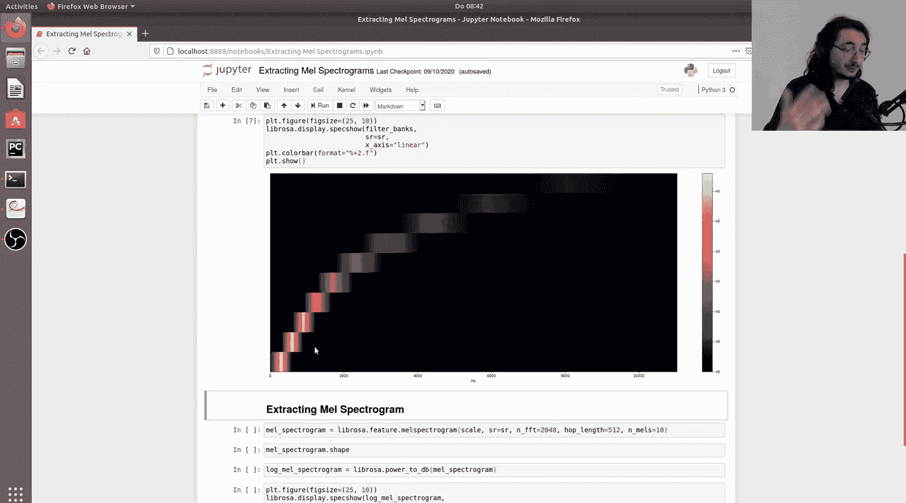

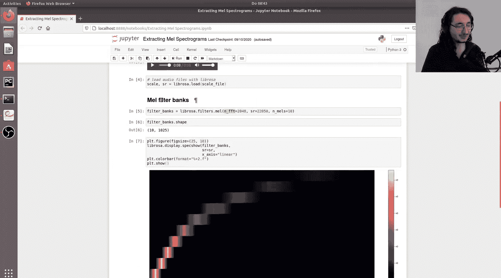

Melpattroogram function does under the hood。😡，And it did what you should do here is pass information for both extracting。

😊，The like vanilla spectrogram as well as the creating like a me filter bank。

 So we pass in the signal。 So in this case， it's our scale signal。 then we should specify these some。

 the frame size， the hop length and these are this is all the information that we need for extracting the spectrogram。

 And then we also need to pass the number of meltbones， which yeah。

 let's put it just like equal to 90， for example， right And as I said。

 what mouse spectrogram does under the hood is calculating the vanilla spectrogram。

 it creates the male filter banks and apply the mouth filter banks to the spectrogram。 Okay。

 so let's run this。 And next what I want to show you guys is the shape of this mouse spectrogram right And so what we get here is a by dimensional array。

 once again。 and the shape here is like so。😊，The first dimension has like size equal to 90 and this checks out because the number of rows that we have in the mouse spectrogram should be equal to the number of melt bands and in this case is equal to 90 so it checks out and this second dimension has the size which is equal to the number of frames or temporal bins that we extract from the signal which in this case is equal to 342 so next up what we want to do is just like move from the power spectrogram apply a logarithm to it and then move to decibelts and so what we do by doing is moving from mouse spectrograms to log mouse spectrograms and this is like very important and we showed is also like a couple of videos ago when we extract it vanilla spectrum。

And that's because like the way we actually perceive amplitude is logarithm is not linear。

 So this passage is quite important if you want to use like mouse spectrograms。 Okay。

 so let's do that that obviously it doesn't change at all。 The shape of the mouse spectrogram。 Yeah。

 let me just like show you that。 So I'll do a quick log spectrogram like this， and I'll do a shape。

 so we get over here is the same shape that we used to have to mouse spectrogram。

 So the transformation happens at each for each item in the matrix。

 But the overall like shape of the matrix is not changed okay。Good。

 so the final thing that we want to do here is just like to show the me spectrogram。

 And once again for doing that， we'll use this libbrosa do displayplay do spectro。

 So I'm going to guess into the details here because I've coveredVd them like multiple times in previous videos So you guys should be aware of all of this and here we have like our nice little me spectrogram。

 So the X axis is we have time and this is like this great time and each bins is a frame or yeah it's a temporal bin and on the Y axis we have the frequency well it's actually expressed in the different like melt bands right and in this case we have like 90 bins and as you can see here we have like an overall pattern that follows you can't like kind of like guess that we have like a scale here。

 So we start here with a melt band， which is。😊。

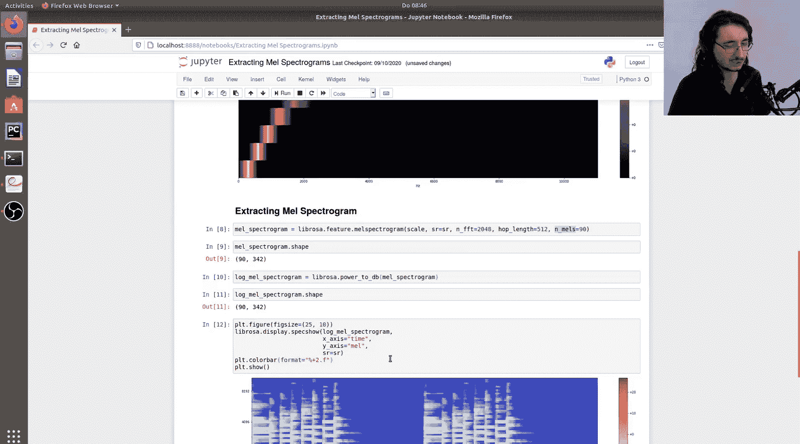

Close to like a see then we go up to D up until like we go to this point。

 which is like see at the ocve above and then you also have like the relative harmonics over here okay but。

It's kind of like a little bit difficult to understand that like the x axis is in this case。

 like its divided like its discrete has like 90 melt bands because yeah。

 it's difficult to see like the discrete points there。

 So what we can do is just like move this number of Mel bands over here from 90 to say 10 and just like rerun the whole thing so yeah。

 now obviously like the mouse spectrogram shape is equal to 10 and 342 as the second dimension because we have 10 Mel bands Okay So moving on So yeah。

 and now we actually see that on the X axis we have like 10 discrete blocks right， So we have one，2。

3，4，5，6，7，89 and 10 over there。 Co so by now you should be able to extract melt spectrograms and visualize。

😊。

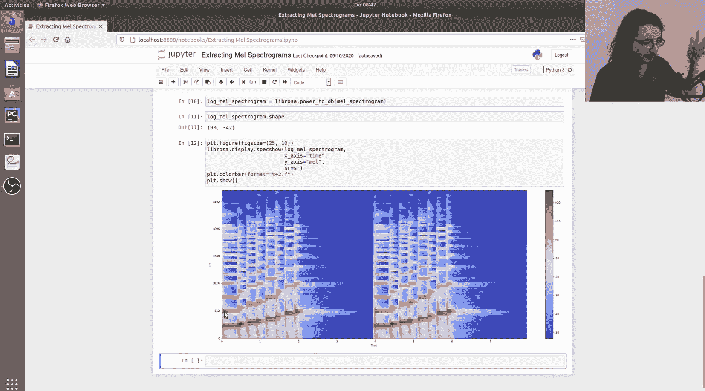

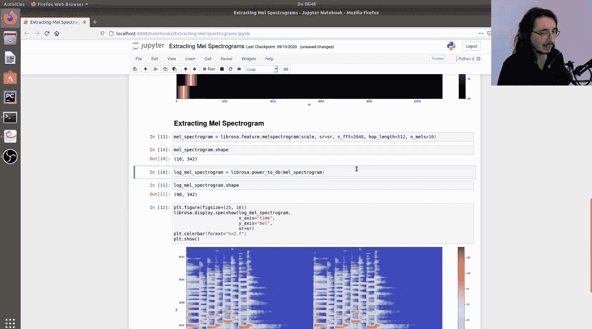

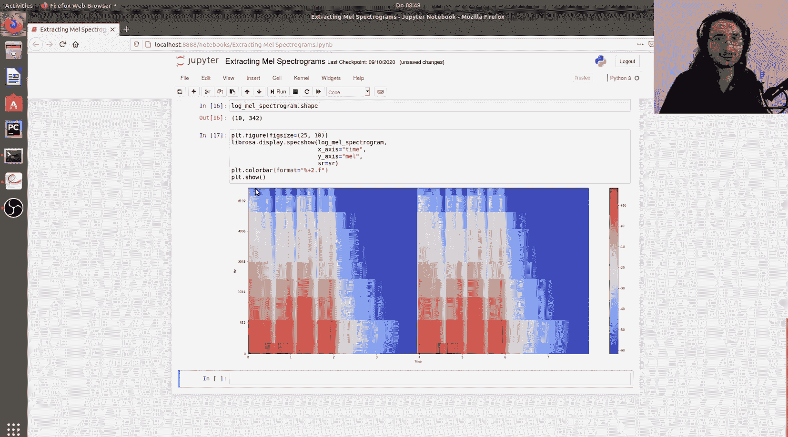

as like extracting mailfi banks and visualize them with Python and specifically using the Libbraser library Okay so I hope you enjoyed this video and you found it useful if that's the case please leave a like to the video and if you want to watch more videos like this and you're not subscribed to the sound of VI channel please remember to subscribe if you have any questions as always leave them in the comment section below that' so for today I guess I'll tune that time cheers。

😊。

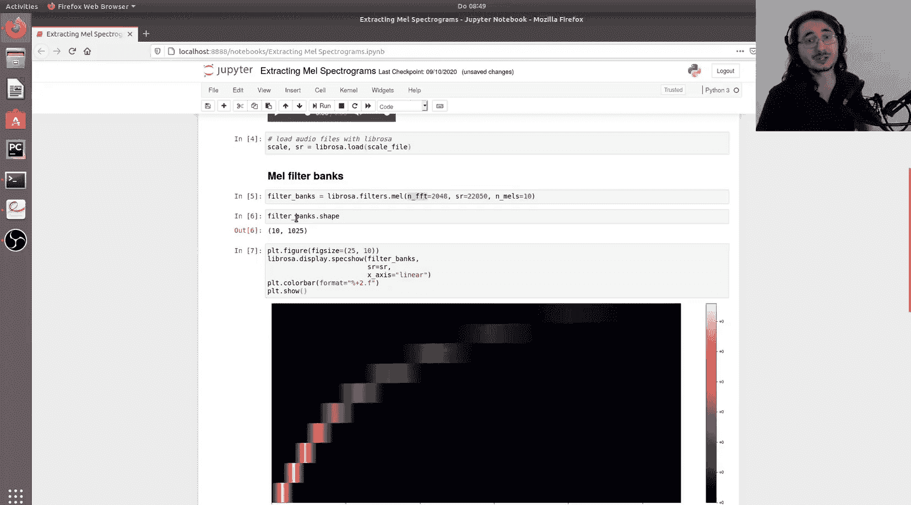