# Valerio Velardo【中英⚡面向机器学习的音频信号处理 Audio Signal Processing for Machine Learning】 p19 p18 Mel-Frequency Cepstral Coefficients Explained Easily [BV1ftPLeCEhX_p19]

Hi everybody， and welcome to a new exciting video in the audio signal processing for machine learning series。

 This time will look into a very important audio feature。 In other words。

 mal frequency S coefficients。 or if we use their acronym MfCCs。

 But before we get started with this super cool topic。

 I want to remind you about the sound of the Sla community。 So if you sign up there。

 you can get feedback， share projects and share ideas with a community of people who are interested in AI audio。

 AI music and audio signal processing。 So I really invite you to check this community out and I'll leave you the link and the sign up link to the slacklack workspace in the description box below。

 Now， let's move on to the cool stuff。 But before we get to MfCCs。

 I want just like to remind you about what we did in the previous couple of videos and we focused on Mel spectrograms now。

😊。

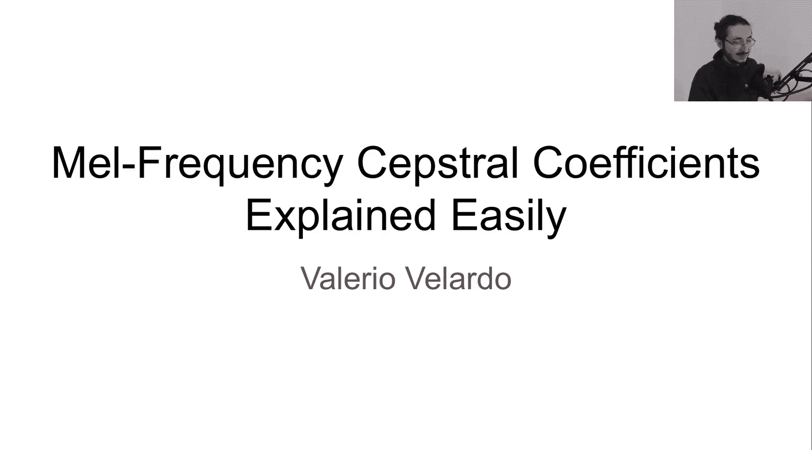

M spectrograms are going to be like an important building block to understanding MfCCs。

 So if you are really not that familiar with that， I highly suggest you to check out my previous couple of videos on mouse spectrograms。

 Okay but now let's get started with MfCC that as I said build on top of the concept of mouse spectrogram to a certain extent。

 Okay， so now we have this audio feature it's called mal frequency conceptualual coefficients， right。

 so in this feature， we have many different words。 So now let's try to understand which word means what。

 Okay， so mal frequency。 Well mal frequency as I said。

 refers somewhat to the concept of a mouse spectrogram。 Basically。

 the idea is that we are using the mal scale here， which is perceptly relevant scale for pitch。

 And there's something that has to do like with mouse spectrograms and mal scale like。😊。

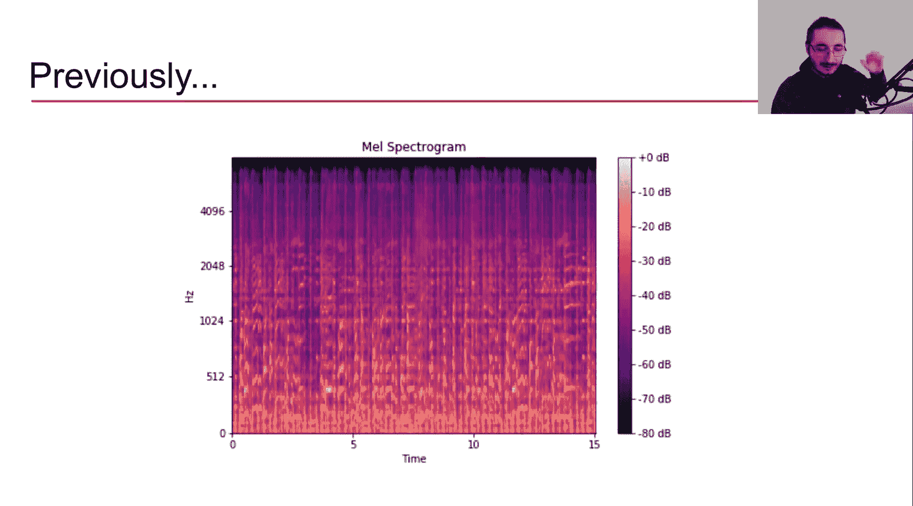

In in MfCCs， Okay， so we know that and we know doubt what mouse spectrograms are from previous videos。

 Okay， so now let's move on。 the last point is coefficients。 Well。

 this isn't really like that difficult to understand， because the idea that probably you may guess。

 like from from like this name is that out of these features。

 you're going to get a number of coefficients。 A number of values and those coefficients will describe some characteristic of a piece of sound。

 right， that's all it is， right。Okay， and finally， we have probably the most interesting part here。

 That's a seal， right， So this is a weird word， right， And sestril is the adjective。

 But if we want to move to the noun， the noun is a seone。😊，Okay， does this word ring a bell at all？

No， if not， I'll give you a hint。Sepps。Just like， focus in this， like four letters here。Any idea？

If not， I'll give you the answer。It's。Spectrum， right， so if you。

 if you just like take steps and you spell it like backwards， you'll have spec and spectrum。 Okay。

 so sestr is somewhat related to spectrum。 Okay， so here we have clearly a wordplay。

 And so it's going to take us like some time to understand why this is like relevant and why researchers who came up with the idea of sestr used like this word。

 And they had this kind of like wordplay on spectrum。 So。😊。

I suggest you just like to bear with me because this is gonna be like a quite intense and in- depth session to understand sestr。

 And then once we understand sestrom， we're going to use like this concept to build MFCC or to see how we can build MFCCs on top of sestr。

 Okay So now let's put sestr and spectrum like down there。

 But when we're talking about sestrum is not only sestr the weird word that we we have。

 or that these researchers who came up with these idea came out with。

 So there are a bunch of other concepts there。 So that's the concept of lifting and raonic。

 for example。 Now， I guess like you have an idea of how like to translating like these things into stuff that make sense。

 And indeed query is work on a frequency， Liering is connected to some sort of filtering。😊。

And monic is connected to harmonic。 Okay， so now we are entering the world of sepsum where we don't have frequencies。

 but we have preferences。 We don't have filtering， but we have lifting， and we don't have harmonics。

 but we have monics。😊，Sounds a little bit weird， right， Yeah， and it is。

 So bear with me to understand what all of these things like really mean。Okay。

 so now let's get like an historical understanding of the concept of sepsstrum。

 where like it came out from and how it developed over time。 So researchers。

 I believe at at MIT during the 60s came out with this concept of a sestrum and they used it to study specifically echoes in seismic signals。

😊，Then other researchers noticed that like this concept of sepsstr could be nicely applied to speech processing and indeed。

 towards the end of the 60s， sestr started to be used like in the speech processing community。

 and during the 70s and onwards it became the kind of like audio feature of choice for speech recognition。

 speech identification and all sorts of speech processing related problems and that remained like that for a long time until I think like the advent of deep learning so very recent stuff and in the 2000s sestrum started to be adopted in the form of MSCCs also in music processing and specifically in music information retrieval。

 So as you see now we have an audio feature， a mystery audio feature that。

Can serve many different purposes or many different applications。 It works well for sismic signals。

 It works great for audio， I mean， speech processing。

 and it also works really well for music processing。 Okay。

 so now it's time to understand like this mysterious audio feature a little bit more。

 So and here we'll do like we'll try to understand this like in a few different on a few different levels。

 So the first level will be a mathematical formalization of the concepts of sestr。

 then we'll look into the visualization of sestr so that hopefully you can understand what's going on there for real。

 And finally， we'll look at sestr in the context of speech。

 And there probably you'll have like the better intuition out of all of these approaches。 Okay。

 let's get started with the math behind it。 So how do we compute the se stream。 Well。

 we compute it like this。 So now here we have like。😊，Spsstr， and we indicate that like S capital T。

 and the sub is provided by like this formula here。 So let's get started with x of T。 Well。

 x of T is just like a normal signal in the time domain it's just like normal waveform then out of this normal waveform。

 What we do is we take the discrete Fourier transform， which here I've indicated with this capital F。

 So when we do that， we come up with a spectrum and we move from the time domain to the frequency domain。

 Okay， now the next step that we want to do is apply a logarithm to the spectrum， and in this way。

 we get the log amplitude spectrum。 So in other words。

 we are applying the logarithm on the amplitude of the spectrum。 Now。

 if you if you are not familiar with the Fourier transform or log logarithm。Pluoo spectrum。

 all of this kind of stuff I highly suggest you to go check out from my previous videos on the Fourier transform because all of these things I've addressed them time and again like in my previous videos。

 okay。😊，Good， so we said we start from the signal。 We take the the Fourier transform。 So we。

 we move to a spectrum。 We take the log up amplitude spectrum。 And finally， at this point。

 we do the the kind of the key step to get to a sestr。

 which is basically applying an inverse Fourier transform to a log amplitude spectrum。

 And when we do that， we come up with a sstr。😊，Well， if you think about this。

 what we are actually doing is we are taking a spectrum， specifically a log amplitude spectrum。

 and then we are calculating a spectrum of a spectrum， right？😊，So。

 and that's because we are applying the inverse Fourier transform at this point。 Okay。

 so we could have called。

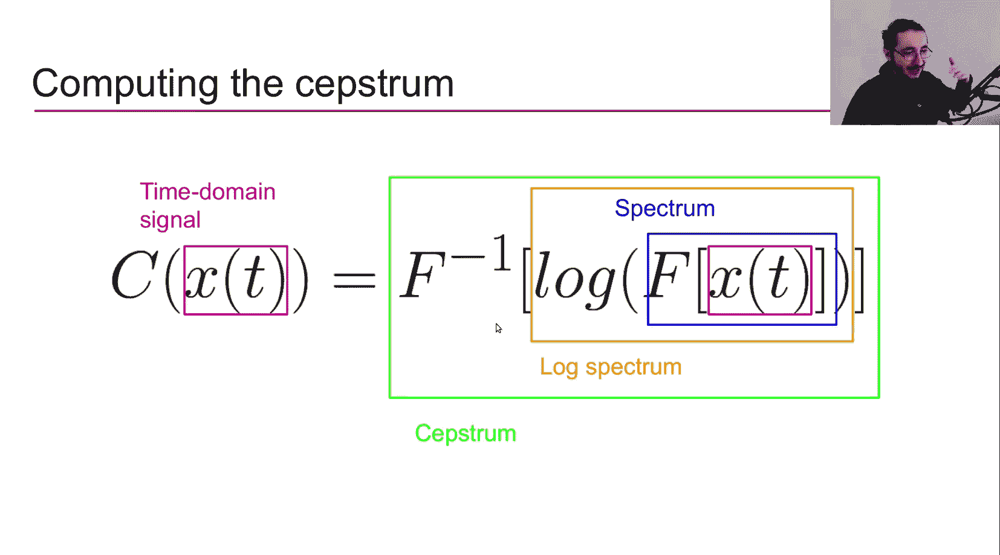

The se spectrum of a spectrum， right， But that wouldn't sound really cool。

 So what the researchers decided to do is use like this wordplay and so they decided to use like this se。

 And the reason why they， they used like this， they just like took like the first like four letters in spectrum and。

😊，Kind of like use them like backwards is gonna be clear like in a few moments。 So bear with me。

 Okay， so now we we know like that on a very high level， the spectrum。 Well。

 the spectrum is the spectrum of a spectrum。 Okay， but now let's try to visualize this concept because this is going help us understand what's going on here。

 Okay， so we'll try to visualize all those different steps that we in the mathematical formalization。

 So we start with a normal waveform。 We are in the time domain。

 We have like very short amount of sound just like 40 milliseconds， for example。

 here And then what we want to do here as a first step is taking the discrete Fourier transform。

 and what we get out of that is our usual power spectrum where on the X axis。

 we have frequency and on the y axis， we have power。 So we've seen this like time and again。

 time and again during this series。😊。

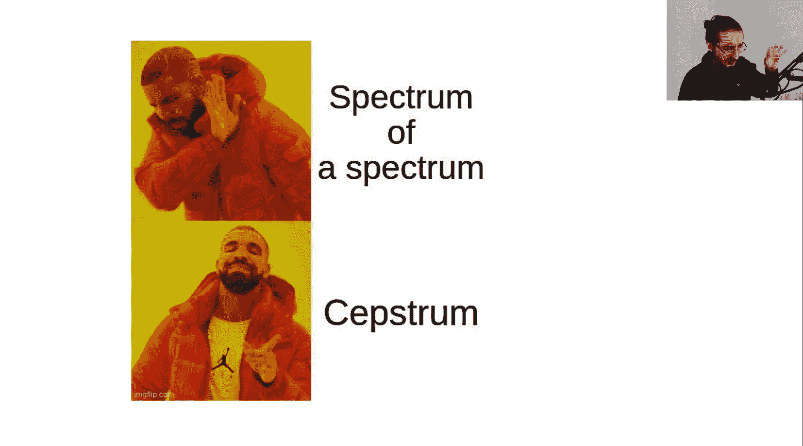

And basically what we've done here is moving from the time domain to the frequency domain and the values that we have for each frequency tells us how much each frequency component is present in the original signal in the original waveform。

 right， so this is like the first step now the other step is that of applying logarithm to a power spectrum。

😊，And we， yeah， let me just like shifts like the power spectrum spectrum here on the left。

 And now we can apply the logarithm。 And so here what we do is the simple transformation。

 So we take like all the amplitudes and we apply like a logarithm so that we get。

De bolts right on the y axis as the unit of reference and on the x axis still， we have frequency。

 because the transformation was only like on the y axis， really， Okay。

 so now we have the log power spectrum。 Now， let me shift this like onto the left once again。

 So what about the log power spectrum。 So first of all， it is a continuous signal， right？

 second point， it has some periodic structures， right。

 and those periodic structures are present because the log power spectrum has like some harmonic components or like the original signal has some harmonic components that get that become kind of like periodic in the spectrum。

 And so when we have a signal， even if it's just like a spectrum that has some periodicities。

 What we can do is apply a transformation。😊，Like a Fourier transform to understand like the different components and try to find like which frequencies right are present in the signal。

 So in other words， what we can do here is treat this load power spectrum as a signal a time domain signal and we can apply a Fourier transform like transformation。

 right， and specifically we'll be applying an inverse Foururier transform。

 And what we'll get is a spectrum of this signal， which is the spectrum。 So in other words。

 is the spectrum of a spectrum， which is the， And here we go。

 we apply the inverse discrete Fourier transform， and we get the spectrum。

 which is the spectrum of a spectrum。 Now， the cool thing or the thing that we should think about is what do we actually have on the x axis。

 right， So because now we have the spectrum。😊，Of the spectrum， I mean。

 if you are in the time domain and you and you take like a Fourier transform。

 then you move in the frequency domain。 So on the X axis， you'll have frequencies， obviously。

 But if you start from a signal that has like frequencies on the X axis。

 what do you actually get on the X axis of the transformation， right and。The。

 the answer is that we take， we get like some sort of pseudo frequency axis。

 and this pseudo frequency axis was termed by the research as。

 And the unit of reference here is milliseconds or seconds。 Now。

 let me show you why we are talking about and sstream。 So why this work workplace makes sense。

 And the reason is because we are starting from the time domain originally with the waveform。

 Then we go to the frequency domain with the initial discrete great Fourier transform。

 Now we apply another。😊，Discrete we apply like an inverse， discrete Fourier transform at this point。

 and we go back to somewhat something that resembles like a frequency domain。

 but it's not really a frequency domain， right， And so they just like decided to take like the opposite of that。

 So it's not frequency is query。 And this is not a spectrum， this is a sestr， right？ Okay。

 so here you have like the intuition。 Okay， so what are like all of this values here， right。

 So in the se visualization， right， we have certain pixels。

 And here we have like a very high pick there。 So what do they represent， right？ And so。

These basically represent how present these different equis are in the log power spectrum， right。

 Okay， so here we have like this huge pick。 And that is the first raonic。

I bet like you guess you realize this like yourself。

 This is like the equivalent of a harmonic right and this is the raonic that provides us or this is like let's put it this way。

 This is the equi where that is associated with the fundamental frequency of the original signal of the original waveform and indeed one way of using se setra。

 I should say is one application is for pitch detection because you take like the log power spectrum and then you take the the sestr and the peak that you're gonna have like this is going to be like the first raonic and you can use that to then move back to the frequency domain and then understand where you have like the fundamental frequency in the original signal And so and why is this。

😊，such a peak。 Well， this is a peak because this reflects the harmonic structure of the original signal that gets some that gets like represented in a periodic way here in the log power spectrum。

So this is like the the key idea there。Right， okay， so。

I guess like now we have an understanding of the math behind the sestr and we also have an understanding of what the seum looks like。

 but I think like what still is missing here is understanding to having like an intuition of the sestr and why it is so important。

 why should we better taking the inverse this group Fourier transform of the log power spectrum。

 why should we butter right so for understanding that we have to take a little detour into how speech works and into speech processing really and so I want to contextualized se in within speech and so the first thing that we need to do is understand how we produce speech and a key element to understanding how humans produce speech is the vocal tract。

Voccal trap is。😊，K of a very complex systems that has like multiple elements。

 So it has like the tongue。 it has the teeths， it has the nasal cavity， your throat。

 And the basic idea is that depending on how you shape your vocal tract。

 you're going produce different sounds， different what like ling linguists。

 I believe it's called like call phonemes or like different constants， different vowels。

 it really depends on how you put your tongue， how you stretch your or you contract it right and but if we think about this in terms of like digital signal processing。

 we can think of the vocal tract as a filter In other words， words， the vocal tract acts as a filter。

 So how do we actually generate， produce speech。 Well。

 this is like quite fascinating and I'll give you like a simplification of like the real thing。😊，I。

 but it's gonna be instrumental to understand seum fully。 Okay。

 so speech generation acts in a kind of a pipeline form。

 So initially you have what we call a glotal pulse。 And this is like a signal noisey signal。

 high pitched signal that gets generated by the vocal folds right。

 and that signal passes through the vocal tract。 and the vocal tract acts as a filter on the glotal pulse and by filtering like the initial signal。

 it creates the speech signal Now the basic idea once again is that depending on how you shape your vocal tract。

 then you're going have like a different speech signal starting from this more or less the same glotal pulse。

 now。😊，The the intuition here is that the glotal pulse carries information about pitch or a high frequency。

 kind of like information， whereas like the vocal tract。

 or I should say like the frequency response provided by the vocal tract by this filter is going kind of like carry information about the timer of the sound of the speech and specifically the timer when we talk about speech is like the actual phones that you utter that you produce。

 right the different consonants or the different vowels that you can produce。

 Okay so this is kind of like the high level idea， now let's take a look at a kind of visualization of all of this。

 So we start with a speech signal that looks like this， right。

 so and here we are like representing like this。😊，Well。

 it's not really like a speech signal in the time domain is a speech is the log spectrum。

 log amplitude spectrum of a short amount of speech。 Okay， and it looks like this。

 So we can think of this like as I search like as a log amplitude spectrum。

 But now one thing that we could do is kind of like try to smoothen this signal here， right。

 And so how can we do that。 Well， we can take the envelope。

 And what we actually do is we take the socalled spectral envelope And now we already so like a similar idea in the time domain when we discuss the amplitude envelope。

 And I have a couple of videos on that one is like fully theoretical so you can understand what the amplitude So how to calculate the amplitude envelope。

 and then I have another video where I actually implement the amplitude envelope。

 obviously in the time domain。😊，With Python from scratch。

 But but basically like we we take that idea and we put it here like in the spectral domain。

 in the frequency domain。 And so here we have like the spectral envelope。

 basically like movements like all the complexity or like the quickly changing like information like here。

 like in this signal， right， Okay， now what's cool about this。 Well。

 it turns out that there's like something that's extremely important in how we perceive speech and sound that the spectral envelope captures and it's this ps in red that you see there。

 So those ps are called four months。😊，Now， foremans are responsible for。

 for kind of like for carrying the identity of sound。 So yeah。

 identity of sound sounds really wishy watch。 So what's that。 Well， that is like the timer。

 So depending on the fors that you have in a speech signal。

 Then you're gonna to perceive certain fomes instead of others。 In other words。

 the spectral envelope provides us information about timer about the the different like formes that we have in speech。

 So this is extremely important because like this is like a feature that we want to isolate to do speech processing。

 okay。😊，Okay， so the spectral envelope turns out is something like very similar to the vocal tract frequency response right and this is like the impulse response like of the vocal tract depending on how we shape the vocal tract and it's going to give us like a signal like this。

😊，That resembles like this spectral envelope here， And depending on how you shape your vocal tract。

 you're going to have a slightly different vocal tract frequency response with different fos right。

 And that is going to determine different timerss， different identities of sound。Okay， so this。

 I hope like you're starting to understand how important like this is， right now。

If we think about like， if we take like this initial signal。

 So now we have like the this mooden version of the signal。

 right So now we can kind of like subtract the to。 And what remains is something like this， right。

And it's a lot like Ive quickly change changing。Information here。

 and we can call this like the spectral detail。And the cool thing is that this spectrall detail maps really nicely into the glotutter pulse。

😊，Okay。Wow， that this is like really fascinating stuff。 So we have like an initial speech signal。

 And we can decompose that like into two parts。 So one carries information about fours and slowly changing spectral features。

 And that is like the vocal tract frequency response。

 And it's basically like the filter that we have with our vocal tract or the response of that filter。

 And then the remaining part of the signal is the initial glot of pulse。 Okay。

 so the carrier of pitch information。 And yeah， okay， so now what should we do。

 So let's move on and try to formalize speech。 And， and we can say that speech。😊。

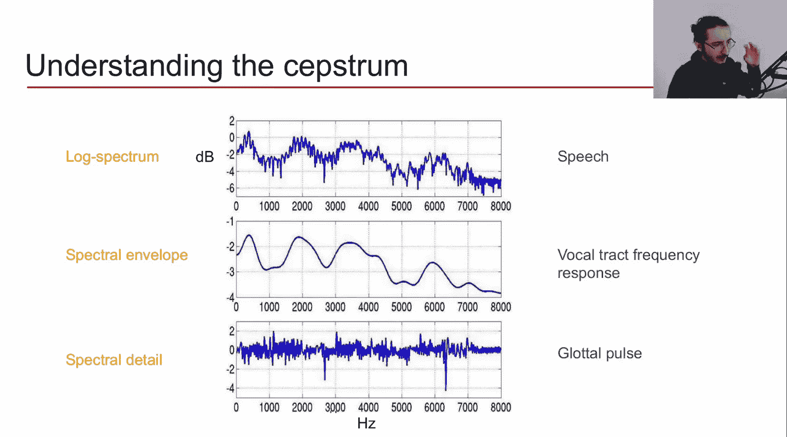

Can be interpreted as a convolution of the vocal tract's frequency response with the glotel pulse。

 So this is kind of like。Formalization of what we just said in a qualitative way， like up until now。

 now， let's take a look at the math behind this， because like this is。

Very important to understanding why， for example， we take like the logarithm。 right， Okay。

 so let's start。 So X of T is our speech signal。 Okay， and here we have like this convolution。

 So we are convolving the vocal。Tracks a frequency response with the glotal pulse。

 And here we are in the time domain。 So， these are all like waveform。 Okay。

 so now if we move to the frequency domain。 And we do this， obviously。

 by applying a Fourier transform。 So what we we know is that the the the spectrum， the speech。

 or I should say， the spectrum associated to the speech signal is equal So the multiplication of this two spectra。

 the one that comes out of the glotal pulses and the other one that comes out from the vocal tract frequency response。

 Okay， so let's put this one up there。What we can do is now take the logarithm and so we'll apply the logarithm to both sides of this equation。

 Okay， like this。Now， we can use the properties of the logarithm and rewrite this formula like this。

Good， so and what's the advantage of this。 Well， the great advantage now is that we can treat the vocal tract frequency response as separate from the glotal pulse。

 right， There are two separate elements that we are just adding up。

 So using the logarithm has the advantage of treating like these two elements as separate。

 So we can just like add them up， and then we get the speech。

 or we can just like focus on one of these two things alone。 okay。😊。

I hope you are getting now why we use like the log amplitude spectrum and not just the， the。

 the normal like spectrum when we， we get the when we calculate the sestr。 Okay。

 so now we should yeah， now， yeah， let's， let's take a look like at this different elements。

 So now let's try to map them to the different elements of speech that we talked about。 so。Again。

 so this is like the this first element here is just like the the speech or actually we we should say it's the log spectrum of the the speech signal。

 Then we have here， like in orange， the vocal tract frequency response here。

 And here we have the glotal pulse。 And so these are like all the different elements now。

What we should ask is， what's the goal like of speech processing， So what should we。Should we do。

 So what should we achieved to get like from a speech signal。 And the point is， really。

 is that like when we。Work with speech signal。We really don't have like the luxury of having the vocal tract frequency response separated from the glotal pulse。

 right， because we just get the speech signal and the speech signal is this massive signal like this。

 right， And so the ultimate goal。 So the one thing that we want to achieve is to separate the initial speech signal into two components。

 So one that's connected with the vocal tract frequency response。

 and the other one that's just connected with the glotal pulse， right， Okay， but。😊。

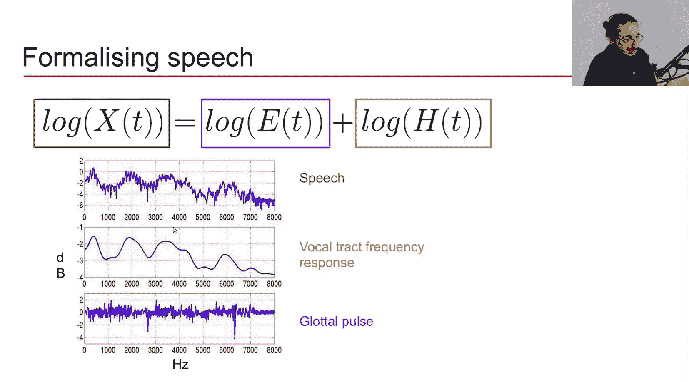

Are we really interested in the Gotter pools？Well， really。

 not that much in terms of audio well speech processing。And that's because， yeah， pitch is important。

 but not really that important。 What we really care about is the identity of sound， is the forin。

 is the timer is the for months right， and the for and all of this stuff is carried by these component of the speech signal。

 So what we want to get at is a set of features。😊，That enables us to work only with this part of the speech so that we can just like fur out the grotal pot because we don't need that for audio process for speech processing or speech recognition。

 so we should find a process through which we can start from a speech signal like this or log spectrum speech like this。

 And then move and isolate the vocal tract frequency response component。

 How can we achieve that Well， sestrum comes to re Here， guys。

 we have the visualization for three log spectra。 So up here。

 you have the log spectra relative to speech And then down here。

 you have like the two different components。 Okay， so now if we want to take the the sestr。

 What we should do is apply the inverse disc Fourier transform to this speech spectral。😊。

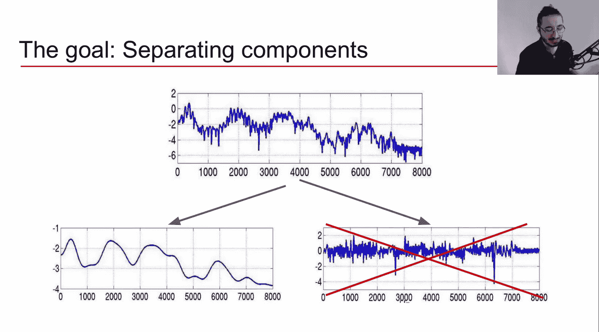

So if we do so， we move from the frequency domain to the domain。

 but if we want to like see like the details of how to do that， well。

 basically what we do is we take like sine waves with different frequencies and we try to feed them onto the spectral signal up here and basically what we what we want to do is try to decompose that signal into its components and see how present the different components R so we start with low frequency sine waves and if like for example。

 like take a look at this speech spectral signal here you see and that we have like four picks here and it's easier to see down here in the spectral relative spectral envelope so you have a pick one to34 So probably a sine wave that has a frequency of four htz it's going to do a pretty good job。

😊，Approximating this spectral signal。 And so what that means is that when we move to the domain。

 we're going to get a high value with respect to the frequency that is at four hertz right now the cool thing here is thats the like all the low values are going to represent the slowly changing spectral information in the speech spectral signal here。

 In other words， like here in the low end of the axis。

 we're going to get all the values that are relative and all the information that's relative to the spectral envelope。

 So it's going to carry information about fors， the relative formes and time。

 Now the moment we go up， we increase the Htz and we go up like here like on the axis。 whats。😊。

Going to happen is that we are going to start to approximate the spectral detail。 So the fast。

Changing information on the speech spectral signal So here， for example。

 we could say that a sine wave at 100 hertz perhaps is going to do a good job at exproximating this spectral details here that are obviously part of this like speech spectral signal up here and so in other words。

 the great thing of moving from the frequency domain from the log spectrum to the equi domain in other words the sestream is that we are going to have a natural physical separation of the information that's relative to the spectral envelope or in other words。

 the vocal trap frequency response and the information that's connected to the spectral details or glotal pulse so here on the frequency axis all the information relative to the spectral envelope is in lower where end and the information relative to the spectral details is in the higher part of the frequency。

😊，And say access， we can capture all of this information through the mathematical formalization。

 And here you can see that the sestr， which is capsax of T， is given by the sum of two components。

 So all the sestr coefficients that are relative to the glotal poles。😊。

Added to all the se coefficients that are connected to the spectral envelope now if you remember our goal and the reason why we move to the spectrum to the se is because we want to just focus on the features relative to the spectral envelope so how do we do that well here comes the last weird word that we introduced earlier in other words the lifting or a lifter what we want to use here is a low pass lifter which is basically a nice way of saying that we want a lowpa filter that's just going remove all the values related to the high equis okay and so once we do that we remain only with the se coefficients connected to the spectral envelope which is the stuff that we wanted now that we know about the s screen。

😊。

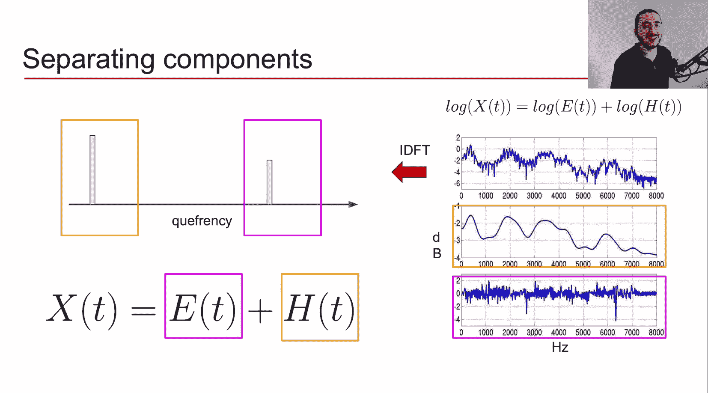

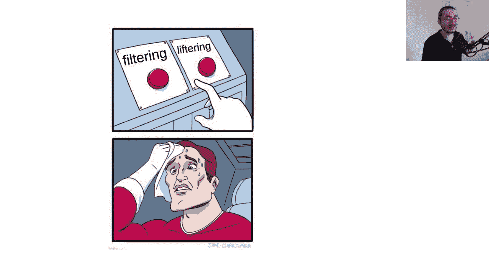

We can move on and understand what male frequency seps coefficients are。

 The cool thing is that MFCC is built on top of seum。 So that is going to be a piece of cake for us。

 The best way we can understand how MfCCs work is by looking at how we can compute them。

 And this is a multi step process。 many of the steps are shared by how we compute seum and MfCCs。

 So let's get started。 we begin with a simple waveform。 So signal in the time domain as usual。

 we apply a Fourier transform and we get a spectrum out of that next step is to apply a logarithm to the amplitude so that we get a log spectrum。

 and up until this point the process for getting se and mal frequency se coefficients is actually the same right But here we have the first divergence。

 So what we do next is applying me scaling。 what this means is that。😊。

We take the log spectrum and we apply the mal filter banks。

 which are these triangular filters like this， right， So if you followed along on My series。

 you should be familiar with this image because I've used it in the previous couple videos when we were talking about Mel spectrums。

 Now， if you're not familiar about which like mouse spectrograms or mal scale。

 I highly suggest you once again to go check out my previous videos。 but。At the end of this step。

 we have now a melt spectrum。 We now enter the final step for getting MFCCCs。

 which is that of applying the equivalent of anyverse discrete Fourier transform for the se。

 And in this case， that one transformation is the discrete cosine transform。

 Now I'm not going get into the details why were using the discrete cosine transform instead of the inverse Fourier transform。

 I'll do that like in a few moments。 But for now， all you need to understand is that once we apply the discrete co cosine transform。

 is that we get a number of coefficients， a number of values or MFCCs。

 which are the ones that we are interested in。 Okay So one thing I want to draw your attention to is the type of transformations or the type of steps that we are using like in this multistep。

😊，For getting MFCCCs。 And the cool thing about this is that at each step。

 we have a process that's somewhat perually informed。 It's perually relevant。

 So let me explain what I mean by that。 So we start with the signal away from。 Okay， at that point。😊。

We get the， we apply a discrete for transform so that we can move to the time domain all good and well at this point。

We apply a logarithum。On the amplitude。 And this is something that's perceptually relevant。

 And that's because you may be familiar with this because like you've seen it like in earlier videos that I had on this on this series。

 so。😊，We don't perceive amplitude or loudness linearly， but rather logarithmically。

 So by applying a logarithm at this point， we're putting like a step that's like perceptually relevant the next step is similar to that。

 right， because when we apply mouse scaling， we are basically passing from a linear frequency representation to a mal based representation。

 which is perceptually relevant in the realm of frequencies， right， And finally。

 when we apply the discrete cosine transform that's kind of similar to applying the inverse  Fourier transform to get the substream。

 what we get out of that is information about the different values that kind of。😊。

Construct like form the different format or the time or like the basic information about the spectrum that we need in order to understand like speech。

 understand phone namess and just like recognize speech really。

 The question we should now ask is why using the discrete cosine transform。

 Cant we just use the inverse Fourier transform Well。

 it turns out there are a bunch of reasons why we prefer to use a discrete cosine transform for getting MfCCs。

 So the first one is that a discrete cosine transform is a simplified version of a Fourier transform。

 And one of the reasons is that the discrete cosine transform gives us back real value coefficients。

 And this is different from what a Fourier transform does。

 So if you're not familiar with the Fourier transform。

 I highly suggest to go check out this video there。

 you'll find that a Fourier transform returns complex numbers。

 But we don't really need complex coefficients。Real value coefficients are more than enough for our purposes with MTcs。

 So discrete cost and transform is way。😊，Simimpr to handle with than a Fourier transform。 Okay。

 so now one thing that I want to show you guys is how we move how we can apply this discrete cosine transform and move from the logarum spectrum to the MFCCCs。

 And basically， like here， the idea is that we get like cosines like with different frequency and we try to fit them to the log spectrum。

 right， and each cosine is gonna to have like a different frequency and it's gonna basically come up with a value。

 that value is how well like that cosine with that specific frequency fits the original log spectrum and that value is an MFCCC。

 the higher， like the index of the MFCCC and the higher like the signal。

 the cosine signal that we pass that we try to fit。😊，To the logs spectrum， okay。Good。

 so now I hope like you have like this idea of how to apply like this discreted cosine transform。

 Now， moving on， another advantage of the discreted cosine transform is that it enables us to the correlate energy in different melt bands。

 Okay， so what's this all about。 Okay here we have once again。

 the mal filter band and these are like triangular filters。

 So you can see like the center like of a mal bench， for example， like this one here。

 which is we can say like this is Melbankch number two。

 is somewhat correlated with what comes after it， the subsequent meltb and the previous me bench。

 And you can see it here like there's some overlap。

 And that means that information is somewhat like correlated is shed across multiple mal bands。 Now。

 when we apply the discreted cosine transform。 What we do is we。😊。

Correlate the energy in the different Mel band， which is a really good thing to have。

 because with machine learning algorithms， we want features that are as least correlated as possible。

Okay， so one final thing that comes with the discreted cosine transform is that it reduces the number of dimensions that we use to represent the log spectrum。

 In other words， we can think of the discreted cosine transform as a dimensionality reduction algorithm that takes like the input。

 which is this log spectrum， and it provides us back with like a feature or set of features like that is that has like a smaller dimensionality。

 less dimensions。Okay， good。 So now I guess like one important question that you may have is how many coefficients should there take。

 How many MFCCCs。 Now， traditionally， we focus on the first。

 We consider the first 12 to 13 coefficients。😊，Why do we take this， right？

 We take the first coefficients， Because these are the ones that keep the most relevant information。

 which is the information about foments and spectral envelope。

 this is like the same stuff that we had with the sestrom， if you recall on the equiency axis。

 the equiency values like that are like on the lower end are the ones that provide information about like the spectral envelope。

 right。😊，The equi values on the higher end are the ones that provide information about the the glotal pulses。

 Were not interested in the glotal pulse。 We're interested in the spectral envelope or in other words。

 interested in the vocal trait frequency response， because that provides us information about the。

 the stuff that perceptually the most relevant， the phonemes， the fors， Okay， so。

The moment you take like the initial coefficients， you are taking information about like dose format。

 how your coefficients provide us information about fast changing spectral detailed information。

 right and we don't really need that that much for speech recognition。

 we're more interested into the performance， as we said multiple times。 So all of this。

 say that of course， you can take more MFCCs， but it's not necessarily going to improve the quality of your algorithms like that much。

 But there's another strategy that's probably going to boost the accuracy of your machine learning algorithms quite a lot。

 And it's taking the first and second derivatives of MFCCs or in other words。

 taking the delta and the deelta delta of MFCCs。😊，What is this？Let's think about like MFCCC says。

 So if you remember like the pipeline for extracting them。 So multistep， that one is used。

For each frame in a signal。Which basically means if we have like a10 secondcon long signal。

 we're going to have like a ton like a frames at each frame， you're going to get a handful of MFCCs。

 Now， if you want to take like the delta MFCCs。 what you do is you take all the values MFCCs values at one frame and you subtract the values from the previous frame so that you get the delta Now。

 if you want to get like the deelta delta， you do the same thing。

 but you start like with all the delta MFCCs and then you subtract the values for the deelta MFCCs。

 for one frame and you subtract to that like the Delta MFCCs from the previous frame and in that way。

 you get the delta Dlta MFCCs， if you think about this。

 this is equivalent to taking more or less the first and the second derivative of this MFCCs。😊，Okay。

 so this is gonna it's usually used in music and audio speech processing， really。

 And what this basically means， like in terms of coefficients is that we start with 13 coefficients。

 But then we take like the Delta coefficients。 So we， we add another 13。

 And then we take the Delta delta， which is another 13 on top of that。 So the。

 the whole figure there is probably like something like 39 coefficients。 And remember。

 this is like for each single frame。😊。

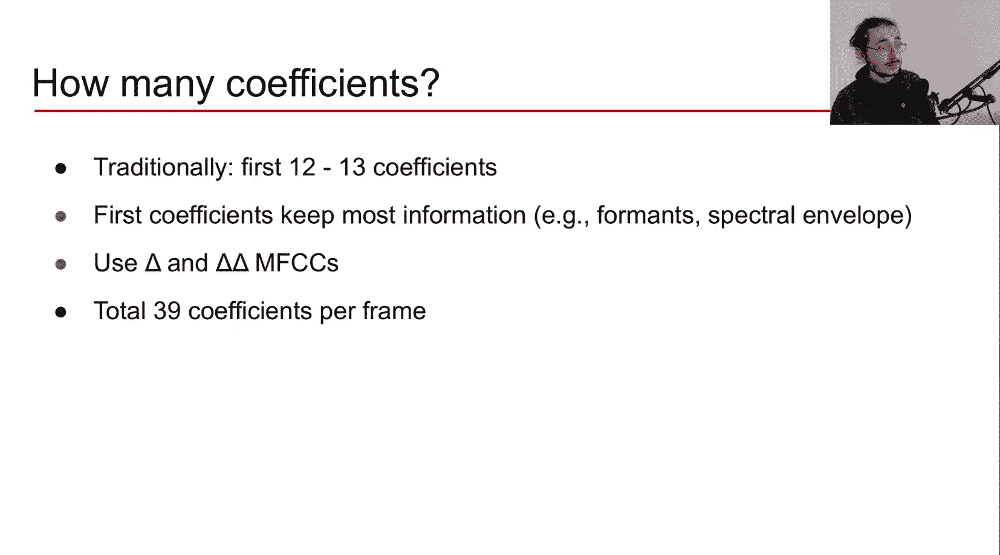

Okay， so now。I think like its we are at a point where we want to actually visualize like these MFCCCs。

 And as you can see， like when we visualize them， like the the kind of like impact that we have is very similar to a spec program that we saw in earlier videos。

 right and。😊，That's because we have like MFCCCs， like we we can think of them like as a matrix。

 right， in the rows， we have like the different indexes， like the different MFCCC。

 the different coefficients。 and on here， like on the columns， we have the different frames。 Okay。

 and so we can use a hitm like this。 And as the one that we use for visualizing spectrograms to visualize MFCCCs。

 So what happens here is that like the time is discretes。

 And we have like as many like kind of like discrete section segments as the number of frames that we have in the given chunk of signal audio signal。

 And here， we have like as many。😊，Disre like segment here as the number of coefficients that we have。

 So for example， in this case， you can count them。 I believe like we took 16 mal frequency sub coefficients。

 And so we at each point， like in this matrix， we have the value for a given coefficient at a given point in time or at a given frame。

 And that value is expressed visually through some kind of like color coding here。 right。

And this is very similar to what we did with the spectrograms as well。Cool， okay。

 so now I want to talk about like a couple of like。

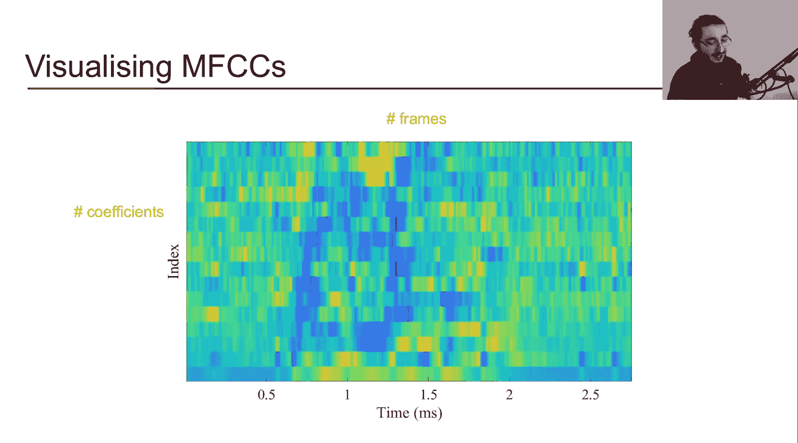

Things just like to wrap up like this very long video。

 And I want to talk about some of the MFCCC's advantages。

 So some of the benefits that come with MFCCCs， some of the shortcomings。 And finally。

 the applications of MFCCCs。 So let's let's start with the good stuff。 So MCC advantages。

 So a great thing about MCC is is that they're able to describe the large structures of the spectrum。

 and we saw this。 And we we we said this like multiple times。

 So the moment like we take like the first MFCCs。😊，We are mainly focusing on the spectral envelope。

 on the fos。 And so like the different coefficients MCC coefficients are basically providing us information about the fo about the phoneems。

 And this is all we really need。 We're just like cutting out the details and the noise that comes with the with the spectral details and focus on the main stuff on the phonemes on the fos。

 Okay， and yeah， so the second point， we ignore the fine spectral structures， which we really。😊。

don't care that much。 So we don't care about pitch when we do mostly when we do speech recognition。

 for example。 Okay， so， and the great thing about MCC is is that like they've been tested for a long time both in speech and music processing and they work。

Quite well。 That's the point。 And they've been like the。

 the audio feature of choice where speech and music processing for a long time， right。Okay。

 now let's take a look at some of the disadvantages。 So first of all。

 MSCCs are really not that robust with respect to adddjectitive noise。 And then the second point。

 I think like it's at the same time， a great thing and it's also like a shortcoming。 So as we say。

 to come up with MSCCs， we have to put a lot of like knowledge regarding like the way also we humans like perceive speech or music。

嗯。And that can be a shortcoming。 And why is that？ Well。

 that's because we are somewhat biasing this audio feature based on biases like that we have。

 And we are not letting the machine decide like for itself。

 whats the what are like the most relevant elements， for example。

 in a in a rare audio filele or in a spectrogram， right？ And some of these decisions。

 arbitrary decisions that we take is like the， for example， the， the， the male the the male。😊。

Scaling like that we do on the spectrogram。 So when we move from the spectrogram to the mouse spectrogram。

 So， for example， there， we use the mouse scale， right。

 And the mouse scale is definitely like a valid like。Informed perceptual informed pitch scale。

 but it's not the only one。 We could have used another one that's called bark， for example， right。

 Or even like when we are dealing with like the filters， the mal filterter banks there。

 We are using triangular filters。 but that is like an arbitrary decision。

 So we are injecting some level of bias in there。 So and the machine may not need that。

 it could just like use data， like spectrograms， for example。

 and figure out what it needs learning it directly from data without us biasing the data。 Okay。

 and finally， a major disadvantage is that mCCs are great for analysis。

 we can do like all types of like analytical stuff like speech recognition。

 music genre classification， but they're not great for synthesis because we don't really have an inverse。

 So we' are not capable of moving from NCCs back to。R audio in in a perfect like manner。

 So we only have approximation of that。 So you can't really use MfCCs for synthesizing audio。Cool。

 okay， so now the final step is anyesis applications， as I promised。 and so。😊，As I said。

 MCCs are an extremely have been an extremely important audio feature。 now。

 a little bit less so because the trend with learning has been to move towards data that are like as rare as possible。

 So we are now using spectrograms or mouse spectrograms most of the time instead of MCC。

 But still it's very important to have like a dip understanding of MFCCs because like they providers like with a clear。

😊，I don't know。 like a clear example of how you can create like something really cool in terms and relevance in terms of like audio features using a bunch of different transformations and also to understand what came before the deep learning wave like with all applications and speech and music processing and of this。

 I want to talk So we can use MfCCs for speech processing。

 And here we can use them for as the main and only features for doing speech recognition。

 speaker recognition， speaker diization and also we can use them extensively for music processing。

 So you can use it for music genre classification， mood classification。

 automatic tagging because it turns out that MfCCs are very good describers for music as well。

 And because they're capable of capturing the timer of instruments。

 So all of the tasks in music processing that have to deal with timer features。😊。

Are a good candidate for using MFCCCs。 and that's because MFCCCs are mainly timecentric and they're more or less like pitch environmentvariant。

 right But obviously you wouldn't use MFCCs for， for example， like for identifying codes right。

 because you're not really getting that much of a that much pitch information。Good。

 so I feel like you should really， really congratulate like yourself because we've done a lot of work like in this video。

 So we looked at the sestr， we'll look like at the math behind se。

 we looked at the visualization of the sstr， how we can interpret sepsstr in the context of speech。

 and then we moved down to mal frequencyequ sestr coefficients。

 But up until now we've just dealt with theory。 So as is' usually the case in this series。

 the next step is going to be that implementation， or just like playing around with Python。

 So in the next video we'll use all the information that we've used here in this video to extract MFCCs with Python and Lib browsersa and we'll also visualize MFCCs for different audio files。

😊，Okay， so I really hope like you enjoyed this video。😊，And if you found it useful， yeah。

 please leave a like。 If you haven't subscribed and you want to have more videos like this。

 please do remember to subscribe。 And I guess that's it for today。 I'll see you next time， cheers。😊。

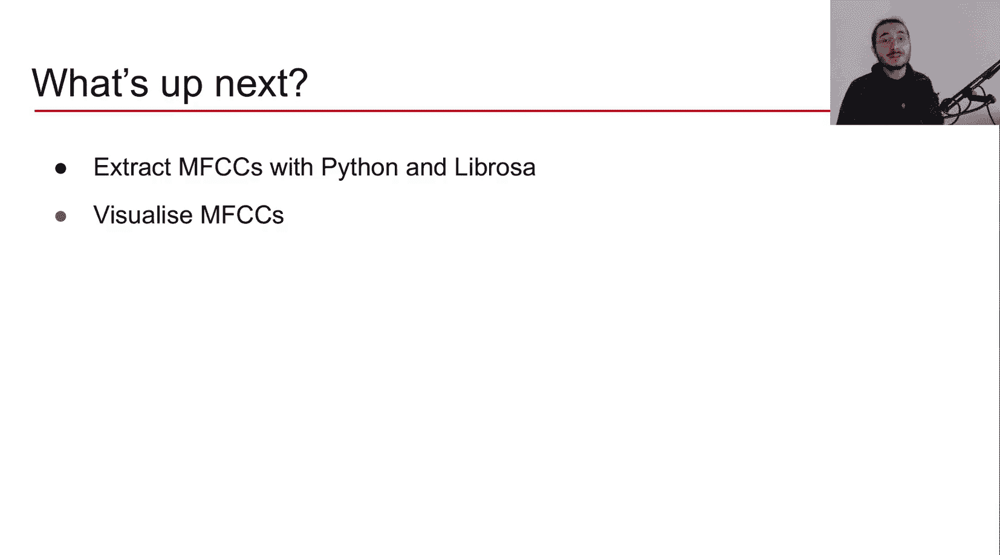