# Valerio Velardo【中英⚡面向机器学习的音频信号处理 Audio Signal Processing for Machine Learning】 p20 p19 Extracting Mel-Frequency Cepstral Coefficients with Python [BV1ftPLeCEhX_p20]

Hi， everybody， and welcome to a new exciting video in the audioud signal and press the for machinech learning series。

 Last time we looked at malfrequ conceptual coefficients from a theoretical standpoint In this video。

 I want to show you how you can extract MfCCs using Python and Libbrosa。

 So let's get started with this Jupyter notebook。 So the first thing I want to do is just import a bunch of libraries that we'll be using。

 So I'll import Libbroa Libbrosa do display Python do display Plo and Npi。 So let's do that。

 Next thing we want to load an audio file。 So which file are we gonna load。

 So it's a file that we you should be familiar with by now。

 it's a short passage of a piece from thebui。 So we're talking about classical music here。 Okay。

 so I'll do audio。 And then I have the file that's called thebu do。😊，Now first thing。

 let's play back this audio file in the Jopyter notebook， so we'll doN IPD do。

Audio and then pass in the path to the file。Okay， and here you go。

 so let's listen to a little bit of this。😊，🎼Okay所以。Good， so the next thing that we want to do。

 we want to actually load the audio file using a Lib browserser and so again。

 this is something that we've done multiple times so we'll take the signal and the sampling rate over here and then we'll do a Lib browserser dot load and then what we want to pass is the audio。

File。Over here。AndYes， and so here we have the sampling range。 And here we have the signal。

 So let's take a look at the signal over here at the shape of the signal。 And as you can see。

 we have this amount of samples in this waveform。 The next step for us is extracting MFCCs。

 extract MCCs。 Okay， so how do we do that。 Well， this is extremely simple in Lib browsersa because we have a function that does that almost for three for us。

 So MCC is equal to Lib browserser dot feature and then MFCCC like this。

 And we want to passing the signal specify the number of MFCCs and will。

Used like a traditional number， which is equal to 13。 And then specify the sampling rate like this。

 Okay， let's do this。 Okay， so here we have the MFCCs Now， now， let's take a look at the。

 the shape of this MFCCs。 And so this should be a bial array or a matrix。

And so we'll do MCCs dot shape。 And as you can see， we have the number of rows is equal to 13。

 and the number of columns that we have。 or in other words。

 like the different frames is equal to 1000 almost1300 frames。 or discrete time points。 Next。

 we want to visualize the MFCCCs。 So let's write visualize MFCCCs。

 And so we can easily do this with a native function in liberals that that's called spec。

 So let's get started。 So we'll do a plot dot of figure as the first thing。

 and we want to specify the figure size of yeah of our figure。

 So we'll do a size and we'll set this equal to 25 by 10。Okay。

Now we are going to be using the Lib browsersa dot display dot spectro function。

 and this is a function that enables us to visualize any spectrogram like feature。

 So we'll pass in as arguments the obviously the MFCCCs。😊。

We want to specify that the X axis is going to have like time。And finally。

 we need to pass the sampling rate in。 Now this is gonna be a hit map like visualization。

 So we're gonna have like some colors。 and what we want to do is like having the ability to map this different colors to numerical values。

 So for that well need a color bar。 So we'll do a plot dot color bar。

 And here we have an argument called format。 And here we'll pass percentage plus to F。

 And the last thing is just showing the this visualization。 So let's take a look at this。

 And here we go。 So here we have the visualization。 and as you can see on X axis。

 we have a time and like this the B musical passages， a 30 second long。 And here on the y axis。

 we have the different coefficients。 So the different MFCCC。😊。

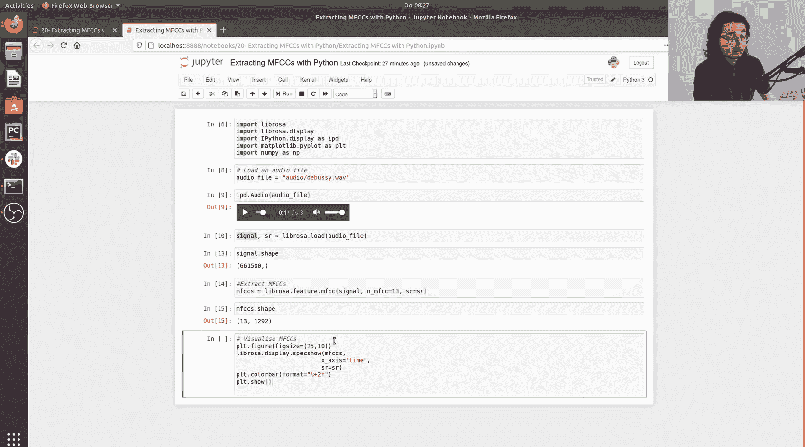

Coefics and if you count， you'll see that we have 13 coefficients right and at each point in this diagram。

 we have the value for a given MFCCC MFCCC index at a certain point in time。 and here you have the。

The mapping between like the the colors and the different numerical values。 Next。

 we want to calculate the first and second derivatives of the MCCs。

 We showed this already in the previous video， and we can call this features Delta and Delta Delta MCCs。

 And they are very important to tell us how the MCCs change over time in an audio file。 Okay。

 so first of all， yeah， let me just add a few of this。 So it becomes clear what I'm doing。

 And then let me just add comment saying calculate Delta and Delta。😊。

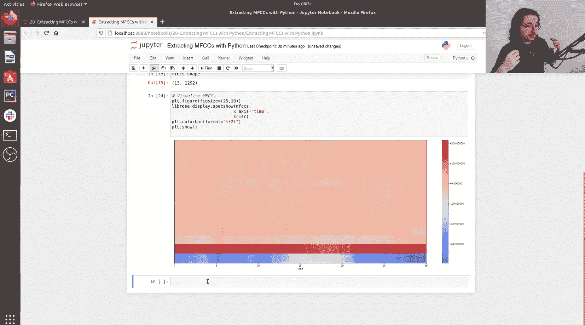

To MFCCCs。Okay， so how can we do that， Well， this is， again。

 very simple because Libbrosa comes with a built in function for doing that。

 So we'll say Delta MFCCCs is equal to Lib browsersa dot feature dot Delta Delta。

 And here we just pass the MFCCCs and for the Delta to。MFCCCs will use the very same function。

 so it's Lib browsersa dot feature dot delta and we'll pass once again the MFCCCs here。

 but we should specify a keyword argument called order and here we'll say the order is equal to 2。

And so this is the second derivative。 Okay， yeah， so now let's take a look at the shape of this。

Delta MfCCs， for example。 So we'll do Delta MfCC dot a shape。 And as you can see。

 they have the very same shape that we have for MCCs。

 And if you don't remember if we do a MFCCs dot shape。 You can see yes， so we have 13 indexes。

 and also like in the Delta MFCC because at the end of the day。

 we're just taking the first derivative right， So 13 and then the number of frames that we have。

 it's equal to 1292。 Now， let me visualize Delta MfCCs and Delta Delta MfCC。 So how can we do that。

 Well， it's very simple， we just take like this piece of code here。

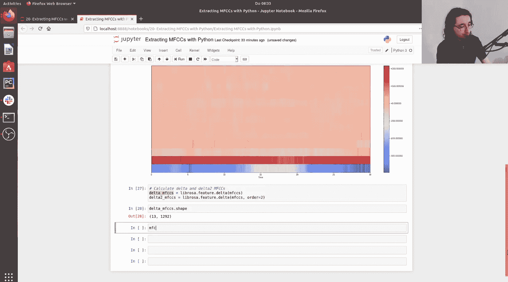

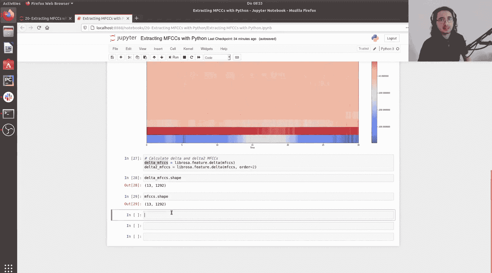

Let's just get。

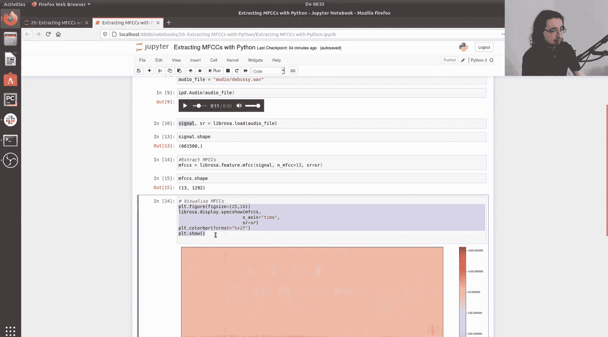

This。We'll put this one here， and instead of MFCCCs， we'll pass in Delta MFCCCs over here。

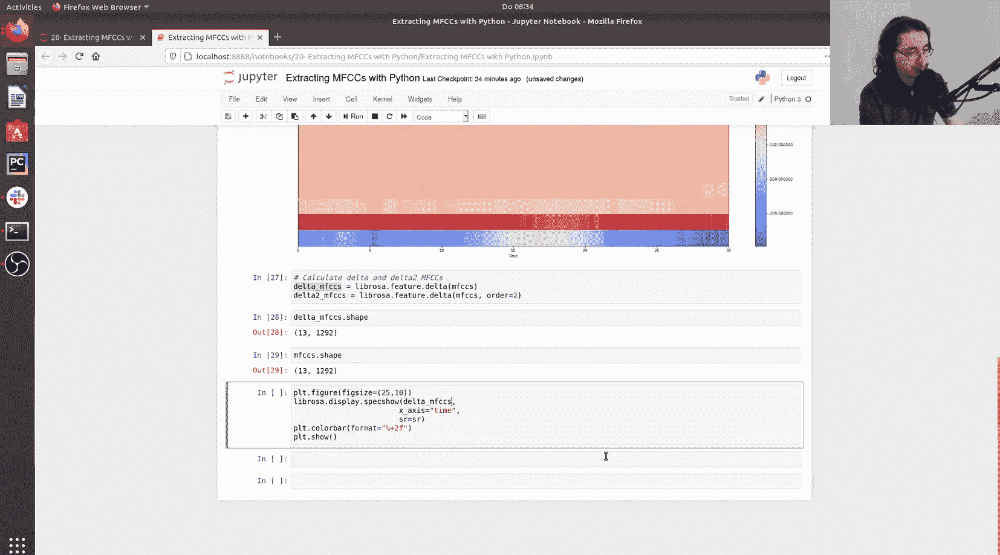

Let's do this。 And so these are the Delta M FCCs。 And now let's do the very same thing。

 but with a Delta， Delta MCCs， it will pass in the Delta to MCC。 And here we go， okay。

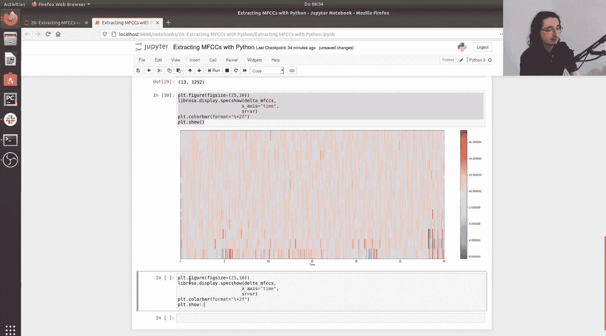

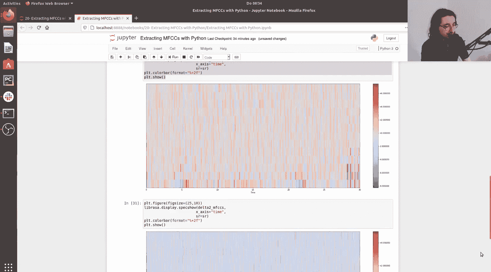

So here we have the original MFCCCs。 Here we have the first derivative of the MFCCs。

 and here the second derivative of the MFCCCs。 The final thing that I want to show you guys is taking the MFCCs and the first and second derivatives of the MFCCs and concatenating them together so that we have a unique audio feature that's like quite comprehensive because we have the MFCCs。

 and we also have information about how those MFCCs change over time。 thanks to the derivatives。

 Okay， so how can we do that。 Well， this is very simple。 Or if we use N。

 So we'll say that here we have yeah， let's call it comprehensive。

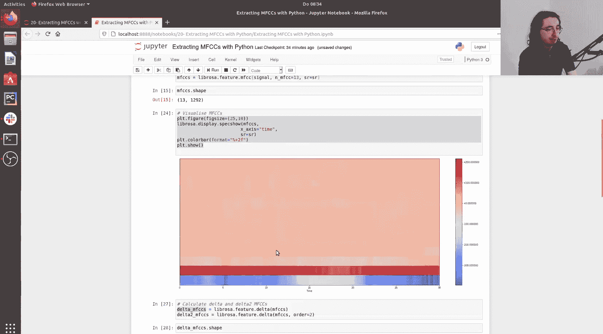

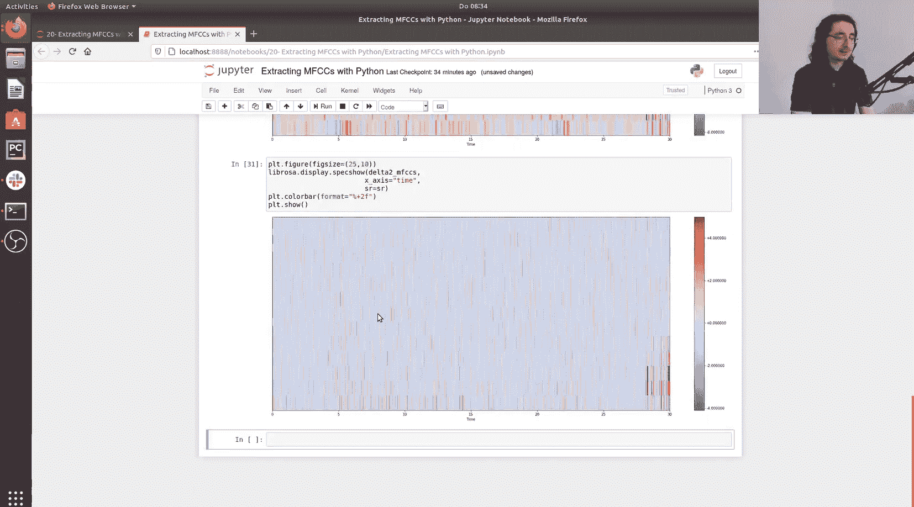

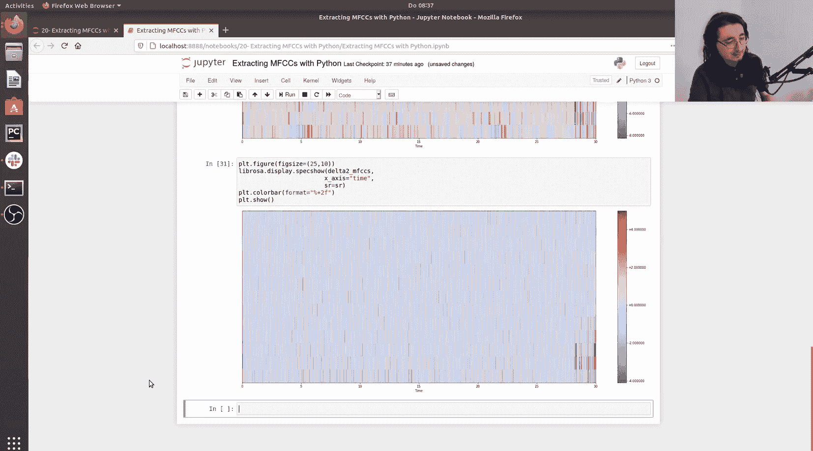

H save。MFCCCs。 And here we'll do a Nie dot concatenate。

 And here we need to pass the free array that we want to concatenate。

 So the first one is MFCCCs and then we'll pass Delta MFCCCs and Delta。To MFCCCs。 And here we go。

 So now let's take a look at this shape of this comprehensive MFCCC's audio feature。

 and not surprisingly here， we have that the number of rows， the first aes is equal to 39。

 And that's because we basically are concatenating like 13 indexes like for each of the three arrays。

 right， And so we get like a 39 here， whereas the number of columns remains unchanged。 Great。

 by now you should be able to extract MfCCs。 And first that's like a derivative MfCC is using Python and Libbrosa。

 And you should also be able to visualize them using yeah spec from Libbrosa。

 So in the next video will'll be looking into frequency domain audio features。

 So I guess that's all for today， I hope you enjoyed the video。 if that's the case。

 please remember to live a like。 And if you haven't subscribed yet， please consider doing it so。😊。

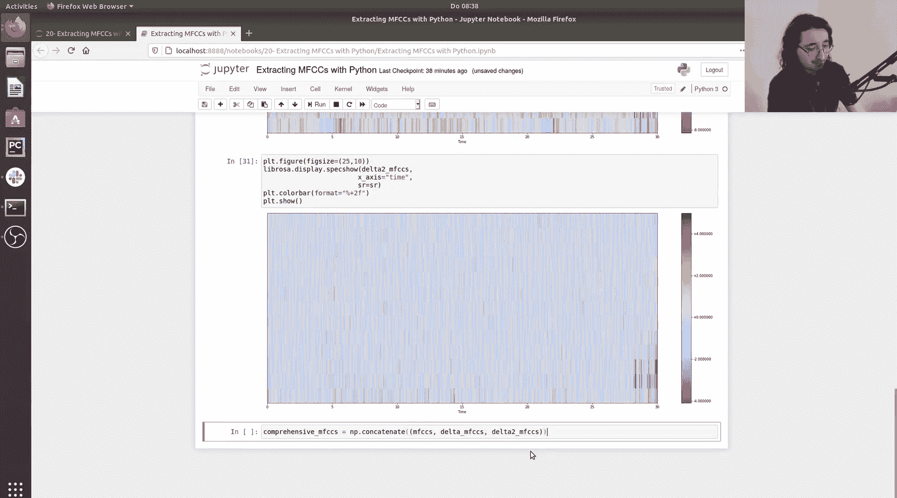

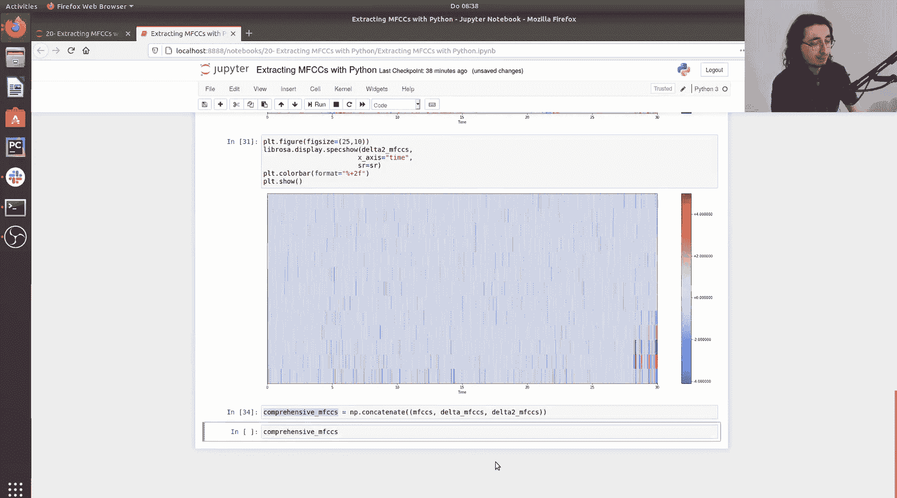

I'll see you next time， cheers。

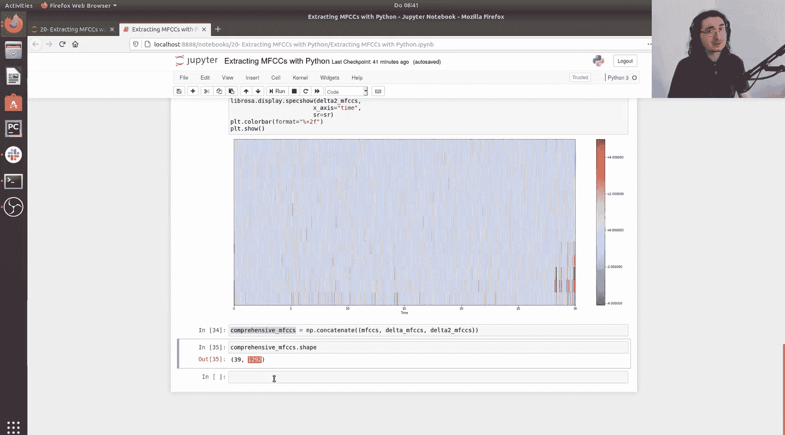