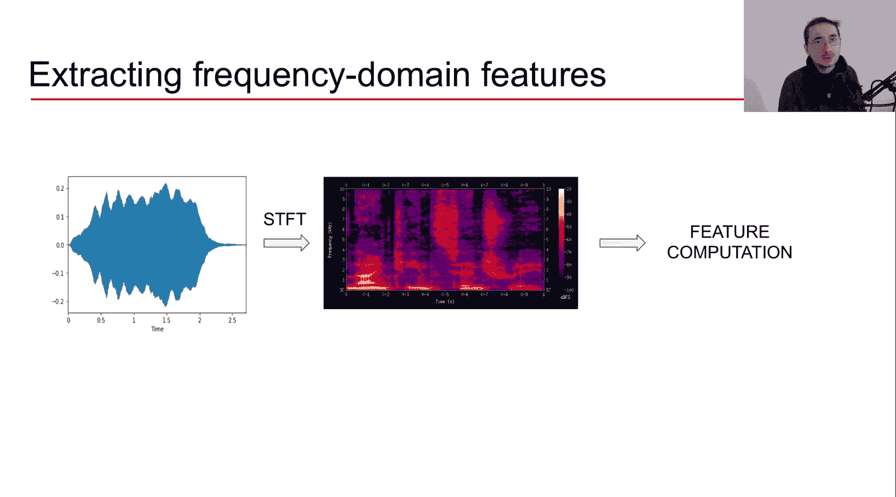
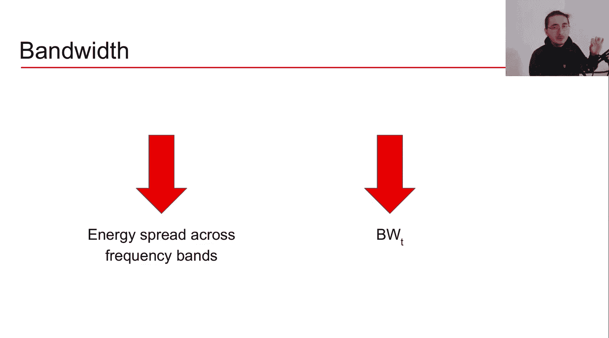
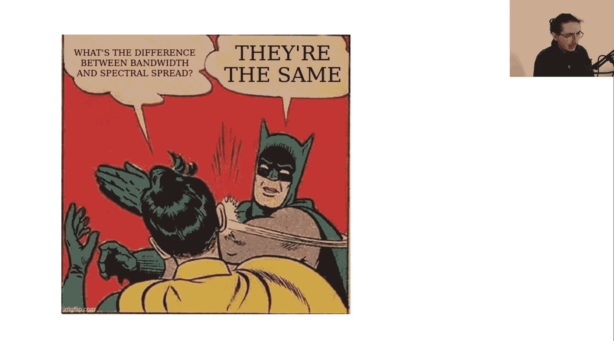
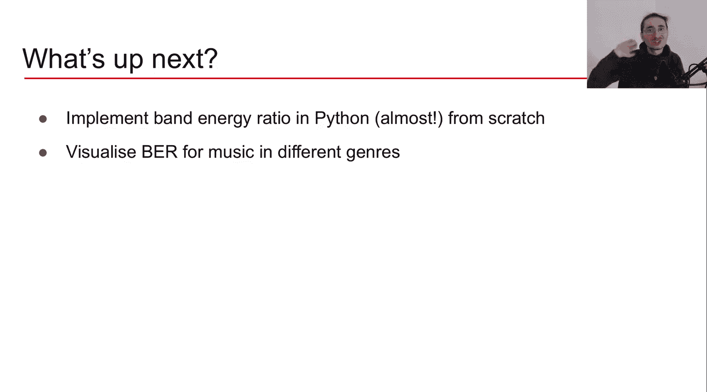

# Valerio Velardo【中英⚡面向机器学习的音频信号处理 Audio Signal Processing for Machine Learning】 p21 p20 Frequency-Domain Audio Features [BV1ftPLeCEhX_p21]

Hi everybody and welcome to a new exciting video in the audio signal processing for machine learning series。

 This time we'll look into frequency domain audio features specifically we'll be looking at the math and theory behind it and I'm also going give you the intuition But before we get started I want to remind you about the sound of the eyesla community。

 which is a community of people who are interested in all things AI audio music and signal processing。

 so you can join， get feedback on your projects and network with very cool people。

 So if you haven't joined yet， I highly suggest you to go check out the sign up link in the description box below。

 But now let's move on to the cool stuff。 So in the last couple of videos we' looked into mouth frequency sub coefficients or MfCCs and now it's time to move on to frequency domain audio features and we can do this because now if you followed it along with the series。

😊，We have a deep knowledge of Fourier transform， shorttime Fourier transform。

 so we know how to move to the frequency domain today。

 we'll be looking into three frequency domain audio features。

 specifically these are the band energy ratio， the spectral centroid and the bandwidth。

 I just want to say that there are a lot more frequency domain features。

 But for today we'll just be focusing on these ones。 Okay。

 so I just want to remind you about how we can extract frequency domain features in a nutshell in a very like simplistic way。

 What we do is we start from the waveform。 then we apply shorttime Fourier transform and so that we get a spectraltrogram。

 And then at this point we can compute a feature computation so that we can arrive at a feature。 Now。

 as I said， this is a simplification of the whole process and I have a whole video that details how to extract。

😊，Audio features in general and the frequency domain audio features specifically。

 So I highly suggest you to go check out that video。

 Then another thing that is gonna be required for this video if you want to really understand it is the understanding of short time for transform and the understanding of what a spectrogram is。

 Now， once again， I have a bunch of videos in that。 So just go check them out in the series。

 I just want to share a couple of math conventions that we'll be using during the video。

 So the first one is this M T of n。 And this will send for the magnitude of the signal at a given frequency bin and and at a given frame T。

 And then the other convention that we'll be using is that capital N is equal to the number of frequency bins that we have in the spectrogram。

 Let's jump to the first audio feature。 That's bent energy ratio。

 And this feature provides us information about the。😊。

Between the energy in the lower and the higher frequency bands。

 So we can think of this as a measure of how dominant the lower frequencies are。

 Let's take a look at the math behind the band energy ratio so that we can understand how it actually works。

 So as you can see here， we have a formula and as a fraction。

 and the fraction is to be expected because we are talking about a ratio of two elements， right。

 So now let's take a look at each of the items So here both in the numerator and thenominator。

 we have the power of the signal at time T and frequency bin N。

 And this is the power because we're talking about the magnitude of the signal squared。

 which is the power as you should know by now。Okay。

 so the other thing that I want to draw your attention to is this capital F okay because we are talking about we are considering a couple of like sums here。

 right in the denominator， we sum from the frequency being F capital F to capital n and then in the up here in the numerator。

 we are summing the powers from the first frequency being F capital F minus1。 Okay。

 so that capital F is called the split frequency。 So what's the split frequency。

 Well it is that frequency that tells us or like provides the difference between the lower frequency and the higher frequency。

 So now let me visualize this because it's gonna become very， very easy to understand。

 Okay so here we have like our usual spectrogram， we have time on the x axis and on the y axis。

 we have frequency now， the split frequency is just horizontal line like this。😊。

In this case the split frequency is at 2000 hertz now so this is the threshold below that frequency。

 we have lower frequency and above that split frequency we have higher frequency now this split frequency is completely arbitrary so you can put it wherever you want really but so we can just like move it down here for example。

 say around 800 hertz but a usual split frequency value is 2000 hertz it makes a lot of sense okay so now let's go back to the math here and so with this idea in mind we can recognize that in the lower part of this fraction so at the numerator we have the power in the lower frequency bands and so how do we get to that world we have a sum here and we are summing the power for each frequency bin at a given。

😊，Poin in time。 And that is starting from the first frequency bin up to the split frequency-1。

 So this is all the power that we have in the lower frequencies。 Okay， and at the denominator。

 we actually have the opposite of that。 So we have the power in the higher frequency bands。

 And we can see that because of the indexes here in the sum。 So we start at the split frequency。

 And then we go all the way up to capital n， which is the the higher number。

 the higher frequency bin that we have。 Okay， one thing that I want to stress here is that we are taking the band energy ratio at a specific frame。

 So in other words， here， once you have like all your frames in the spectrogram。

 you are gonna apply this formula to each frame to each point in time。😊。

That you have in the spectrumgram。 Okay， so this is but the band energy ratio。 Now。

 let's try to visualize this。 So as we said here， we have that purple horizontal line that is split frequency。

 So now let's take a frame。 So it's this rectangle， red rectangle here。 Obviously。

 this is not a frame because we have a lot of frames in it。

 But let's assume this is just like a frame。 Okay， so now we take the the power and we sum it here in the higher frequencies。

 we do the same thing like in the lower frequencies。

 And then we just apply the a fraction ratio there。

 So we divide like this green power here by the the power here like in this blue bar。

 And that is the band energy ratio。 Okay so what can we use the band energy ratio for。 Well。

 we can use it for all sorts of things in music and switch processor。😊。

And specifically band Energy ratio has been extensively used in to discriminate music from speech and for certain music classification problems like music genre classification or mood classification Okay now let's move on to the second audio feature。

 which is the spectral centroid and this is a very。😊，Common famous one， I should say， right？

 And so the spectral centroid in a nutshell。 So the intuition is that it's going to tell us it's going to provide us the center of gravity of the magnitude spectrum。

 In other words， it'll give us the frequency band where we have most of the energy concentrated right。

 and the cool thing about the spectral centroid is that it nicely maps onto a very prominent timeer feature。

 which is brightness。 So how open or dull a certain sound is。 So now。

 let's take a look at the the math behind the spectral centroid and。😊。

Before we actually look at the formalization， like we mathematical symbols。

 let's take a look at the the kind of like quality formalization。

 So the spectral centroid is the weighted min of the frequency or the frequency bins， if you will。

 So what are we talking about here。 Well， this is like easier like sin in math than than said。 right。

 And so this is like the the formula for the spectral centroid at a given frame T。

 So and as you can see here， we have like all the usual stuff that we have in a weighted min。

 So here we have like the frequency bin N。 And then here we have the the weights for n。

 So and the weights obviously R。😊，Not they are like the magnitude for that frequency bin at that specifically at that specific frame T。

 Okay， so we can also see that down here， we have the some weight。 And yeah as you can see here。

 we're talking about a weighted min， And this is the weighted min of the frequency bins， right， Okay。

 so where can we use the spectral centroid， Well， once again。

 the spectral centroid has been extensively used in audio classification or a music classification problems。

 And it's one of like the key frequency domain audio features。 And yeah， it's been like very。

 very extensively used throughout time and different applications。 Okay。

 so now let's move on to the bandwidth。 So the bandwidth is somewhat related to。😊。

The spectral centroid。 And we can think of the bandwidth as that spectral range。

 which is of interest， and it's around the centroid。 or in other words。

 we can think of the bandwidth as the variance from the spectral centroid。 Once again。

 the bandwidth has a direct relation or a correlation with the perceived timebra。 Now。

 let's take a look at the formalization here。 So the bandwidth once again is a weighted mean。

 but this time， it's not a weighted mean of the frequencies。

 but rather weighted mean of the distances of frequency band from the spectral centroid。 Okay。

 I know this can sound a little bit yeah， difficult complex。

 So now let's take a look at the math and understand that。At the end of it today， it's quite simple。

 So here we have the formula for the bandwidth at a specific frame T okay and as you can see。

 we are once again talking about a weighted min here。

 So here we have the weight and the weight as always are just like the magnitude for the signal at the specific time T we are analyzing at and at the frequency band n。

😊，Then we have like this element here and this element is indeed the distance of the frequency band from the spectral centroid。

 and we can like easily see it。 This is like the absolute value between the frequency band n minus the spectral centroid the value of the spectral centroid calculated at time。

😊，T， okay， and down here， once again， we have the sum of weights。 And as you can see， this is。

 once again， a weighted min。 Okay， but now let's try to understand how the bandwidth。

 like changes depending on how the energy is distributed across all the different frequency bands。

 So so if the energy is spread across the frequency bands。 So it's kind of， yeah。

 it's just like spread。 then what happens is that the the bandwidth is gonna the value for the bandwidth is gonna increase。

 on the other hand， if the energy is kind of concentrated in in a kind of like small frequency band in just like a few frequency bands。

 then what happens is that the bandwidth is going go， the value for the bandwidth is going go down。

 And as you can see here， this is somewhat。Related with the idea of variance， right？

 So if the energy is spread across the spectrogram across the different， sorry。

 across the different frequency bands， then we have like a higher variance for the energy。

 And if it's not， if it's just concentrated， we then have like a low variance。

 And now the bandwidth can also be called spectral spread。

 So this is just another way of calling bandwidth。 And you can now understand why that's the case。

 right， because spectral spread is yeah， that idea of like where how much the energy is spread across the frequency bands。

 Okay， so let's take a look at the applications of the bandwidth。 Well。

 bandwidth just like the band to energy， spectral cent has been extensively used for music processing。

 for example。

Problems like music genre classification or music mood classification。 Now。

 all of these features we've talked about today， as I said。

 have been used quite a lot during like the traditional machine learning era， right。

 where like we were using like knowledge engineering。

 like for coming up with interesting and significant audio features。 And so yeah。

 all of these frequency domain audio features have been extensively used like in that period。 now。

 they are a little bit less so because like moving to deep learning applications while we tend to use audio features that are more role like like spectrograms。

 mouse spectrograms or even just waveforms。 Okay so by now。

 you should have a good understanding of this basic frequency domain audio features， as I said。

 there are。😊，Way more than this。 But now with this idea in mind and with this basic understanding。

 you can go there and you can easily understand all the other ones that are out there。

 So what's up next。 Well， we talked about the theory behind this frequency domain audio features in this video next time we're gonna be implementing one of this audio features from scratch and that's the band energy ratio。

 and we use python for doing that， as we've done throughout this series。

 And then we're gonna be visualizing the band energy ratio for pieces of music in different genres and try to understand if we can tell them apart based only on the band energy ratio。

 Okay I hope you enjoy the video， if that's the case。

 please remember to live a like if you haven't subscribed and you want to watch more videos like this。

 consider doing so。 if you have any questions， as usual， please leave them in the comment。😊。

A section below that's all for today， I'll see you next time， cheers。

