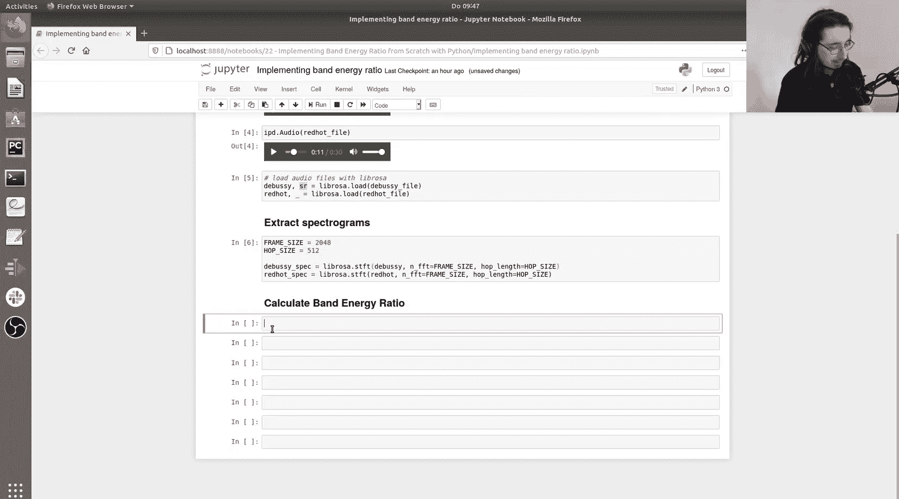
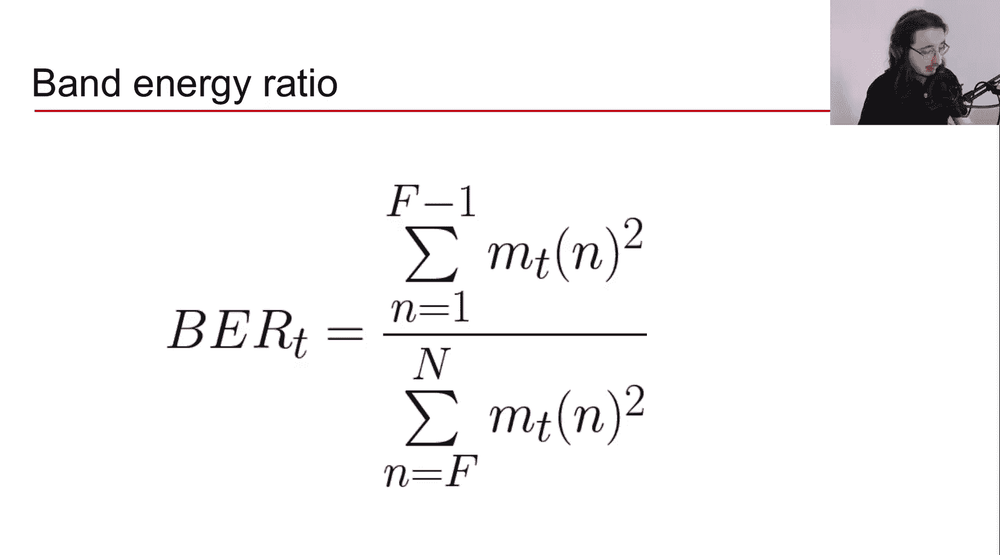
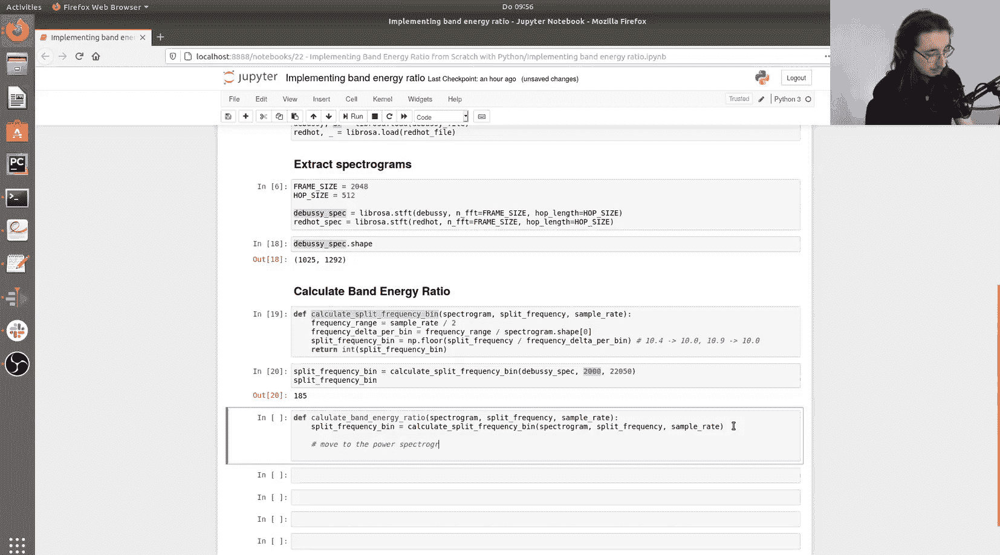
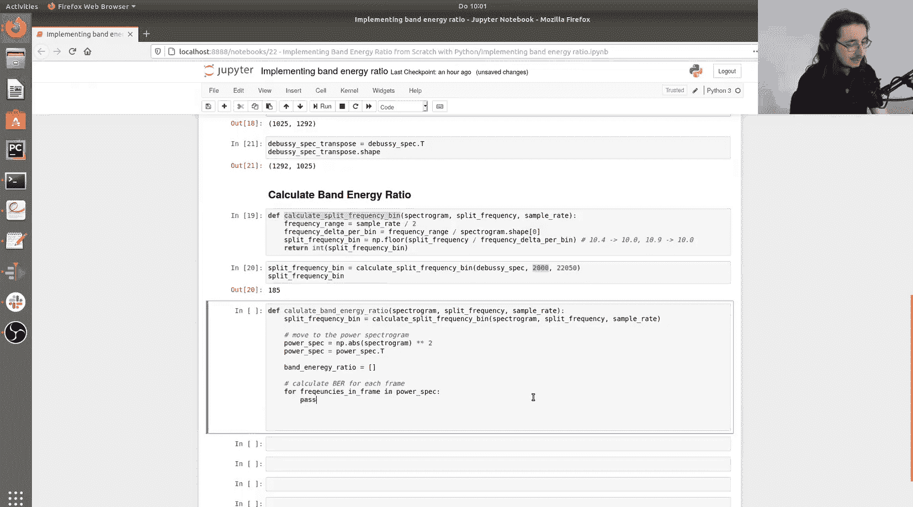
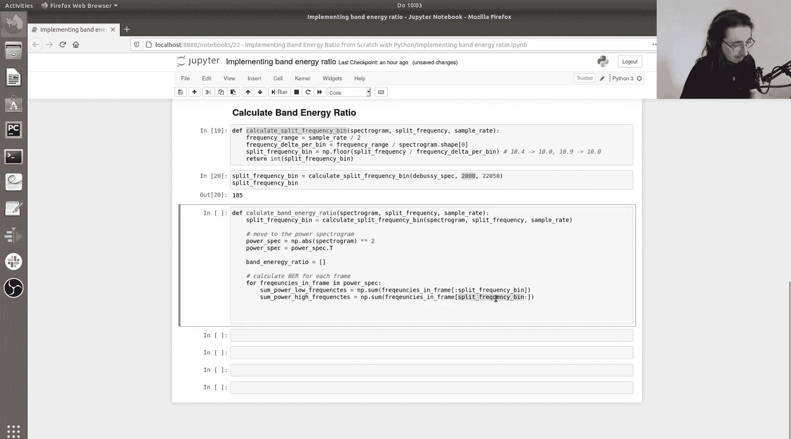
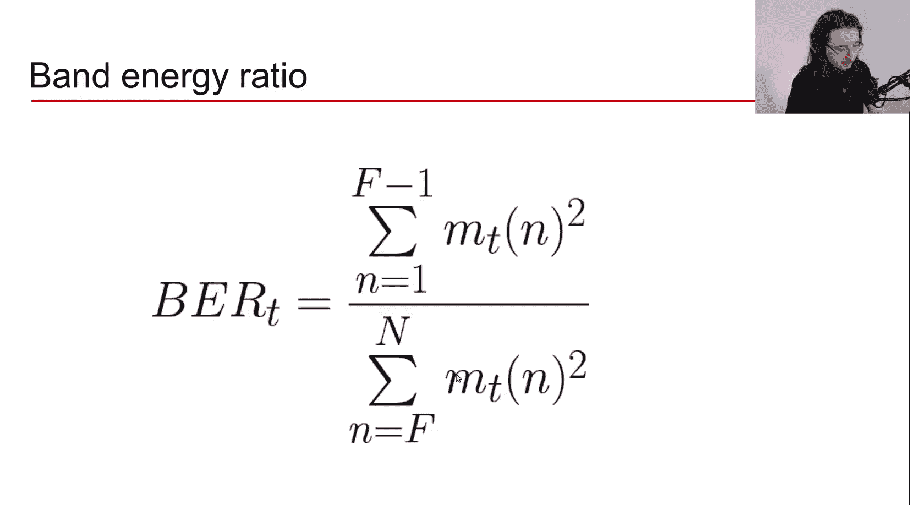
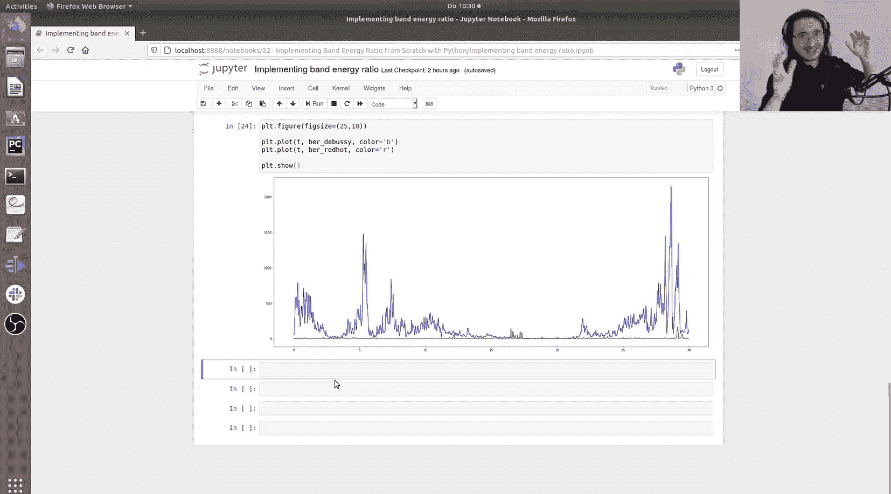

# Valerio Velardo【中英⚡面向机器学习的音频信号处理 Audio Signal Processing for Machine Learning】 p22 p21 Implementing Band Energy Ratio in Python from Scratch [BV1ftPLeCEhX_p22]

Hi everybody and welcome to a new exciting video in the audio signal processing for machine learning series。

 Last time we looked at the theory behind a few frequency domain audio features。

 This time I'm going implement one of those from scratch in Python and the one that I'll be implementing is called band energy a ratio。

 I'm not gonna get too much into the theoretical details of this because I've done this like in the previous video。

 So if you find yourself not understanding what I'm talking about。

 just go back to my previous video which should be over here。

 Okay so let's take a look at this notebook and as you can see I've already implemented some code And that's because this is like stuff that we've seen multiple times throughout like this series and I didn't want to spend time like coding typing this down so the first thing that it is import some libraries that will need then I load the audio files。

 So I have a couple of audio files that I'll be working with。😊。

🎼So one is a red hot Chili peppers song and we've heard this time and again throughout the series and the other one is a classical music piece byCloude Debues so let's quickly listen to this too。

😊，🎼So yeah， this is a lush string。🎼Driven orchestra pace by the PC。

🎼And here we have the song by the Red Ho Chili Peppers。😡，Okay。

 you get the idea right so when I do next is just I load the audio files which Libbrosa using this Libbrosa do load and I get the waveform really。

 so like an N array and then the sample rate which is the 42 22。

050 Htz and then given we are working with。😊，Frequency domain features and bent energy ratio is a frequency domain feature。

 What I want to do is just extract the spectrogram。 And so how do I do that， Well。

 I just use once again， a simple function from Libbrosa， that's called to Libbroa doF。

 And I pass in a couple of constant。 So the frame size and the hop size。

 and I obtain the spectrogram for the beauty and bread hot chili peppers。 Now。

 if you don't know what a spectrogram is， I or like short time Fourier transform is I have a bunch of videos on this topics in this series。

 I highly suggest you to go check out before like moving along with this video。

 Let's now move on to the cool stuff and start calculating the band energy ratio。

 So let me add a few。😊，Boxes down here。And I'll use some markdown to say， yeah。

 calculate a bend energy。Rio， okay， so let's take a quick look at the definition of the band energy ratio。

 So here we have the definition from。 Yeah， the previous video， basically。

 and here you can see that the band energy ratio at time two。

 So a givenon frame is given like by this formula here。

 So the key thing that we want to get as the first point is the split frequency F cap F because this is the one。

 if you recall， that's going to tell us that's going to give us like the threshold that we'll used to say okay。

 so all the frequencies above this frequency are belong to the higher frequencies and all the frequencies below the split frequency below to the lower frequencies。

 But now obviously we can pass in a continuous frequency like in herz like 2000z or 3000 Hz。

 But the spectrogram has discrete values right， so it has discrete frequency bins。

 So we need to create a function。

That maps a continuous frequency onto the discrete frequency bins that we have。

 And so that's what we want to build now。 So we'll define a function and we'll。

 we'll call it calculate split。

Frequency bin like this。 And this function accepts a few parameters。 So， first of all， it。

 it accepts a spectrogram。 then the split。Frequency and finally， the sample rate， okay。

So now let's see what we should do here， like all the different steps。 So as the first thing。

 what we want to calculate is the frequency range that we have in the spectrogram。 In other words。

 So we want to ask ourselves。 So how what's the frequency range that we are capturing in the spectrogram。

 And now to show you what I'm in here。 let's just go back and take a look at the， for example。

 at the the B spectrogram。 So I want to just like take the shape here。Of this。 And as you can see。

 like in the the shape of this spectrogram is given its it's kind of like a two dimensional array。

 right。 And so on the first dimension， we have 1025。

 And that is the number of frequency bins that we have， right？

 And so what we want to really understand is like， what do does 1025 frequency bins like correspond to in terms of like frequency range。

 Okay， So and how do we do that。 Well， this is like something that we can easily do because we know that the spectrogram。

Reduces the it like frequency range from the sample rate。 It moves on to the nius frequency。

 And so we can obtain that by doing the sample rate divided by 2。

 The next logical step here is to calculate the Delta frequency between to adjacent bin。

 So in other words， how much， So when we move， say from frequency bin to number 3 to frequency bin 4。

 So how much do we actually move in the continuous frequency， right so。

We can do that by saying that the frequency。Delta。P。Ben。Is equal to the frequency range。

Divided by the total number of frequency bins that we have。

 And we can easily get that from the spectrogram。 So we do spectrogram dot a shape。

 and we take the first dimension and the first dimension， as we so。

 is equal to the number of bins that we have in the spectrogram。 Okay。

 so now we know the frequency delta for each bin。 And so we are now ready to calculate the split frequency bin。

 So the split frequency bin。😊，Is equal to the split frequency and this is given in hertz and that's divided by the frequency delta per bin In other words。

 what we're doing is we're mapping this continuous frequency。

 that's the split frequency onto the closest frequency bin available。

 and but you may see here that given like we have two numbers。

 So the split of frequency of frequency delta per bin。

 it's likely that we're going to get like some kind of a flat number and obviously the frequency bins that we have are discrete and that's the whole point of having like thisriization here so we can't take a frequency bin that's equal to 10。

4。 it doesn't make sense right so we have to move to an integer number。 So we have to roundup。

The numbers。 So what what can we do to this round this number so we can use the Nmpy dot floor。

Function。And what this function does， is's a form of rounding。

 and it always round rounds numbers down。 So， for example， say I have 10。4。

 And then if I applied the floor， what I gets back a stem。

And I get it as a float number if I have like 10。9。Again。I'm going to get T。Point here like this。

 Okay， so here we have the split frequency bin so。Now we can return it， but as I mentioned。

 this is a float number， so we want to cast it to an int。Okay， so。This should be ready。

 so now let's try it。So we can say split frequency bin， and then we use this one。

Calculate frequency bin， so as the spectral， we just pass into the boost spectralogram。

And then as the split frequency， we're going to be using 2000 Htz。

 which is a totally fine split frequency。 and as the sample reach。

 I'm going to use the default rebri one， which is 22050。😊，AndNow let's print this。

For split frequency bin like this。 And as you can see， okay， so。

The 2000 Hz split frequency has been mapped onto this frequency bin， which is185。

 which is 185 out of 1025 frequency bins that we have in the spectrogram。 Okay。

 so with this knowledge， we can now move on and actually calculate the band energy ratio ratio。

 So let's write the function here。 So we'll do definition with the carque late。Bands。Energy。Raio。

 and this function gets three parameters once again。 So it gets the spectrogram。

 It gets the split frequency and the sample rate。 And obviously。

 these are the same that we are using in calculated frequency bin。 Okay， so the first step。😊。

Is to actually gets the split frequency bin， right， And so we can easily。😊。

Do it is by using our newly implemented function。 So we'll call calculates its frequency bin and we'll pass in all of these arguments and。

That function。Will be so nice as to expect the expected split frequency bin。 Okay。

 so now the next thing that we want to do is to move to the power spectrogram and why do we do that Well。

 we do that because as you can recall probably like from this formula from last video or just like looking at it now。

 we are interested in the power spectrogram here。 So this m T of n squared is basically like the magnitude spectrogram So it's kind of like the power spectrogram right。

 because we are taking the magnitude spectrogram here for a given frame at a gr frequency bin and we are squaring it which basically means we are moving from the magnitudetrogram from the magnitude to the power Okay and so rather than calculating this power。

😊。

Were at each point in time and frequency bin will just like calculate it once initially。

So what I want to do as I said， is like move to the power Spectrogram and so how can I do that Well。

 this is quite simple because we start from the spectrogram which has complex values and we apply the absolute value to that and so we'll do an Npy dot abs and I'll pass in the spectrogram and。

If we did only days， we would have the magnitude spectrogram。

 but now we are going be squaring this so that we can get the power spectrogram。

 Now there's another trick that we need to apply here and that's because we're going to be calculating the band energy ratio at each frame So we want to iterate through the power spectrogram and and be able to iterate like frame by frame。

 But now if you take a look at the spectrogram like this here you'll see that the shape is given by。

 yeah， it's a by this。 it's a two dimensionmenal right。😊。

But the first dimension is the frequency dimension。 And the second one is the time dimension。

 So in other words， here we have like the number of frequency bins。

 And here we have the number of frames。 Now， if we want to iterate through this yeah。

 the spectrogram or the power spectrogram。 based off time。

 So what we need to do is just like inverts， get the socalled transpose of this thing here of the spectrogram。

 And so how can we do that and that's very， very simple。

 So let me just like get this and say w spec transpose And this is equal to wbuis spec dot capital T。

 And this will give us the so-called transpose of the spectrogram or of a matrix or N。

 So and now if we take a look at the shape here。😊，You'll see that what happened was kind of like the inversion of these two dimensions。

 So now I have the the time dimension first。 So the number of frames。

 and then I have the frequency as the second dimension。

 And this is what we want to do on our power spectrum group。So we'll do like this。

 So power spectrumtrogram is equal to power。Spk。Dot capital T。 And so this way。

 we just get the transse of the power spectrum。 Okay， so now let's create a。Variable like this。

 So an empty list like this。 And this is where we'll cache the band energy ratio for each frame。

 And remember， the band energy ratio as as a feature is is a frame best frame based feature。

 So we're gonna have a value of a band energy ratio for each frame。

 So and we'll be caching it for each frame here。 like in this variable called band energy ratio here。

 Okay， so we'll do now I will iterate through all the frames in the power spectrogram。😊。

And so we'll do four。Frequencies。And frame。In。Power。Specttrogram。So what should we do here？ Well。

 so here we are iterating through all the frames and getting like the the the value like of the of the for each frequencies。

 right， like for each frame In other words， what we want to do here is calculate the band energy ratio for each。

😊，Frame， so， let me put a password for the time being。 And so what should we do here。 Well。

 it's quite straightforward。 So what we want to calculate is like this two items。

 So the numerator and the denominator。 So the numerator is basically the。

 the sum of the power in the lower energies。😊。

And the denominator corresponds to the sum of the power in the higher frequencies。

So。Let's do that。 So we'll do some power， low frequencies。Frequs， and how do we calculate this。 Well。

 we can use Nmpie dot sum， and then we'll pass in the frequencies in frame。Here。But we， we want。

Some across all the values or across all the frequencies， but ratherudder。

Just take the first frequency bins up to the split frequency。Ben， okay， so。

 and it's gonna be easy to do the same thing for the high frequency。

 But so let me just like rewrite this as high。 So some power high frequencies。

 And so you here will some， the values， all the， the。

 the values for the power at all the different frequency bins in the higher part of the spectrum。

 And so what this actually means is that we'll slice this。

Starting from the split frequency bin and then go up to like the， the， the last frequency bin。

 the highest frequency bin。 Okay， so now with this， we have both of the elements。

 So the numerator and the denominator here in this formula。

 So what remains to to do is just like to divide this。 Okay。

 so we'll do that the band energy ratio current frame。 is equal to the sum power。

Of the low frequencies divided by the sum of the power for the high frequencies like this， okay， so。

The next step here is to just append。第。Band energy ratio for the current frame to the band energy ratio list here so that we can catch the value of the band energy ratio。

For the current frame。 So we'll do a band energy ratio dot append and we'll pass in the band energy ratio of the current frame like this。

 Okay， so now we are ready to return。 and I'll just cast this list to an N array。

 So I'll do an N dot。Aray， and we'll pass the bend。Energy ratio like this。 Okay。

 so now let's see if this works。So what want to do is to get the band energy ratio for thebui。

And so the way I'll do this is I'll call the cc band energy ratio。

 and I'll pass in the spectrogram and the spectrogram here is going to be this piece spec。

Then I'll need to specify the split frequency。 So the split frequency will be using 2000 that。

 as I said， is a totally fine split frequency。 And then for the sample rate， we， if you remember。

 guys， like when we load it。The waveform here， we got back like the simple rate that's defaulted to 22050。

 but I'll get like this SR。Over here。Like this。Okay， so now let's take a look at the。

Bend energy ratio。shapepe。Let's take a look at this。 Okay， so this is a nu array。

 which only like one dimension， and it has 1292 items in it。 And is it correct。 Well， it is correct。

 because if you guys remember here like in the spectrogram we had well。

 this is the transpo spectrogram。 So here， like in the first dimension we have the the time dimension。

 which is equal to 1292， which is the same number for the bent energy ratio array。

 And that basically means that we're getting like values for all the different frames that we have in the spectrogram。

 which is what we we're looking for。 Okay， so now let me do the same thing。

So let me also get the bent energy ratio for the red hot。Chilli pepper。Red hots。Song， and so here。

 obviously， I need to pass the red hot spectrum。 Okay， good。Okay。

 so the last thing that now remains to do is they actually visualize this bent energy ratio curves。

 And I also want to compare this to so that we can draw some conclusion about bent energy ratio curves in different genres like in this case。

 rock music and classical music。 Okay， so now， first of all， let me add a few blocks like this。

 And then I'll yeah well， not that。 I want the marked markdown。 and I'll say visual lies。😊，Bands。

 energy， ratio curves。First thing we want to do is create a figure。

 so we'll do plot dot figure and I'll pass a fig。Size， and I'll set this to 25 by 10 like this。 Okay。

 so next， we want to create a plot。 So we'll do plot do plot。 And here we should pass three things。

 So the value for the X axis， which is gonna be time for us。 And then the value for the way axis。

 which is the actual bent energy ratio array and then an optional color so that we can identify the two different curves for the B stuff and for red hot chili pepper song。

Okay， so let's do the first thing。 we'll pass T now T doesn't exist yet。

 so but for the time being I'll put it there as a placeholder。

 then I'll pass the band energy ratio for thebuC as the Y axis and then for the color outside blue for thebuC。

😊，Okay， so we'll do the same thing for the red hot chi pepper song。

 So here I'll pass the relative band energy ratio array。

 And here will' set this color equal to red and finally， we'll do a plot dot show。 Now， obviously。

 if I go on and press enter。 I get an error because the T is not defined。

 We don't have a value for that。 So I should implement that。First thing。

 I want to just like bring up one of these boxes here so that I can find tea。So first， first off。

 I need to define frames and this is going to be equal to range and I'll get the length of the。Say。

Bear。ThebuC bent energy ratio array for thebu， and the。

 the length is going to be equal for the beauty and the red hot chill pepper second is just one。Okay。

 so here now I have like this value for on dis wearable frames。 and now I can。

Move on and implement T。 And here， what I can do is use Libreser。

 And here Libresa has a nice utility function called frames to time。 And what it。

It needs as arguments is the frames。 And then I should。Spify the hop length and the hop length。

 I think we specified up here as a constant called hop size， which is equal to 512。Totally。Yeah。

 traditional number for that。 Okay， so we'll do this。 Okay， and so here。

 what it get is basically like the， the value of time at each frame。 So let。

 let me show you what I mean。But that's so。Here T。Is an array and the length of T is equal to 1292。

 So these are all like the the frames。 And for at each frame。

 we're just like converting from just like int to like the relative time。

 given the hop length that we are using。 Now that we have T。

 we can move on and plot our bent energy ratio for the two songs。

So and as you can see in blue we have the bentter energy ratio for thebuC piece and in red we have the one for the redhot chili pepper song and there's a stark difference between the two and basically the bent energy ratio is way higher for theBC piece than the red hot chili peppers ones and that's usually the case it's something that you find quite often when you compare classical music which rock music and that's because in classical music most of the energy concentrated in the lower end of the spectrum whereas in rock music you have a more balanced distribution and that's probably has to do with the fact that there are a lot of like noisy sounds like snares or like stuff like this that just like provides energy offers energy in the higher end of the spectrum in rock music so by now you should be able to have well you should have like a very deep understanding of bentter energy。

How to calculate it from scratch with Python。 And you probably also have an idea of how bentter energy ratio like works in different genres。

 which is great。 So that's all really for today。 So next time we'll be looking into the remaining to frequency to audio features and how to like implement them。

 But we want to implement them from scratch。 But rather we'll be using Lib browsersa for implementing them。

 So if you've enjoyed the video， please leave a like if you haven't subscribed and want more contents like this。

 please subscribe to the channel。 And I guess I'll see you next time， cheers。😊。

