# Valerio Velardo【中英⚡面向机器学习的音频信号处理 Audio Signal Processing for Machine Learning】 p23 p22 Extracting Spectral Centroid and Bandwidth with Python and Librosa [BV1ftPLeCEhX_p23]

Hi everybody， and welcome to a new video in the audio Sler processing for machine learning series。

 This is not only a new video， but it's gonna be the last one in the series。

 So what I'm going to do today is basically show you how you can calculate the spectral centroid and the spectral bandwidth using Libbusa。

 so let's get started。 So here as you can see I already fight up and we can wrote down like some stuff。

 So I'm not going go through this like in detail because we've seen this time and again time and again throughout the series。

 but basically， so we have like all sorts of imports here with Libbua not the stuff that we'll use here we are loading some audio files。

 and we're always using the three usual audio files。 So a debuy piece and orchestral piece。

 then I song by Red Ho Chili peppers。 And then a nice beard by jke Elton。 So this is a jazzy music。

 So here just like display all of them。 I'm not going play this back because we've heard them。😊。

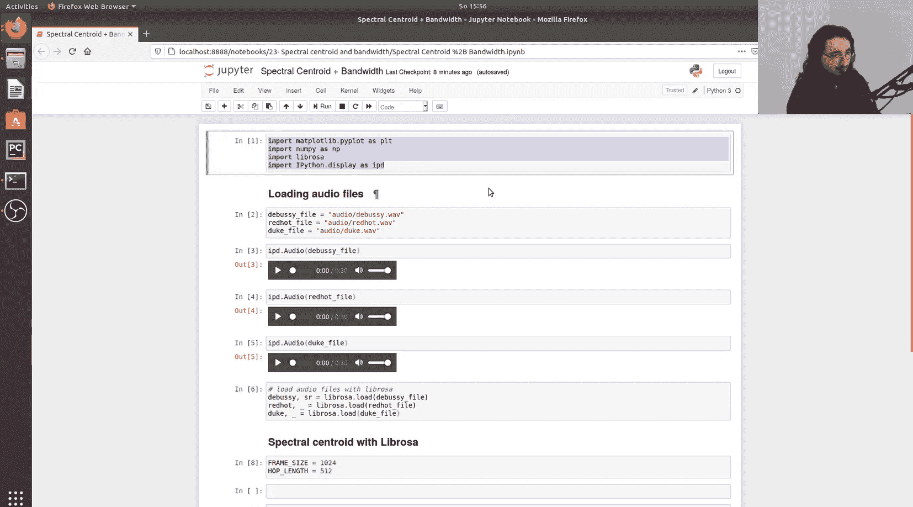

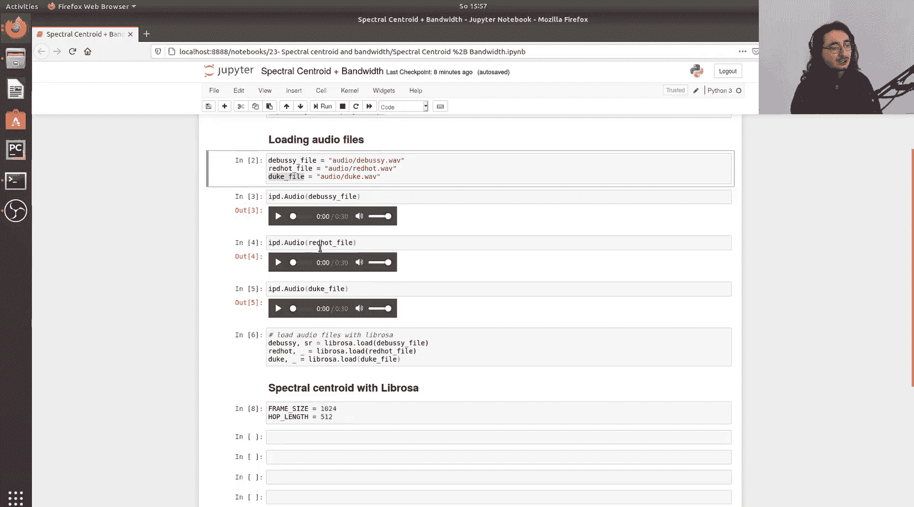

multiple times and if you're interested， you can download the notebook and here for yourself。

 and then what I do here， I load all the audio files with Lib browsersor so that we get both the the signal as a nup array and the sample rate so it's now time to calculate the spectral centroid with Libsor Now the first thing that I want to do is just like set up the frame size and the hop length and we're gonna need these values for extracting the spectral centroid Okay so now let's move on and actually extract the spectral centroid So we'll do a SC this is like a stands for spectral centroid and we'll do thebuC over here and so what we'll do is a Lib browsersor dot feature and then we'll get the spectral centroid feature。

😊。

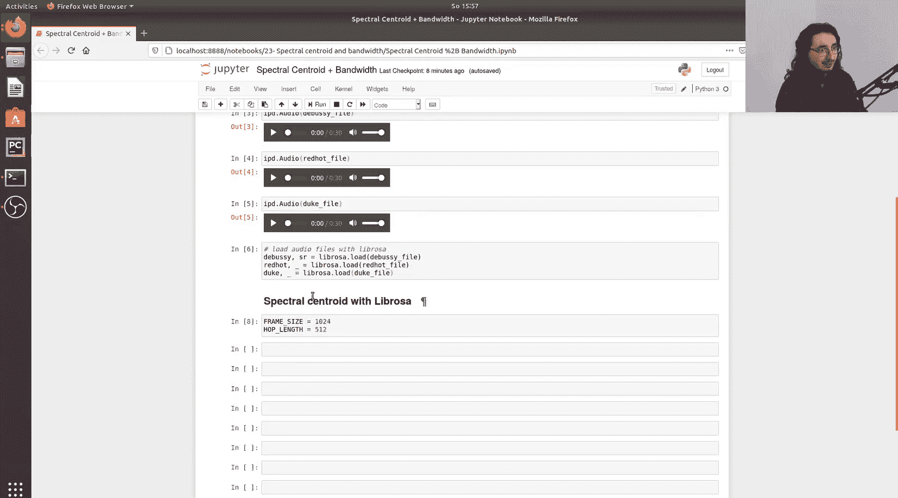

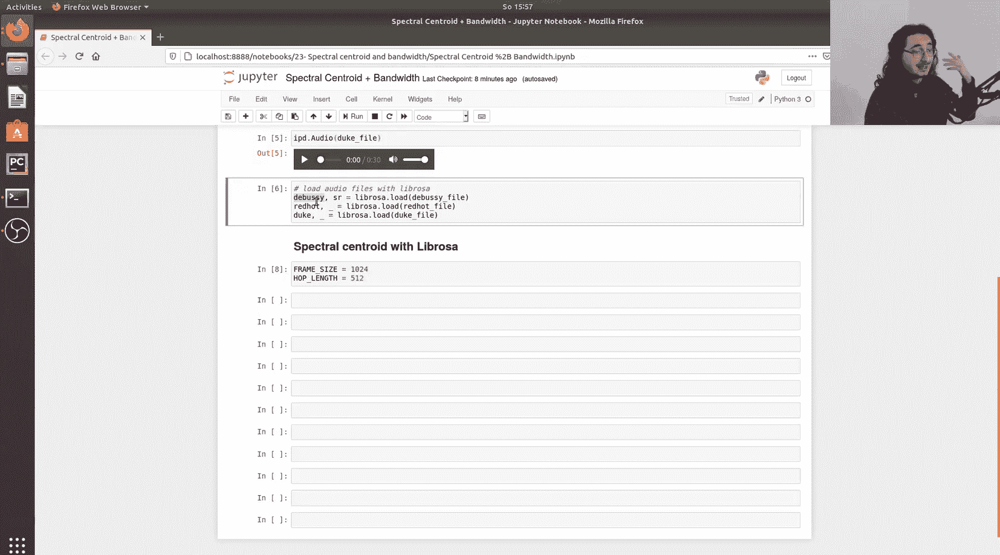

Here we should pass a few arguments， so the first of which is just the signal itself。

 so we'll do a y which stands for signal for in Lib browserser and here we'll pass the thebuC signal so we'll pass thebuC then we want to pass the sample rate and we know that this is equal to SR because we took it here then we need to pass the frame size that's called N dash and underscore FFT。

And so this is gonna be equal to the frame size。 And finally。

 we'll pass in the hop length that's equal to the constant that we just like set over here。 Okay。

 so let me just do the same thing for the three other signals that we have。

 So for the red hott Chili peppers And for for the two other signals so that we have。

 So Red Hot Chili pepper song and j Ellington song。 So this one not。

 I'll just call red hots and let me pass this guy。😊。

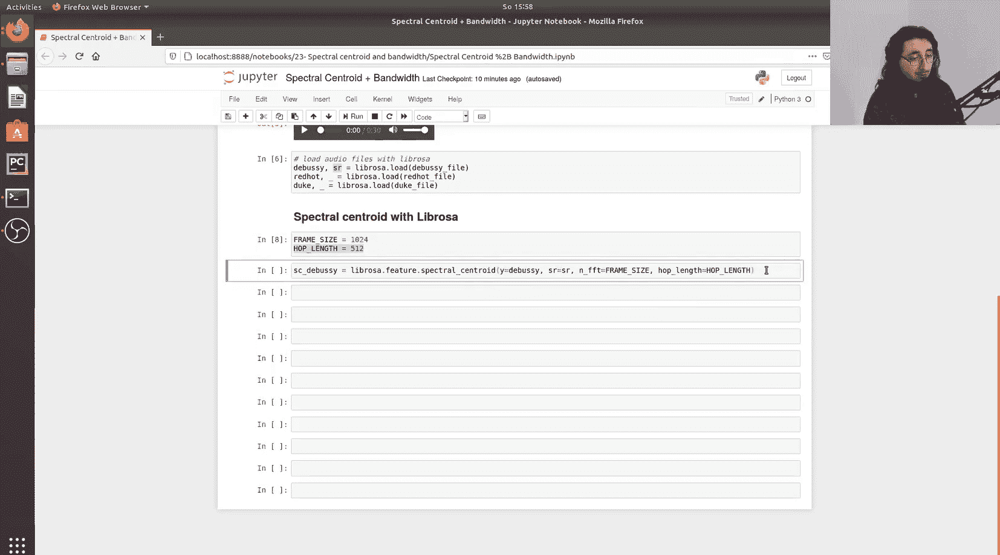

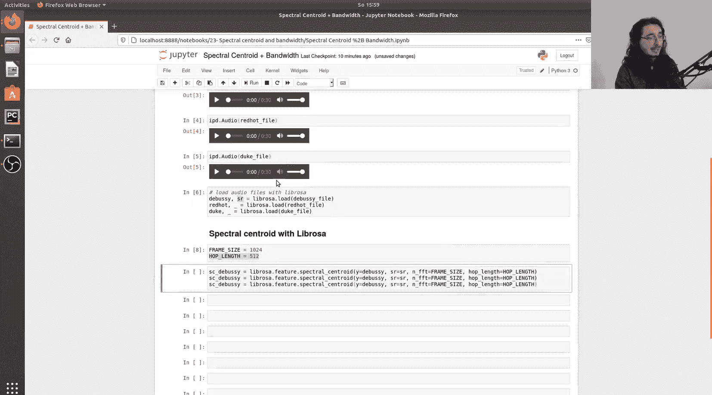

Over here as the signal and then we'll do IC the spectral centroid of duke。

And I'll pass the signal for GLine over here。So if I don't have any mistakes。

 we should just like run this and get the spectral cent。 Yeah， it seems like it worked。

 Let's now calculate the shape of the features that we just got。 so we can do SC the B C dot shape。

 And as you can see here， we have a by dimensional array。 The first dimension is equal to one。

 And the second dimension is equal to 1292。 So the second dimension is equal to the number of frames that we get。

 So it's all like the we are like in the time domain。 And it's all the the frames that we have there。

 Okay， but we are mainly interested like in doses。😊，1292 values of the spectral cent across time。

 So what we should do here is just get item。0 over here。 So let's do that。 And if we rerun this。

 as you can see， obviously here， we are just getting like a one dimensional array。

 which this almost 1300 values。 And that is like the value for each frame。

 the value of spectral centroid for each frame。 The next thing that we want to do is we visualize the spectral centroid across time for the three pieces of music。

 Okay， so let's thought by just creating some markdowns， say。😊。

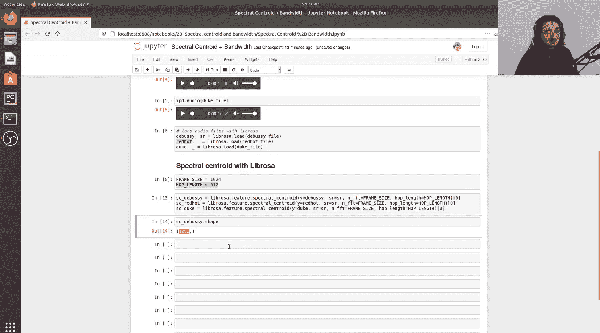

Visualize spectral centroid。 Okay， so here so how do we do this， Well， we'll use map Li。

 So the first thing that we'll do is plot dot figure。

 So we'll create a figure with a given fig size figure size。

 And this is going to be equal to 15 or like， yeah， let's say 25 by 10。

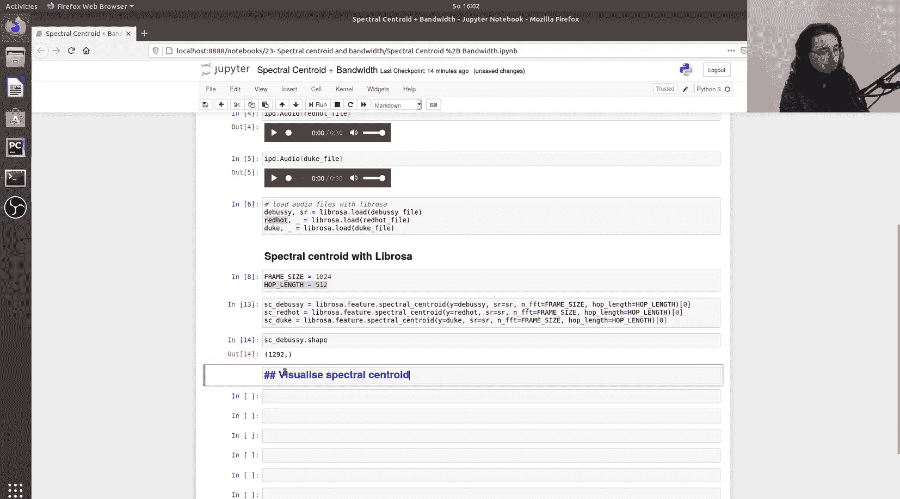

And then we want to move on and here start adding like the curve。

 So we're gonna have like a single figure with three different curves for the three different pieces that we are analyzing。

 Okay， so we'll do a plot dot plot。 and here we need to pass the value for the X axis。

 the y axis and a color。 Okay， so for the x axis， we need to pass time。

 So I haven't still calculated that。 So yeah， I'll do that like once we have like all of this ready。

 for the y axis， obviously what we want to pass is the。😊，The values of the spectral centroid。

 And finally， we want to pass the a color。 And so for the B， we'll use a blue。 Now。

 let's just add the same thing。 but for the otherer。Songs。

 so we'll have like the red hot chili pepper song here。 And this is gonna be a red。 And finally。

 we'll have like the Duke Ellington piece。 And this is gonna be yellow like this。 And finally。

 we'll do a plot dot show。 Now， as I said， we still don't have time。 So we need just like to， to。

 to create that。 And so we'll create that starting from the frame。 start by。😊，Getting the frames。

 And we can easily get， get them by doing the length of， well， the range of。

The length of any of these spectral centroid features。

we'll take the spectral centroid feature for debuC and we can't use any of this because they all have like the original signals all have the same duration。

 so they'll have like the same number of frames。😊，Okay， so and then we can build time here。

 And so we'll do a Lib， the browser dot frames to time。

 And here we should just pass the frames like this。 Okay， let's do this and see if it works。 Well。

 I have an error。

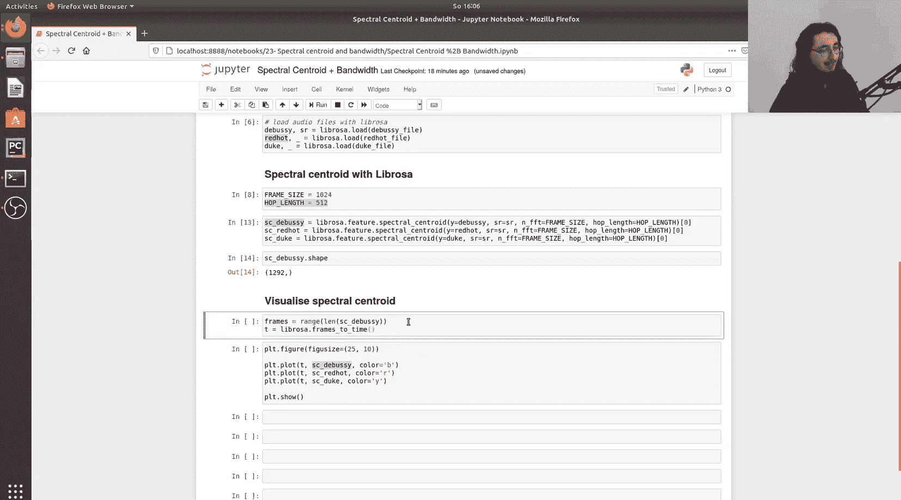

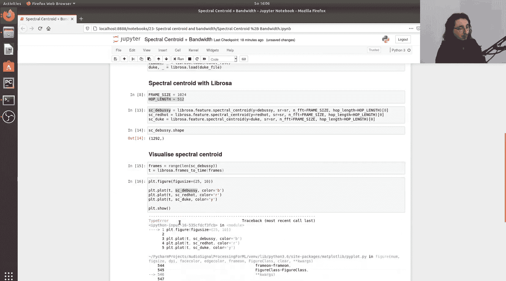

So yeah， this is not figuregu size， but it is fig size， so yeah lets。

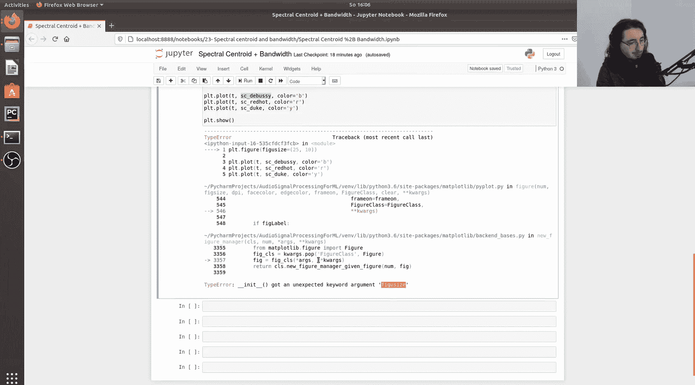

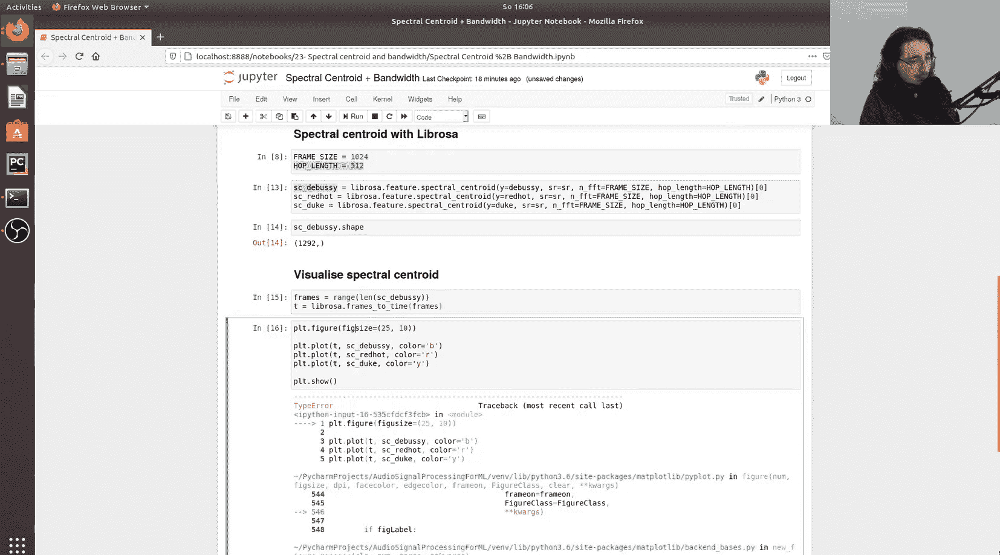

Wth this out， okay， nice。Okay， so here we have the。Yeah。

 a graph with the three curves for the spectral centroid for like Duke Hallington。

 for the Red hot chili peppers as well as for the debuC orchestral piece。

 So on the X axis we have time。 And as you can probably see it's difficult， but it's there。

 we have 30。 So this is like 30 seconds worth of data of like a piece。

 And then here like on the Y axis， we just have the value of the spectral centroid。

 And as you can see， the spectral centroid for the red hot chili peppers is overall like higher across time than the same for thebuC。

 which is like this curve in blue and for the Duke Hallington piece。

 Now this is something that is usually the case。 So usually like which rock。😊，Music you or like EDM。

 popular music。 you tend to have spectral cents that are like a little bit higher than。

The other like pieces that are that tend to use like acoustic instruments like classical music or like jazz。

Okay， so now， of course， like if you don't remember like what the spectral centroid is。

 I highly suggest you to cocheck out like this video， where explained like what spectral centroid is。

 But in a nutshell， we are talking about the center of gravity the frequency that's the main center of gravity for a piece。

 and it's calculated like for each frame。 And so here we have just like a curve that goes through the whole duration of the signal and each a frame we we're getting a value for the spectral centroid。

 Okay， so now we can move on to the spectral bandwidth。 and we can calculate it with Lib browsersa。

 So let me just write some markdown here just to keep things neat。 So we'll say spectral。😊。

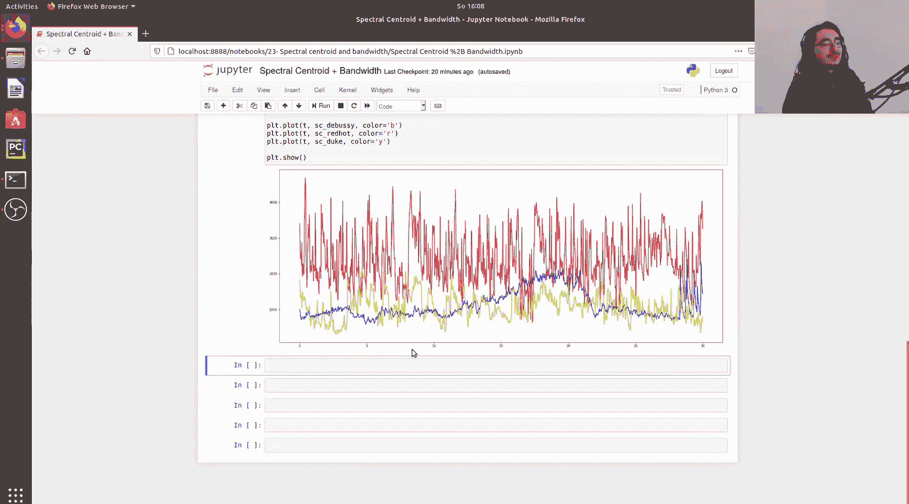

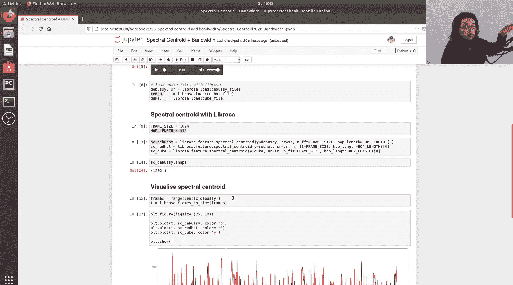

Or yeah， let's say just like calculate band。

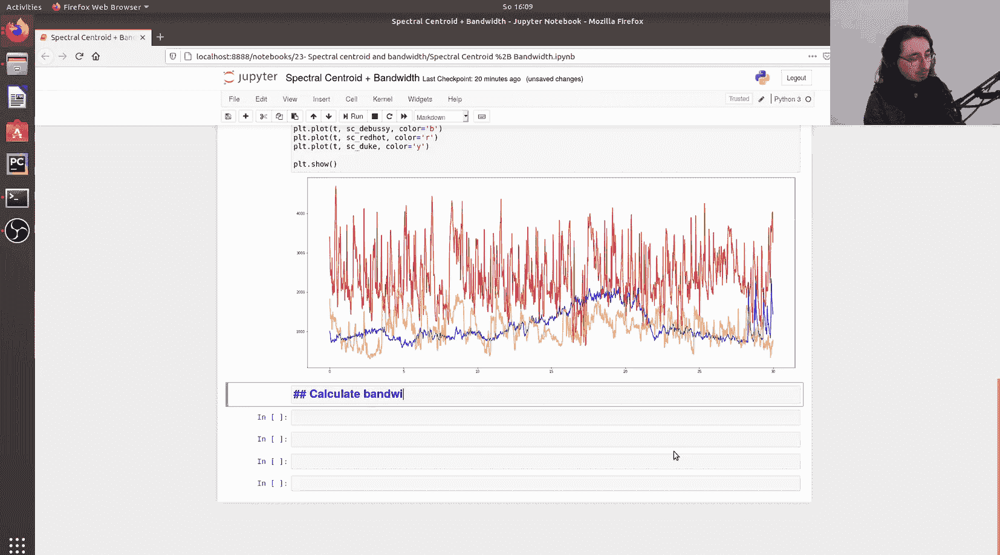

With。Okay， and so here。

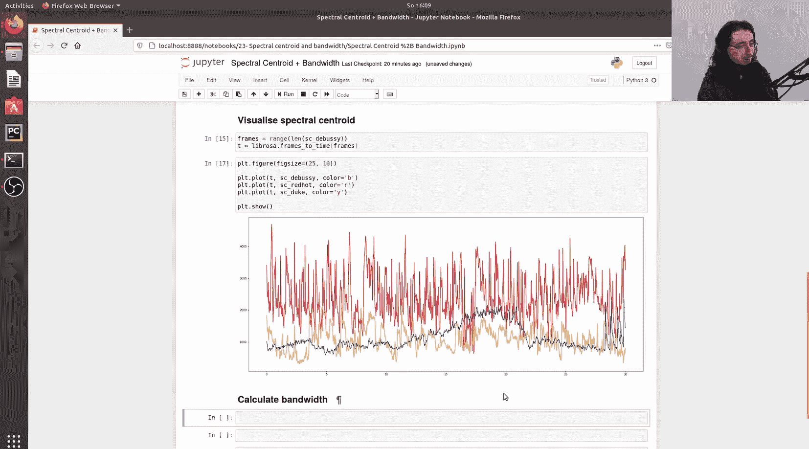

I can easily calculate all of this。 And so I can just like copy the stuff that we use for the spectral centroid。

 And here instead of like calling the spectral centroid function in a Libos a feature。

 I can't call spectral underscore。😊。

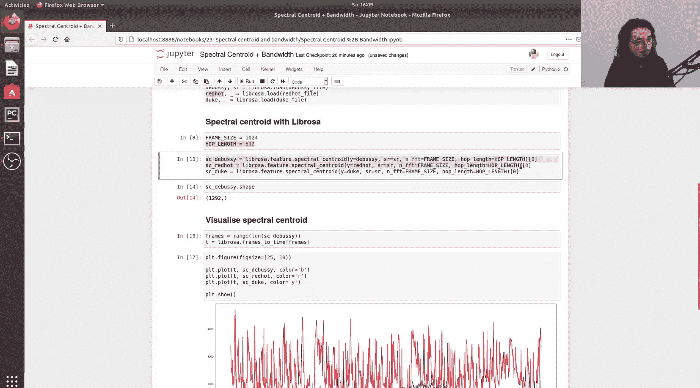

Banddth。That's all I need to do。 And now magically， I'm gonna get the spectral bandwidth。 Obviously。

 I need to change like the the name of this variable because we're not dealing with spectral centroid but。

 which a spectral bandwidth。 And so I can just like put。 yeah， let's put band。

 which stands for a bandwidth and we'll do the same thing for。😊。

The red hot chili peppers signal and for the jke Allllington signal and。

We need to change this thing to bandwidth， same thing down here。

 And the rest remains the same because the arguments to spectral bandwidth are the same as to we use for the spectral cent。

 So the signal itself， the sunplay rate， the frame size and the hop length。 And yeah。

 we need to always like take the the the first item。 So the item 0。 And once we do this。

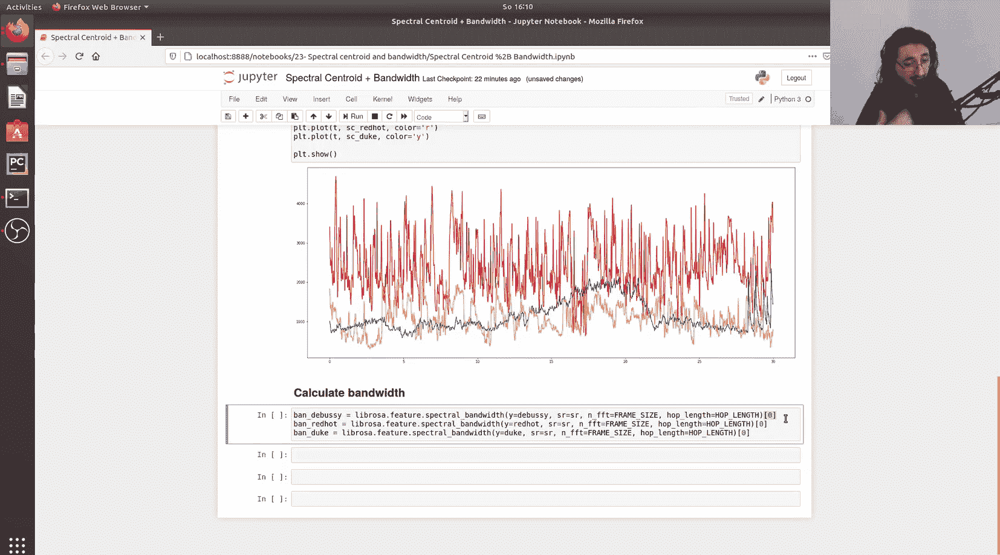

Okay， so here we have like the the spectral bandwidth， like for all of these three signals。

 Now let's take a look at the shape。 and here once again， you should have like yes， this 1292。

 and this is like a one dimensional array once again。

 because we are taking like item the the zero item here， right， And this is like equal。

 So basically what this means is that we have a value for the bandwidth for each frames that we are analyzing。

😊。

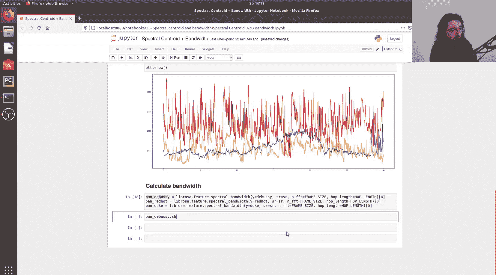

Okay， so now let's move on and just visualize this。 And once again。

 we are gonna basically reuse the kit that we just wrote。 So we'll do visualize。

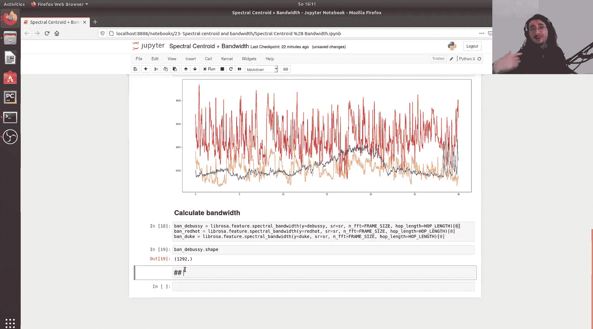

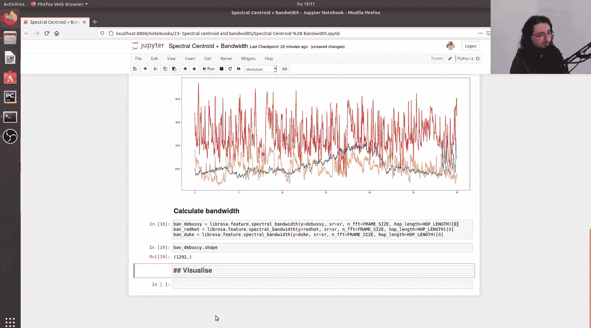

Bned width。Okay， like this。 And then I'm just going get this stuff。

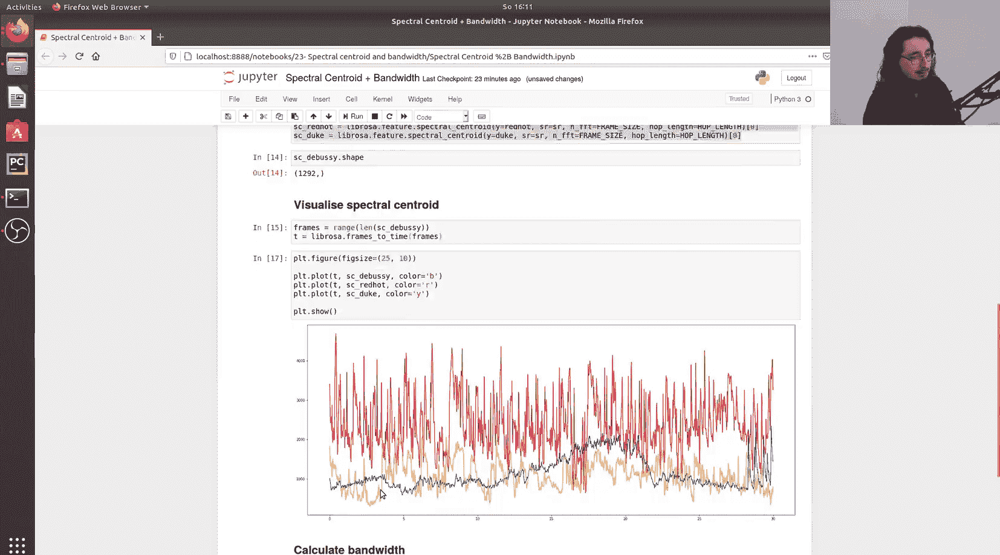

Over here。

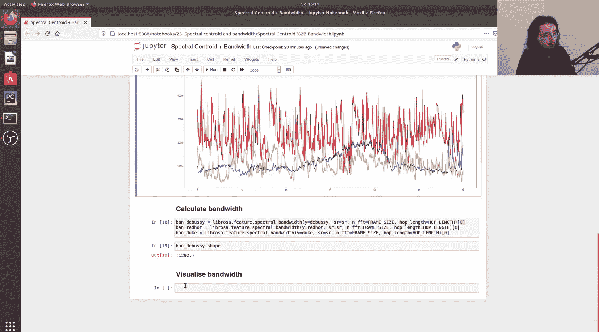

And we can reuse this。 And so I'll use the instead of like the spectral centroid di I'm passing the。

The bandwidth for thebuie， for the Red Ho chili peppers and for Duke Ellington like this。

 And now tea remains the same because and well， I ask you for a swing。

 So just like post the video and just like， think about why a T for the bandwidth is the same as the one that we have for the spectral centroid。

I'll give you a couple of seconds well。😊，The the answer is is super easy。

 and that's because the shape is the same。 if if you take a look at this， right， so the shape。

 so the number of frames that we have like for the bandwidth are the same number of frames that we have like for the spectral centroid。

 so we can use like the same X axis。 So we are using like the same times。😊。

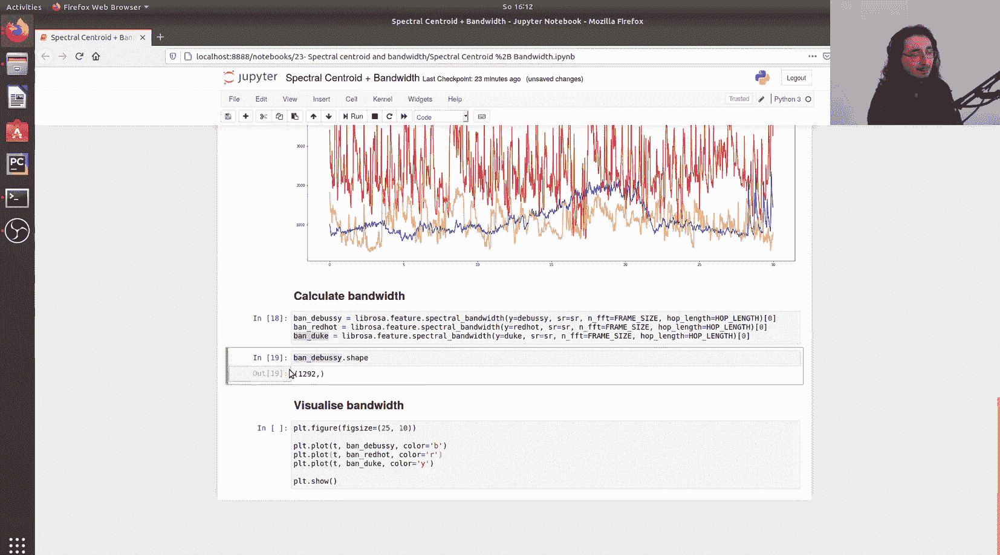

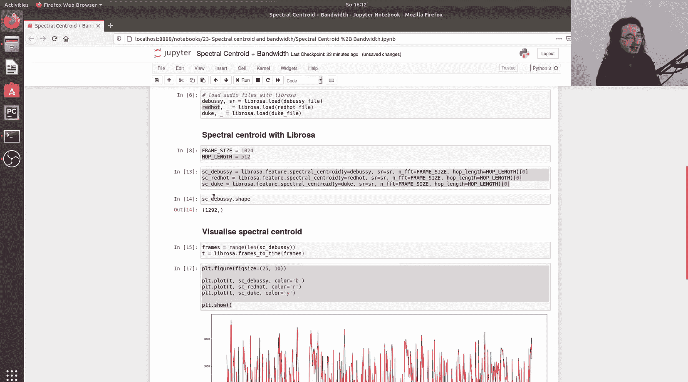

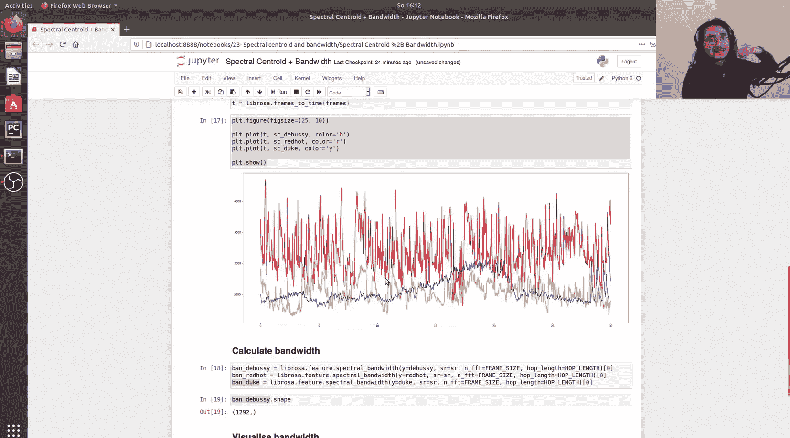

Okay， so now let's just。

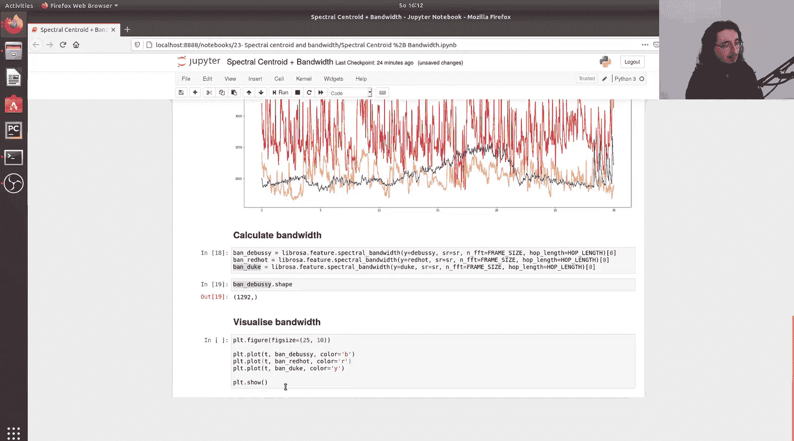

Plot this。 And as you can see， yeah， we have like a nice Yeah。

 the three curves that more or less like resemble like the the ones that we have like for the spectral centroid。

 And that's because like， in a sense， like the bandwidth is derived from the spectral centroid。

 And it gives us basically like the amount of frequencies that are like relevance。

 there are significant around the spectral centroid。

 And the the kind of like comment that we can apply to this plot and to yeah， I would say。

 like to the spectral bandwidth is similar to the one that we had regarding the spectral centroid in a sense。

 like the spectral bandwidth of。😊。

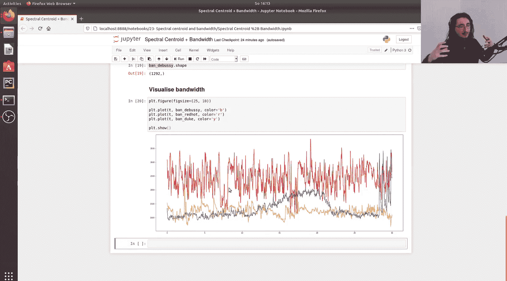

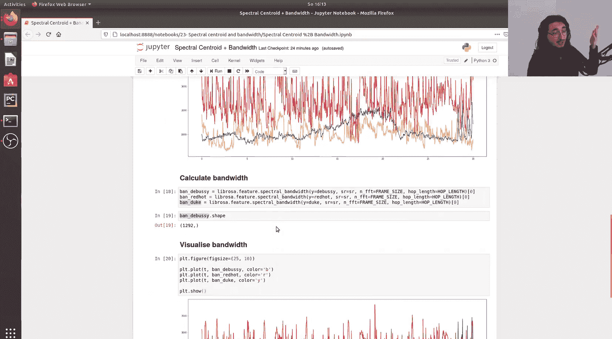

Acoustic pieces like classical music or jazz music tends to be like smaller than the one that we have for。

 yeah， rock music or yeah， music， which like electronic instruments usually or percussions for sure。

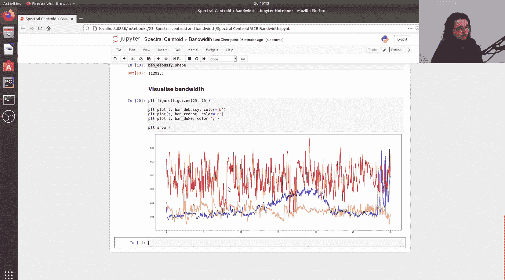

Okay， so yeah， this is it。 So now you're able to calculate the spectral centroid and the bandwidth using Libbrosa。

 And yeah， I think like that's it for like this video。

 and I just wanted to yeah close like this series like with a few with a couple of common。

 So one thing， I think like this was like an amazing ride。 So we went through a lot of things。

 and if you followed along with like my series。 Now， yeah。

 you have like a very strong background in audio processing and audio features for machine learning。

 So you now know about different of like a time domain features， frequency domain features。

 you should have a very good understanding of the Fourier transform and great understanding about MFCCCs。

 mouse spectrograms， spectrograms， log spectrograms。

 And so these are all ingredients that are will be necessary。😊。

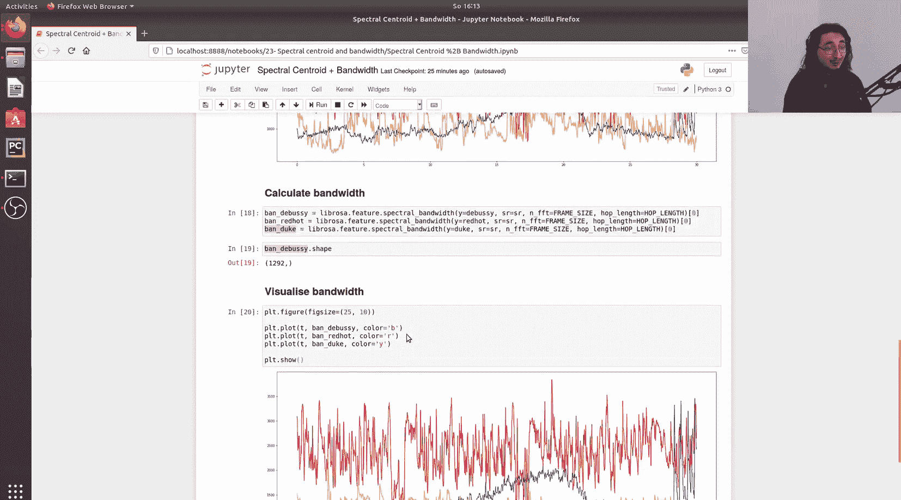

For your activity as an AI audio or AI music engineer or researcher so yeah congratulate like yourself because you did a lot of stuff if you followed so far and then a final like personal lunch like it was very happy with all the feedback that I got the questions that you guys like asked throughout the series it was like amazing also like the feedback that I got like on the sound of AI channel by the way if you want to sign up to that community you have the signup link in the description box below so yeah I hope like I can continue like produce I will continue to produce like content like this and get like feedback positive feedback from you and yeah I think like that's all for today if you enjoyed the video the series and you haven't like subscribe yet to the sign of AI channel please consider doing so and if you like the video just hit the like button。

😊。

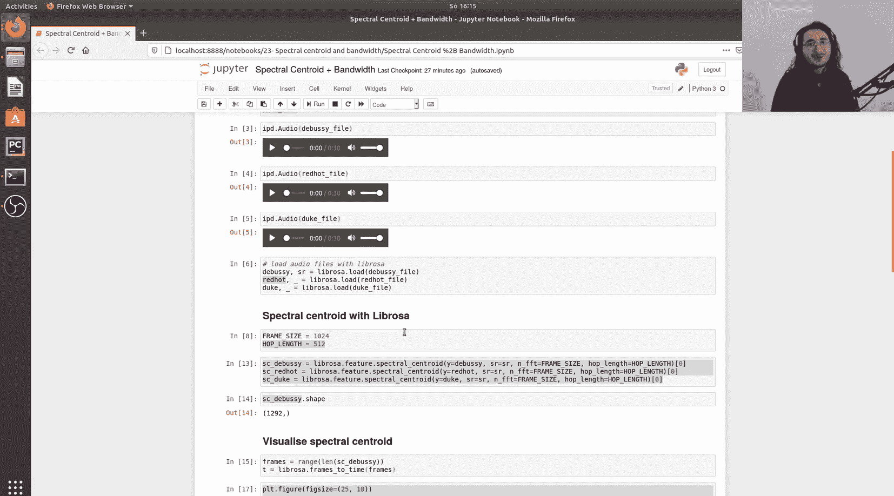

And I guess I'll see you in the next series， cheers。

