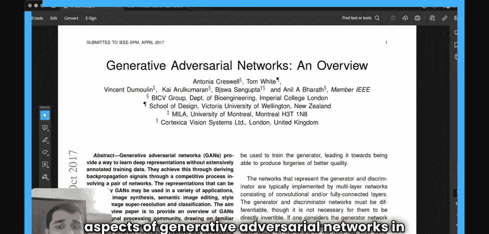
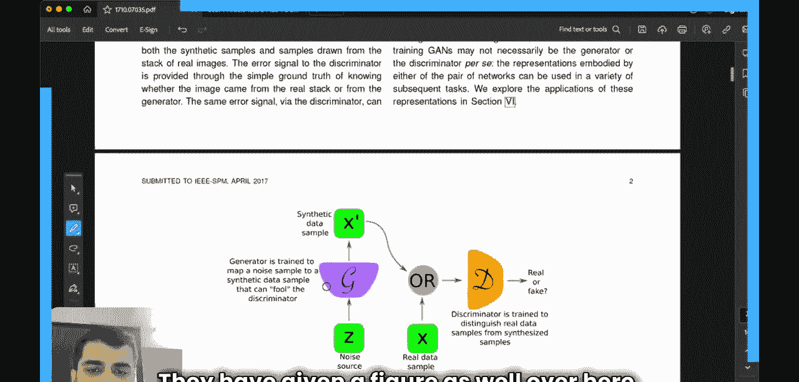
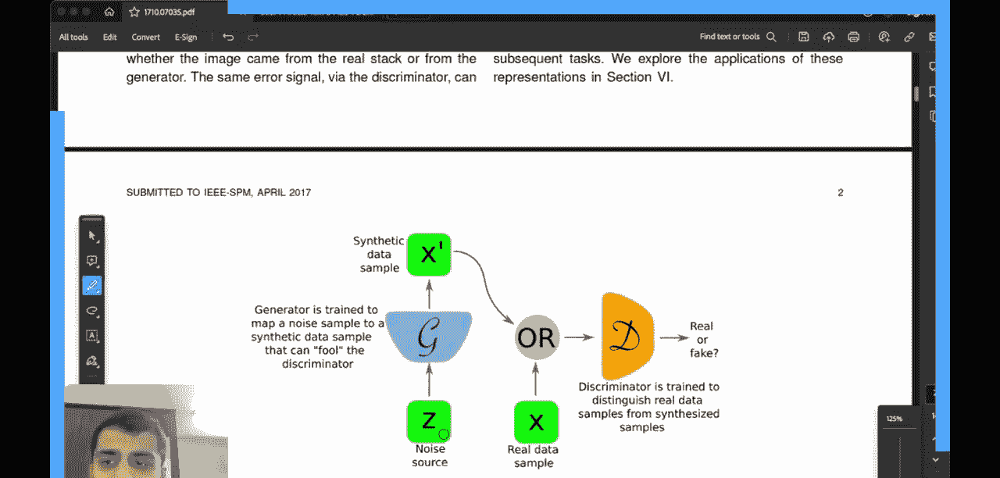
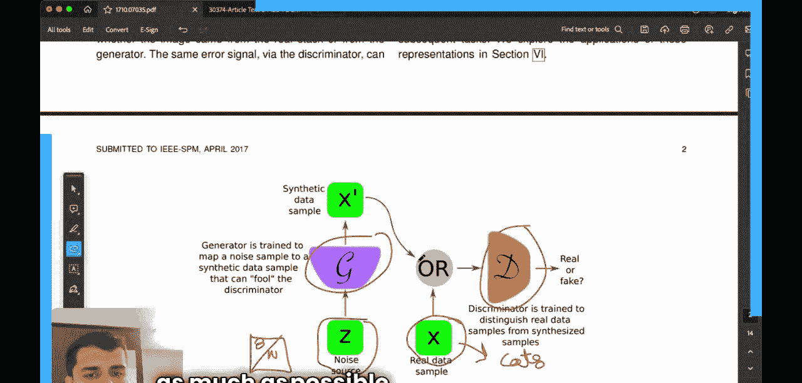

# Vizuara【中英⚡AI研究员训练营｜AI Researcher Bootcamp】 p01 P1 AI Researcher Bootcamp Session 2： Generative Adversarial Networks [BV1qi4VzJEPd_p1]

Hello， everyone。🤧嗯。Welcome to the second session。Of the AI researcher bootcam。In the first session。

 we looked at this particular paper。And。While reading the background。

 I was pretty much fascinated by this。T our GNs。Now， I'm going to assume that I do not have。

Any background of GNs before and we are going to try to understand。What do they exactly mean？

So I went to Google Scholar。And I tried to search for papers。

Related to GNs and I found this really amazing paper which came out in 2017。It has more than 3。

000 citations。And it provides an overview of generative adversarial networks。

So we are going to divide this session into two parts。

And we are going to start from the complete basics。

So just follow me along and as I go and read the paper。

We are going to try to understand several aspects of。Generative a networks in detail。

So let's let's dive right in。So first of all， let us try to understand what the paper is essentially trying to talk about。

Okay， so。The abstract。Says that this paper is going to be an overview。Of a。

Geneerrative adversarial networks， it looks like a way to learn。

Deep representations without extensively annotated training data。Okay， this is。

A little bit unclear at the moment， which is fine since we are reading the abstract。

The aim of this paper is to provide an overview of GNs for the signal processing community and drawing。

On familiar analogies and concepts wherever possible。So when I start reading this abstract。

One thing I have in mind is that。GANs come in the category of generative VI。Which means that we are。

Looking at a technique， which is。Let's say going to look at a series of images。And then。

Try to produce something unique which is not necessarily present in the existing images。

So this is the preliminary background which I have before I'm diving deep into the paper。

The abstract has given me a rough idea that GNs are a way to learn deep representations and。

A note I have made in my mind is that the data is。Not going to be labeled。

So we are going to receive a bunch of unlabeled data， which means that let's say。

You receive a bunch of images of。嗯Or forget。And。Then using GNs possibly will try to。

Draw a figure which represents a cat， but which is not there in the existing data。

This is my understanding right now， it will obviously evolve as we go and read the paper in detail。

I have also made a note of the department in which this paper has come out。

Department of Bioengineering， Imperial College of London， it seems to be a collaboration between。

Three different universities， okay interesting and also this looks like a name of an industry called Tika vision systems。

O。Okay， so let let's try to read through the introduction to understand。

More about generative adversarial networks。Okay， so this technique was first proposed in 2014。

And the interesting thing about this particular technique is that。We are going to be training up。

Pair of networks。In competition with each other。So imagine there is going to be one neural network。

Then there is going to be a second neural network。And I'm assuming that some parameters。

Are going to be shared between these neural networks and we are training these neural networks simultaneously。

I have made a note in my mind that objective functions for these neural networks might be different。

Currently I have no idea why do we need two different networks， let's let's try to dig a bit deeper。

Okay， so they have given a very interesting analogy here。The analogy states that。

You can imagine the two networks as following。One network is an art forger。

And the other network is an art expert。The forger is known as generator G。

Whereas the art expert is known as discriminatory D。Okay， so what is the meaning of generator。

 why is it called forger？What is the meaning of。A discriminator of why is it called an expert。

So the basic understanding I get from this paragraph is that。

The generator will probably try to come up with。Images。Which will be fed to the discriminator。

Which will try to compare this particular image which is generated by generator。And the actual data。

And predict whether it is real。Or whether it is fake。

 it looks a bit confusing at the moment they have given a figure as well over here。

Let let's try to deconstruct this figure all right。呃。

Okay， so I'm going to use a different marking for this。一子。Okay， so this is the generator。Over here。

This is the discriminator over here。嗯。We are going to talk about this in the context of a very specific example。

Again， we are going to look at。A series of data， let's say we are given。A series of images of cats。

Imagine you have given 1 hundred0 images of cats。As the real life data example。So， this x。Over here。

In this case， it's going to represent a series of cats for us。嗯。

How these images are represented we come back to that later。

 but for now just keep in mind that the real data sample is going to be a series of images。

Which are provided in the platform。Okay， no。Interestingly。

 the generator is not fed the real data sample but。It is fed a noise source。In my understanding。

 I'm going to assume a the noise source as a random image。 let's say the noise sources。

An image which is probably， let's say， black in the first half and white in the second half。

It can be anything it looks like a noise source， so it does not have to match the image of the real data。

Let's see my understanding might evolve with time， but currently this is my understanding。Now。

 this noise source is going to be fed to the generator。

And the generator is going to produce a synthetic data sample。

Initial versions of this sample might be completely different from cats as we have provided a noise source。

Now， what's happening is that the discriminator is being fed two things。

One thing it is being fed is the direct data， which is the images of the cats。

And the second thing it is being fed is the synthetic data sample generated by the generator。

The discriminator is going to be trained。To be able to distinguish between the synthetic data sample。

And the real data sample。So initially try to think about it。 initially， the discriminator would be。

UIt it will find it very easy to understand that the synthetic data sample will obviously be fake because we are providing with a noise source。

However， as we train the algorithm， as we iteratively update the weights of the generator function。

And the discrimination function。We are going to reach a stage where。

The discriminator is going to be confused。Whether this data is a fake data。Or whether the data。

Is there real data， so my understanding at the moment is that the objective is to be able to confuse the discriminator as much as possible。

And to provide。