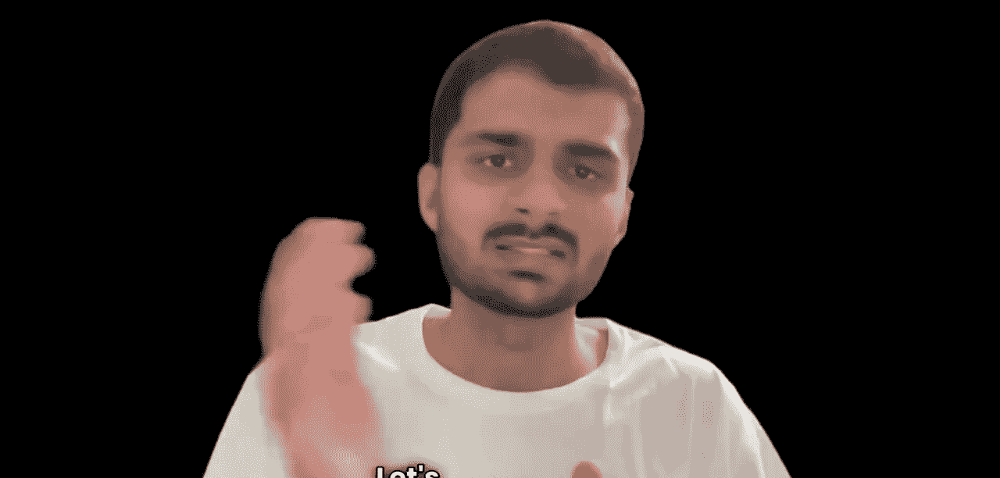
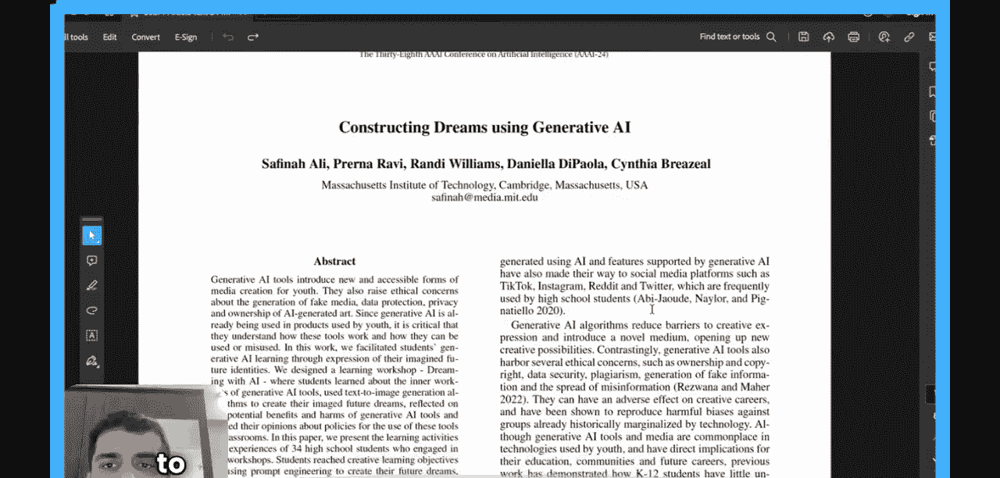

# Vizuara【中英⚡AI研究员训练营｜AI Researcher Bootcamp】 p02 P2 AI Research Bootcamp Session 1： Reading our first AI paper [BV1qi4VzJEPd_p2]

Hello everyone， my name is Ra Duneker and I welcome all of you to this AI Researcher bootot camp。

In this series， I'll be taking you through。What it is to read research papers。

 how to start reading research papers。And how to identify gaps in the literature。And finally。

 even try to publish your own research papers in the field of AI。

I'll be assuming very little or up to no background in the field of AI and I'll be reading research papers as a beginner。

The objective of this course would be to help you understand how to read research papers。

 how to summarize the key findings， how to identify gaps in the literature。

 and then finally how to start writing your own research papers。So。😊。

I'm starting this journey along with you， and I'll be reading several research papers as we go along。

 Every single video will be focused on reading one research paper。

 You will get to understand how a researcher reads the paper。

 So it will be extremely valuable for you。 And I welcome all of you in this journey。

 Let's dive right in。

The paper that I'll be reading today is called constructstructing Dream using Generative A。

It is almost a 7 to 8 pages paper， and。I was turned to the paper because of its title。

 so I really want to understand what it means。To be able to construct dreams using generative V。

So first， let's try to get a gist of what we are trying to learn as a part of this paper by reading the abstract。

So呃。In this paper， what the authors have done is that。They have exposed 34 high school students。

To a bunch of generative AI applications。And。They have asked them to create their imagined future dreams。

While also trying to understand the potential benefits and the harmps of generative VI tools in the process。

So as I was reading this， I was trying to imagine the different generative V apps that I've used。

Chad GPT being the most common， followed by mid journey。诶。

The thing that hooks me onto this paper is that。How can a student use these tools？

To create the imagined future dreams。And then， also， understand。

About the potential benefits and the harmps。Of the generative VI tools。So looks quite fascinating。

 especially in the current times， we know that。Generative VI is probably going to play some role in the classrooms of the world。

As we go ahead， but let's try to explore a bit deeper into what are the different aspects。

Which might be affected。So we start with the introduction。

And the first paragraph of the introduction really。Trice to。Teach us about what is the meaning。

Of generative artificial intelligence。So the difference from traditional classification type of problems。

When it comes to generative V is that。What you are doing here is that you are training the algorithm based on。

An existing set of text and images。And the output that you are getting is not in terms of probability。

 but。It's a completely new text or a new image。Which the algorithm is trying to generate that is the meaning of generative artificial intelligence and we have。

Already seen that there are apps which are coming out to create a bunch of text， images， videos。

 3D models， etc。The application to protein folding was quite interesting。

So I have just made a note in my mind regarding this。

Open AS chat GT came around December 22 and it am 100 million users in a quite short span of flight。

Quite interesting。Okay， so what about the next paragraph， let's move on to the next paragraph。

Here they are talking about。The advantages of generative VI were the barriers to creative expressions。

Are significantly reduced we have already seen this with the usage of chat GT it can be used for a wide range of creative purposes。

At the same time， they can also be used for some negative purposes and the way they have。

Writ it down is quite interesting， ethical concerns such as ownership and copyright。

Data security plagiarism， generation of fake information and the spread of misinformation。Here the。

The topic of copyright interests me a lot because。You never know whenever the AI is generating any new thing。

Which existing work is it using， it's not cited recently in an interview we also saw that。

The CTtoO of。Open EI was not aware what was the source？Of the data for its new application so。

So I've made a note of this as well that these applications。Have ethical concerns。

 including copyright in particular。They can have effect on creative careers， yes。

 they can reduce the number of jobs that are available out there in the market。Of course。

 that also depends on the number of new jobs that it will create eventually in the future。

 so it still remains。A matter to be debated about。呃ok。Now in this paragraph。

 they also relate this to how K12 students， which means students who are studying below their 12 standard。

They have little understanding of how these tools work。

And there have been few efforts designing curricula and learning materials for。These students。

So this is quite interesting I have made a note in my mind that this is something which is。呃。

Like a gap in the existing field out there， not a lot of school students are are familiar with the different。

Gen VI tools and。There is not a curriculum which is currently developed， which can actually。

Introduce students to the proper use of generative way algorithms at a young age。Now。

 the next paragraph is particularly fascinating for me because。

There are a number of things which the authors mention here firstly。

I would like you to focus on these three points。They talk about。

When a student is asked to create something， let's say create a future version of the student。

It allows them to express their self identity。And it allows them to share something which otherwise might not have been possible using only words。

So let's say I dream of becoming a scientist in the future。

And I am not able to express it to my friends， to my parents， but using these applications。

 I can actually create an image where I can show a rocket， I can show myself and I can use。😊。

All the different prompts which can make the figure。

Very closely representing what I really want to do in the future。The third point is of course。

 interesting because。It raises the question of the societal and ethical implications of generative algorithms。

They have used dream studio by stability AI， so this is interesting I have not used this particular。

APart platform before。Now。The last thing that they focus on in the introduction is the creative the technical and the ethical learning objectives。

 the creative learning objectives would be to teach the students how to write appropriate prompts in the generative VI tools。

The technical objectives would be。Understanding the abilities and the limitations in the current algorithms。

The point number four is really interesting。Tries to。Fcus on。

How the patterns in the generated images are really a reflection of the patterns in the underlying data。

So for example， let's say。If lets say people of specific color are given a lot of importance。

In the training data， that becomes the pattern which is reflected in the output。

 so whichever image that you want to generate will be biased towards。People who are white。

 or let's say， people who are fair looking or。Whichever。A pattern was used in the training data。

 why it is just just as an example。Then ethical learning objectives。

Potential harms we have already touched upon algorithmic bias copy。

 infringement creation of fake media。Again， algorithmic bias is something which is super interesting because。

