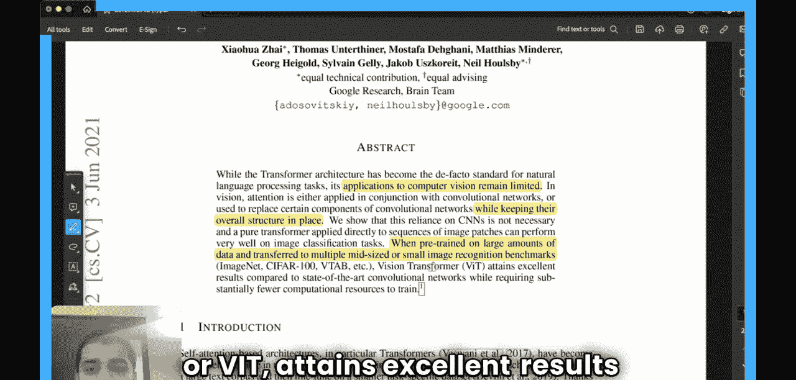

# Vizuara【中英⚡AI研究员训练营｜AI Researcher Bootcamp】 p03 P3 AI Researcher Bootcamp Session 6： Vision Transformer Basics [BV1qi4VzJEPd_p3]

Hello， everyone。Today we are going to look at this paper。

 which is titled an image is worth 16 cross 16 words。Transformers for image recognition at scale。

As the title suggests， this paper talks about using transformers for image recognition。

And it was published at a conference called ICLR in 2021， so it came around three years back。呃。

The particular architecture that is mentioned here is also known as Vi transformers。

And today we are going to look at the architecture behind vision transformers。

 how do they exactly work and why are they so powerful so well go through the paper step by step we'll start with the abstract and then move into and then move into more details。

Again， the research has been conducted by the brain team at Google Research。

So let's make a note of this as well。So let's start with the abstract。

 the abstract says that while the transformer architecture has been。

The de facto standard for natural language processing tasks。

 its applications to computer vision remain limited。

In vision attention is either applied in conjunction with convolutional networks or used to replace certain components of convolution networks while keeping their overall structure in place。

So basically what had been happening till the year 2021 was that。People for image recognition tasks。

Were still using CNN。And they are applying attention mechanisms on top of it。

So imagine a scenario where you are feeding an image into a network。

And you have multiple convolution layers， you learn some representations for the image after that you apply attention mechanisms and then you again convert that into an output layer。

This was something where you could see that okay transformer architecture is being used。

 but the CNN architecture is still being preserved。

 people had not completely eliminated the CNN architecture。

So interesting because the transfer of paper came out in 2017 and people were。

Still trying to introduce that to image recognition tasks。

 but not a complete 100% change from CNN networks yet。

When pretrained on large amounts of data and transferred to multiple bit size or small recognition benchmarks。

Vision Transer or VIT attains excellent results。

Compared to the state of that convolutional networks， okay。

 so let us write down some of the key things that we have learned over here。A bill 221。Cieemmens。

Would。Still used for image。A recognition tasks。呃。For large data set。VIps achieve。

Better performance。Okay， let's go ahead。Yeah。Self attention based architectures in particular transformers。

Have become the model of choice in natural language processing。

The dominant approach is to pretrain on a large text corpus and then fine tune on a smaller task specific data set。

Thanks to Transers， computational efficiency and scalability。

It has become possible to train models of unprecedented size with over。Hundred billion parameters。

However， in computer vision。CNN architecture still remain。Very much dominant。呃。

Inspired by NLP successes， multiple works have tried to incorporate CNN architecture with self attention。

But they have not been very successful。诶ok。Inspired by the transformer scaling success in NLP。

 we experiment with applying a standard transformer directly to images。

With fewest possible modifications。To do so， is split an image into patches。

And provide the sequence of linear embeddings of the patches as an input to a transformer。

Image patches are treated the same way as token in an NLP application。

So this is quite interesting when trained on mid sizeized data sets such as image it。

Vision transformers yield modest acuracies of a few percentage points。

Below resonance of comparable size， this might be seemingly discouraging。However。

 for larger data sets they work very， very well and the picture is very different。We will try to see。

Why this happens。Why is that for mid sizeized data sets？Vision transformers do not work。

As well as they work for large size data sets。呃。So the reason has to do with something called inductive biases which are inherent to CNNs。

 we'll be looking at that as really closely。Okay， so first of all， let's try to understand。

The basic task of applying attention mechanism onto an image， right？So。If you， if you remember what。

Attention is， exactly。If you have a set of words， let's say。

If you have a set of words， let's say I I have five words。

What attention exactly does is that it arranges， let's say these five words into a matrix of5 by 5。是。

And。For every single bird。There is a key， there is a value， and there is a query attached。

The size of this matrix is obviously 5 by 5 which is 25。是。

So the number of entries are going to be scaling as n square。

Where n is the number of words in that particular sequence that you are looking at in this example n is equal to 5。

 so the number of。Entries that we are looking at is equal to 25。Now we are looking at an image。Right？

What's going to happen is that instead of words， you have this image。

So let's say we have a 5 by5 image， right， we have a。5 by5 image。And。

What is going to happen in this attention is that。Every single pixel。

He is going to attend to every other pixel in this image， for example， this pixel attends to this。

This pixel also attends to this。This pixel also attends to this。

So how much is this going to scale by can you think about it， how much？

Is the number of calculations that we need to perform？For a self attention mechanism。

 which is applied to an image。Is it going to be 5 to the power2，5 to the power 4 or 5 to the power 8？

是。So呃。You can imagine this entire。Sequence to be， let's say of。

25 entries that is the values of 25 pixels， so the number of operations that are going to be required are 25 square which is equal to 5 to the par 4。

So what we essentially see is that when we are applying self attention mechanisms。For an image。

The number of operations that we need to do are very large， in fact the scale in a quadratic manner。

That is why it becomes intractable to apply the complete transformer architecture directly to an image as it is。

嗯。Maybe that was the reason why four years even after the transformer architecture was developed。

People are not able to successfully apply the architecture for image related tasks because of。

The quadratic nature of。The attention metrics。So what did people。Doke， in that case。

