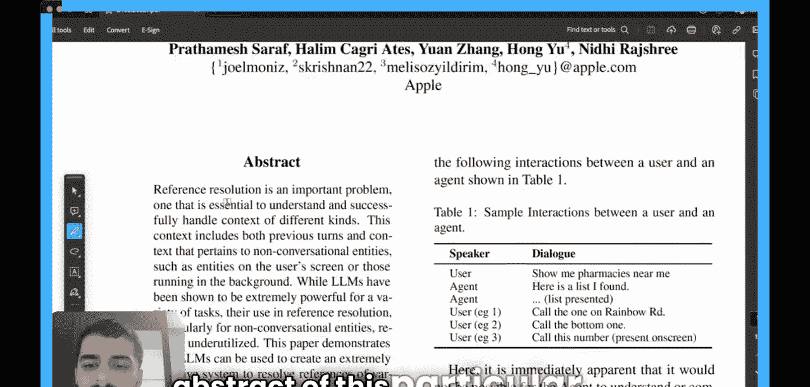
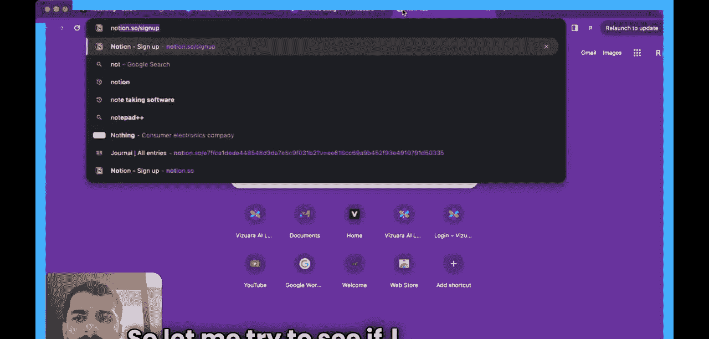
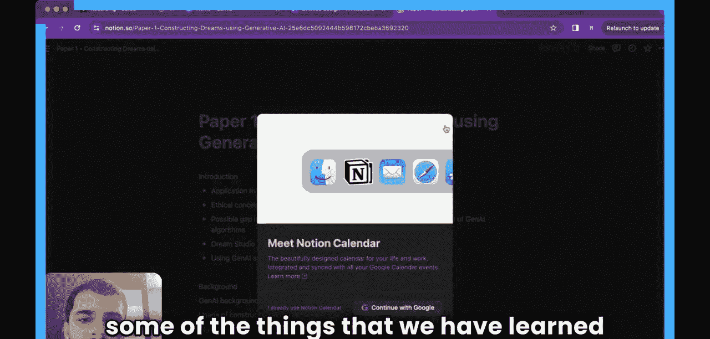
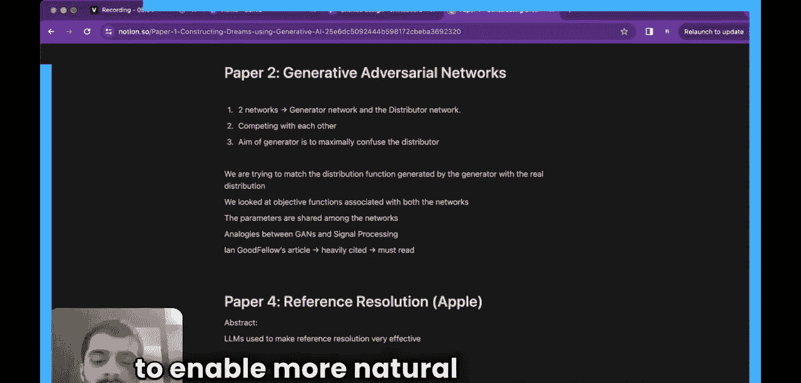
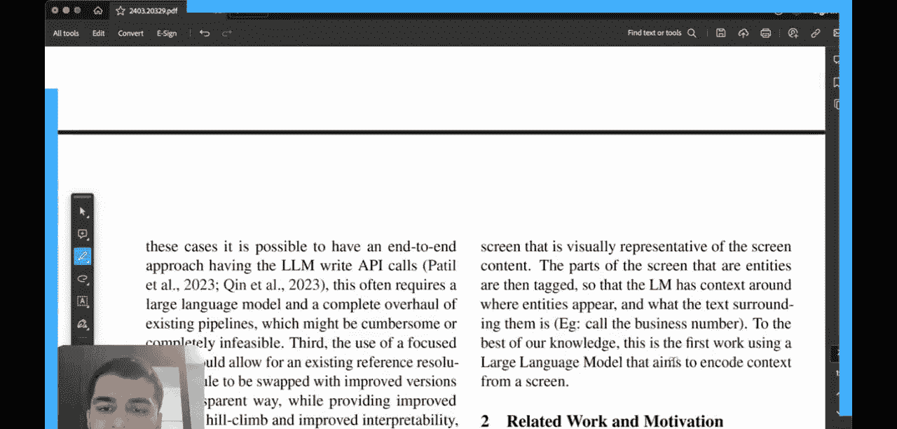
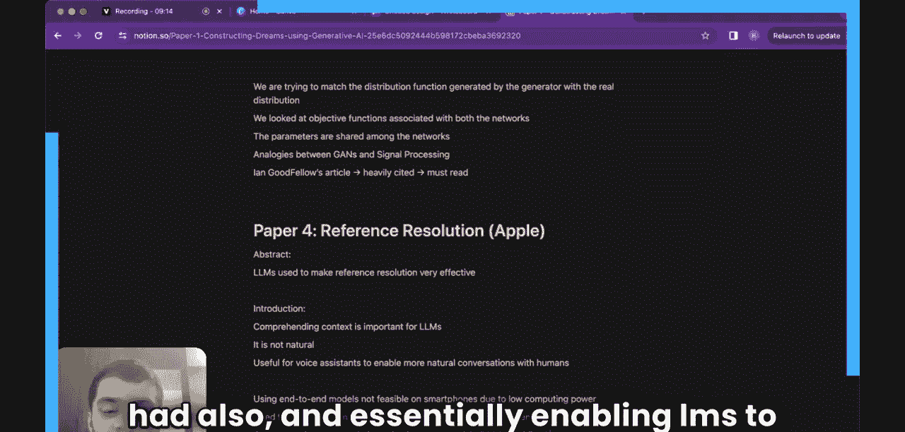
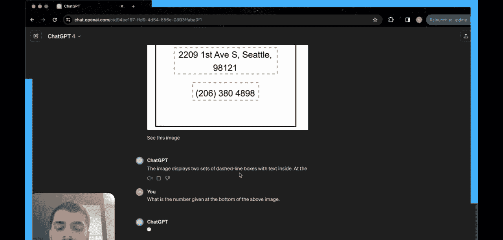

# Vizuara【中英⚡AI研究员训练营｜AI Researcher Bootcamp】 p04 P4 AI Researcher Bootcamp Session 4： Reference Resolution Model (ReALM) by Apple [BV1qi4VzJEPd_p4]

Hello， everyone。Today I'm going to look at this paper which reads。

Reference resolution as language modeling。This paper has come out at Apple。Quite recently， actually。

 29th March， so around one week back。I was curious to understand what Apple is currently doing in the space of large language models because we have seen LLMs being released by open AI and Google where is Apple in this journey this was where I wanted to understand and。

That's why I want to read some of the papers that they have been releasing recently。

So we are going to go through this paper， I do not know what reference resolution is currently。

 but hopefully Ill try to understand this in detail as as we go along。Okay。

 so let's start with the abstract of this particular paper。

So it says that reference resolution is an important problem to understand and successfully handle contexts of different kinds。

The context includes previous terms and contains two non conversational entities。

Such as on the user screen or those running in the background。

So they have written that the file LLMs have been extremely powerful for a variety of tasks。

Their utilization for reference resolution。Remains。

Underutilized and this paper demonstrates how LLM can be used to create an extremely effective system。

To resolve references of various types。So。Let me try to see if I can document so。

The things that we have learned over here。

ok so。We are going to。Read about reference resolution。やぱ。Okay， so within the abstract。

 what we can see is that。LL Ms have been used to make。A reference resolution， Very effective。

This is all I have learned so far from the abstract。

And let's see what exactly is a reference resolution as we move along。Yeah。

So they say that human speech typically contains ambiguous references such as they or that whose meaning is obvious to other humans given the context。

Being able to understand the context， including references like these。

 is essential for a conversation assistant。ok。For instance。

 consider the following interactions so they have given a bunch of examples of what exactly is the meaning of reference resolution。

So let's say the user tells the agent or the AI that show me the pharmacies near me and then the agent gives the user a list of pharmacies and then the user asks questions like example one call the one on Rabow road or call the bottom one or call this number which is present on screen now here we are not explicitly mentioning。

Call this pharmacy or call this pharmacy， etc ce。We are referencing something which is related to that particular pharmacy。

So this is something which is quite obvious for a human， but it's probably not so obvious for NAI。

Or an agent。 So here it's not immediately apparent。

For the agent to understand or complete the user query without the ability to comprehend context。

So comprehending context seems to be one of the。Let's try to summarize this seems to be one of the important task。

Comprehending context is important。Po res。It is not natural。Useful。For voice assistance。To enable。

More natural conversations。

With it be humans。Okay so this is good lets try to look at some of the previous works that have happened in this area。

 so they have say they have said that Tet LLMs have enabled end to end experiences。Now。

 what they say about these end to end experiences is that。Firstly， when a framework runs completely。

On a device on a system such as a smartphone that has a limited computing power due to the low power nature of the system using a single large end to end model is completely unfeasible。

U usinging a single LLM for this task code usually require the use of a very large model with log prompts and through end to end experiences I am guessing this is what Cha GPT also does it's an end to end model。

In which a very large model is embedded within the system。Second。

 consider the case when the model has to integrate with APIs and has to consume information from components upstream。

This often requires。A large language model and a complete overhaul of existing pipelines which might be cumbersome or completely unfeasible。

Third， the use of a focused model would allow for an existing reference resolution model to be。

Swaap to the improved versions。In a transparent way。Okay。

 so essentially what they are saying is that。Using。And to end。Models。Not feasible。On smartphones。

 because typically people are going to use smartphones when they are interacting with their voice assistants。

刘嘟路。Computing power。Need to have。Much smaller， and。Focus models relevant for。Reference resolution。

Yes。Okay， so let's try to see exactly what this means also later as we move along。So in this work。

 they have advocated the use of relatively smaller language models but fine tuned for specifically and explicitly the task of reference resolution。

So that's the advantage of the novelty that this paper is bringing。So， this is。

Kind of the novelty also， which this paper brings about。

There have been some papers along similar lines relying on language modeling alone。

 so it's not a large language model anymore it's an LM which is a language model。

It does exceedingly well on tasks that can be modeled in a sequence to sequence fashion。However。

 the biggest challenge with adopting this technique。

Of a voice assistant lies in resolving references to entities on the screen。

We'll come to what exactly this means， references to entities on screen。Essentially。

 we are trying to get the Lm to C in other words， we are trying to have the language model to have I。

So this is something which this paper talks about and what it talks about is。On screen。Elements。

Good resolution。Using。Language models。Or as。I have went through some of the paper I had also had essentially enabling。

Ems to see。

I just want to give you an example of what exactly do they mean by this and this is a screenshot I have taken from the paper itself。

 so imagine this is the on screen entity。Which is there on the screen of the user now。

Ill be asking a question which is not a direct question。

 but it references to something so for example。嗯。What is。The number。Given at the bottom。

Of the above image。

