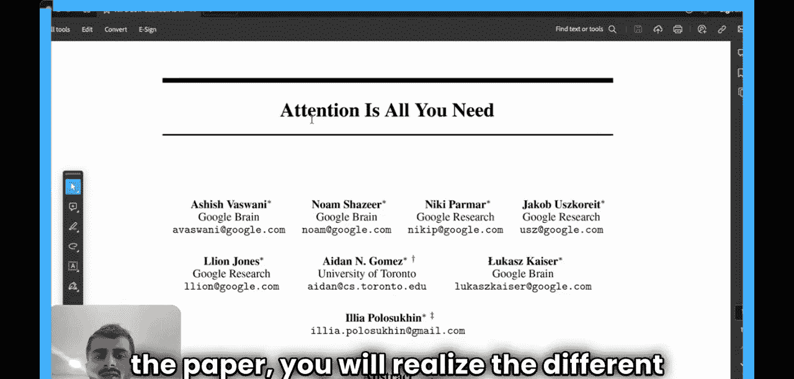
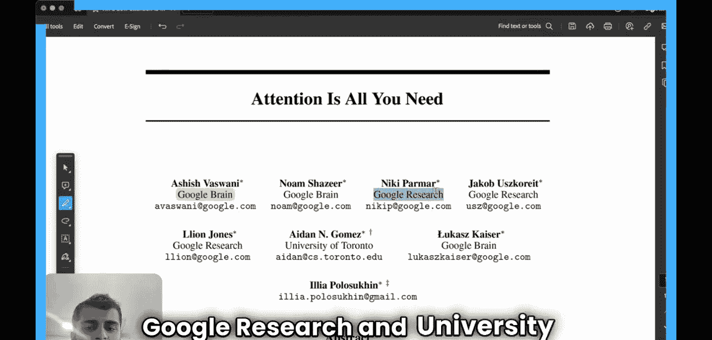
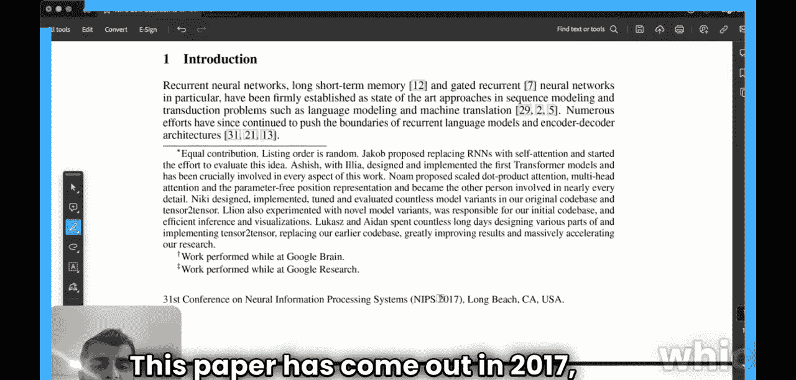
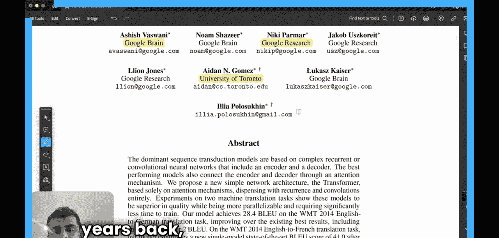
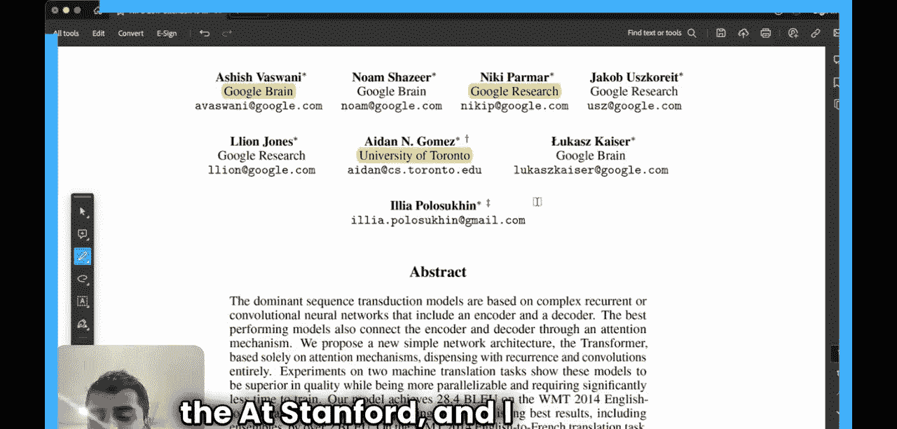
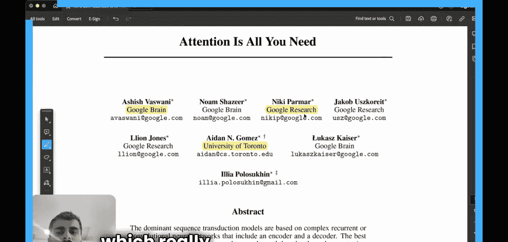
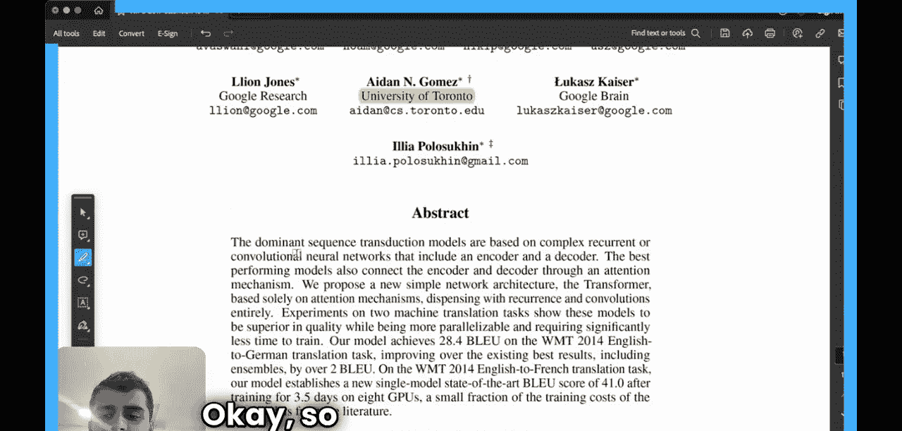

# Vizuara【中英⚡AI研究员训练营｜AI Researcher Bootcamp】 p05 P5 AI Researcher Bootcamp Session 5： What are Transformers？： The paper that star [BV1qi4VzJEPd_p5]

Hello， everyone。Today we are going to look at this paper which is called as attention is all you need。

This is a paper which introduced the concept of transformers to the world。And it is an extremely。

ASeminnal paper in the field of artificial intelligence。After this paper。

 the entire field of generative intelligence really mustroomland。It gave the field a push。

The result of which we are seeing right now in terms of applications like Cha GPT。

It looks like a very unassuming paper at the start， but。As we dive deep into the paper。

 you'll realize。There are different intricacies and it's the simplicity of this paper which。

Kind of makes it beautiful。One thing which I realized after reading this paper is that。呃。

The particular model that is being or the architecture， which is proposed here。

Is still followed even now with very little changes which。呃。

Definitely says that the work here is very robust。It also means that in in terms of the way we are trying to。

Understand or the way we are trying to predict。呃， language。Is。

Getting more similar to how our brain does it。In a way we are trying to we got one step closer to how our brain interprets things or translates languages。

 etc。So this is how I am doing this paper it brought us one step closer to。

Imitating the architecture of our brain。And then。Yeah。

 so this is really a seminal paper and it really changed。

The field and gave a lot of impetus so let's let's try to understand this paper in detail we are going to walk through the paper。

And then we are going to understand some of the key things outlined in the paper。

Biochematics and diagrams。I'm not going to assume any prior information we are going to read everything from scratch and then we are going to understand。

One thing we can note that the paper， the authors have been working at Google Brain。

 Google Research and University of Toronto。

This paper has come out in 2017， which means seven years back。

呃。

I was was going through one of。The lectures at Stanford。And I realized that attention。

This is not the first paper which really talks about attention， it came back in 2014。

呃。The professor who at that time。Published that paper they did not name it as attention， however。

 they introduced this idea。That paper did not caught on as well as this paper did。

But that that person essentially was inspired from。

His English teacher one day he was sitting at home and trying to think about how he learned English and。

We tried to adopt that approach anyways we will start by going through our paper and lets let's look at the different details。

Okay， so we'll just start with the introduction， we won't go through the abstract for this paper。

Recurrent neural networks， long short term memory and gated recurrent neural networks have been。

Forly established as state of the art approaches。In sequence modeling and in instruction problems such as language modeling and machine translation。

I think this is crucial for us to go further。Into this paper， we need to understand what exactly is。

Recurrent neural networks and how do they work。So let's， let's try to。

Understand it somewhat in detail。Okay， so let's say you don't know anything about neural networks。

 right？Our recurrent neural networks， we are going to。Look at。For example， let's say。

I'm writing this sentence。哎。I live in India。My。Mother tongue is。

And we want our AI to essentially complete this this sentence， right？So呃。

Let's look at how do we begin to do that？呃。One thing that I want to emphasize upon is that what we are essentially doing here is。

Okay， so let's look at first what what are neural networks to just understand some basics。Okay， so。

Let's say we have a variable x。We have x here。And。This variable is being fed。

Into neural network architecture。我晓。And as an output， we are getting the variable wire。Right。

 so this is a simple feed forward neural network where x is the input。

There are some processes that happen within this block。

Which is a transformation operation and you get why。Now。

So this is a function which transforms x to y。Now， what you can do is that this this particular sentence at the top it has。

1，2， three，4，5，6，7，8， it has eight words。You can represent。Each of this word。呃。

By an embedding which is essentially a vector， so every single word can be represented as a vector and what you can do is you can pass that embedding。

As the input here。And you can essentially。Get an output over here。Now。

 the kind of problem that we are looking at though is very different from this。

Here in this in this approach， what we can probably have is we can。We have eight different words。

You will need a。8 networks。Like this， which are arranged sequentially。

And then every single network would take the input as the word and then give a corresponding output at the end。

No呃。When you are trying to look at a complete sentence， though， you have interconnections。

Between different words， which are not captured in this simple model。So what people did was that。

What they did essentially was， let's say this x is an input which。

Goes in the network and then gives an output y。The network started computing another variable。

 which is called as the hidden state。So let's say the first hidden state is at zero。

This hidden state is passed on to the next network。So now the next network has two inputs。

 it has x and it has h0。It will give another hidden state at1。

Which is then passed to the next network and it gives another output。So basically。

 what you have is the function。F。It's taking the input。At time P。And the hidden state。At time。T-1。

As the input。Right， so this is Y of T。Or this is H of three actually。

H of T equal to this and then this hidden state is then fed to the next time step t plus1。

These are called recurrent neural networks。Now， what happens in the recurrent neural networks is that if I am predicting something which is here。

I have the information of the entire C。