# Vizuara【中英⚡AI研究员训练营｜AI Researcher Bootcamp】 p06 P6 AI Researcher Bootcamp Session 3：  Origin of CNNs [BV1qi4VzJEPd_p6]

Hello everyone， and welcome to the third session of our AI Researcher bootot camp。In this session。

 I have chosen the topic of convolutional neural networks。

And I wanted to basically read one of the first。Seminnal papers that came out in this field。

And I wanted to understand how the field has evolved since。

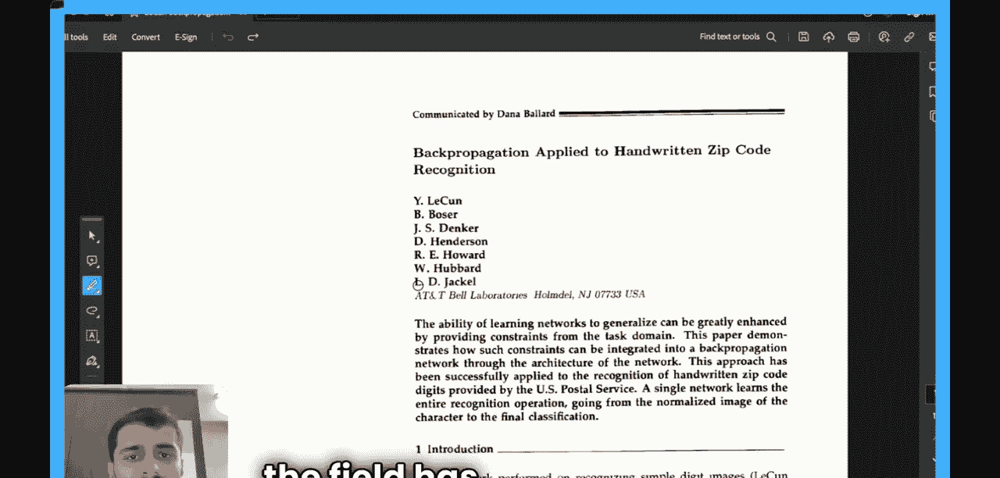

So this particular paper dates back to 1989。

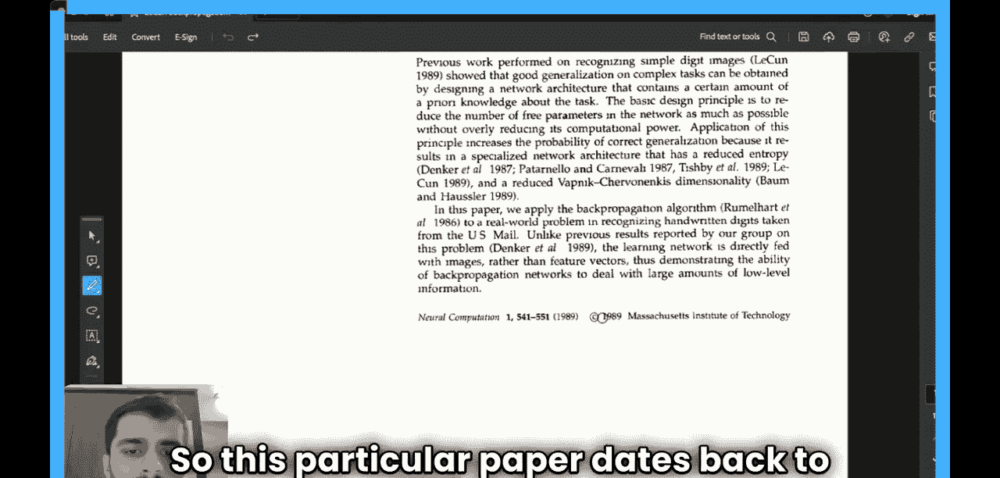

And it was published in the Journal of Neural Comput。

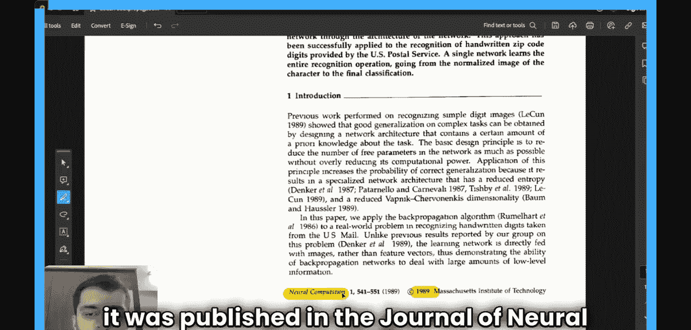

Its the title of this paper is back propagation applied to handwritten handwritten zip code recognition。

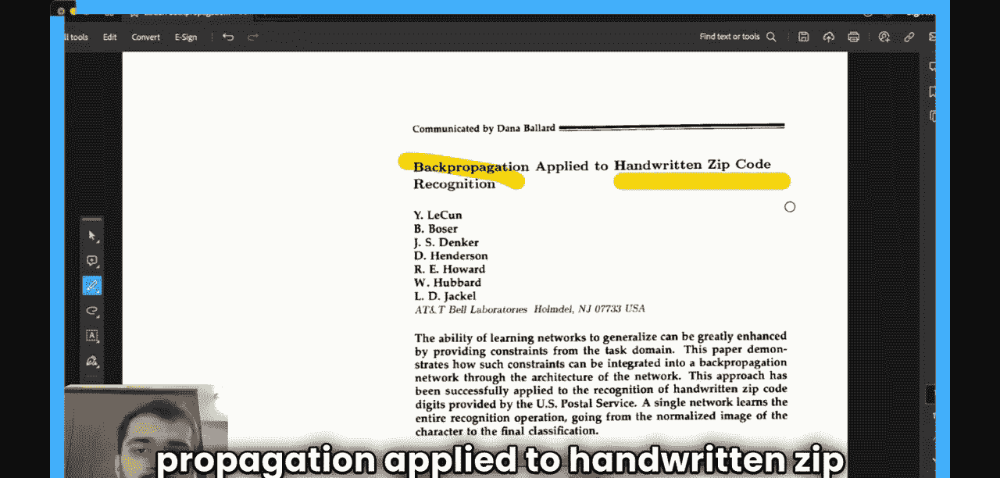

And。The authors seem to be working at ATNT Bell laboratories in the US。Of course。

 you can recognize Ian Lacoun as the first author of this particular paper。

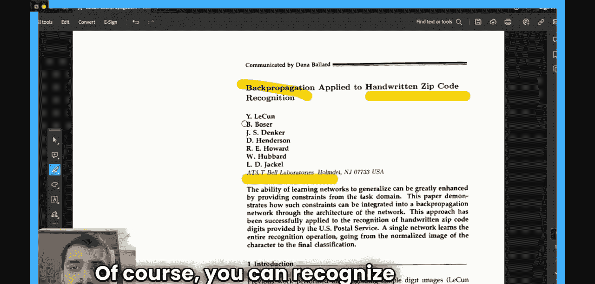

So。This paper interested me a lot because it came out almost three decades ago and really laid the foundations of。

The CNNs。Which we are seeing right now being implemented on the。

On a regular basis and part of machine learning curriculums and coursework。

But these guys were one of the first people who actually came up with the celeory the men。

I wanted to get an insight。Into their mindset and what the thought process was before even writing this paper。

Obviously at that time， AI was a very， very evolving field。And。No one knew where。

 where this could go。 So the research as such， was very much based on。

What has happened in the past and then trying to improve it instead of going in a specific direction or developing a particular application。

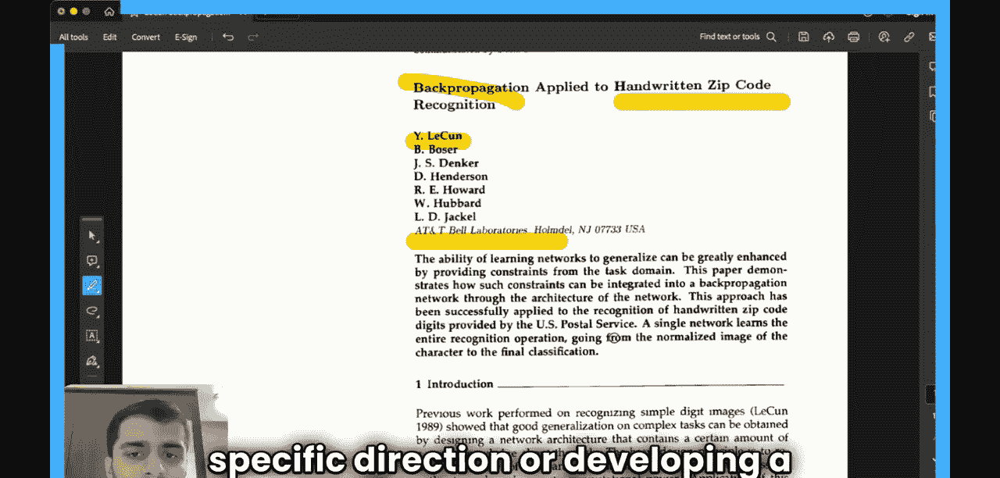

Okay， so let's read the abstract of this particular paper first。

So what this paper says is that it demonstrates how constraints。

Can be integrated into the back reproation network。Through the architecture of the network itself。

So this approach has been used to recognize handwritten zip code digits。

Which are provided by the US Postal Service。So there is no mention of convolutional neural networks as such but。

The way the authors have specified it is such that。They want to integrate constraints。

Into the back propagation network and they have developed。A completely new architecture。

So we are going to。Forget everything that we know about CNNnns。

 let's say and then try to look at this paper from a fresh start。

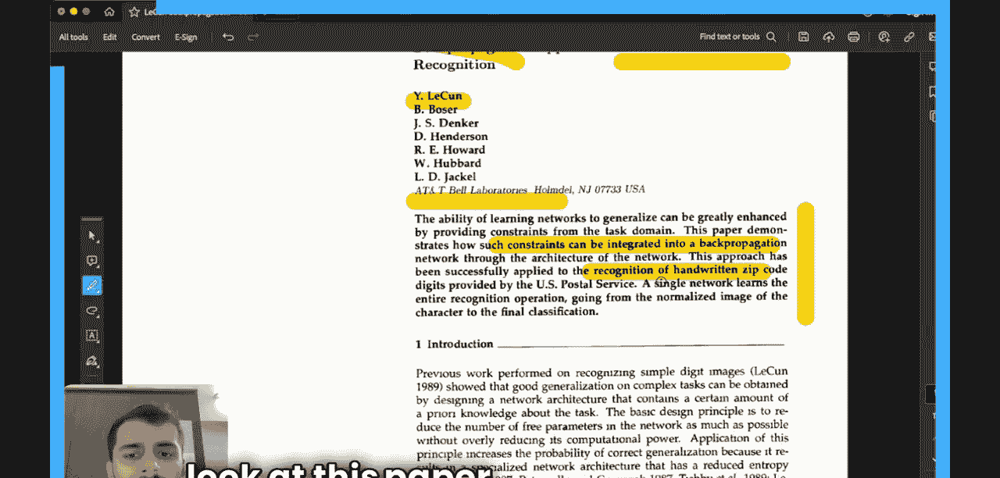

Okay， so let's go through the introduction。What I have seen in this introduction of this particular paper is that most of the works。

Date back to 1987。So in a sense， this was a very， very niche field at the time。

 it doesn't date back to 70s or 60s but。Probably the research around this page started in 85 or 86。

And。These guys were one of the pioneers。In this particular field。ok呃。

So one of the main arguments in this particular paper is that。The design principle。

 when you are constructing the architecture of a neural network should be such that。

Number of free parameters in the network。Should be as low as possible。

And they say that application of this principle increases the probability of correct generalization because it results in a。

Specialized network architecture which has a reduced entropy。

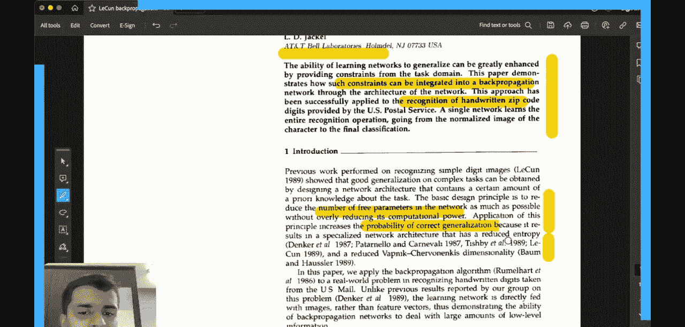

And they have applied this principle and the back propagal algorithm to a real world problem。

So instead of handwritten digits， they have taken handwritten zip code digits。

Which are actually provided by the US Postal Service。

Keep in mind that back then the computational powers of the machines was also not very high。呃。

So let's keep the decade and which era。This paper was published also in mind as we go through the different paragraphs。

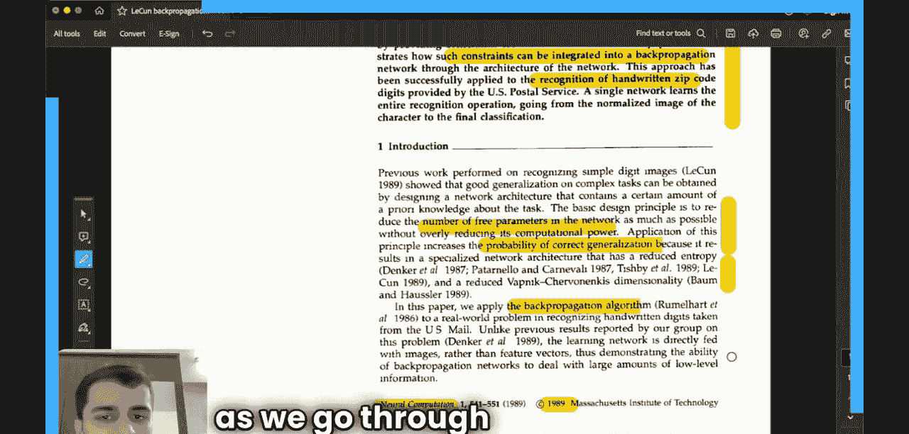

Okay， so this is where the data is obtained from the data is obtained from the US mail。

 which is passing through Buffalo。In the New York Post office。

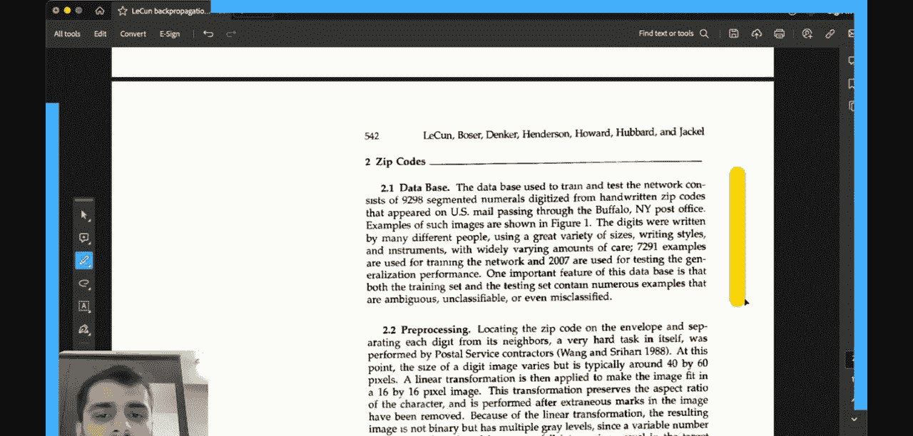

Examples of these images， as you can see， these are some of the images which are handwritten by people。

嗯。As a postal code in the US mail system。

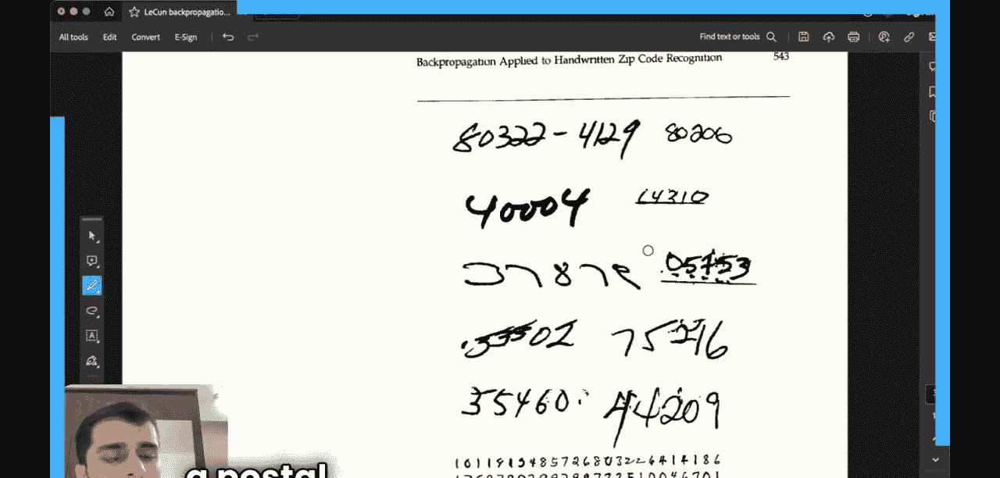

All right。Let's look at the last point of this particular data set where they say that both the training and the testing set contain numerous examples that are ambiguous。

Unclassified or even misclassified。

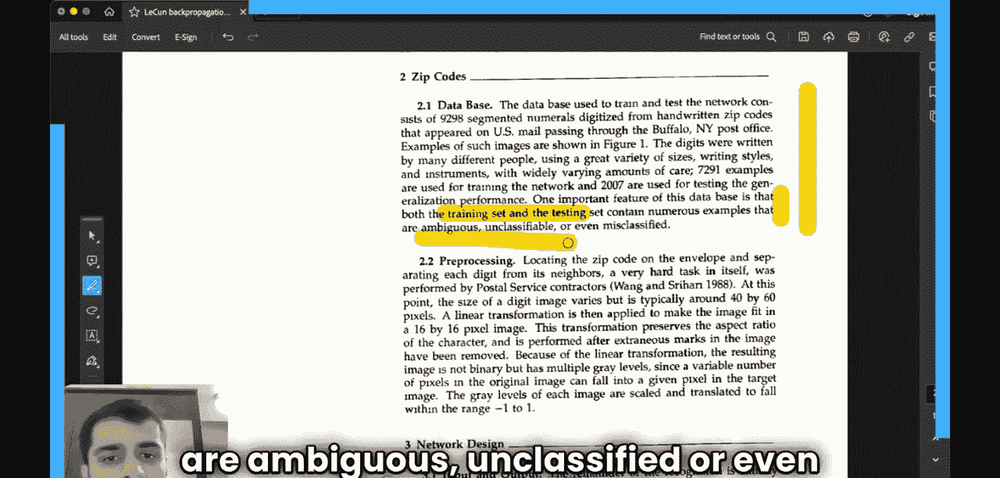

Okay。So they have done a pre processingcess step here where。

Each digit image is typically around 40 by 16 and they have performed a linear operation to bring the image size down。

To a 16 by 16 pixel image。So this transformation basically preserves。

The aspect ratio of every single image that we have in the data。

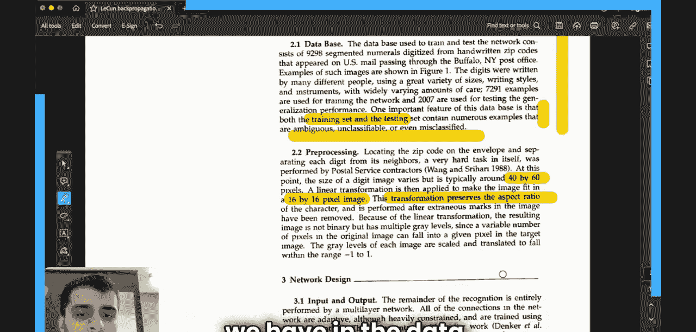

You can refer to this as well。As the。As the sample image， so it has 256 image input units。

 it's because the image has been brought down to a scale of 16 by 16 pixels。Okay。

 so lets let's move on to the next， which is the network design。

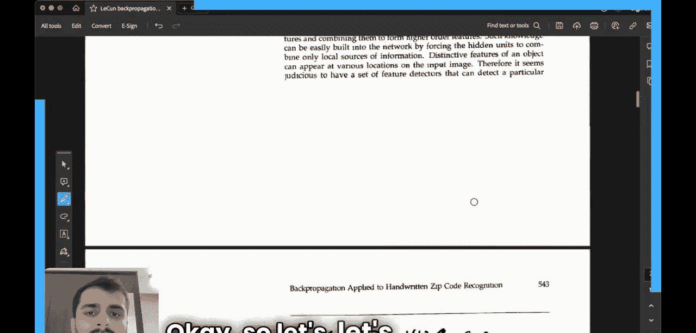

So the remainder of this recognition is entirely performed by a multilayer network。

All of the connections are adaptive， heavily constrained and trained using back propagation。So。

You might have noticed that this word heavily constrained is being repeated multiple times。

Initially I did not know what is the meaning of this particular particular words。

 but we come to the meaning in more detail as we go along。Another interesting thing here is that。

The input of this network is a 16 by 16 normalized image。

I think this was the first time in the history of neural networks or image processing that。

An entire image was fed as an input。Previously。The vectors were provided as the input or the features were extracted manually。

 and then they were provided as the input。The radical change that this paper brought into the system was that it allowed you to feed the entire image。

In the input for the neural network。And。That's what makes this design so useful because it。

Removes the manual preprocessing completely out of the equation。

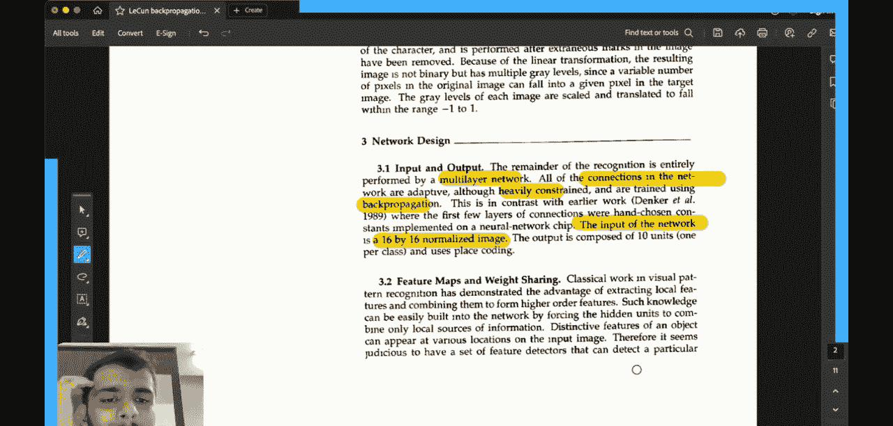

Okay， let's let's try to move into the next section， which is feature maps and weight sharing。

So what exactly is the meaning of these two？Classical work in visual pattern recognition has demonstrated the advantage of extracting。

Local features and combining them to form higher order features。So if you have。

Used a classical network， convolution neural networks or CNNs before。

You might be aware of these words which are called feature maps。So let me try to explain this。

In simple terms。嗯。So feature map is basically where let's say you have an image。

 it's a handwritten digit， let's say it's a 1， two， three， four， 5， etc。

what you are trying to do is that you are trying to extract different features out of this particular image。

 which might be let's say vertical edges。Or it might be individual components。

 horizontalages boundaries of different components which are present in that image。So features。

Or what make the entire entire image。So if you have to classify an image。

 it makes a lot of sense for us to extract all the feature features and then make sense of the features we also see this in in detail as we go along。

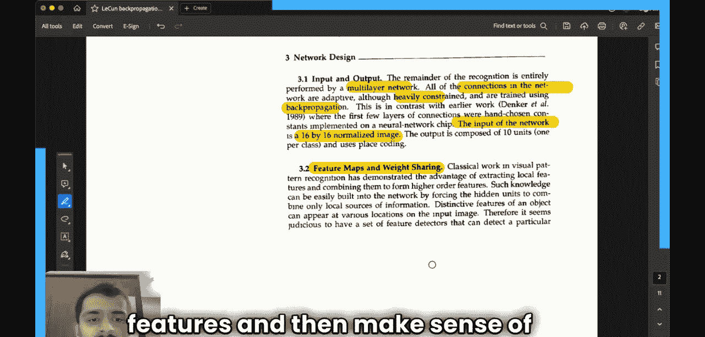

Just keep this word called feature Mas in your mind before we move ahead。

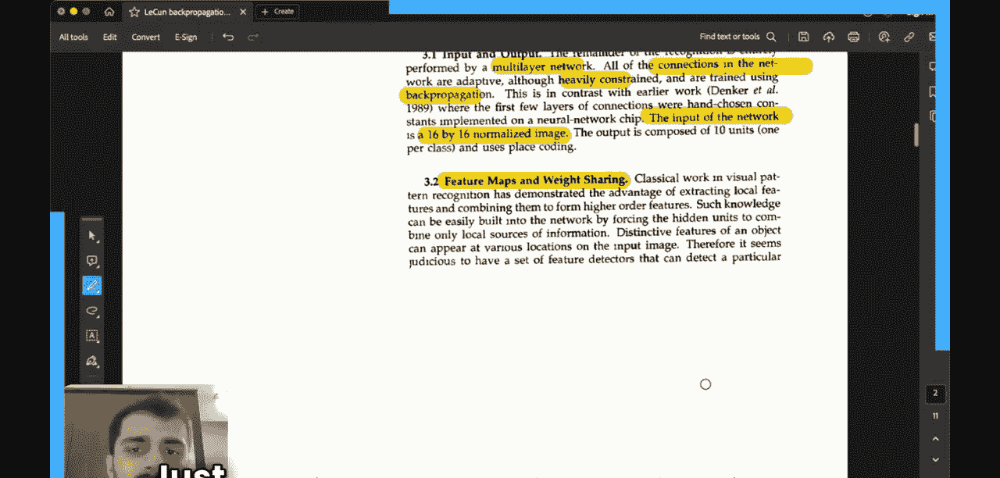

The next tour that you see over there is called weight sharing now this is something which I think was one of the main things that was implemented in this particular paper。

 so they say that weight sharing not only greatly reduces the number of three parameters。

But also can express information about the geometry and the topology of the task。

So we are going to look in detail what is the meaning of。

