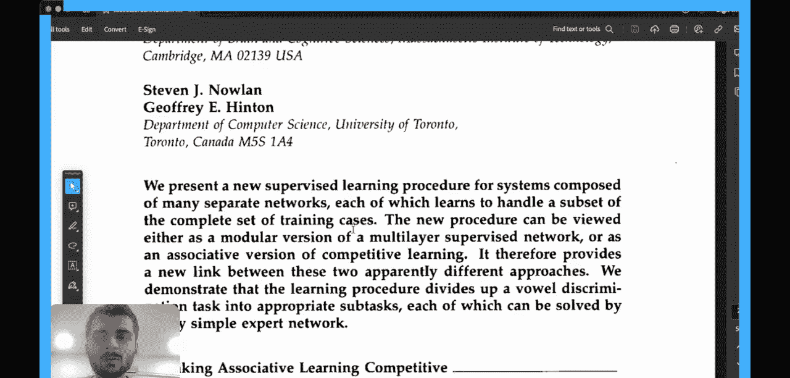
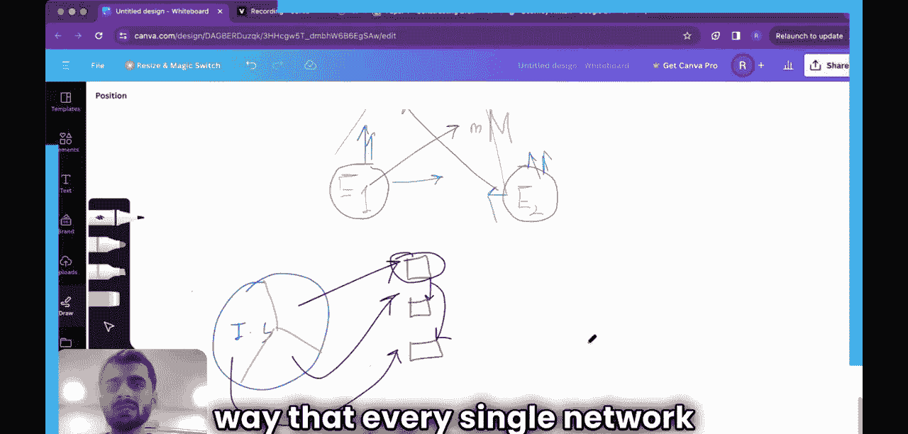
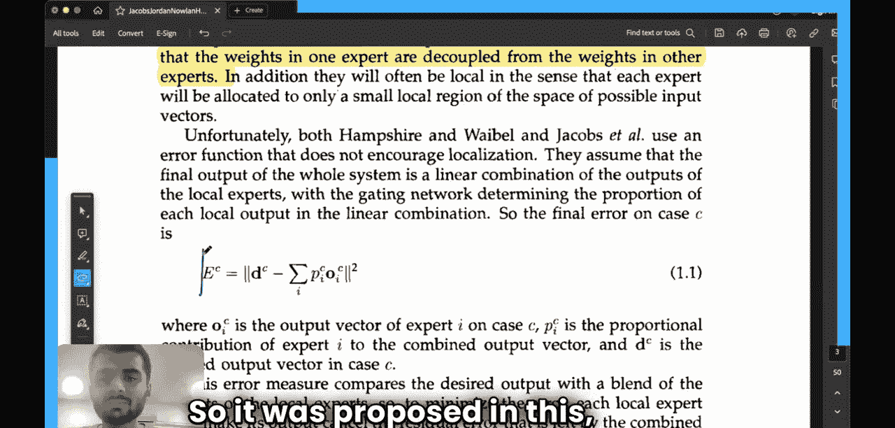

# Vizuara【中英⚡AI研究员训练营｜AI Researcher Bootcamp】 p07 P7 AI Researcher Bootcamp Session 7： Mixture of Experts Basics [BV1qi4VzJEPd_p7]

Hello， everyone。I hope all of you are doing good。Today we are reviewing this paper which is called as adaptive mixtures of local experts。

I have chosen this paper because I wanted to introduce you to the concept of mixture of experts。

This has become quite a popular model recently， for example。

 LMs like Mr LeI have recently launched a model which is based on mixture of experts。

This is one of the first seminal papers which。Introduced the idea of mixture of experts。

And the authors of this paper are Robert Jacobs， Michael Jordan and。

Stephen Noland and Jooffrey Hinton， it came out in the year 1991 and it was published in the Journal of Neural Computation。

So let us have a read through this paper and。What exactly are these people trying to propose？

So we are going to directly start with the introduction for this particular paper。Okay。

 so let's dive right into it and understand what is the meaning of mixture of experts。

 what is the architecture and。What is the intuition behind developing such sort of an algorithm？

So let's start with the first paragraph。B pretubation is used to train a single multi layerar network to perform different subtasks on different occasions。

There will generally be strong interference effects that lead to slow learning and over generalization。

If you know in advance that a set of training cases may be naturally divided into subsets。

That correspond to distinct sub tasksask， interference can be composed of several different。

Expert networks， plus a gating network。All of these terms might be very new to you right now。

 let us try to explain what does this exactly mean。O， so呃。Let's take a very specific example。

 let's say we are trying to build a classifier。Whose task is to classify between four woels。

We are going to take a lowercase I。And a percase I。

We are going to take a lowercase M and an uppercase M。So the first option。

 which was prevalent at the time this paper was written was to train a single network。

To be able to distinguish between。They're different woels。Now。

 obviously in the representations of these vows， youll probably come up with a。

With the classifier like this and like this。Which distinguishes between these vowels。呃。

What this paper is trying to say is that when you have a single network which is trying to learn between classes。

In which there is probably some interaction， for example， small ion capitali。

prettyty close representation wise， small m capital M again， pretty close representation wise。

Instead of having a single network， we can have。Two different networks。Where we let。

One network is specifically focusing on distinguishing between the eyes。

And the second network is specifically focused on distinguishing between the Ms。

These two are called as the expert networks so we can rename them as。Expert number one。

 which recognizes between lowercase and uppercase I and expert number two which recognizes lowercase and uppercase M。

How this will help us they are hypothesizing in a way that。A single network。Can。

Take a lot of time to train because we are not feeding this inherent information that。

There is some connection already present between these different classes and if you already feed that information into the network。

 probably the training will be much faster。And the interference also might not be there Why is the interference not there because we are not allowing。

We are not allowing this network to focus。On this and we are not allowing this network to focus on this。

So the cross interference is completely reduced， that is what they are trying to say。

So whenever you are thinking of this example now， we are going to refer to this Voels example。

 which is again referenced at the bottom of this paper as well。

So what they are saying is that instead of having a single network， we can。

Use a system which is composed of several different expert networks。

And a gating network that decides which of the experts should be used for what a training case。

Now this is this is important， you know， we are trying to。

Let's say we are selecting a bunch of candidates who interview for our company。

And we are looking for a candidate who is good at technical skills。

 we are looking for a candidate who is a good speaker。

We need someone in between who is able to filter these candidates for the right positions。 Now。

 the gating network is doing exactly that it is。Assigning weights for。Every network。

Which tells the network that am I supposed to attend to this particular case or not， for example。

 if I am looking at this network even。Then。More weight is going to be assigned here。

And less weight is going to be assigned over here， similarly for E2。

 more weight is going to be assigned over here。And less it is going to be assigned over here。 Now。

 who will decide these， who will decide that which network。

Has more weighttage for what cases that is done by something called lasergating network。

So we have two terminologies we have introduced here， we have experts in the model。

And we have a gating network， you can imagine that as an interviewer which is trying to filter out candidates based on their abilities or based on their capabilities。

呃。Okay， so the idea behind such a system is that。The gating network allocates。

A new case to one or a few experts。And if the output is incorrect。

 the weight changes are very localized to these experts。We'll come to exactly what this means。

 how the weight changes are localized to these experts。This is what we ideally want。

 What we have is that we have。Let's say， we have。A bunch of inputs right now let's let's try to visualize this in the form of image。

So let's say this is the entire input space。This is the input space， right？

And let's say we are having a bunch of networks over here。These are the expert networks。

Let's say we have three networks。What we are essentially doing is that we are dividing the input space。

Into。Three regions。And we are allocating each region to a network， for example。

 this region is allocated here。This region is allocated here and this region is allocated here。

So each network is attending to a different space in the entire input space。

What that means is that when I am training the weights of this network。

These weights should not be altered。So。We would like to construct the architecture in such a way or define the objective function in such a way that every single network essentially。

Acts in a way that it doesn't affect the weights of the other networks。

 so we'll come to how we are able to do that exactly as well。

Also interesting to note that this idea was first presented by Jacobs and Internet， the connectist。

Summer school in Pittsburgh in 1988， which was three years before。So。

 so there is no interference with the weights of other experts is that specialize in different cases。

 The experts are therefore local in the sense that。

The weights in one expert are decoupled from the weights in other networks。

 this is what we saw using this schematic representation as well。Now this。

 this particular idea of experts was。Was proposed previously as well in literature。

And we are going to look at how exactly this was proposed， so it was proposed in this。呃。

By this equation。Now let us look at the meaning of this equation， right？In this equation， B is the。

Desired output output。