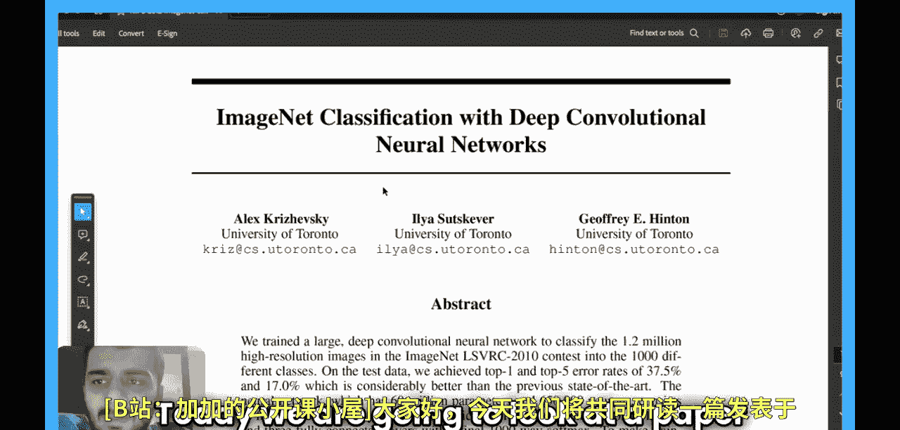
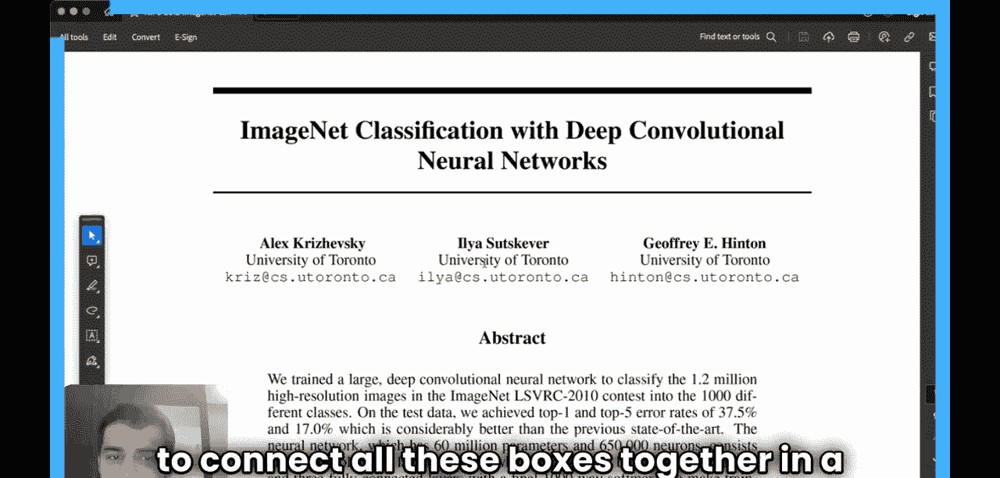
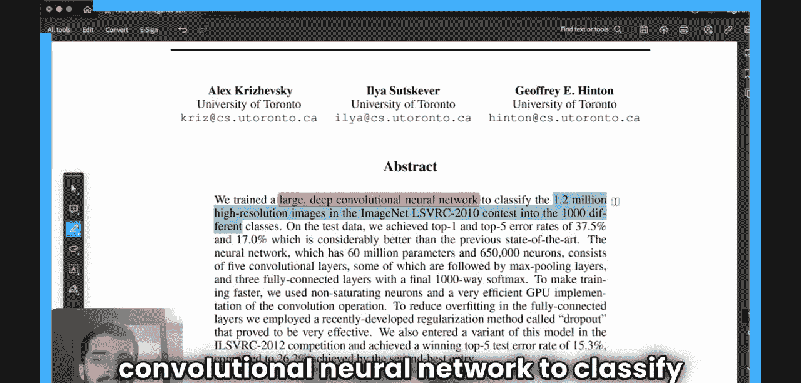
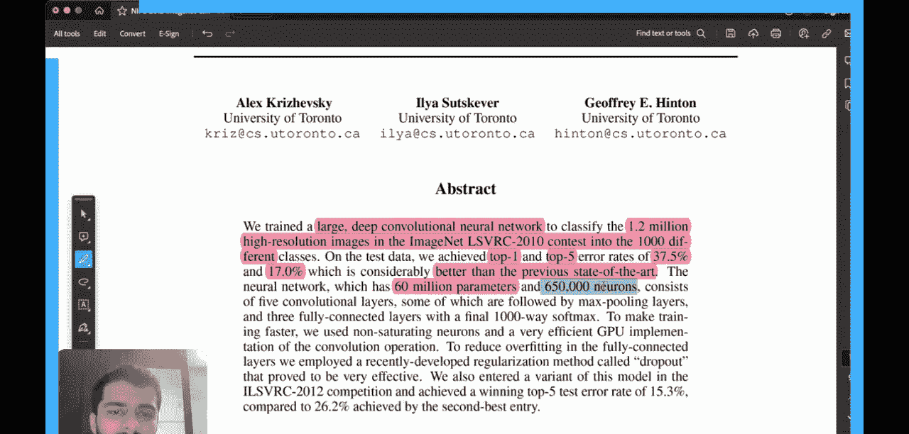
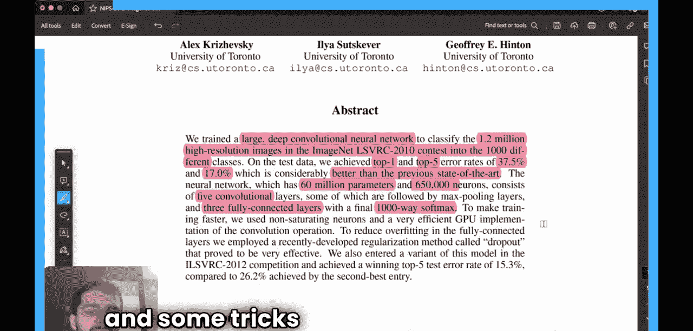
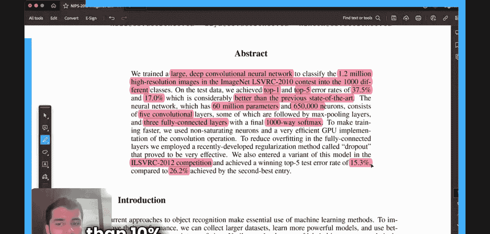
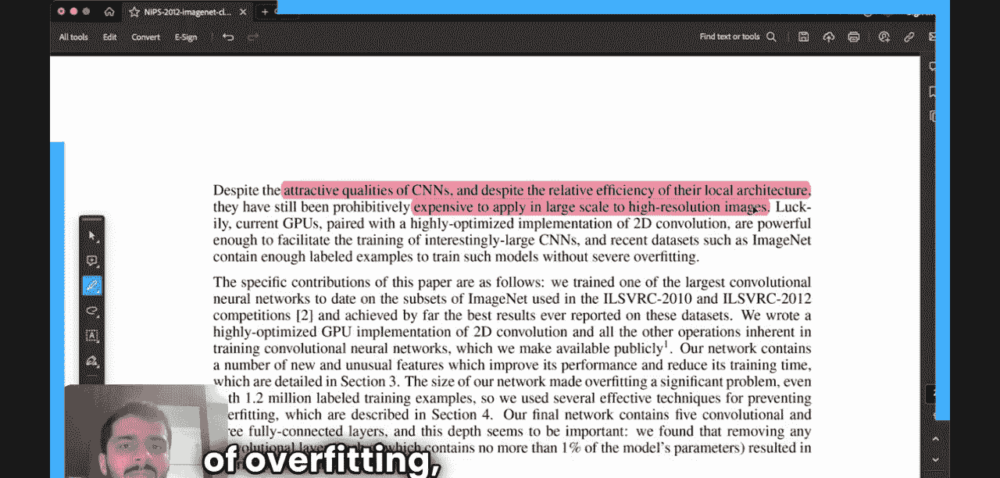

# Vizuara【中英⚡AI研究员训练营｜AI Researcher Bootcamp】 p08 P8 AI Researcher Bootcamp Session 8： ImageNet Classification with Deep CNNs [BV1qi4VzJEPd_p8]

Yes。Hello， everyone。Today we are going to look at a paper， which。

Came out in the year 2012。And this is one of。The classical papers in the field of。

Artificial intelligence。The title of the paper is Inet Class with deep convolutional neural networks。

And。The author， one of the author is。Jeoffrey Hinton， the other of authors are Eliia and Alex。

 the surnames。Are difficult to pronounce for me。嗯。And well come to why this paper has become so popular。

Why it has so many citations。I believe this was one of the first papers which introduced。

The concept that CNNs can actually be much deeper than what people have had been previously using and。

What they had been originally conceived for。And the idea of increasing the number number of layers and taking the network very deep。

Was first introduced by this paper， I believe。Also。

 it was a combination of a number of different things that they introduced， I would say。

None of the techniques they have mentioned in this paper is completely novel but。

The way the elements are arranged together that had never been done before。

 it was the first time a paper was。呃。Using con networks that were deep enough and using all these different tricks and all of these。

Combined together in the package which was written in this paper。So it it is a short paper。

 it is a very easy read。I guess it had。Restrictions in the number of pages。

So that it could be submitted successfully to the conference， that's why they had to cut it short。

 but it makes for an easy read。So let's try to understand this seminal paper so that。

We put one more box to understand our journey。Of artificial intelligence and hopefully there will come point where we will be able to connect all these boxes together in a nice way。

Let's start with the abstract。So they have drained a deep， large， deep convolutional neural network。

To classify the 1。2 million。

High resolution images in the image net。L S， V RRC。2010 context contest。

The classification challenge was that， okay， here are these 1。2 million images。

Develop your model and try to predict which of these thousand classes does this image belong to？

And they achieved top1 and top five error rates of。37。5% and 17%。Top 1 means that。Out of。

All the predictions。That your model has made for a particular image。

With what error rate is the top one matching with the actual prediction。

 top five means you look at the top five entries and you are okay if any one of the top five entry matches so obviously the error rate would be a bit lower because it is a lineient scale over there。

However， this。Network performed better than the previous state of the art。

 These error rates were completely。Unseen before， and。Everyone was presently surprised that， okay。

 we can reach these error rates using neural networks。

The network itself was quite big it had 60 million parameters。6 lack 50，000 neurons。

We look at the architecture， but essentially it had five convolution layers。

 three fully connected layers and a final thousand way softm。Now。

 they have implemented some neat tricks to make sure that。The error rates drop even further。

 we are going to look at different tricks。And some tricks to reduce overfitting as well。

So this this challenge they had entered it into the 2012 competition as well entered their network and。

They had achieved a winning top five test error rate of 15。3 and 26。2%。

 which was excellent at that time。This was the second based entry actually they achieved a a fire rate of 15。

3%， so you can see the improvement is。More than 10%， which is amazing。

Okay， so let's go through the introduction the current approaches to object recognition make essential use of machine learning methods。

To improve their performance， we can collect larger data sets， learn more powerful models and use。

Better techniques for preventing overfitting。Interesting to know for me is that up until that year。

 very recently actually。Data sets of labeled images were starting to get large， for example。

 previously N Calte and CR data was very common， but recently these new large data sets include label me and imagenet。

Now， it is also interesting to know that the actual imagenet data has over 15 15 million labeled high resolution images in over 22000 categories。

In the Inet large scale visualization challenge， however， we take only 1。2 million images。

And only1 thousand classes， so it is a subset of all the images that are out there。Again， imagine it。

 I believe， is a phenomenal effort。Of collecting data， because。

It was incredibly useful to test the effectiveness of different networks and。

Where we are right now is hugely thanks to this data set and all these computations which encourage people to improve their network further and further。

Now， obviously we can until that point that is 2012。呃。The networks were。Good enough to model。

 let's say， handwrittenton digits。Because smaller size network could be enough。

And their accuracy actually approached human performance， which was very good。However。

 images pose a very different challenge compared to handwritten text。

It' is because of the large scale variability and recognizing them is very， very difficult。

So naturally， we cannot achieve this error rate。However， we need to try to do our best。

And they are arguing that the current approaches are not good enough。To。To recognize images。

So they are saying that we need a model with a large learning capacity。

So our model should have lots of prior knowledge。To compensate for all the data that we don't have。

Now this is something I believe which is also called as inductive bias。

 we had looked at it in one of our earlier videos as well。Essentially。

 CNNs are one such class of model where。There is an operation， which。

Kind of induces a bias in the network， which helps us because we are pre feedingeding the the network with some information which we do not necessarily get from all the images put together。

Which is important if the complexity of the object recognition task is so immense， right？

The capacity of these CNNs can be controlled by wearing their depth and breadth。

And they also make strong and mostly correct assumptions about the nature of images。

Up until that point CNNs were definitely used for image recognition tasks。

 but I believe they were not deep enough。Let's， let's see， let's go ahead。

Despite the attractive qualities of CNNs and despite the relative efficiency of their local architecture。

They have still been prohibitively expensive to apply in large scale to high resolution images。

The reason why the CNNs were not applied in deep networks is probably because of two things。

First is that people were worried about the problem of overfitting if I have a very deep network。

 if I have a huge network。

It shouldn't happen that the network is not trying to learn the correct function。

 but simply trying to pass through all the data points。So in other words。

Let's say these are the points that。