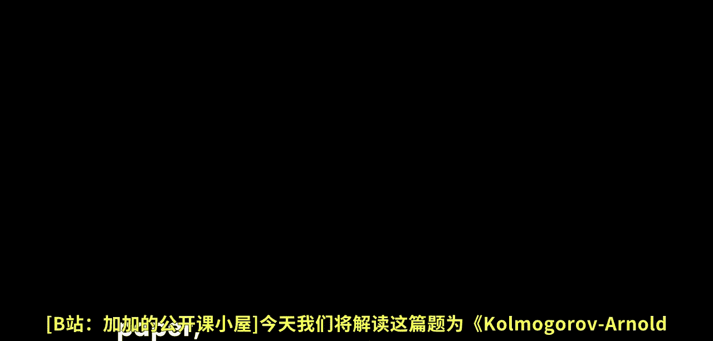
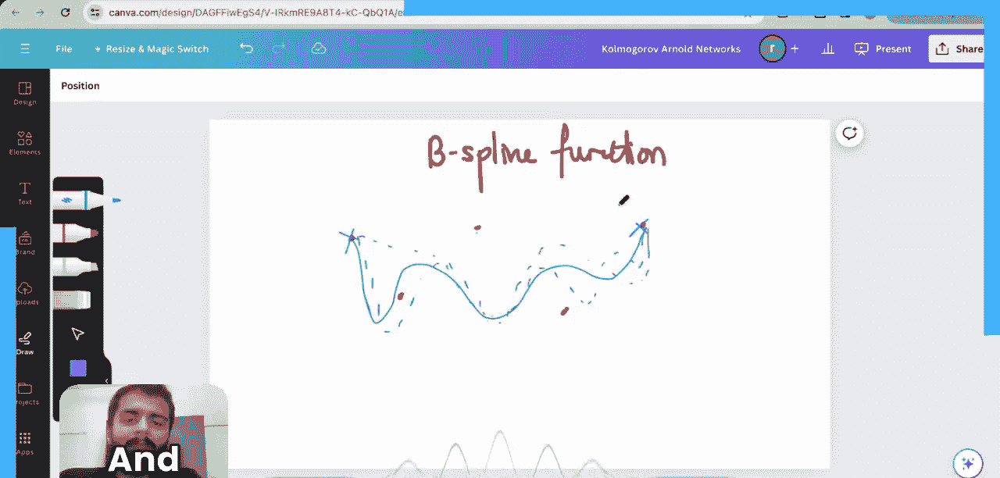

# Vizuara【中英⚡AI研究员训练营｜AI Researcher Bootcamp】 p09 P9 Basics of Kolmogorov Arnold Networks： Build your first KAN in 10 minutes. [BV1qi4VzJEPd_p9]

🎼很累。🎼Today we are going to look at this paper which is called as Kmogorov Arnal Network。

This particular paper has been released quite recently and it has been making a lot of waves。

When I read the paper I found the writing to be very simple and easy to understand。

 so from that point of view it is a very nicely written paper and it has been almost written like a tutorial。

So it is fairly easy to follow。诶。So my objective。In in today's video would be to give a brief background of what is covered as a whole。

In this paper， and we are going to dive into。The individual aspects of the paper。

A bit later in a separate video。So let's go through the abstract。Okay。

 so in this paper have they have proposed。An alternative to multi layerar perceptrons。

And these networks are being termed as Komogoro or neural networks。

So the main difference in this network when we compare it with multiar percept is that。In MLPs。

 you have activation functions on the nodes of the network。Whereas cans。

 which are columnmogoro Ar networks， have activation functions。

On the edges of the network instead of the nodes。We will look at what this means in detail。

 but this is one of。The major difference。When we compare MLPs with cans。

So these are two completely different approaches。Neutural networks are known as function appros。

Through their complicated architecture， they can be used to approximate。Any function。

So conceptually speaking cans also achieve that cans can be used to approximate。Any given function。

 the difference， though， is that。We don't use weight and biases for every different node over here instead every edge is represented by an activation function which is。

A be plane function。If you don't know about a B plan function。

 it is completely fine for understanding cans it is not really required。

So what exactly are Kmogoro urban networks？So I'm just going to explain this to you using a diagram。

呃。Okay， so let's get started with this。Right。Let's take， let's take a network with the。

With three layers。Let's say we have。2 neurons。In the first layer。And。We have。3， four。

 five neurons in the second layer。And we have one neuron。In the final layer。No。

In a traditional multi layerer perceptron。What you would have is that at every layer。

 there would be connections。With。Each of these two neurons like this。

And there would be a specific operation which would be performed at the level of a neuron。

Let's take any neuron over here。Right， so basically you have。You have two inputs。我咧。Okay。

 so you have two inputs， you have input number one。And you have input number two。

And what you do is that you attach certain weights and biases to both of these inputs。W1 and W 2。

So what you basically do is that you， let's say there are these inputs which are termed as x1 and x2。

So we multiply the inputs by their weights。And then we add the biases as well。

And this whole thing is later subjected to an activation function。And then the output is calculated。

So at every node。We have。Weights which are associated with all the inputs which are coming in。

So we have weights and biases and we have an activation function。

 which can be either a tannish function， relu function， sigmoid function， etc。

Now let's come to what's happening in cans。So in canirs。

Let's say we stick around with the same structure， we have two neurons in the first layer。

We have a set of。5ive neurons in the second layer， and this is the final layer。

 so overall we have three layers。What happens here is that let's consider the first neuron and will the connections remain the same。

Right， so let's say this is x。0，0。And this is x 01。Right。

The difference in cans is that instead of you do not have individual weights which are associated。

With these connections， but instead you have。Actation functions itself。 So let's say now we consider。

This x0 zero。What typically happens is that this x00 is。Passed through an activation function。

 which just one minute。X0，0 is。Passed through an activation function。

 which is let's say represented by。5，0，0。Right and then in the bracket we have x0，0 as the input。

And then x 01。Is also。Associated with an activation function， which is。Named as55，0，1。

So these are two activation functions。And what you do at the output is you simply do a summation of these both。

 So basically at the output you will have x 00 of sorry500 of x00。Plus。5，0，1。Of x01。That's it。

 so this will be the output which is coming from this network。

 this node and it's connected over here。What are the differences you see。

 you do not see any weight parameters over here， you do not see any bias parameters over here。Now。

 the learnable parameters in cans， therefore are these activation functions which are。Name does 5，0。

0， and 5，0， and over here。And so what are these activation functions？

How do we get to know about them？So the basis of these activation functions are given by this thing called B sp functions。

So呃。What is a beast plane function？Okay， so B plane function are basically。

Let's say you if you have worked with CAD models before。If you recall， you would have。

Let's say you're trying to draw a curve。And then。Let's say there are these control points which you have。

At your disposal， and you're trying to。Controller curve using these control points。

So let's say the curve has to pass through the first point and the last point。

And let's say the curves goes something like this。Now。

 what typically happens in these CAD applications is that using these control points。

 you can change the shape of the curve completely。So you can have the one as the dotted occur for。

We can have a curveb like this。And using only the five control points which I have described here the entire。

