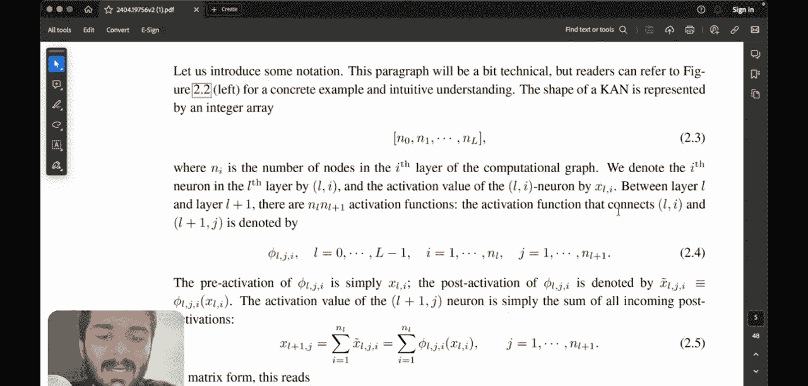

# Vizuara【中英⚡AI研究员训练营｜AI Researcher Bootcamp】 p10 P10 Kolmogorov Arnold Networks： You KAN understand the mathematics [BV1qi4VzJEPd_p10]

🎼Hello everyone， today we are going to look at the mathematics behind the CA architecture。

So before we dive deep， let me recap。The previous video。

 if you have not gone through the previous video， I have given the link in the description。呃。

In the previous video， we started looking at。This paper called Kmogororov are no networks。

And we try to develop an intuition of。The basic concept behind this paper。

 so let me do a quick recap of that。So we started by discussing about how cans are different。

Thenhan traditional multiar perceptrons。And。In this slide you can see we have a traditional MLP where we have weights and biases which are associated with a specific neuron。

So what generally happens is that the neuron gets a bunch of inputs which are assigned certain weights and biases。

Whi are added together and there is an activation function which basically decides whether the neuron should fire or not。

Now what the can architecture proposes is that you get rid of the weights and the biases。

 but you make sure that every connection between two neurons。Has an activation function。

 which is associated with it。So this activation function is denoted by phi over here。

The activation function is present between any two corresponding neurons。

 so you have basically got rid of the weights and biases but you have these functions which you have to train and these are learnable functions。

We also looked at what is the meaning of B sp。 So B sp functions are basically。

Used to approximate any any function so basically there is if you have any function。

 you can write it as a series of B spine functions where you can vary the coefficients to match the given function。

In order to specify any beast sp， you need to mention the number of control points which are denoted by n plus 1。

The order， which is renoted by k。So the number of segments which you will have with this notation is n plus k minus2。

So it allows you to control each segment separately。In the B function approximation。So for example。

 if we have n equal to5。And k equal to 3， we get n plus k minus 2 equal to6。

 which means that I will have six different segments in my curve which I can control separately。

You can assume that this is quite similar to。The kind of function control we do in CAD or cam softwares where you are trying to drop curves by connecting segments。

Remember we try to control each point separately and the curve between these points changes if you have used any one of these tools before。

Anyways， the basis functions typically look like this， which is shown in this figure。

Here I have shown five basis functions， two are shown in blue， two are shown in red。

 and one is shown in yellow。You can see that。The blue basis functions and the red are mirror images of each other and there is one basis function which goes through the center。

So typically we do a linear combination of these basis functions to represent the sp function between any two neurons。

Now。The Kmoer of Arnold theorem basically says that you give me any function and I will give you。呃。

Basically a two layer architecture of comoer of Ar networks。

 which can be used to represent that function。Now， the problem with this is that if the function is not smooth。

You would not get such an approximation and this was what was the reason why the field was stuck。50。

60 years back， even after the can the Kmogo of Arult theorem was present。

 it could not be successfully applied。To a universal function appromator。

 what these guys are basically saying is that。We can extend the Colmogoro Arold theemmen。

App it to build neural network architecture of arbitrary width and arbitrary depths so that it can be used as a function appromator。

The objective of today's。Video is to help you understand。

The mathematics of the can architecture so let's dive deep into the paper now。Okay， so let's look at。

The K AN architecture。And。Let's start by looking at some notations。So。Okay。

 so the first notation that。Will be utilizing is Phi over here。

ThisThis particular notation is what we'll be looking at。First。

So these are one dimensional functions。And。Between two layers。

 so Q is representing one layer and p is representing the second layer。So basically。

 you can assume them to be one dimensional functions between two layers， two corresponding layers。

The first layer has n in number of neurons。The second layer has n out number of neurons。呃。So。Let's。

 let's try to look at it in in terms of。The original colmoer of Arnold theorem。

 So in in the original theorem， what what they basically said is that if， if you have。N neurons。

In this layer。The second layer will have 2 n plus1。Neurons and the final layer would have。

When Europe， basically。Which is what you see in this formula over here。Q goes from1 to2 n plus one。呃。

Okay， so。The end in。According to our notation。Over here is N。And the n out。

 which is the number of neurons in the next layer。Is 2 n plus1。And out is to n plus one。Okay。

 so that is what they are saying over here in the coulmogo Ral theorem。

 the inner functions form can layer with n n equal to n and n out is equal to 2 n plus 1。

And the outer functions from a can layer with n n equal to 2 n plus1 and n out equal to 1。

 so basically what this means is that let's say。We consider this。For these two layers。

 n in is n and n out is 2 n plus1， but for these two layers。

The output in the first case becomes the input， so the n in。Is to n plus1。And the end out。

Is equal to one。So this is what the notation essentially means。Let us。Draw it separately over here。

 so that。Go from two， then five， and then finally what。Okay。Okay， so let's move ahead。So呃。

The shape of the can is typically going to be represented by this integer array， N0 N01 up to Nl。

And so if we are looking at this particular can， then。

We are going to represent it it's a three layer can， so l equal to three。And n0 is2。

And no one is five， and then it's one。So this is the three layer network which is represented according to our notation。

Just keep this in mind， it is just as as a symbolic notation it will not。

Hinnder you in your understanding of the algorithm that much。Okay， so let's go to the next step now。

Okay， so we denote the I neuron in the L layer by L and the activation value of the L neuron by XL。

So between layer L and layer。