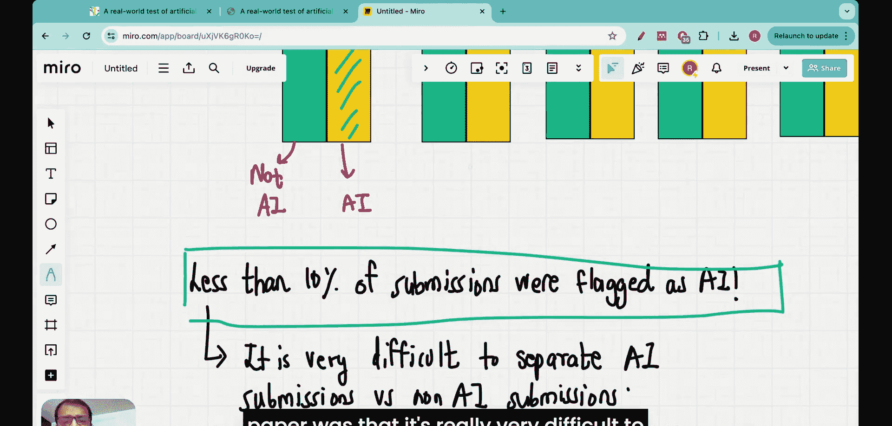
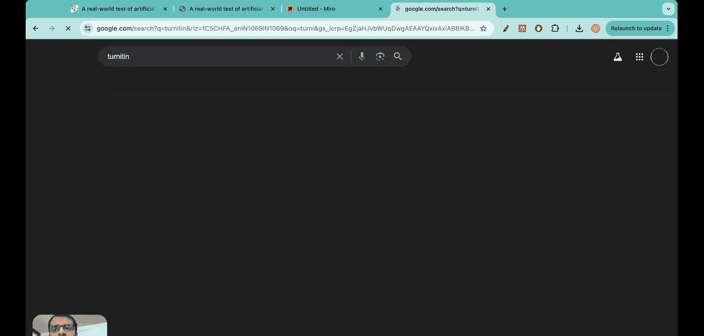
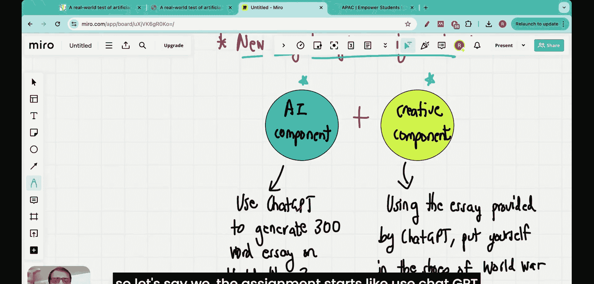

# Vizuara【中英⚡AI研究员训练营｜AI Researcher Bootcamp】 p12 P12 Will ChatGPT end school assignments？ A Research Paper Review [BV1qi4VzJEPd_p12]

Hello， everyone。Two days back， a paper was released which is titled a real world test of artificialific In infiltration of a university exam system。

 When I read this paper， I was really shocked to see。That。

The assignment structure and the exam structure in the world is completely changing because of artificial intelligence。

When I read this paper， I very seriously thought that in five years the way assignments are given to the students and the way assignments are graded。

 the way homeworks or homework problems are graded is completely going to change。

And then I thought of making a video on it to explain my learnings。

 to explain this paper itself and to explain how I think assignments are going to change as we move forward。

So let's get started with the video。My name is Dr。 Rajthan Decker。

 I graduated from IIT Madra in 20170 and completed my PhD from Massachusetts Institute of Technology in 2022 in the field of artificial intelligence。

So this paper as a whole is。Very simple what these authors have done is that they have partnered or rather focused on a specific university in the UK。

And they have。Grated some assignment solutions。Using AI or Cha GbT and compared the grades received。

On those submissions with the normal submissions which have been written without the use of Cha GT。

So for example， lets let me directly jump to the first table。

 which is the most important one if you look at this table right here。

What these authors have done is that they have divided the question papers into five modules。P 1， M1。

 P1， M2， P 2， M1， P 2 M2， and P 3 M1。In each module。

 there are real submissions which are not generated by AI and there are some artificial intelligent submissions Now these AI submissions were generated by the authors themselves and no one knew which submissions are real and which submissions are AI。

So all of the submissions were given to the evaluator without knowing which one of it was AI and which one was real。

So here I've written a pictorial representation of the way the study was done。

It was divided into five modules module 1 module 2 module 3。

 module 4 and module number 5 in each module， you will see that this small portion or a small number of submissions were AI。

 approximately 5% of AI submissions。 and then this entire。

Module was given for grading and the examiner did not know which of the submission was human generated and which of the submission was AI。

In the paper， the authors also mentioned the prompts which they gave to chat GPT to generate the answers。

 such as for essay based answers， the prompt was including references to academic literature。

 Write 2000 World essay。And the authors explicitly say that they did not make any attempt to make the chatd GPT answer sound like human。

 so it was clearly written by Cha GPT and then given to the examiner and then the examiner at no knowledge which one was real and which one was Cha GPT I hope you are following with me until this point because the results will completely blow your mind。

What happened after this part was that then slowly the grades were released。

And it was really shocking to see that the AI generated。

Submissions consistently received a much higher grade than the normal submission。

 so if you look at this particular plot it actually sums up this entire paper in one plot。

So let's look at these first two bar plots here， they belong to the first module P1 M1。

So the median grade for the real answers which are not AI generated is shown by the yellow bar and the grade for the AI generated answers is shown in the blue bar you can clearly see that the blue bar is higher than the yellow bar。

 which means that the AI generated answers consistently received a higher grade。

You can see this trend for all the modules in almost all the modules except for this module 5。

 you will see that the blue bar grade is higher than the yellow bar。

 the blue bar is higher than the yellow bar this clearly says that the AI generated submissions were scored much more than the normal submissions or human generated responses。

This is illustrated in this plot over here here we can see grades for module 1，2，3，4 and 5。

 as you can see for AI generated which is the yellow bar it is consistently higher than the not AI generated。

 which is the green bar over here。So your question would be that， how is this possible？

Couldn't the examiners understand which submissions were AI and which were not AI。

And here lies the second main result of the paper it is very it was very very very difficult for examiners to understand which submissions were generated by chat GPT and which were not in fact it turns out that less than 10% of the submissions were flagged as AI。

Let's look at another。Very interesting result from this paper and I want to show you this result first in the format of a table and then in the format of a graph so let's look at the first module so you can see that the percentage of submissions which are flagged as AI is 6% in the second module it is 12。

5% over here。Right， and overall， the percentage of submissions which flagged as air was just about 6 percent。

 and this is also illustrated in this graph over year。

If you look at this graph closely and look at the yellow barrier。

 it shows the percentage flagged as AI。 so for the first module you can see the yellow bar is so less compared to the blue bar right。

 it was very difficult for the examiners to understand which is AI and which is not AI It was virtually almost impossible。

So the examiners thought all the submissions were written by humans and they graded the AI submissions on a much higher scale。

Yeah。When I read these results of the paper I was extremely shocked。

 imagine a student who is given an assignment the student goes back home。

 the student just uses chat GPPT finishes the assignment in5 seconds。

And then submits it not only that what if the this particular student is now the highest ranking in the assignment。

If the examiner or the teacher does not recognize is the as submission。

 what if this student receives the highest grade？Then what is the purpose of assignments anymore the main purpose of homework or assignment is to make the students practice to test their understanding。

 but if students are using chat GPT itself it is virtually impossible to detect which text is generated by chat GPT and which is not。

So one of my main takeaways from this paper was that it is really very difficult to separate AI submissions versus non AI submissions and then I started exploring some tools。

 for example， there is a famous tool called Turnitin。

And if you look at this tool。Turniin is a plagiarism detector。

 so it turns out that turnniin can detect。Whether the student has copied from somewhere etc。

 but as I read further I discover that even termmitin is not very good in understanding which responses are generated by chat GP1 which are not。

Right now， as。As we proceed with the inventions in Chad GPT it is very difficult to have a plagiarism detector or a chad GPT detector no one has 100% rate of detecting AI generated data versus human generated data and this problem is going to get even worse because Chd GPT now GPT5 will come the LLM will keep getting better and better and better and they will start sounding more and more and more like humans。

So then I was thinking what can be the better way to give assignments right and I think that the best way to give assignments is to not be afraid of AI or to think that students will use AI chat GPT we should assume that everyone is going to use chat GPT anyways and then construct assignments which。

which openly say that you use Cha GPT but we can build on top of that to add some creativity so then the new world or the new education system should be based on the fact that students will use large language models but we have to now train them to efficiently use these models and to use their creativity on top of it。

This is what happened with drafters and computer a design right Drafers were replaced with computer a design and that did not mean that jobs were taken or the creativity was lost It just that students or engineers who understood computer a design better they got more jobs because their skills were more relevant Similarlyly students who know how to use chat GPT correctly and apply their creativity on top of it will be ready for the modern world so I think that this should be a new way to give assignments whenever we think of assignments we should have two components we should have an AI component and we should have a creative component so when we look at an AI component of an assignment so let's say the assignment starts like use chat GPT to generate a 300 over essay and World War2。

