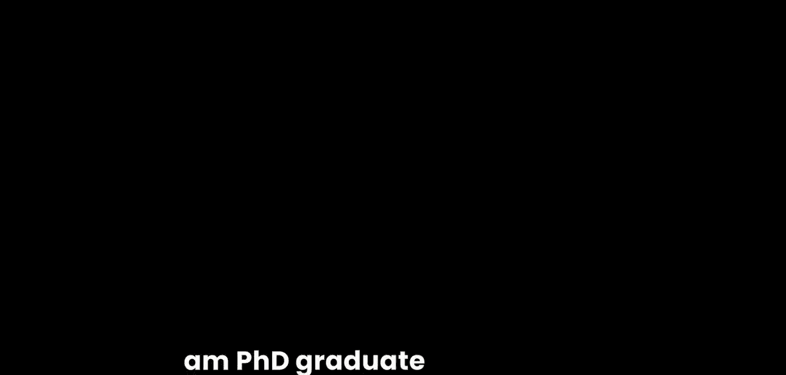
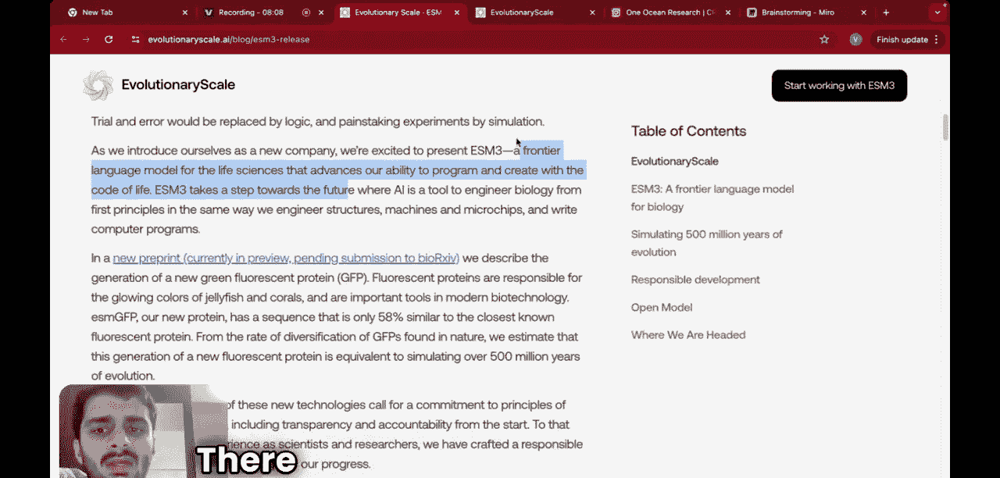
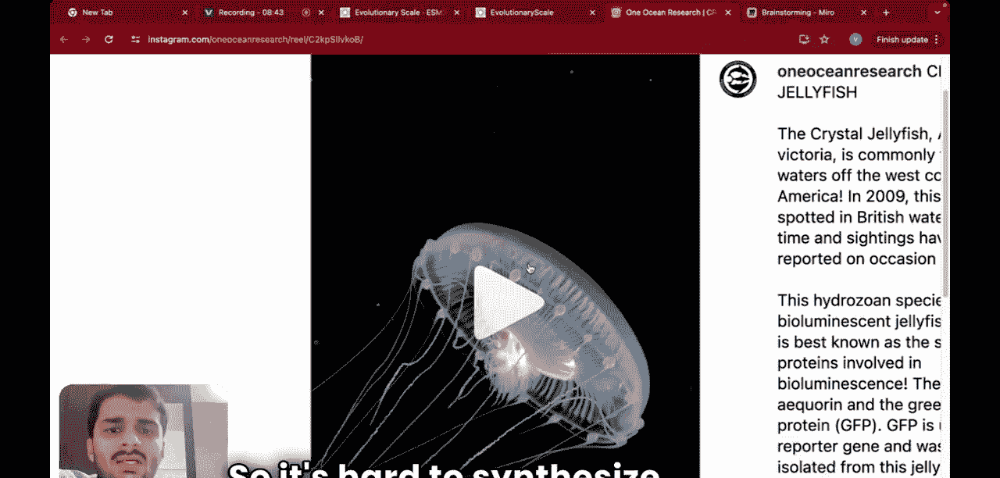

# Vizuara【中英⚡AI研究员训练营｜AI Researcher Bootcamp】 p14 P14 Simulating 500 million years of evolution ｜ Synthesizing proteins using larg [BV1qi4VzJEPd_p14]

🎼Hello， everyone。My name is Rogert and I'm PhD graduate from Purdue University。

Today I'm going to talk about a very interesting topic， which is。

One of the recent advancement in the field of。Artificial intelligence and large language models。And。

The main topic and the area which we are going to look at today is proteins。So。Let's first。

Understand a little bit about proteins， so proteins are basically the building blocks of of our bodies and every single protein is。

Is being made to target a specific function and that function can be， let's say， digesting food。

It can be movement of your muscles。It can be fighting diseases。

 so there are a lot of functions which our bodies do and every single function can be mapped to a protein or a sequence of proteins。

诶。And proteins are basically made up of a bunch of amino acids。

And these amino acids there are 20 different amino acids and every single protein has a unique combination and a set of amino acids。

 which is called as the sequence of a protein。So in the latter half of my PhD。

 I was actually working on a very specific type of proteins which are。Known as monoclonal antibodies。

This might be new to some of you。So for humans who cannot develop their own antibodies。Or。

Their own proteins to resist diseases， people inject these monoclonal antibodies or maps。

which are artificially injected in our bodies to fight these diseases and this was relevant especially during COVID 19。

So monolobe antibodies have a very specific shape which is called as a y shape structure。

And within this structure， there are these bunch of aman acids which are recsiding。

Within each domain， so there are three broad broad areas within which the amOS acid is rec。

And so basically the point I'm trying to make here is that every protein has got a sequence。

Which is a sequence of amino acids it has got。A structure。

 which is a three dimensional structure of the protein， which is。

which is pretty much unique to that particular protein as you can see here it has a y shape structure and then every protein has a specific function as well。

So the function of these monoclonal antibodies would be to fight off the infection。

 which is posed by an invading virus。In our bodies。

And so every single protein has a unique set of sequence structure and function。

And these proteins have actually evolved through millions of years or even billion of years。

 and the reason why evolution has taken so much time is because of mutation。

So maybe initially before we get to these antibodies。

 initially we had only the first domain and then after up。Few centuries we had two domains。

 then slowly we started to learn about connecting these in the form of a y shaped。And then finally。

 we get the antibody。And this this whole process， this whole sequence of steps。

 it usually takes a very long time， which is the process of evolution。That every single mutation is。

Being studied and whichever mutation survives， that mutation is being carried on in the future generation。

 so this takes a very long time。In general。And any new protein that let's say scientists go out and they see a new protein。

It is very rare to synthesize a new sequence and a new structure in the lab。Now。

 another problem which is quite different from this is that how can you predict the structure given the sequence it is not very straightforward。

Google released a model called Alpha4， which was a big revolution it used AI to kind of predict the structure from the sequence。

Now the question that we are trying to ask here is that can we basically mimic evolution？

Can we mimic it， mimic evolution。And it it looks like a pretty strange problem。

 even when I speak about it。And the reason it looks strange is because evolution is something which has which takes a lot of time and how can we and what do I even mean by this question。

 so what I mean by is that can we basically skip all these millions of years of evolution and can we predict？

Newer and newer proteins。Just by understanding data。

So the main concept is that we take a huge repository of sequences。Then， structures。

And functions of all the different proteins that we know in the world， which exist in the world。

 we collect a huge data。We pass it through a large language model。

And then we develop the capability to predict new structures and new functions of proteins。

New proteins。And this this problem inherently sounds okay。

 like does it even make sense because large language models we typically have sentences。

 let's say we have a sentence like I am learning AI。I am learning， AI。

And what happens in large language models is that we calculate。Attention between different words。

So let's say we calculate attention between I and M M and learning and learning and AI。

And then we basically encode this sentence and then。

We can use it for different tasks like translation or even predicting the next word in the sequence now the question is that how can we apply the same logic to a protein is which looks very complicated right it has a three dimensional structure。

So how can we apply the same logic of a large language model to a three dimensional structure。

 which is that of a protein？So essentially， we want to think about how can we mimic evolution by using large language models to predict new proteins based on the huge repository of sequences structures and functions。

And this was something which I did not think really was possible。

 but recently I came across an update。Whi kind of solves this problem。

 so this is this is a model which these authors have proposed it is called ESM3。

Which is a frontier language model for biology。And。

What they have done here is that this this frontier language model advances our ability to program and create with the code of life。

And what they are essentially doing is that they are using large language models to generate new proteins。

And I just want to show you one very cool application of this there are these proteins which are called as green fluorescent proteins or GFPs when you see these beautiful jellyfishes having these amazing colors。

 it is because of the presence of these proteins which are imparting that color to that particular animal。

And these proteins are are rare to find， first of all， scientists have not been able to。

Bring about new proteins in in these class of proteins in the laboratory。

 whenever they are found in nature that's when we know okay oh， this is a new protein。

 so it's hard to synthesize a new protein in this class。

Of GFps。And what these people have done is that they have they have generated a new green fluorescent protein which has only 58% similarity to the closest known fluorescent protein。

And what does a low similarity mean it means that we are predicting something which evolution has not yet reached so we are predicting something which is far into the future right so if you look about if you look at this figure。

Now is there is a lot of difference between this first shape and the last shape。Right。

And so the similarity is maybe 30%。So， the lower the similarity。

 the longer is the gap for the mutations to happen and 58% similarity is quite low。

 which means that we are kind of simulating way into the future。

Which is what these these authors have have actually achieved and this is what they are。

Their model EM3 has done。And how， how it has been trained is that it has been trained on one of the highest。

呃。