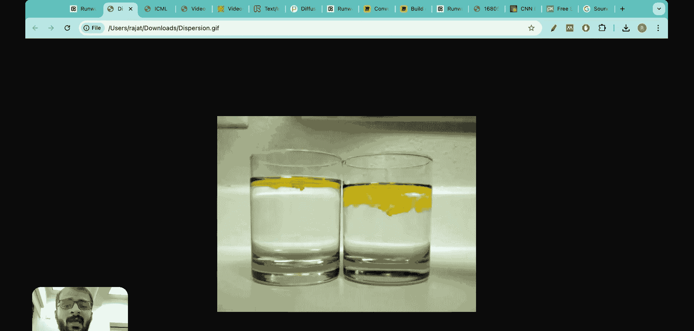
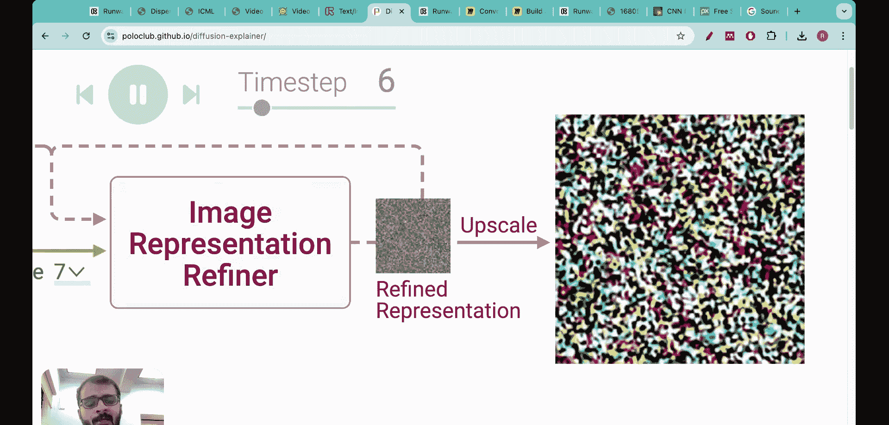
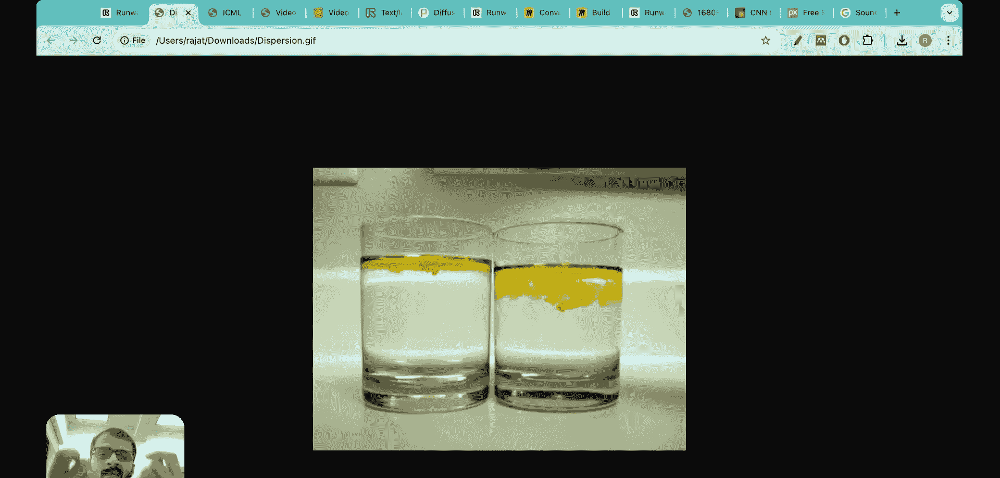
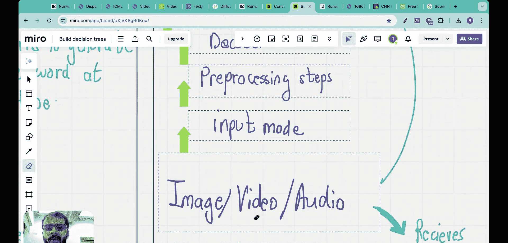
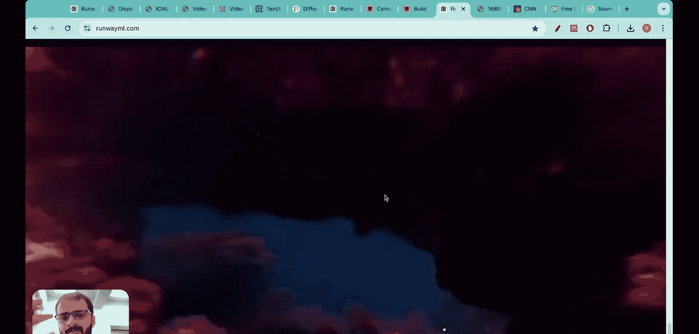
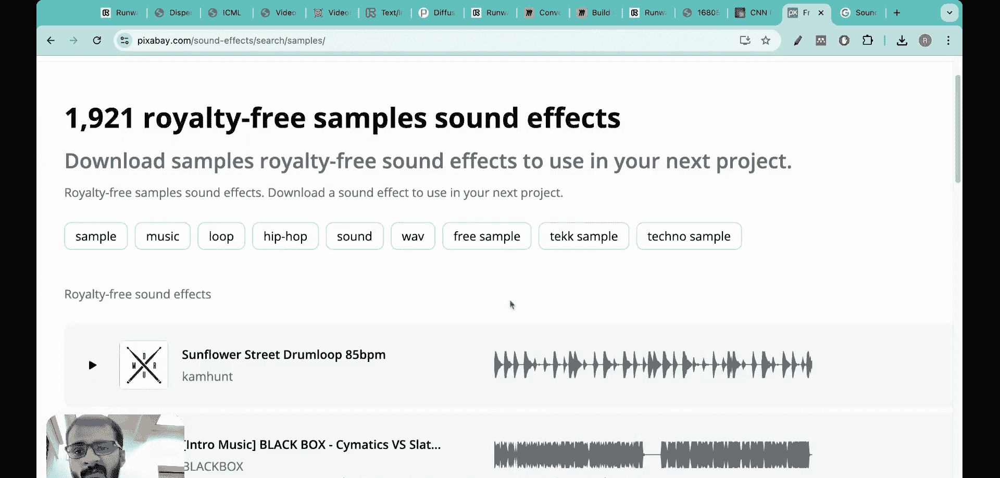
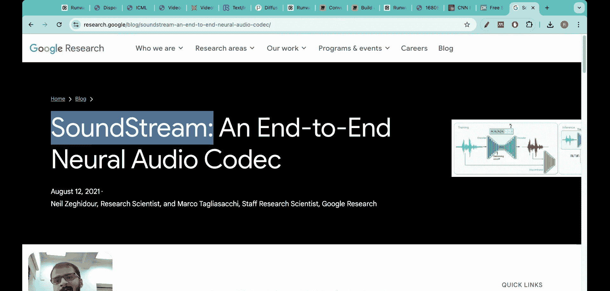
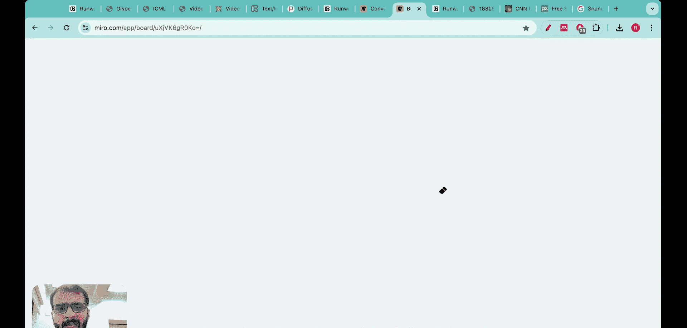

# Vizuara【中英⚡AI研究员训练营｜AI Researcher Bootcamp】 p15 P15 Language models beat diffusion？ ｜ AI video generation ｜ ICML best paper 2024 [BV1qi4VzJEPd_p15]

Take a look at this video。It looks pretty awesome， right？Looks very realistic。Looks very immersive。

Well， it is generated by AI。Most of the modern AI generated videos。Come from a technology。

 which is called as。Stable diffusion。Why is it called diffusion。

 well because we start out from an image which looks like random noise and then it gets better and better and better。

 bunch of these images are stacked together and then the AI gives you an awesome video like you have seen here。

In ICML 2024， which is one of the best conferences in machine learning。The paper。

 which was selected for the best paper award， was termed as video poet。

What these people basically said was that， hey。Stable diffusion is good。

 but why don't we use large language models themselves？For generating AI based videos。

And what if we show you that such an approach is better than stable diffusion？

Then why do we even need diffusion？That's their whole idea。

 they won the best paper award for this idea， and they have also released a beautiful website。

Caed video poet， and here you can see they have named it as a large language model for a zero short video generation。

Look at the awesome AI based videos， which they have created。

These videos are not based on stable diffusion， but。

They are from the same place where the chat GPT generated text comes from。

 they are generated through large language models。That's awesome right in this video we'll break down how this paper actually works。

 whats the technology image they have developed。So that you will develop an understanding in a very simplified and easy manner。

 so let's get started with this video。My name is Dr。 Raj Danandeer。

 I graduated with a PhD from machine learning。From MIT in 2022。

 and since then it's my mission to make these AI videos so that AI becomes accessible to all。

Here's the paper called videoide Poet， which was the best paper award at ICMl 2024。

 it's a 20 page paper but it's brilliantly written and I really had a fun time reading this paper。

First， let me start by one of the best modern。Text to video generator AI softwares or AI companies。

 and that's called Runaway ML。 What I've done here is I've given my photo here and I've asked Re to move my head from left to right。

Here is what it does。Does not really look like me。 but okay， that's pretty cool。

 Here's a image of a video of a person who kind of looks like me and the image moves from or the video moves from left to right。

 awesome。Now， making videos like this requires us to rely on a technology which is called a stable diffusion the way this technology works is that。

First， you break down the video into a chunk of images and then you process each image。

 the way each image is processed is that first you have a prompt。

 let's say move head from left to right that prompt is then applied on individual images when it is applied to an image。

First an image representation is clear is generated。

 which looks like random noise as you can see here and slowly that random noise gets better and better and better and it starts looking like the image on the right。

So on the right hand side look at this animation of this rabbit。

 it starts from a random noise and then it gets better and better and better。

This transformation from randomness to something more refined and something more uniform vaguely looks like the diffusion process which happens when chemicals are introduced in a fluid。

 that's why it's called as stable diffusion。

Most of the modern。AI generated videos are based on the stable diffusion technology。

Even the run videos like these are based on stable diffusion。

What these people from the video point paper essentially ask the question is that can we use large language models for video generation。

 why do we have to rely on stable diffusion？Let's dig into that further。

 when we look at large language models， there is a specific way in which GPT models are constructed。

There is a process which is called as pretrain and then there is a process which is called as fine duty。

 so there is a big corpus of data which is let's say internet textbooks， media research articles。

 etc that is broken down into tokens which are you can think of them as individual lovers for now then we train a large language model on these tokens so that we can predict the next world。

And this is trained on billions of data just to give you context GP3 took 4。

6 million to train these pretrained models are called as foundational models and then we do fine tuning so let's say if you are a production level company and if you want better performance you can fine tune the pretrained LLM on your specific data sets。

So this is the usual sequence of training NLLM in the pre training stage it' is usually called autoregressive method since its also an unsupervised learning the sentence itself。

The structure of the sentence itself is exploited to construct the training data。

 and the next tour is used as testing。And then the next word which is predicted in one iteration is used in the training in the next iteration that's why it's called autoregressive and it is also unsupervised。

So these are the usual steps which are involved in the training of La language models and the architecture itself looks something like this。

So here I have a schematic for the G architecture。 you have a sample text。

 let's say the sample text is this is an example of how LLM can dash this sample text is converted into tokens This tokens are fed to the decoder the decoder generates the output text that it predicts the next world。

 This is an example of how LLM can perform So it's a decoder only architecture and transformers it does not have an encoder Now what the authors of video poets say is that what if we use the exact same methodology and apply it to images video and audio So let's say instead of incomplete text here。

 we have incomplete images video and audio and then we follow the same thing we pass them through the preprocessing steps which is tokenization then we have a decoder and let's see the final output which is generated That's all which is done in this paper at a very fundamental level。

You take images， video and audio， you break it down into individual tokens。

 you pass these tokens to decoder， and then you have the final output。

 which is the image video or the audio it's very， very simple and it exactly follows what is done in training large language models such as the GP。

But the real question you need to ask yourself is how do I convert these different modalities into tokens because if you have a huge paragraph of data like large language models used we can think of tokens as individual words right there is some sort of an understanding but let's say if you take a video for example。

 how do you convert it into tokens。

Our image is pretty easy to think about it， right you just take an image it's broken down into pixel representation and maybe those are tokens。

What about is this actually true and what about the tokenization for video and audio。

 so let's see further。So let's take this video。

And let's say we want to tokenize this video。 The way it is done is that first this video is broken down into chunk of images。

 Each image is passed through a convolutional neural network。

 The convolutional neural network generates a feature map for each image。

And then that feature map is essentially broken down into tokens。

And then this same thing is done for every image， and thats why that's how you have the tokenized representation for a video。

Now the times stampamp information is also encoded in this tokenization。

 you should know which frame comes after which frame and which frame comes before which frame this is how images and videos are encoded。

For audio there is a different method， let's say if you have an audio sample which looks like this what happens is that Google has developed this audio encoder called Soundstream。

 so you pass this audio sample through this soundstream， soundstream。

 a neural network downgrades it to a lower dimensional space and from there we get the tokens。

Of the encoded audio。

So through methods like soundstream and。The method which I just showed you for the video。

 what we can do is that we can actually convert image。

 video and audio all into tokens and then once they are converted into tokens they are passed into the decoder and then exactly the same steps are followed like which are followed for the GP architecture。

It' is a very simple yet brilliant idea which these folks have implemented and when I checked out the videos which they have it truly awesome look at some of these videos。

 these are purely done from large language models， the stable diffusion is not used over here。

Be active。