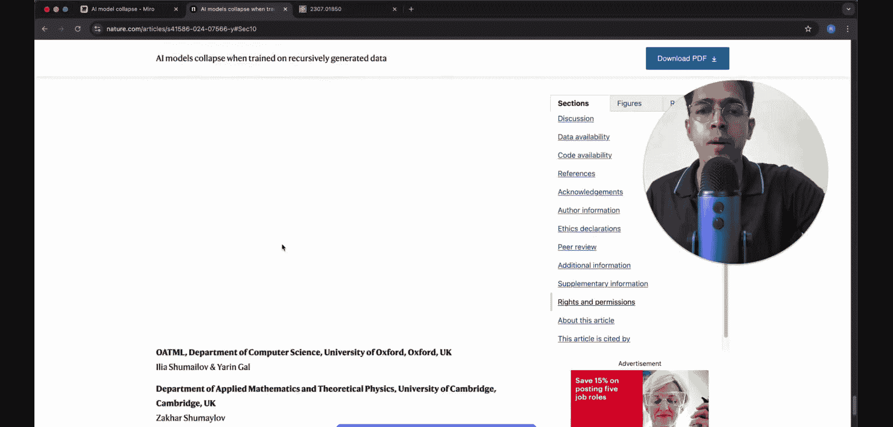
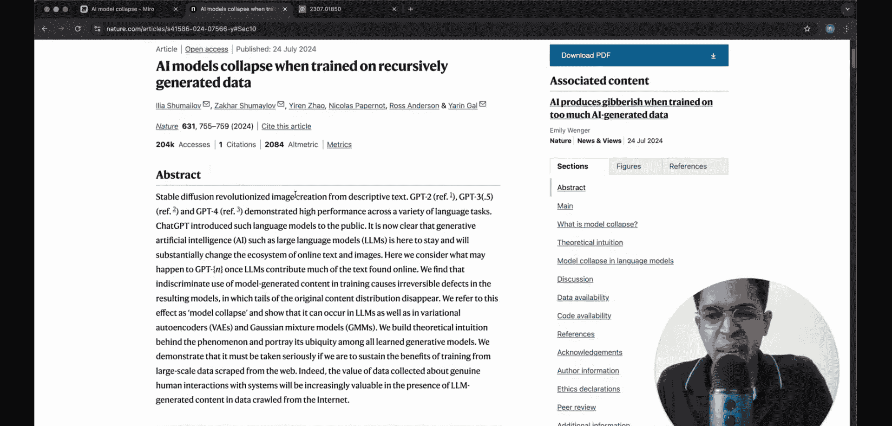
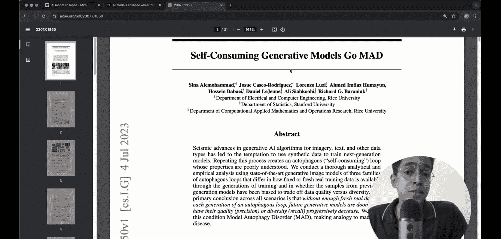
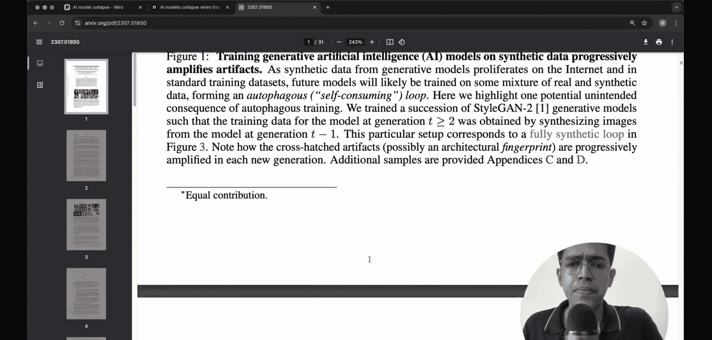

# Vizuara【中英⚡AI研究员训练营｜AI Researcher Bootcamp】 p16 P16 AI models collapse when trained on recursively generated data ｜ Nature ｜ Res [BV1qi4VzJEPd_p16]

Hi， in this video， I will be reviewing this paper that was published very recently in a very prestigious journal Nature。

😊，The paper is about AI model collapse when you train the model recursively on generated data。

At the time of making of this video， this paper has been only published two weeks ago。

So it's a very interesting paper， so along with looking at this nature paper we'll also be looking at one more paper which was published roughly one year ago on archive about selfconsuming generative models and how it goes mad and I'll show you what this term mad specifically means。

🎼Yeah。

So before going into the idea presented in this paper。

Let's try to understand how generative AI models like large language models or other image generation models how they are trained。

All of them are or most of them are trained on internet data right so there is vast corpus of internet data and that is used for creating the Gen AI training data so what data is there on the internet a subset of that is used for training large language models but the real question is what if this internet data itself consists of AI generated data so we are using chargeGT to write articles let's say news channels are or news bulletins there are posting articles written using chargeGT and imagine this continues for next 10 20 years？

What fraction of the internet data would be AI generated， what if it's 80 percentage AI generated。

 then basically the future AI models are training。On AI generated training data。

Which was created the by its parent generations， right the future generations of AI are using the data produced by the previous generations。

This can cause certain issues， so we'll see what this actually means。So， you must have。

sn this whisper game right W game is like I'll say something in someone's ears and then theyll they'll hear what I'm saying and theyll say they'll pass it on to the next person that person will pass it on to the next person and this can continue for 1015 people and by the time this thing reaches the last person they'll be hearing something completely different from what I started with so the original data which is something that I say may get completely altered when it gets passed on from one person to the next person to the next person and by the time it reaches the last person it will be something。

Completely meaningless。So。The way in which AI generates data and then。

AI training on its own data is very interesting and to some extent it resembles that of this whisper game。

There is one more interesting point to be thought。So。

If you are training AI models to generate images of people。

Most of the photos of people available on internet are probably photos of people smiling because if they are in front of a camera。

 they are maybe smiling they are in a vacation on a vacation or they they are doing something happy So they are they are probably smiling a lot in these photos that are available on internet that are taken from people and in normal life probably we won't be smiling that much。

 but what would AI learn from this AI might learn that people actually smile a lot So when AI is generated image data set or image data of people。

 maybe those data image data will have more number of smiling images than non-smiling images So what if it so happens that the internet gets polluted with these fake AI generated data of humans who are smiling a lot and then after。

😊，A lot of iterations of this happening。 AI can no longer create an image of a crying child。

 What if that happens， So this is a fascinating concept to think about。

 And it's also like on a tang related to this AI。😊，Model collapse。So。

If you think of another analogy which is also equally interesting is imagine you are studying and for studying you are copying from your friend's notes so your friend is taking notes from the teacher so teacher is your friend is listening to the teacher and he or she is taking down some notes and you are copying their notes for your own purposes and someone else is copying your notes and the 40th student in the class is copying the 39th student note so the original version of the knowledge was given by the teacher to the first student but by the time。

It gets copied multiple times and reaches the 40th student maybe there are so many mistakes right maybe the knowledge that is gained by the 40th student is will contain the cumulative mistakes of all these students who copied from one person and then the next person and then the next person like that so AI generated data and generative AI being trained on this data is in exactly that way。

😊，So。Let's have a look at this idea of AI model collapse mentioned in the Nature paper。

So what they propose is。Currently we have GP2 GT33。

54 etc so what if we have the n version of GPT or any other LLM how would it behave so they have this figure which I have snipped into this board where the initial data is the real human generated data it is used for building the zeroth version of the model right so now this model is capable of creating new data so now the sample data used for training the first version of the model will contain some fake data fake data meaning some data that is generated by the generative AI model and imagine you go on to build the n version of the model so in this paper they assume two situations one in which no data from the original training data is part of the training data for the next model so 100 percent of the data for the model one is fake meaning it's synthetic。

That is one situation in another situation the paper also assumes that 10 percentage of the data is from the original training data of the past generation and。

😊，It gets passed on remaining 90 percentage of the data is synthetic data created by the model and what will happen if this proceeds for n number of generations what will happen to the model's performance will the output be even making sense thats something that we look at in this paper。

😊，So。U。An interesting application of this which you can very quickly relate with is training generative AI models on image generation so this paper which was published I think in last year 2023 yeah it's titled self-consuming generative models go mad so what they propose is that if gene AI image generation model was trained on its own Gene images so you know let's say the generative AI model is able to create human faces like this so they look like actual people right but then this is generation 1 generation 357。

9 etc you can see that as the generation progresses some artifacts or some features are becoming more pronounced like you can see that this person on this person's face there are some kind of it's not wrinkles right it looks like some kind of there are some of these tribes who burn their face to make。

😊。

Some of these marks， it looks like some kind of marks which look very unnatural。

 but for whatever reason， the generative AI model。😊，That is capable of making these images。

ItIt's making these artifacts more pronounced in the future generations so while this initial version of the generated images look very real the later versions it look like oh something is wrong in these images。

 so this can happen if that original training data for these AI models have a lot of fake synthetic data。

😊。

And that is the case right in reality if you look at this figure in reality there are so many high fidelity synthetic images。

 there are so many websites where you can go and you can check these fake images created by AI many of them look super realistic many of them do not look realistic so you be you might be wondering what if all the synthetic data is actually looking very much like real images is there a problem I'll show you why there is a problem even in that case。

😊，So let's get back to the board。So this is one very small example where synthetic data can amplify some of these issues that or some of these artifacts which can cause issues in the output that is generated by the AI model。

This is another example where they used some model called OPT 1125 m and here you can see that this is the original input some started before 1360 was typically accomplished by a master mason and a small team of Ener and mason so it's like a small。

😊，3 sentence paragraph and you can see the quality of the output that is generated based on this input over different generations so gen gen1。

 gen Z gen 2， etc ceter， and you can see that the qualities。

