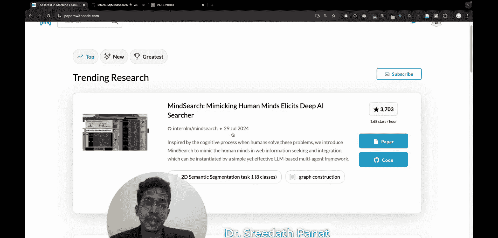
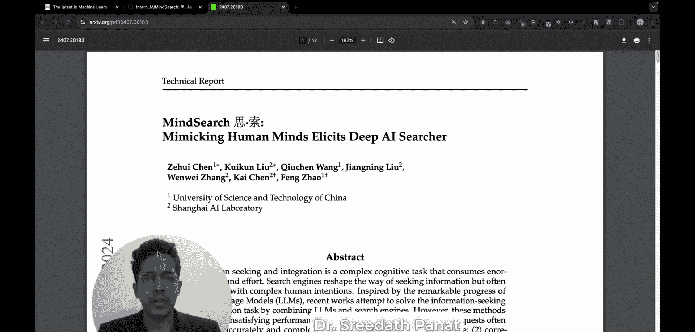

# Vizuara【中英⚡AI研究员训练营｜AI Researcher Bootcamp】 p17 P17 MindSearch： Mimic human brain for better AI search ｜ Research paper review [BV1qi4VzJEPd_p17]

系。If you have been using Cha GT to get information。In a good answer kind of manner from internet。

 you were essentially using a search engine coupled with large language model。

 search engine could be Bing and that large language model could be GPT 3。

5 or whichever GP you are using。This lecture or this video。

Is about a review of a very recently published paper on archive and what that paper is looking at is。

How can you mimic human mind or human brain。And couple that with the search engine plus large language model approach for getting very high quality answers to your search queries。

My name is Dr。 Shida Panak。I'm a PhD from MID。And this lecture is so special to me because the moment I came across this incredible paper on paperswithco。

com， I really wanted to talk about this and make this video I went through this paper in full detail。

It was published just on 29 July， so at the time of recording of this video it's been hardly two weeks right and it has already 3。

7 k stars on paperswith code。com the GitHub repository corresponding to this paper has already 3。

7 k stars large number of forks。

And this paper that was published in archive was presented by a group of researchers from China。

In this lecture well be going in deep into this paper and I'll be making it as simple to understand for you as possible so that you can also appreciate this idea of mind search which is mimicking the way human brain search for information in modular manner。

 so let's get into the video。

The main difference between Google versus Cha GPT is that Google just gives you search result in the form of web pages。

 so it is not analyzing the information and giving it to you in a easy to consume manner。

 but Google gives you the most relevant web pages from internet so that you can go to the webage and read the info and understand it for yourself。

On the other hand， when you use Google+ large language model like charge GT or I mean GPT。

 you can get a direct answer to your search query from the internet。

 so Google will do the searching and GPT will analyze the information that you get from the search result and it will present it to you in a very easy to understand manner。

But there are several issues with this， which we will discuss soon。

And what this paper about Min search does is。It looks at the idea of how can you combine？

A search engine。Plus， large language model。With the way human brain tries to get information。

 how can you do these three things together to get better and efficient response to your search query？

So if you just look at Google search。The great thing that Google has done is their algorithm is so good that whatever your search query is。

😊，It can give you the best possible information from internet in the form of web pages。

 so Google ranks the web pages based on relevance to the search query。

So this is why many companies pay a lot for SEO like search engine optimization is a huge， huge deal。

😊，Google does not alter the info， so whatever search results are coming in the form of web pages。

 those web pages appear as such。And as long as the content within those web pages are accurate。

 basically the Google search provides high accuracy results。

But the problem is Google search Google search engine cannot integrate the info， meaning it cannot。

Interpret what is the content of these web pages and give you an answer to your query。

 it cannot do that。You have to read and inform yourself。

 it's up to you for what to interpret from these web pages it's up to use to spend let's say there are six relevant web pages and if it will take you three hours to go through all these web pages in detail。

 it's up to you you have to do that work and you have to find the info you have to take the decision if you are searching regarding something to take a decision。

Now， if you combine LLM with search engine。You combine the power of。

Both you get the best of both worlds。 so search engine is incredible at you know seeking info。😊。

But they cannot integrate the info， but large language models have incredible capacity to for。

Interpreting language and for also reasoning so if you combine these two things。

You can get the best of both worlds。But what this paper is discussing is some challenges within this and those are the following。

😊，In large language models。😊，嗯。There is something called。Context length。

So you might have noticed that in charge GPT， if you paste a huge paragraph， not even paragraph。

 let's say you copy paste something from a textbook and you paste it in charge GPT。

 it's very difficult for it to consume that much information it's too big for it to process and this is because of something called as the context length。

😊，Although context size is increasing for the later models of GPT or later more modern large language models。

 this is still a limitation so basically when you are searching and finding hundreds or thousands of web pages as a result。

There is not only a huge amount of noise， but also because the info in these pages are so huge。

 LLMs will get overwhelmed because there are a lot of search results to process。

And for whatever reason， if the question that you are asking is a little bit complex。

 search engine cannot retrieve the results very accurately。

 it can actually misinterpret your intention you might have noticed that you might be asking something but the search engine go is providing you something else as the response。

So what can you do to kind of？Solve this challenge。

You can try to mimic human brain so what is so special about human brain in this context let's look at a very simple problem that we might be trying to solve at least some point in our life let's say we want to buy a new car how do we decide。

😊，What car to buy or how do we find the relevant info corresponding to this？Let's see how， you know。

 as humans， we take this decision or we find information that is relevant to buying a car。

 We first define our requirements whether the car is for。

U just for you and your partner or your kids to travel。

 whether it's for just going to office and coming back within a short distance。

 whether it's for long trips。Whether it should be heavy duty， all those things。

 then you try to initially get some basic info which are corresponding to each of your individual requirements and based on the info。

 you might redefine your constraints I you might have said that okay， my constraint is I want。

This CC engine ettera， et cea， and this is the budget etc cetera。

 but once you get the basic info you might redefine your constraint of the CC of the engine because you might notice that the budget is exceeding your limit and then based on that you will learn after you redefine your constraints or change your requirements you will learn more info and at the end of all of this process you will have a lot of options to compare and you integrate all of this information which you got as a result of an iter to process and then you take take a decision to buy a car。

So。We are not going in a linear fashion。We are not。

Taking all the information into consideration at once。😊。

We are sequentially getting info related to individual requirements that we may have and then we will take the decision so this whole process can be represented using something fascinating called graph network。

So if our final goal is to identify this car type that we have to buy， we want to buy this thing。

It is informed maybe by a few parameters， budget might be a thing， brand of the car。

The features of the car， resale value， purpose for which we are buying， all of this will inform。

The decision of which car type to by。Now within the brand。

 the brand can influence the features the features and the brand may influence the resale value。

The purpose of your car will inform the features because if you are taking it for heavy duty。

 you may be looking for a certain set of features。The features now that you want might inform your budget so will the brand so this is like a complex web of subqueries associated to a simple query of I would like to buy a car to drive to office on a daily basis my budget is 12 arup piece and I want a marruy car and please tell me what car type to buy this is a simple query but there are so many other complex subqueries that we are seeking the answer to and somehow all these subqueries are kind of interlinked with each other and this whole interlink this web of information that are connected to each other finally inform your decision so this is how human brain maps。

You know， information in a manner in which it is modularized and this is something。

