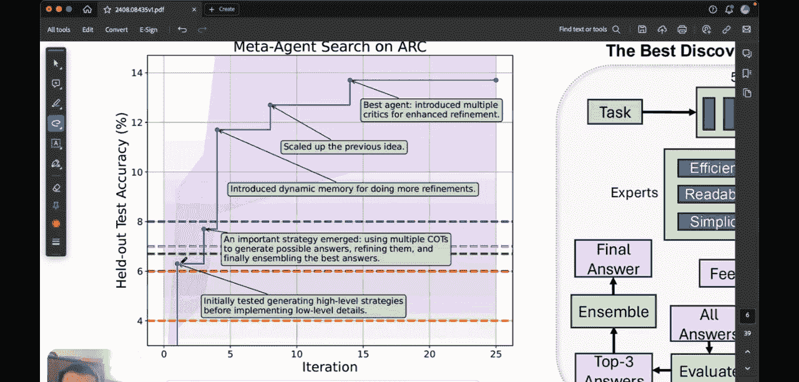

# Vizuara【中英⚡AI研究员训练营｜AI Researcher Bootcamp】 p18 P18 Are we close to AGI？ - Automatic Discovery of Agentic Systems [BV1qi4VzJEPd_p18]

🎼好ello这。Today we are going to discuss about a new paper which has recently been released。

 which is titled Automatic Design of agentic systemss。

So I'm focusing on this paper because。I I found this paper to be very interesting and。APo taking。

The field of artificial general intelligence to a new level。And。

What they have proposed in this paper is that essentially they have formulated a new research area。

Which they are calling as automated design of agent systems or it has。

The idea is to automatically create。Powerful agent system designs。In an approach where。You know。

 you're writing the agent in the format of a code itself。And then。Iteratively。

Generating better and better agents。By developing what they call a meta agent。

So the approach is that。The agent can be first defined in code。

And then new agents can be automatically discovered by a meta agent。

So what this means is it's highlighted very nicely in this figure。

So what happens is that there is this archive of agents。

Which is like a repository of all the agents which the model has learned。啊。Over time。

 you can consider this archive to be similar to an archive of books， maybe。

Where let's say youre learning about a particular topic。

And first you read something that maybe happen 50 years back， then you refine your knowledge。

 you try to understand what happened 20 years later， and then what happened quite recently。

So typically in the archive， you would have different versions。Of the agents and。

Every single agent will have， let's say different performance。 The idea is to。呃。Have。

The agent in the current version better than the previous agent， that is why you have。

More number of discovered agents。And the number of discovered agents will continue to increase。

Up until the time we run out of the iteration number。In every iteration， what happens is that。

The meta agent。You know。Take a look at the existing archive。

And then it tries to find the next interesting agent。

So we we will try to see what does interesting mean essentially it。Means that the。Agents should。

Try to give better performance compared to the previous agents in the archive。

And then it will return a new agent。So we will test the performance of this new agent on some tasks and then add this agent to archive if it is found to be satisfactory。

And then this process runs multiple times every single time this process runs。

 we discover a new agent and then we add that agent to the list of。Agents in the agent archives。

This is basically what it means by ADS automatic design of agentic systems。

Their main hypothesis is that the history of machine learning。开始。Reveal the recurrent theme。

And that theme is that。呃。Over time as we get more compute and data。呃。

Hand design features are replaced by。By better systems， which are more automatic in nature。

So what what they are saying is that historically we have seen that the field of machine learning has evolved from。

More manual intervention to a place where， you know， for example。

 CNNs where the features are now discovered by themselves without having to。

designign the features by hand and they are trying to extrapolate that for agentic systems as well。

 they are saying that instead of manually designing new agents every time。

Can we have a system where the new agents are？Discovered automatically。And that's the main idea。

And they are trying to pose this。A research question， can we automate the design of agent systems？

Rather than relying on manual efforts。So that's the basic hypothesis which this paper is trying to solve。

And this paper is a very easy read， and I'm just going to take one example to demonstrate what exactly they are trying to do。

So we will take the example of， let's say。Okay， so let's take this example of。Okay。

 so we'll take the example of the ARC challenge。So what happens in this challenge is that you are given three sets of input output examples。

 this is the first set， this is the second set， the third set is not shown here。

And then what happens is that typically there is some kind of a transformation rule which takes the input to the output and manually you can see it right the transformation rule is simply what is happening is。

It's kind of filling the bounding box。Outside the central square like this。

Right so we understand this as humans， but the question is that can we build an AI agent that can understand this logic and then given a test grid it can go from this test grid to the answer。

RightSo given a new design。Can it put squares around these and then tries to predict this answer？

It turns out that traditional AI agents are not very good at this and then let's see what these people do using their methodology。

So what they do is that firstly， they。They define a description for this meta agent。

RightAnd then what this description see is that。Your aim is to find an optimal agent performing well on ARC。

 which is the abstraction and reasoning corpus。In this challenge。

 each task consists of three demonstration examples， and one test example。

Each example consists of an input grid and an output grid and test test takers need to use the transformation rule learned from the examples to predict the output grid for the test example。

 so this is exactly same what I was demonstrating to you before。Now what is this meta agent。

 this meta agent uses the GPT 40 model。Which is developed by Open AI。Okay。

 and this is an example task from the ARC challenge， which is。

You can sort of consider this like a prompt that you provide to the large language model。

 so the meta agent is。Is just a piece of code？WithWith this prompt given to the agent right so here this is an example it says overview of the task。

And it says you will be given some number of pair example inputs and outputs the outputs were produced by applying a transformation rule。

And your task is to determine this transformation rule， which is pretty clear and it gives。

Example zero， example one， example2， three examples， and then finally it has to。And the lies and。

It has to find the transformation rule based on these examples up until now it is pretty simple this is what the meta agent description actually looks like。

Now， what happens is that。Based on the flow chart， which I showed you， which is shown in figure 1。呃。

The ADs discovers multiple lesions。So in the first step agent one is discovered it is added to the archives in the second step agent2 is discovered added to the archives similarly it goes on discovering better and better agents。

And we can actually see what happens。In this discovery process。So。嗯。Yeah。

 so this is what happens in the discovery process， so what happens is that。So。

 this is the this is the test accuracy and these are the number of iterations right so as you go from iteration 1 to iteration 25 newer and newer agents are discovered and added to the archives。

This is the this is the first agent you can see the accuracy is not very good。

