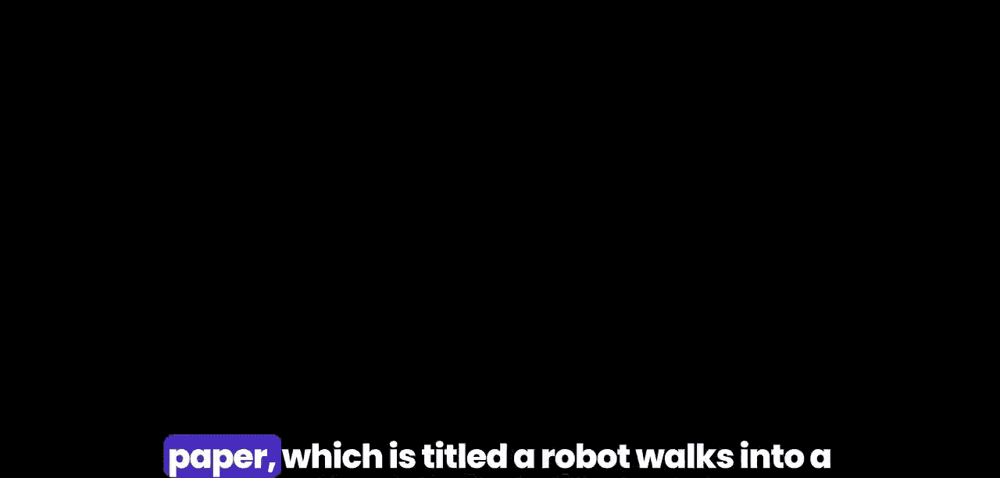
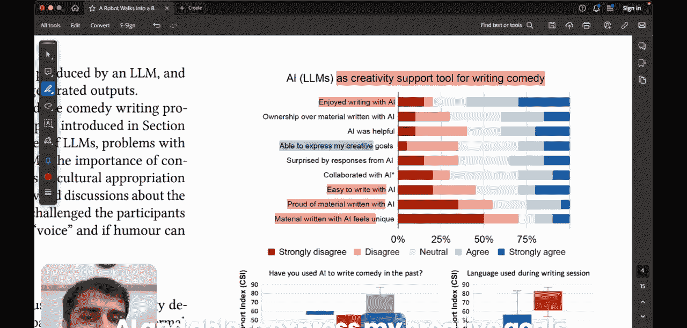

# Vizuara【中英⚡AI研究员训练营｜AI Researcher Bootcamp】 p19 P19 Using AI For Standup Comedy - New Research Study by Google DeepMind [BV1qi4VzJEPd_p19]

🎼Hello everyone， Today I'm going to take you through a very interesting paper。

 which is titled a robot Walks into a Bar。

And the main objective of this paper is to explore whether language models can serve。

As a creativity support tools for comedy。And the topic is itself very interesting because。

It it dives deep into。Whether stand up comedians。Can actually find a lot of。嗯。

lot of usefulness with the help of large language models to generate their script and create their content。

So what these people have done is that they have interviewed our 20 professional comedians。

Who perform live shows in front of audiences？And。They have conducted a survey which consisted of a human computer interaction questionnaire。

And through that questionnaire， they try to understand whether these people are actually being helped by child GPT or not。

So it was it was a workshop termed as AI。EI and community together。

The idea was to explore whether any form of biases or anything which is at the heart of these large language models。

 it affects the generation of the come content。While you are watching this video。

 just try to think about what all factors might influence a comedy and writing a comedy。

 you know so whichever standup comic you really like which part of the jokes do you like。

You might be relating with their personal story with their personal context。

You might be relating with the type of the humor whether it's a dark humor it's a bit of an offensive humor so every comedian has their own different style and it is that style which has made them popular so here what we are trying to explore is itself very interesting because here is a piece of software which has evolved through let's say training on a large set of data a large corpus of data and now we are trying to you know generate comedy with that so yeah so this topic really interested me and I wanted to help you guys understand what I learned after reading this particular paper。

ok， so诶。Let's look at it it in detail now the the main subject of inquiry is whether machine learning and humor can be combined together and its it's。

It's a very fundamental challenge because。As they say。

 humans are the only known species that use humor for making others laugh。

And humor has evolved through millions of years of evolution。

And how it has evolved is that it gives us the capability of maybe connecting with the fellow human better。

And humor is not just in what you say， but it's a complete mixture of the facial expressions。

 the context of the words and everything， so it's really hard to pen down exactly why this particular piece of comedy made you laugh。

And that's why the difficulty of this task is really。Really quite high。Okay。

 so so these people had certain hypothesis which they wanted to test。

Before they conducted their study， the first hypothesis was that whether LLms are。

actly biased and whether that plays out in the committee which LLms have generated。

 so these these biases can be of two types， gender and racial biases。

And they have listed down all all these biases in detail。

 so some of these biases can be representational bias itself。

And some of these can be extrinsic biases which are manifested as a downstream consequence of these biased models。

Basically， biases can affect the way the script is generated a lot because if you have a bias towards a specific religion or a specific gender then then。

Your jokes will always be in a specific type， so biases narrows you and if large language models are indeed biased that will come out in the script that was their hypothesis。

 it remains to be checked whether it's true or not。

Potential censorship of speech labeled as offensive。

 so comedians often use languages which has a lot of profanities and their materials can have some provoking themes as well。

And these people， they have emphasizesized that LLMs。Might censor your content。

 that is they will refuse to answer offensive prompts。And this will really。

Take away the core essenceescence of comedy for a lot of comedians if let's say there is a lot of dark humor or offensive jokes at the heart of their comic routine。

 then this censorship by the LLMs will really hamper the way the script is generated。

So these comedians typically use offensive jokes to punch up and satire that is to challenge existing social structures。

To build empathy rather than to punch down so it's not used to basically put someone down but it's used as a satire to challenge existing social structures so if you have seen some of these come routines then you might be understanding what I'm saying。

Then these people also thought that LLMs will completely miss the context and the context is really the key otherwise if you just hear something or if someone says something to you without knowing the context you might get offended right。

 so the joke should always be linked to the context properly otherwise it will not land。

And this is what they thought will happen。And finally， the content will be homogenized。

 which means that the AI generated artifacts。Mainly to a homogenization of aesthetic styles。

 for example， if there is a biasness towards a certain ethnicity。

Then that will become an homogenizing force and it will become a socially dominant one。

So all of these were the hypothesis which the authors had before they conducted the study。

And then finally。They write down what is the exact study they conduct and how they perform the study。

 so basically they ran the workshop with 20 comedians and out of which the first workshop was with 10 participants in person。

And the following three workshops were done online。

They started the three hour session by describing the agenda of the program and asking them to basically fill the information sheet and the context form the first exercise was the writing exercise in which participants had to。

Engage in a comedy writing exercise they spent around 45 minutes working with this large language model to develop a script。

And。The researchers invited them to use the language they felt comfortable with。

They use the tool to generate， explain jokes， core write jokes via iterative prompting and analyze rewrite or complete some of their previous materials。

 so it was used as kind of an assistant for generating the script for the comedy routine and most of them used Cha GPT3。

5 some of them also use GPT4 or Google bard powered by Geminniro。And then after that。

They asked the participants to fill out a number of surveys and the second survey was used to calculate the creativity support index。

So basically the more the creative support index， the more creative and satisfying is the script which is generated with the help of AI so the CSI has exploration。

 expressiveness， immersion， enjoyment， results， etc。

And then finally there was the focus group questions so now let's let's look at the results。

 I hope you have understood the broader aim of this study and how this study is conducted。Basically。

Lets let's look at the output of this right， so AI as a creativity support tool for writing comedy。

So most people， let's say if you look at this question， whether the material written by AI is unique。

 most comedians disagree with this， they say the material is not unique， it's very common。

Whether you enjoyed writing with AI， so there is a majority of people who say yes， they did enjoy。

They are not proud of the material written， it was not very easy to write with AI。

And able to express my creative goals also it's not a very strong agree。

