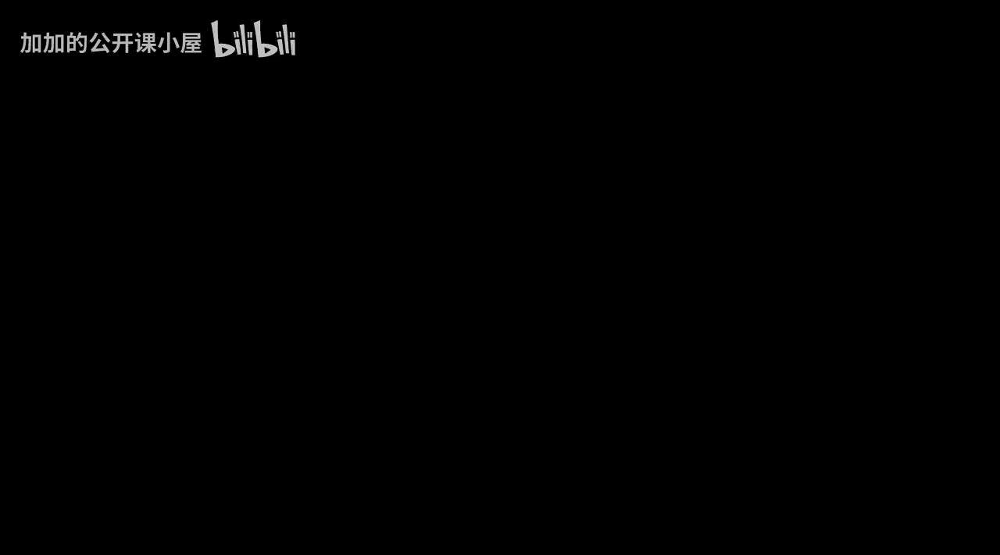
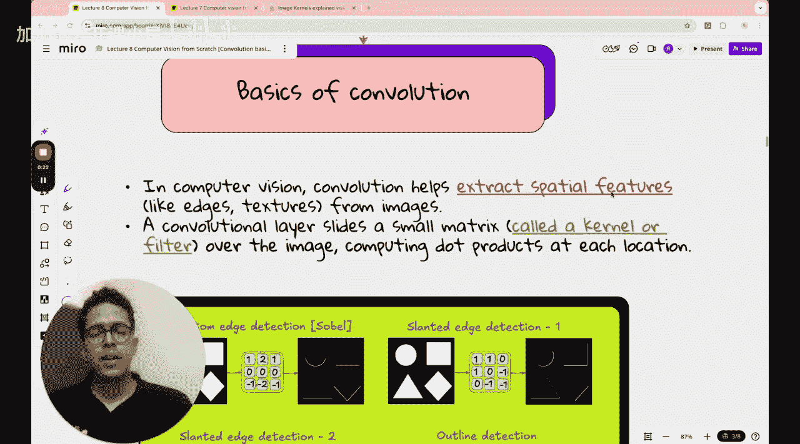

# Vizuara【中英⚡面向新手的计算机视觉｜Computer vision from scratch】 p01 P1 AlexNet - the neural network that transformed Computer Vision ｜ Convolution, [BV1UMxxzPE5Y_p1]

Hi， welcome back to a new lecture from the course computer vision from scratch today we'll be learning about convolution layers。

 pooling and E。If you don't know any of these termss， don't worry。

 we'll be approaching this as if we are all complete beginners。

We have spent some time on convolution filters in one of the earlier lectures at the start of this course。

However， we did not look at convolution from the context of deep neural network layers where in the reality you have multiple convolution operations that are being applied on your data one after the other。

 so we'll be looking at convolution as an individual kernel or individual filter that is being applied on animation we will also look at convolution as a stack of operations。

Then we'll spend some time on pooling such as Max pooling which is very famous operation used in many deep neural networks and towards the end of this lecture we'll be also implementing Alexnet which is one of the most popular deep neural networks and AlexNe had revolutionized the way deep learning was implemented for various tasks especially for computer vision related tasks so this is going to be a very important lecture and I'm so excited to have you all here so with that let's get into the lecture。

So before we get into the lecture as always， let us all remind ourselves that starting a course is easy but finishing is not and if you have reached until this point you have already done a fantastic job you have covered a good fraction of the course already but let's remind ourselves to finish the course because there is a reason why we started so have a pledge it keep it for yourself if you want to make yourself accountable。

 have a friend or whoever is learning the course along with you keep each other accountable or even put a comment publicly so that you are publicly held accountable but at the end of that it is all about internal motivation and discipline。

 but I hope that you can carry forward this course along with me till the end of the last lecture。So。

At the end of today's lecture， we will understand what exactly is a convolution filter。

 how does it operate on an image， what does it do？We will see the implementation of convolution plus after that。

 also pooling， especially max pooling。We will spend a little bit of time on Alexnet AlexNe is a historic milestone in the machine learning。

 deep learning evolution。Because Alexnet completely changed the way deep learning was implemented for tasks like computer vision related tasks so we will understand the architecture of Alexnet in detail。

 but not just that we'll also implement Alexnet for our dataset that we have been following throughout this course which is the fiveflow data set so you will see what kind of results can we get by using Alexnet we'll be using pre-trained Lnet because training from scratch will take a lot of time and it's unnecessary so just like how we learn from the transfer learning lecture we be using pre-trained Lnet but we'll see what kind of results can we get meaning what kind of training accuracy and validation accuracy can we get by implementing Alexnet on the fiveflow data so with that let's look at what is convolution operation。

Before we go into convolution， I think a small recap of what exactly are we doing and what did we do so far。

 I think that will be very helpful to all of you。So why are we learning all of this what exactly are we doing So just to remind you we are looking at fiveflow data set so we have DC dandelion roseosis sunflower tos so it's a data set consisting of thousands of images and each image belongs to one of these five categories so we are trying to build a five class classifier so what did we do we started with a linear model and what is a linear model we converted the RGB images like this into a fully flat layer so we flattened the image with RGB RGB like that repeating and then we had a fully connected connection to the final out layer which was a five node layer。

And when we drain this neural network and you can already see that this is a very this is not even a neural network this is just a linear model right because there is no hidden layer there is nothing special going on here with this linear model we managed to get like 4045 percentage accuracy we had no activation we simply had softax in the last layer but that was just to convert the final output into a probability distribution so 40 to 45 percentage was the accuracy loss was 10 to 20。

😊，After this we thought okay maybe we need a hidden layer to make our model better because if we don't have hidden layer how can the model learn a lot of complex features or complex things that are happening in in these images right so we added one additional hidden layer with 128 node but this time we did not go with a linear model we had really rectnified linear unit activation function we thought this might improve the accuracy by a good fraction but it did not happen accuracy stayed like when I say accuracy I need primarily training accuracy。

It was it was in this range 40 to 45 percentage validation accuracy was also somewhere in that range。

 not tremendously high， but interestingly loss decreased by an order of magnitude loss was one to2 percentage instead of 10 to 20 percentage so。

The number of images that were getting classified accurately was still the same。

 which is why accuracy did not change， but the confidence with which current classifications were being made that was better so that's why loss decreased。

😊，Then we thought okay this is also not very good， can we do something else。

 maybe we can we can prevent overfitting which may be happening because we had noticed that in some cases we were getting 55 percentage training accuracy and like 3540 percentage validation accuracy so some kind of overfitting was going on and this was getting more pronounced as we increase the number of epos so we thought okay we have to implement sort sort of overfit prevention techniques so we had regularization L and L2 regularization we had batch normalization。

 we had dropout we also had early stopping so in regularization you prevent the waste from blowing up you kind of restrict the weights the magnitude of the waste in batchsh normalization you make sure that your data set is centered around mean equal to zero and standard deviation equal to1 in dropout we kind of switch off certain norms in the neural network layers。

With a certain probability so if the probability is 0。

5 there is a half or 50 percentage chance that a node will be inactive in that particular training and we also implemented early stopping so epos if the epoch continuously decreases for let's say sorry if accuracy continuously decreases for two epos then you can stop training from that point on so this is early stopping it did not increase our accuracy tremendously our validation accuracy was 50 to 60 percentage so not a great improvement loss was still one to two percentage but training accuracy we were able to take to maybe 80% in some cases so but validation accuracy was still 50 to 60 percentage not so great right it was not the best because this is a five class classification the worst possible classification accuracy is 20 percentage in the case of a random guessing so 50 to 60 percentage is not that。

Incredible considering the fact that we have hidden layer， we have non nonlinearity。

 we have all these regularization batch normalization etc cetera。

 which is why we realize that we have to do transfer learning。 So in the previous lecture。

 we spent some time on transfer learning where we used an already trained neural network。

 So this neural network was already trained on imagenet data and this neural network had。😊。

Not a random waste and biases which had pretrain pretrained weight and biases so with this pretrained neural network we added an additional final layer which had five nodes and then we allowed the neural network to train on the five flower data set。

And with that we were able to get training accuracy sorry validation accuracy of 80 percentage and in fact training accuracy we even managed to get about 100 percentage so this was the biggest jump because we initially struggled at 40 to 45 percentage validation accuracy and eventually be almost doubled training accuracy at least almost 100 percentage validation accuracy80 it could it could reach to even to 83 percentage so this was great not the best but but very very good improvement so today's lecture will make you even more happy。

😊，For obvious reasons， because at the end of today's lecture you will see how how the accuracy can even be made better so today also we'll be looking at transfer learning but well spend some time on convolution polling and at the end LXnet but Lnet will be using as。

Bretrained Alexnet model so that we can transfer some of the learnings from its previous dataset set on whatever dataset this Alexnet was trained on so with that let's get into the basic aspects of today's lecture I hope this recap gives you a very good perspective of what exactly have we trying to do。

So what exactly is convolution？You can think of convolution as if you are performing a moving dot product。

Of one small matrix on top of another big matrix， the small matrix is called as the con filter or a kernel。

The big matrix could be thought of as the pixel values of your image。

