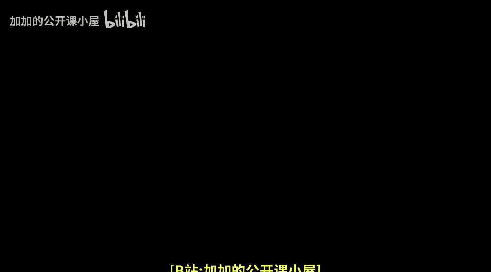
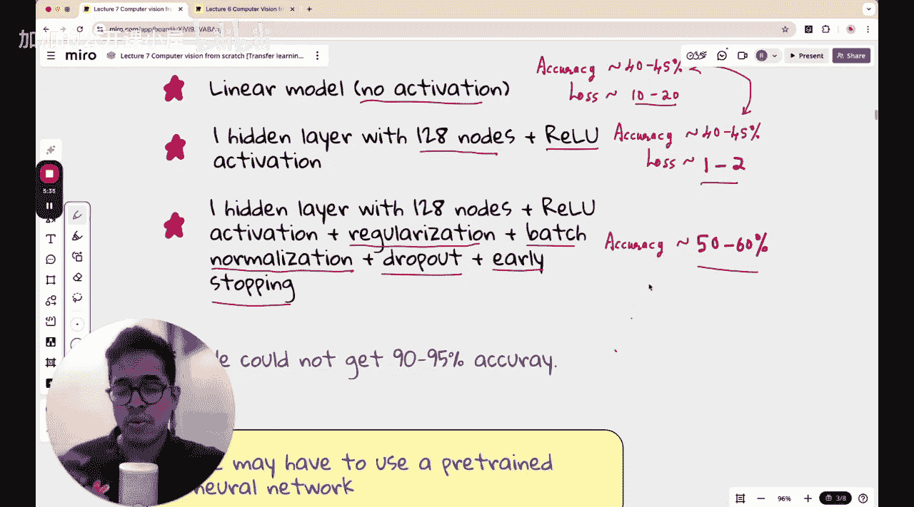

# Vizuara【中英⚡面向新手的计算机视觉｜Computer vision from scratch】 p02 P2 Transfer learning： Pretrained embedding, fine-tuning, differential learning ｜ [BV1UMxxzPE5Y_p2]

Hi， welcome back to the lecture series on computer visionion from scratch today well be learning about transfer learning。

😊，If you have not watched some of the previous videos in this lecture series， don't worry。

 because this lecture is almost like a standalone lecture because the concept of transfer learning is universally applicable for various deep learning related problems which are within computer vision and outside of computer vision。

And if you have been following some of my previous lectures in this course。

 maybe you would have felt some pain because we have been trying so hard to build a deep neural network that can classify5flow data set with some decent accuracy right we were hoping to get some 90% 95% accuracy but none of that happened because we were still trying simpler models。

So if you felt that pain by the end of today's lecture， you will feel very。

 very good because today we are going to have some happy time by building a model that actually performs very good classification on our data。

 so with that let's get into the lecture。And as we always do in this lecture series before we start the lecture。

 let's remind ourselves that there is a reason why we have started this computer vision series right it's to learn C techniques and it' basic fundamental principles from scratch so that we can use it for our own benefit after the course so if there is a reason why you have started this we should finish it so that is the pledge that we will take together so ideally if you are studying this course with one of your friends or acquaintances feel free to keep each others accountable to make sure that you are finishing the lectures one after the other。

And if you would like to keep yourself accountable by publicly commenting， feel free to do that。

 either way， whatever works for you feel free to do that， and I'll be repeating this one thing。

 one point at the starting of every single lecture in this series because I really。

 really want to make sure that you follow this lecture series from start to end so that you maximum benefit from it。

So with that being said， let's get into today's lecture and just briefly mention what exactly can you expect to learn by the end of today's lecture。

 so you will learn about pre-trained embeddings， so pre-trained embeddings。

 meaning if you have a deep neural networks network that is already trained on some other data。

 not the data that you are currently trying to train a neural network on。

 but some other internet data。😊，Can you somehow。Take those embeddings。

 meaning those weights and biases and those parameters and can you transfer that to your current neural network and enhance the neural network's ability to perform classification on the data of your interest so pretrained embeddings can be kind of imported and that can be used in your current model and this is also broadly called as transfer learning this is a very famous term and I absolutely love the way I mean I don't know who coined this term but this is an absolutely amazing way to mention it because see people are training neural networks on all types of data sets So there is no real need for you to train something on your own if you really think about charge GT there are fine tunings which you can perform on large language models right so there is really no need for you to spend millions of dollars to train a GT completely from scratch or train any other language model completely from scratch you could also take some LLMs that。

People have already trained on extensive internet data and you could perform fine tuning on that。

 so we'll be learning about these concepts in today's lecture from the context of neural networks for image classification。

 especially deep neural networks for image classification but many of these ideas also have parallels with how you do fine tuning in large language models so maybe if you are familiar with the space of large language models these terms are kind of familiar to you。

But either way， let's get into the lecture assuming we are starting as a complete beginner。

 all right。😊，So why are we learning about transfer learning？😊，In our course。

 the reason why we are doing this is because for every single thing that we are going to do in the future in computer vision throughout this course。

 you will be almost always using transfer learning。😊。

So I'll give you a brief recap of what we have been trying to do so far in this lecture series so that even if you have not followed some of the lectures before。

 you can still catch up very easily。So we have this dataset called as five flowers dataset we have five flowers D see dandelion roses。

 sunflowers and tulips What we want to build is an image classifier。

 a5 class classifier that can perform classification on top of this and there are roughly I think a few thousand of these flowers in each category the exact number I have to check but basically the data is not like1 hundred000 or a million images it's not that big it's probably two orders of magnitude smaller than1 hundred thousand flower data so this is a relatively small data which makes it very difficult for training a neural network completely from scratch and achieve very good accuracy so if you had a neural network which was performing random classification as if it's a monkey and this monkey is now picking one of these classes as the flowers predicted class monkey will be accurate 20 percentage of the times right because it's random classification。

😊，Similarly， a very bad neural network in this case can get a minimum 20% accuracy。😊。

Now with that if we compare with respect to that very bad neural network we did three things first is we tried linear model and in this linear model there was no activation function so no activation meaning we had a soft match layer to get probability distribution at the end but other than that in the main architecture we had no activation function so what we did was we took the images converted the RGV pixels into one single flattened layer and we had a fully connected。

Connections going from this flatten layer into the final output layer al right so this was the linear model and the accuracy that we had especially in training was 4045 percentage and test validation was maybe less than that 30。

35% and loss was on the order of 10 to 20。Then what we did is we added one more hidden layer。

 this hidden layer had 122 nodes， 128 nodes， and this layer also had a rectified linear unit activation function。

Unfortunately， although we were expecting better accuracy in this case。

 we did not get a better accuracy， we got still somewhat similar accuracy as that of 4045 percentage exact number obviously depends on your the specific hyperparameter or specific random number see etc but this was the range of accuracy but one surprising thing was that the loss decreased from 10 to 20 the loss decreased to1 to 2 so this was interesting because so we also had a question here so if loss decreased by an order of magnitude how come accuracy did not change that is because the number of images that this model is classifying accuracy is not increasing it is classifying model is 4045 percentage images correctly in the validation dataset or in the training dataset one of them。

😊，But the reason why loss has decreased is because each prediction became more confident so instead of saying this is 75 percentage DC the second model with 128 nodes started saying this is 95 percentage DC so this confidence reduced the cross entropy loss right so that was the logic behind loss reducing by an order magnitude but accuracy kind of staying the same。

😊，Then what we thought was， okay， this is again not very helpful to have just 128 nodes and rate value activation function。

 so what we did was we introduced。Some regularization techniques to make sure that we can improve the model's performing performance by eliminating possible overfit we noticed we had noticed that there was some overfitting happening from graphs like this so in this graph you can see that training accuracy was keeping on increasing after after 5 apos but validation accuracy had started to drop after3 epos so this was kind of a sign of overfitting happening in the model so we thought okay let's do regularization so we did regularization with L2 regularization。

😊，We used batch normalization， so data set mean value was close to zero data sets average the standard distribution was1。

We introduced dropouts so certain nodes in different layers were switched off at a predefined percentage probability。

And we also introduced early stopping so that we will not run the model for many number of epochs so once the moment the validation accuracy starts to drop it will look for a few number of iterations and if the validation accuracy is not improving the model will stop training so with this we were expecting a very good accuracy but that also did not happen so accuracy only increased to 40 from 40 to 45 percentage it increased to 50 to 60 percentage so these were the results so accuracy increased up to 60 percentage in training validation was like 0。

45。5 in that range so not a tremendous improvement only slight improvement but it gave us some hope right some hope that okay our from scratch approach may work if we do more maybe more comprehensive models or some other things。

😊。

But。😊。