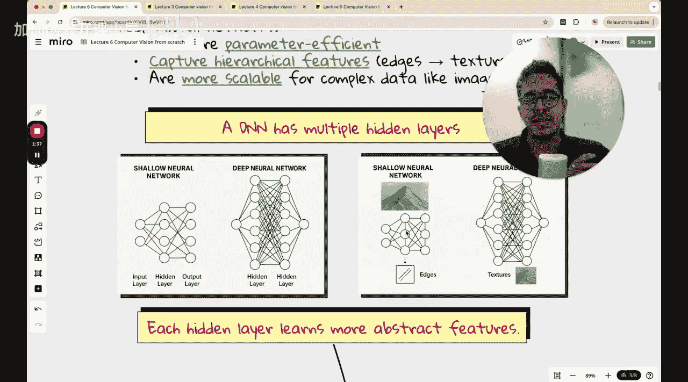

# Vizuara【中英⚡面向新手的计算机视觉｜Computer vision from scratch】 p03 P3 Overfit prevention - Regularization, Dropout, Early Stopping, Batch Normaliza [BV1UMxxzPE5Y_p3]

Hi， welcome back to the course Comp vision from scratch In today's lecture we will be spending time on four topics which will help us minimize overfitting in our neural network。

 so we will be discussing about regularization dropout early stopping and batch normalization you may or may not have heard of these topics before but don't worry I'll be speaking as if you are a complete beginner。

I will also give you a brief recap of what we did in the past two lectures。

 so you have enough context even if you are watching this lecture without the prior lecture memory。

 so we'll be covering about what we did and what we are trying to do in this lecture to make our model a bit better alright。

So before we start as always， I just want to take a moment to just communicate to you that starting something is very easy but finishing is not and all of us have started learning computer visionion for a specific reason we want to become really good at this so that we can solve problems that are relevant to people in research or in industry so since you have already started this series。

 let us take a small pledge to make sure that we will finish this all the way to the end if you have a friend who would like to learn along with you keep each other accountable or you can even just publicly comment so that you will keep yourself publicly accountable whatever works for you feel free to do that but let's pledge that we are finishing what we have started。

😊，With that， let's do a small recap of what we were doing in the last two lectures。In lecture three。

 we built a linear model for classifying the five flower data set。

 so our data set was something like this we had different type of flowers， D C， dandelons， tulips。

 then two more what were those。Let's open the data yeah these were the data D dion tulips。

 sunflowers and roses， so we have dataset set of images consisting of flowers in these five categories so we are doing a five class classification so first we thought okay instead of directly jumping into deep convolutional neural network we will start with a linear model which has no convolution operation no activation function its simply what it does is this is the architecture of the model that we followed let me just scroll down。

So we had the RGB image we converted it into a flattened layer where RGB pixelels are like like a one dimensionmenional vector then we had a fully connected connections going from this flattened layer into the output layer at the end we had softmax although it' is technically an activation function it is used only to convert the final predictions into output probabilities and we saw that this model was very bad the classification accuracy was close to 4550 percentage。

So what we did in lecture4 was we thought okay maybe we can make the neural network a bit more complex so we added one more hidden layer。

 this hidden layer had 128 nodes in the in this particular lecture we were having fully connected connections from this flatten layer into the hidden layer it was fully connected from hidden layer to into the final output layer it was again fully connected and here we were using Ra rectified linear unit activation function。

😊，But here also to our complete surprise， although this was a much more complex model。

 we saw that the classification accuracy was not improving that much。

 we could improve it a little bit but yeah our loss came down by an order of magnitude so the linear model loss was between 10 to 20 our loss came down with this additional layer and activation our loss came down to between one and2 so of course that happened however that did not result in increased classification accuracy but what was happening as we discussed in the last lecture last to last lecture was that the predictions were becoming more confident meaning in the softm instead of let's say having 0。

1。6。1。1。1 here the prediction says that the highest probabilities for class number2。😊。

We were getting something like 0。25。90。25 I mean 0。0 to 5。0 to 5。0 to5 etc ceter。

 so it was making the same prediction but more confidently because of that loss was decreasing but the total number of accurate predictions for all the image images in that test dataset that was not increasing so accuracy more or less remained the same。

😊，Then in the immediate lecture before the current lecture。

 what we did was we decided to do hyper parametermeter training。😊。

And in this hyperparameter training we decided to change the number of epochs。

 we decided to change the learning rate， we changed the batch size， we changed the image size etc。

 and to do this hyperparameter tuning properly like like a professional rather than manuallyly copying and pasting the code in multiple Google Collab accounts and running them parallelly we decided to use weight and biases platform and what we did was we wrote the code which was very minimal modification to our earlier code。

😊，Such that we can automatically log the experimental results into weight and biases so that is what we discussed in the last lecture we also went through the results that were plotted in weight and biases platform for various hyperpara but we saw that even when we change the learning rate even when we change the number of epos or the batch size or the image size itself we were not getting significant improvement and we in fact also realized that perhaps a lot of overfitting is happening and this graph is a classic example of overfitting because here you can see that training accuracy is continuing to increase while the validation accuracy has kind of plateaued and then it started to decrease。

😊，Wwhichch means the model is now trying to memorize the features in the training dataset which is almost probably noise and that is why in the validation data the model performance is deteriorating and this is a classic sign of overfitting so in today's lecture what we will be doing is to figure out various ways in which we can minimize the overfitting and by that hopefully we will increase our validation accuracy as well as the training accuracy so with that let us get into today's lecture。

😊，So in this lecture we will discuss a few ideas first we will talk about how deep neural networks that includes convolution operation can learn some specific features in those images。

😊，And we will also discuss how the problem of overfitting arises in these models and how you can detect that。

And then after that， we will spend the majority of the time in today's lecture in four techniques。

 regularization， which improves the model's ability to generalize the patterns in the training data so that during validation it performs better。

😊，We will learn about dropout which is also another regularization technique。

 but here it is slightly but slightly different from how regularization is normally implemented we will discuss the details of this so don't worry if you are not familiar with these terms。

😊，We will discuss about early stopping where we don't run as many number of epos the moment we see that the validation accuracy is starting to decline so we will decide to stop training the model early before the validation accuracy starts declining because when it starts to decline and when the training accuracy starts to increase it's a classic sign of overfitting so once that starts to happen we don't want to train the model anymore and we will also discuss at the end of the lecture a very powerful technique called batch normalization which is used for normalizing the values that are going into a layer of the neural network so that the mean is close to zero and variance is close to one so all these four techniques we will individually explore and at the very end of the lecture we will also implement in code on our fiveflow data a model with all these four techniques applied at the same time to see how how much of a good model we can get as a result so this is。

Agenda of today's lecture。So why are we keeping on exploring deep neural networks because as you might have guessed the direction in which we want to go in this course is towards convolutional neural networks because you know that they are the most efficient types of neural networks for image processing and we want to go in the direction of transfer learning and all of these are deep neural networks right so why do we go deeper meaning why do we add more and more hidden layers because unlike any other universal function appromators which can approximate pretty much any pattern you see in a function because at the end of the day the data that is presented in the form of images are numbers in the pixels right and this can represent this can be hypothetically represented using some sort of function so we are trying to build a universal function approximator Fourier series is one example of universal function approximator but if you look at deep neural networks they are much more efficient in terms of number of parameters to be used for。

mtting a certain function， so are that's the reason why they are called parameter efficient。

The second thing is these deep neural networks can actually unlike shallow networks we explore in the lecture3 and 4。

 it can detect not just edges in the images， it can detect textures within the edges which will help us detect objects so these two images at the bottom here it shows。

Just as a demonstration， the idea of detecting edges and textures so in shallow neural network it may be good at detecting overall shapes so if two circles versus two squares are there if they are approximately squares and approximately circles。

 these shallow neural networks，😊。

