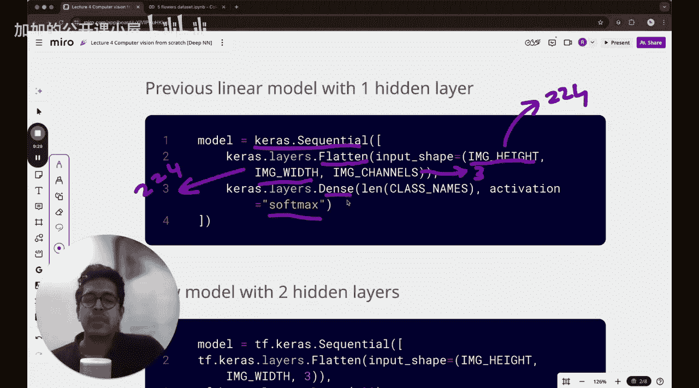
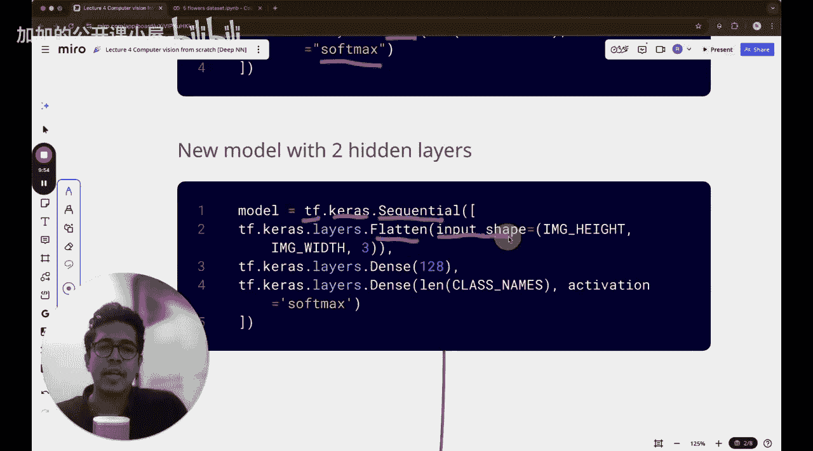

# Vizuara【中英⚡面向新手的计算机视觉｜Computer vision from scratch】 p05 P5 Neural network for image classification ｜ Computer Vision from Scratch series [BV1UMxxzPE5Y_p5]

Hi and welcome back to the course Comp vision from scratch in today's lecture we will be building a deep neural network with just simple two hidden layers and unlike what we did in the last lecture where we were using a linear model。

 this time we will be using activation function。And we will see whether this simple deep neural network can actually perform classification on the five flower data or not。

😊，So welcome to the lecture。So before we go ahead with the lecture。

 let me just remind all of us the reason why we started this course right we want to together master computer vision from its very basics so everything will be starting from scratch。

So we are still at a very early stage in the course and it's very easy to start something but finishing is not easy。

So let us together take a pledge that we will finish what we have started and let's move ahead with this pledge。

😊，So。Last lecture here is what happened， we tried a one hidden layer network。

 it cannot be even called as a neural network because you are converting the input into flatten format so we had a five flower data set like this。

We had DC dandelion， roses， sunflowers and tulips and we had images corresponding to these five categories what we did with the last lectures method was these images which are in RGB format。

 these are color images with red green and blue channels we converted the image into pixel representation and then we flattened it meaning an image was represented using one single column vector and using that as the input we tried to predict the output。

 whether this is which category of the flower a given image is。

But we discussed that before ending the last lecture we wanted to build deeper neural networks。

 so that is the next step so today are' building a slightly deeper neural network。

 meaning just two hidden layers。Actually deep neural networks have much more number of hidden layers。

 but two is the best number that we can start with。

So this will not be a shallow neural network and more importantly， unlike what we did earlier。

 we are this time using activation function。😊，So。😊。

The results from our last experiment was the following。

 we tried five class classification on the training data and validation data。

And we obtained somewhere around the range of 0。5 to 0。

6 as the classification accuracy for training data， as you can see from this graph。😊。

So this of course depends on when like what model parameters you are initiating with so this accuracy is not 100% repeatable but in general from many experiments that I have done I have noticed that the training accuracy is somewhere around 0。

4。45 to 0。6 somewhere around this range and variation accuracy is below that。😊。

You can also observe a few things here that this is a bit choppy so epoC is like you are running the model on multiple number of iterations and you can see that there is huge fluctuation in the validation accuracy and this is a sign of your model parameters not being very optimized in the training process or in the validation process。

😊，So today the question that we are asking is is there something that we can do to improve this accuracy。

 maybe using a deeper neural network might be the answer。

 so that is the reason why today we are going to be using instead of a linear model we will be using a deeper2 hidden layer deep neural network。

😊，So the linear model that we used in the last lecture had basically this issue that it was just this was the layer right after the input layer and it's flattened and then you have a fully connected network no activation function although we use soft Mats in this layer so that you can get output probabilities probability for an image to belong in a certain category。

 but that was not used in。Creating the classification in the first place。

 so technically activation function was not involved。😊。

And the kind of graphs that we were getting was something like this。

 as I mentioned in this graph that I showed， we are getting the training accuracy somewhere in the range of 0。

45 or 0。4 to 0。6， as you can see here after 5 or 4 epos。😊，And here， validation accuracy is below。😊。

So it's choppy because the batch size that we were using was 16 so 16 images were used in one batch for training before we were updating the model parameters so maybe this chopppiness is because we are not using the optimum batch size and the optimizer that we were using was Adam the learning rate by default was 0。

001 so there are few different characteristics of our neural network in the training process that we were using in the last lecture。

But how do we find the idea learning rate E up， how do we find the optimum batch size is it 16 or should it be 4 or should it be 64 we don't know unless we do trial and error so this process is called as hyperparameter tuning。

But one thing you can definitely observe from this model is that the model has definitely started overfitting because look at this end of the third eC technically it is four thepoC because you are starting from0。

0123。😊，As sorry0， this is the first one， first second。Third and fourth， so by the time we reach here。

 you can see that validation accuracy is decreasing by the next epoC whereas training accuracy is increasing。

😊，So what this means is the model is learning more and more intricate patterns maybe noise in the data so that in the training process model is learning to do better and better and as we increase the epoC model will keep on performing better in training the weights in the in the neural network will become attuned to the specific details which are more kind of noises in the training data rather than the model learning the general patterns in the flower data so the moment you see dipping in the validation accuracy it's an indication that your overfitting of the model has started so in general if you were to plot training accuracy initially training accuracy will be low and then it can keep increasing but validation accuracy initially will be low。

It will start increasing after some point it will start decreasing， so this is accuracy。

 this is epoch。And this is training。And this is validation。 So after this point。

You can conclude that the model has started to overfit。

So obviously you should not run too many number of epochs。So and also look at the loss here。

 the loss the order of magnitude of the loss is like 1s right is between 10 and 20 so the order of magnitude is like 10 it's not once it's not hundreds so just keep note of this because this we will be discussing soon。

So now the question is， can we define a slightly more complex neural network with two hidden layers and get better result。

 maybe instead of 50% accuracy， maybe can we get 70% accuracy， is it possible？

So let's discuss the hidden layers that we have。 So first hidden layer is the flatten。

 So this we had previously also。And the second hidden layer is a layer consisting of certain number of nodes。

 hidden nodes， so these are called nodes， and we'll be using in our example。

 128 nodes in the second hidden layer。And flatten the number of layers in this flattened layer is same as the number of total number of RGB pixels in the image。

 so if we are using a 224 by 224，Pixel image of red green and blue color。

 then the total number of pixels is 224 multiplied by 224 multiplied by 3。

 whatever this number is so that many nodes will be there in this first hidden layer。

And then you have fully connected network from hidden layer one to hidden layer two it's fully connected from hidden layer2 to the output layer its fully connected and of course output is converted into softm representation so that you get probability distribution for each flower。

So if you look if you remember the code that we had which was built using Ks。

 we were building the model sequentially so kas dot sequential function was called in which we defined the initial flatten operation So kas dot layers dot flatten and into the flatten。

 the input shape is the image height and image width this was 224。And 2，24。W was also 224。

And image channels was the RGB channels， so number of channels were three。

And then the next layer was the final output layer with softmax activation。

 so technically there is no activation function because what the model is learning to make the prediction is not dependent on any activation function。

 whatever final output we are getting we are simply converting it into a probability distribution using softmax。

 so this softmax was definitely not contributing anything to the model's ability to make a prediction。

So that was the second layer and you had a dense connection meaning it was a fully connected neural network。

Now， today， what we are going to do is we are introducing the additional hidden layer。😊。

Which is this  hundred28 layer。Hidden layer， let me just fix this issue in the code。Yeah。

 so now if you look at the number of layers， it's again Tensorflow。cars dot sequential。

First layer is the flatten， so your are input。

