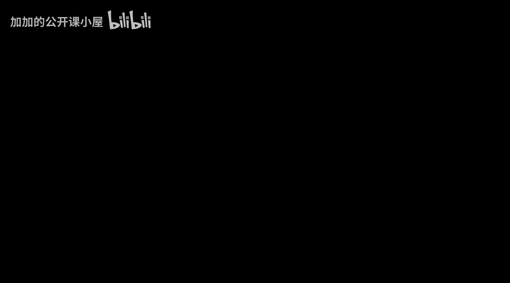
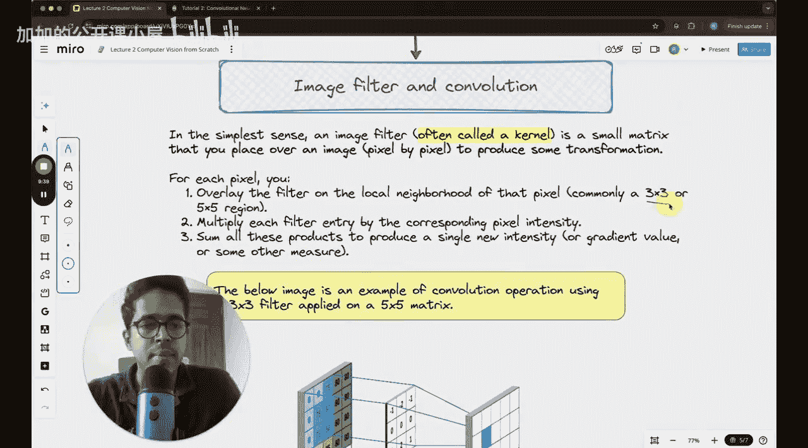

# Vizuara【中英⚡面向新手的计算机视觉｜Computer vision from scratch】 p07 P7 Introduction to filters and convolution ｜ Computer vision from scratch series [BV1UMxxzPE5Y_p7]

Hi， welcome back to the course computer vision from Scch this lecture is dedicated to understanding traditional computer vision approaches using filters and using convolution operation。

So before we jump into the deep learning techniques which are the most modern techniques in computer vision。

 we should have a dive into traditional computer vision approaches because it will give you a lot of fundamental understanding about how exactly filters are able to capture some features from the images which is essentially what also happens in the convolution layers in neural networks so this lecture is purely about traditional computer vision approach using filters so let us get into that。

So I just want to take one moment to just mention before we start this is something that I also mentioned in the previous lecture that if you have started this series。

 just remember that there is a reason why started this right because you are serious about learning computer vision so as you can see in this graph don't be that person who is starting something but who is not able to finish which is in fact majority of the people including myself like maybe the number of courses that I have started in my life is definitely greater than the number of courses I have finished by an order of magnitude so let us promise ourselves that since we are starting this there is a reason why we are starting and we will pledge to finish this so inside our mind let us pledge that we will finish this course since we are started this with a very serious intention and to keep yourself motivated or accountable you could make a comment saying that this lecture is finished lecture two is finished after this is finished or。

If you don't want to make a public comment， you could comment from your Google account or if you have a friend who is interested in learning computer vision just tag them along like you know keep each both of you accountable each other so thatll be a good idea but with that just a little bit of motivation which I wanted to give you so that all of us can stay disciplined let's get started with a lecture。

So。This lecture as I mentioned is about convolution operation and also about classical filters and these are literally the heart of computer vision in the olden times。

 it's also part of modern deep learning based computer vision since convolution operation is literally the biggest idea behind convolutional neural networks。

 but before the deep learning techniques exploded after Lnet was introduced in 2012。

These traditional filters were ruling the traditional computer vision approaches and what are these filters that I'm talking about filters are nothing but they are simple matrices it could be a three by three matrix5 by5 matrix maybe a little bit bigger but basically these are hand engineered matrices why do I say that because you come up with these matrix with some sort of logic or some sort of mathematical construct behind them and there are different logics involved for let's say identifying all the edges in an image or identifying right side vertical edges or identifying horizontal edges so for these things you have to come up with logically come up with different type of matrices or different type of filters and these filters convolve with an image and I'll tell you what exactly does this con convolving or convolution means and this operation allow you to identify edges corners or some。

Other kind of features like vertical edges versus horizontal edgeges or any other features in an image so in this lecture well be taking a deep dive into these classical filters how exactly do they work for for detecting certain features in an image why should we even care about these things because aren't we all into deep learning these days so why should we care about filters and how can we implement some of these filters if we want to identify some features in an image that we have so。

😊，This is actually a gIF image what you see here it's from this website let me first open the website and show you what this GIF is showing this will give you a fairly good idea of what exactly a filter does so here there is something called as convolution kernel this kernel is nothing but the matrix which I mentioned earlier so it could be three by three5 by5 whatever it is and this matrix is moving step by step along this image now this image is sort of like a phase of a person。

If you look at what this kernel or this filter looks like。

 it's like the eye of a human right the shape of the filter is similar to shape of an eye。😊。

And as you can see what happens is if the filter is not matching with the image meaning if in the image。

 what is being seen is something completely different from this I， the resultant output is zero。

 whereas when the filter is exactly coinciding over those portions of the image which assems an eye。

😊，Then the output is 100 this is not exactly how a filter works。

 but this is approximately the idea behind filters so here if your goal is to extract the features which are eyes from an image then you define a feature which sort of can capture that feature。

😊，And then the result and output matrix will also be another image where the region where eyes are present will be highlighted with the maximum intensity which is why these two pixels or it could be even a group of pixels have the highest intensity 100 rest of the pixels or group of pixels have lowest intensity or generally low intensity so this is the convolution filter or kernel this is the image that is doing where the filter is being coned on and what you see on the right hand side this5 by5 matrix is the convolution output and in that you can see two high intensity regions or pixels and thats because in this image there are two eyes and the filter is supposed to detect ice。

😊，Now how do we apply this filter， how do we mathematically calculate the resulting output。

 we can see that in detail。😊，The other important question which you may right now be having is why should we even care about these filters。

 aren't we long a long way away from using filters aren't we going to period use deep learning techniques in which filters are not directly defined manually but rather it's a product of web propagation in the training process yes it is of course that is correct。

 but the reason why filters are so important is because although you will not be hand engineering the filters in today's modern deep learning。

These convolution filters are still part of every single convolutional neural network and if you really want to have a deep foundational understanding or appreciation towards how these filters are actually able to detect features from your image then you have to do some hand calculation from scratch so this lecture is like a from scratch approach of understanding filters so that in the later part of the series when we are dealing with convolutional neural networks and when we are talking about different convolution operations or when we are kind of trying to have a deeper look into what each layers inside our neural network is doing to an image you will have a better intuitive understanding of what different layers might be doing maybe one layer is intended for extracting burs in color intensity of an image or maybe one。

😊，Another layer might be primarily looking at circular features。

 maybe another layer is primarily looking at square like features。

 whatever depends on what your final application is。

 but basically understanding filters will give you so much confidence towards understanding computer vision not just from a traditional approach but also from a modern deep learning approach so that is why this lecture is here。

😊，In deep processing， for example， if you want to reduce your computational time。

 using filters to preprocess your images will be a really good idea。

 especially if you have computational constraints if you don't have access to high computation systems。

 this is a good idea。😊，And these handcrafted filters was the kind of like the predecessor of the。啊冇得。

Filters that are learned through triming right but the thing is there is a logic using which these handcrafted filters there are some filter meanss which I'll be mentioning in this lecture and also I'll be going into detail Sobel filter laplaine filter there is also something called pre filter so we will be going into the details of that but basically what these filters can already capture can be inadvertently learned using using a neural network approach sort of I will show you some example convolution filters when we are looking at a CNN classifier in detail today towards cell as part of the lecture but although the user is not explicitly defining a pattern inside a filter these days just knowing what these filters can do by looking at these Sobell lapplaceian or pre filters will give you a fairly good a deeper appreciation towards this approach as a whole。

So let us talk about image filters and convolution operation so as I showed you just before now this filter often call a kernel is S matrix and the size of the matrix as I mentioned often is 3 by35 by 5 etc the image themselves might be 32 by 32 28 by 28 sometimes bigger usually extremely higher resolution images are very difficult to process in neural networks right because training will take a lot of time。

嗯。