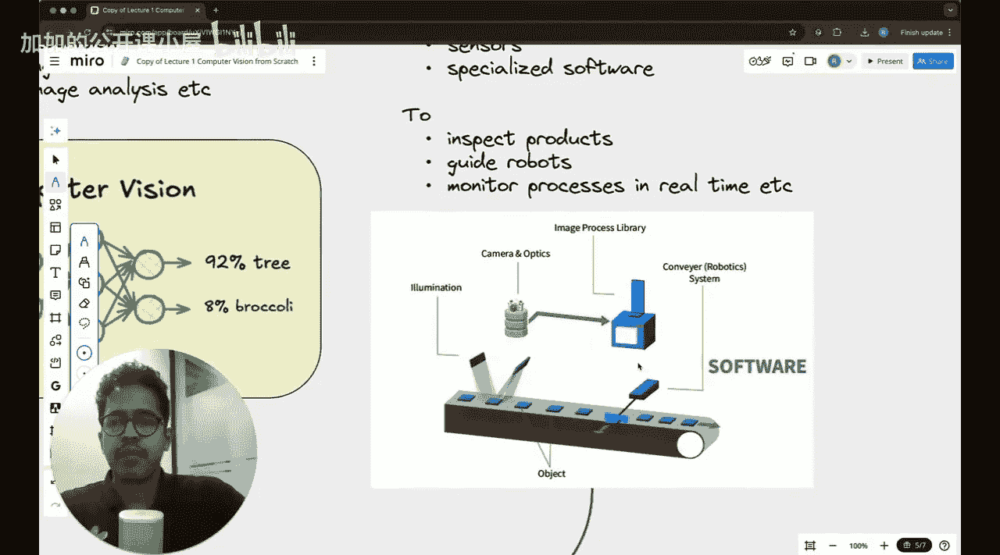
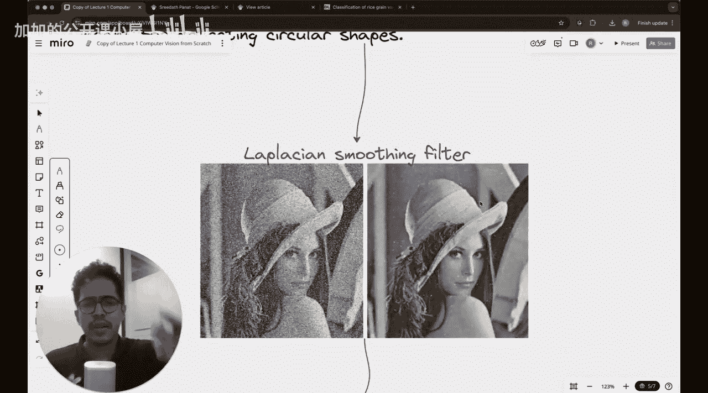

# Vizuara【中英⚡面向新手的计算机视觉｜Computer vision from scratch】 p08 P8 Introduction to Computer Vision ｜ Lecture 1 ｜ CV from scratch series [BV1UMxxzPE5Y_p8]

🎼Yeah。

Hi and welcome to the first lecture of the course computer vision from scratch today we'll be formally looking at what is computer vision。

 how it has evolved historically what are the methods that people tried before implementing machine learning and deep learning techniques for computer vision applications so let us get into the lecture just before that let me show you a graph。

This is a graph from one of our playlists showing the number of views as a function of the lecture number。

 so you can see that the first few lectures first three， four lectures。

 there is huge number of viewers， but 90% or more than 90% in fact has dropped off in the subsequent lectures。

So this clearly shows that starting something is easy but finishing it is not so I really hope that if you are watching this video and if you are starting this lecture series you belong to this second category of people who are able to finish I really really wish that you can do that along with me so before we start the lecture let us take a pledge to finish what we have started let us finish the computer vision end to end I think it will be personally very rewarding for you it will also be very happy thing for me if you are able to learn it and build a very strong foundation。

So。Let us get started。If you are wondering for this lecture series what reference material I'll be using。

 this is the book that I'll primarily be referring to practical Ma learning for Comp vision published by O'reilly。

😊，This is a very popular book， you can find it on Amazon I have purchased like a。Kndle ebook format。

It's not that expensive I think it's in Indian rupees 2000 or something like that for the ebook so it's a very very well written book it also has an associated GithHub repository published on Google Cloud platform repo so the rapport link is also provided in this notebook it has almost like 500 plus stars which is very very big deal so just keep this handy if you are purchasing the book I would say it's a very good investment so there are roughly 500 pages and there are some chapters in the book which I have found to be。

Something that I should modify a little bit for the purpose of this course。

 so I have made my own modifications to the table of content of the book。

 but the primary reference for you will be this book throughout this course。So。

Let us start with the question of。Question that many of you may have， this is a very common doubt。

 what exactly is the difference between computer vision and machine vision？

When I started working on machine vision 10 years ago， I had pretty much the exact same doubt。

So the main difference is that in machine vision we are looking at practical usage of vision based system in industries like manufacturing。

 so I had worked on a project where I implemented a small camera very close to a grinding wheel so grinding wheel can be used for slicing a metal or it can also be used for making the surface polished and this grinding wheel has a lot of aives in so if I look at the grinding wheel the cross not the cross section if I look at it。

Like just perpendicular to its surface， there will be a lot of sharp abrasives embedded in this wheel and the sharpness of this decreases with time so when it is very sharp if you shine a light on the surface it will show a lot of white bright spots whereas when the sharpness has reduced the brightness of these spots also will reduced so you can easily correlate this machine vision setup which in which the camera takes pictures periodically where you track the reduction in the optical illumination the degree of wear and tear that is happening to this grinding wheel so that was a pure machine vision project because you are looking at the system as a whole you may be using cameras you may be working on lighting you may be using sensors or softwares for processing so all of this together make up the system of machine vision so in another project which。

😊，I had worked on， I showed you that already in the first lecture。

So， this was the。

Paper， which I had worked on。Let me show you my Google call。

 so there was a paper on classifying rice grain varieties using computer vision。

And that was accepted to international conference on machine vision so in this paper also what we essentially did was we had like a system a camera based system which tracked the individual I mean track the distribution of rice grains through images and then we could fit ellipses least square ellipses around the rice grains and then using the size of those ellipses the longer the longer part of the ellipse and the shorter part of the ellipse we could predict what rice grain it was this was also a classic machine vision application。

So in machine vision you will also involve hardware along with software systems。

 there will be camera， there' will be lighting etctera。

 all of these are important in computer vision the primary goal is how can you make your machines understand or interpret images or videos videos can be split into frames so essentially they can also be treated as images。

And what this means is computer vision is more about you already have the input。

 you already have the data from your vision system。

 but you are developing algorithms or theoretical models or machine learning models or normal rule based systems for maybe applications like facial recognition self driving car。

Analyzing some kind of scanning images from your body etc so in computer vision you have image input already and you use a machine learning based system or you use a rule based system or you use a deep learning system to binary process and derive some conclusion from this image in this example image that I'm showing it it's like a neural network making a binary classification whether this is a tree or a broolioli。

So that is the fundamental difference between computer vision and machine vision and this course is not about machine vision。

 this course is about computer vision， so we will be primarily be looking at techniques that will allow us to process and derive information from images。

So this is the fundamental difference between。Computer vision and human vision in computer vision you have input as an image。

 so if it's an image of an Apple you have a computer vision model which takes the image as the input this model makes a prediction the model itself can be machine learning model or a non ML model I will show you some examples of non machineach learning models。

 but that makes the prediction。😊，And obviously， as you know， in human vision， you see an apple。

 your eyes are seeing that apple。It will the neurotransmitters will produce appropriate signals and you will eventually receive that information in the brain。

 which will make you say， hey， this is an apple。So this is the main difference。

 the processing of whether this is an apple or an orange or something else happens in the model in computer vision systems for you。

 it happens inside your brain。So。Before 2010。It was a time when mostly the computer vision approach was implemented using heuristics。

 heuristics， meaning manually defined rules。But these days。

 you will most often find deep learning convolutional neural network based approaches for computer vision there are also vision transformers coming。

There are generative diffusion models coming， all these advanced techniques are coming。

 but all these things started a bit later。😊，Before 2010 it was primarily computer vision techniques without machine learning in it so if you look at this overlap it' is not like computer vision always means that machine learning will be used that is not at all the case there are so many techniques in computer vision which has got nothing to do with machine learning there are also so many techniques within computer vision that are more into deep learning rather than into traditional machine learning。

If you are wondering what's the difference between machine learning and deep learning。

 I'll be briefly talking about that soon in the same lecture。

 but basically just understand that computer vision does not automatically mean that you are looking at convolutional neural network。

But that was also a problem right so before 2010 to process an image and to derive information or to get features from it。

 you had to manually define some algorithm， you had to manually define certain rules。

And most of these rules were implemented using something called as filters。So here。

 look at an example of this filter。

The image on the left hand side as you can see is very grainy。

 there are a lot of noises in this image， noisy pixels in the image。

And you can apply something called as lapplaceian smoothing filter to kind of smooth out the image water filters。

 I will show you that in a moment。But the definition of what the filter looks like is very manual you can come up if you are a very smart person。

 you can come up with filters that can do this much efficient。😊。

