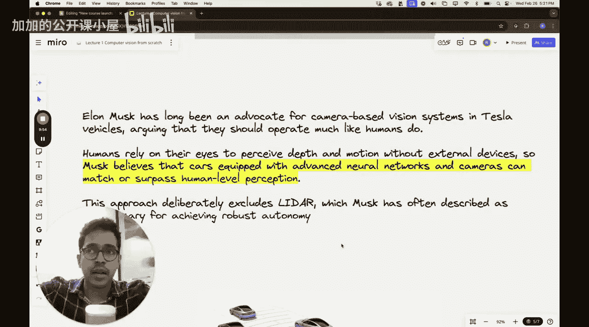

# Vizuara【中英⚡面向新手的计算机视觉｜Computer vision from scratch】 p09 P9 Computer Vision from Scratch ｜ New course launch ｜ By MIT PhD ｜ Foundations a [BV1UMxxzPE5Y_p9]

🎼Yeah。

Hi， welcome to the launch of our new course Comp Vision from scratcht。In this course。

 I will be teaching you the foundations and also practical aspects of implementing computer vision models for actual real life problems。

There has been so many messages that we received on various platforms about the strong need for a well structured computer vision course。

 so that was one of the motivations behind creating this course in the first place。I'm Dr。

 Sar Panant。I am one of the co founders of Visuwarra AI Las， and I'm also a PhD from MIT。

So before even I started my PhD， I was deep into computer vision。

 but more using traditional computer vision machine vision techniques。

 which I will describe in a moment。So in this lecture first of all， I want to lay out a few things。

 one is the outline of the course， what exactly are we going to learn in this course？

And who is this course meant for， is this for industry professionals or is this for students。

 is this course going to help you if you want to let's say get jobs in companies like companies that build self-driving cars or let's say autonomous drones or there are even AI cameras which detect objects。

E cetera， so we'll discuss all of that in today's lecture。😊，And more importantly。

 I also want to discuss one thing which is。嗯。Kind of figuring out how can I make you stay motivated throughout this course because I'm expecting this course to have roughly 35 lectures each will be around 3 to 60 minutes in length depending on how the recording goes but the problem that I have noticed in many cases is students might start a course they will be very enthusiastic in the first three。

 four， five lectures but the moment the length of the lectures increase they find it very difficult to follow through so the number of students who are finishing the entire course is only a small fraction of the number of students who actually start a course I'm also not an exception the number of courses that I have started is probably an order of magnitude greater if I look at throughout my student life it will definitely be greater than the number of courses I actually finished。

But if you are a serious learner， if you are truly serious about computer vision。

 I would love to have you take you through this entire journey throughout this course。

So we'll discuss how we can maintain motivation and how we can go from lecture to lecture。So。

The time when I actually started working on computer vision was almost 10 years ago。

 it was an interesting problem with a professor during my undergraduate studies at I Mads。

So the problem was to classify rise grain varieties using camera images。

And we had to implement non machine learning traditional algorithms for doing this。

So this was my actual deep dive for the first time into machine vision research。

So me and my co-author we developed traditional filters which could detect various aspects of an image in which there could be boundaries or edges。

 curvature of the rice grain etc from which we could extract certain features like length of the rice grain breadth aspect ratio etc。

 and using this we could do some nice clustering， so this was a very nice experience because even implementing traditional non-mach learning based algorithm was a very good exercise which taught me personally a lot of things about processing images。

So this was in 2015， 2016 what I was doing was we had camera images。

 photos like this of different varieties of rice grains。

 then we did thresholding so that you could enhance the contrast between the background and the rise then we figured out ways to detect the edges or the boundaries between the rice grain and its background and this was used for calculating the。

Rdius of curvature， the local radius of curvature of the rice grains。

 and that could be used for defining when two rice grains are touching versus when they are not touching if they are touching。

 how can we split it into two so all these techniques were developed manually just by using pure mathematics and logic。

And we presented this work after submitting it to ICMV International Conference for Machine Vision。

 and that was held in France in the city of Nice。So when we presented this in Ne。

 we realized one thing because most of the researchers who came to present their work。

 they were thinking along the angles of machine learning or deep learning techniques。

 so all the traditional machine vision techniques for manually defining the rules and conditions for identifying objects or things that are present in an image or in a video。

 all those things were changing the field of machine vision was swiftly evolving。

 this we could very clearly understand during this conference。

Many researchers were kind of moving away from these rule- based or expert based systems and they were clearly implementing deep learning techniques and even we were asked questions likeHey。

 can you try actually deep learning techniques for making predictions or let's say you implement rule- based methods for evaluating or estimating the size of the ice grain after that for clustering based on the sizes。

 can you use some k means clustering more there were questions like this。

 which were primarily meant for people who are working in machine learning。

But I realized that after this point。I really had to shift the focus if I want to continue working on machine vision。

 I have to shift the focus towards machine learning based approaches rather than traditional rule based approaches。

😊，So in rule based approach you。😊，Manually define algorithm for classifying your image or even to find some information from the image。

 you convert the image into gray scale， you perform some enhancement there are techniques like o so thresholding you have to do noise filtering otherwise if you are trying to find out individual objects within within your image all these noise grains will show up as objects then extracting boundary information so if you want rice grains you have to extract the boundaries of those rice grains if the kernels if the rice grains of two of them are touching how can you identify the fact that there are actually two kernels and if there are broken grains。

 how can you eliminate them because they will contribute to outliers。

Figguring out what kind of least square ellipse can you fit along the boundary of your eyes grain so that you can approximate the dimension of your eyes grain by a long dimension and a short dimension like the long axis of the eipse and the short axis of the ellipse。

 and then calculating geometric parameters like length of the grain。

 breadth of the grain and using those two parameters to perform like a clustering to say， hey。

 this is bass material ice， or this is po knee or this is jasmine， whatever that is。

So this was rule-based systems whereas this is now a very easy problem ever since because many many deep learning methods have evolved。

 there are convolutional neural network based approaches which we can easily train if we have large number of images and using those images you can train a convolutional neural network and this neural network can basically perform a multiclass classification and it can easily predict what kind of image this neural network is looking at so this shift happened as I saw over the last 10 12 years。

😊，So now whenever I have worked on machine vision related or computer vision related projects。

 it has almost always been deep neural networks， whether it is for object detection techniques like Yolo I even worked on biological systems during my PhD at MIT where the task was to build deep convolutional neural networks for making predictions on messenger RNAs。

 so this was like a very difficult problem to work on。

 so how can you figure out what messenger RNA mRNA treatment was a cell had a cell undergone。

From its morphology。And the problem here in these in these difficult problem statements is that the morphologies dependent on external conditions like temperature humidity and the local experimental conditions more than the。

MRNA treatment， So if there are thousand mRNA treatments possible。

The morphology can depend on not just on which mRNA was used to treat these cells。

 but also on the external conditions， so the signal to noise ratio was very。

 very high and it was very challenging to build a good deep convolutional neural network architecture for solving this problem。

 but that experience also taught me a lot of things from practical point of view in computer vision。

And let us look at Tesla self driving cars right so I was recently reading this book Elon Mus by Walter Iaon it's a huge book 650 pages。

 I thoroughly enjoyed reading it。But one thing I took away from that in the context of Tesla is that Elon Musk was very strongly against LIDarR。

 so LDar is a technology wherere using sensor data you can predict or we can say what is there around the car。

 so even if around the atmosphere around the car。

