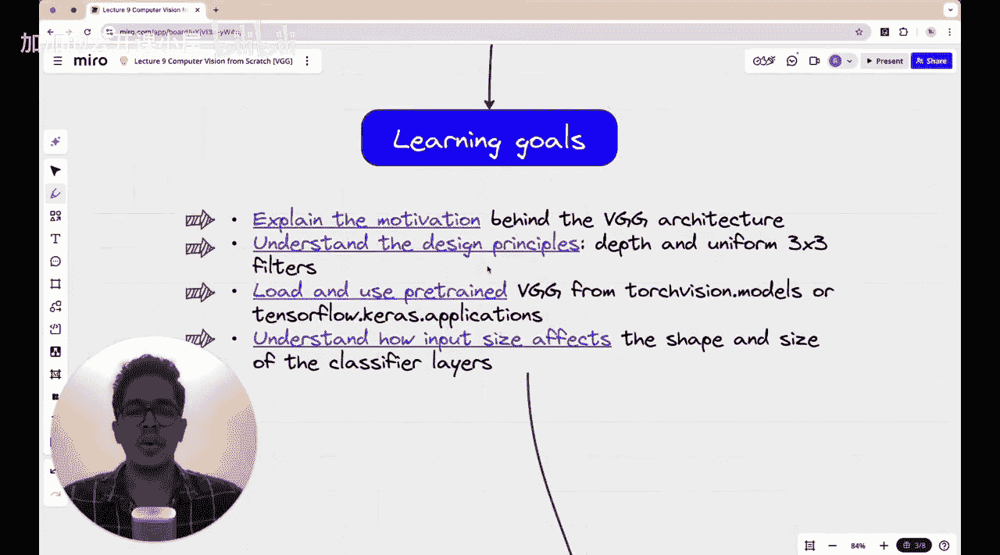

# Vizuara【中英⚡面向新手的计算机视觉｜Computer vision from scratch】 p10 P10 VGGNet： The legendary paper with 145k citations threatened the dominance of [BV1UMxxzPE5Y_p10]

Hi， welcome to a new lecture from Computer visionion from scratch today we'll be looking at a specific neural network architecture which is very famous called VGGNe。

😊，In the last lecture， we discussed how AlexNet completely dominated the deep learning scene in 2012 and how it dominated the INet competition。

Today we will be looking at how VGGnet threatened the dominance of AlexNe and this is also another legendary paper with 145。

000 citations and this was introduced in 2014 and it had won the runner of second place in the Inet Cha。

So we will discuss specifically about VGG today， what was so special about VGG compared to AlexNe and why this term VGG。

 what does it stand for？And let's look at the architecture and let us implement this for our five flowers data set。

 so with that let's get into the lecture。So the years 2014 to 16 was a time when a lot of developments were happening in deep learning。

And that is also when neural network architectures like VGGnet， inception， S net。

 etctera enter into the picture。In some of the subsequent lectures。

 we'll be spending some time on inception and Sque it。

 these are also super famous deep learning architectures。

But the question that all these models were trying to answer was， how can we improve the performance？

Despite adding more number of deeper layers in convolutional neural networks without expding the time that you need to perform the training and without losing the performance performance meaning the validation accuracy or test accuracy so this was the question that all these all the researchers working in deep learning community was trying to answer in those years and one of the early architectures that were introduced VGGNe had a very clear answer despite a very simple tweak or simple modification in its deep learning in the deep neural network architecture。

And some of these models truly set benchmark for several other more complex models to come in the future。

We will be looking at vggnet in the context of what we have been doing in this course so far so before we get into the details of VGg let's kind of take a step back and recap what all have we done in this course so far in this computer vision course so just to remind you we were looking at the fiveflow data set which has roughly thousand images in each of these five categories so we have a five class classification task right so we started with a linear model this linear model was just the images converted into a linear vector and then we had a output layer fully connected connections from the input to output there was no activation function but there was just a softm function at the very end to convert the predictions into probability and this model was really bad we had a training accuracy of 40 to 45 percentage validation accuracy was lesser than that it was around 3540 percentage loss was very high10 to。

20 was the loss。 Then we realized that okay， so this linear model is not working。

 so we have to introduce activation functions and we also have to introduce hidden layers。

 so we introduced a hidden layer model with 128 nodes with a radio activation function which did not improve in accuracy that much accuracy was more or less the same but loss decreased by an order of magnitude showing that we were making more confident predictions compared to the earlier linear model。

 So this was the initial model architecture RGB image converted into like a flattened layer and then you had fully connected connections going from this flattened layer into the output layer。

 so this was the linear model and the additional layers were added after this flattened layer。

Then we realize that even just adding。Hund28 nodes in the middle hidden layer is it's not enough because the model was probably overfitting the training accuracy was still greater than the validation accuracy and that was very clear in some of our experiments then we thought we have to perform some we have to take some measures to prevent overfitting so we decided to do regularization batch normalization dropout and early stopping and in fact this was more or less successful we could increase the validation accuracy from 30 to 40 percentage we increased to 50 to 60 percentage which is not so bad for a five class classification model whose random classification accuracy will be 20% right and we also saw that when we did batch normalization we could have very high training accuracy training accuracy touched almost 75 80% although validation accuracy was still close to 60% so this was a huge impro improvement in the model performance compared to the previous hidden layer。

based model， but we realize that we are just moving slowly this is not good enough because typically in convolutional neural network image classification tasks we are all very used to seeing models with 9500 percentage accuracy so this is when we decided to do transfer learning where we used a pretrained restNe model and we used it for not training from scratch but we we trained the only the later layers in the model the remaining layers were pretty much fixed and here we were actually able to attain 100 percentage training accuracy and about 80 percentage validation accuracy there was some amount of overfitting as denoted by this trend but it was the best we had obtained until that point。

😊，That is when in the previous lecture we decided to do try AlexNe which completely had revolutionized the deep learning scene in 2012 and this paper was written by Alex Professor Geoffrey Hinton and Elias Sekever from Open AI he was the co founder of Open AI and this paper was a legendary paper that has been cited 170。

000 times till now and we obtained。😊，A 90% validation accuracy and 95 percentage training accuracy。

 and this was the best models so far。But then after 2012 so many things have happened in the deep learning convolutional neural networks scene and now in in the next few lectures of this course we are going to be exploring what are those changes what new models emerged and what did they do in the what did they do new in the deep learning scene right so that's what we are exploring and today we'll be looking at VGG。

But before we start the lecture as we always say starting any lecture series or course is very easy but finishing is not at all easy and I'm glad that all of you have reached this stage of this course because I'm pretty sure that many people who had started with the lecture one lecture to they have not been following and this is the usual trend that we see even the number of courses that I have started is always greater than the number of courses I have finished so starting is easy but finishing is not but I just want to repeat this lecture after lecture to motivate you so that all of us are in one boat towards one mission so let's internally take a pledge that we will finish this because we have started it if you have a friend or friend or acquaintance who's also taking computer vision who's interested in learning computer vision keep each other accountable if not just feel free to make a public comment from your any account so that youre just kind of internally keeping yourself accountable to come back and。

Finish this course right so with that now let's get into the details about VGg so hopefully at the end by the end of this lecture we should be able to understand what was the motivation behind proposing the architecture that VGg proposed in the year 2014。

VGG had a very specific3 by three convolution filter it removed the complexity in using different shape filters like 5 by 5 11 by 117 by 7 all those things were not there vG simply focus on one thing use filters of uniform size3 by3 but increase the number increase the number of layers so increase the depth but keep it simple so and this was very effective and we'll discuss that then we will also load and use a pretrained VGG。

😊，Not using ks， but we'll be using Pytoch so we'll be using toch visionion do model but we'll use a pretrained vGg on our fiveflow dataset and let's see what kind of results do we get it may be better than Alexnet it may not be and then finally let's also have a discussion about how input size of the image affects the shape and size of the subsequent classification layers and since we are performing transfer learning obviously we have to modify some things in the subsequent in the last layers of the neural network right because we have a five class classification but when vG pretraining was done it was probably not done for five class classification so obviously the last layer layers need to be modified so we will see how to do that and what should the shape of those intermediate layers right from the last layer of the pretrained part of the VG plus the extra layers that we are going to add so that we can bring it down to the five node final output layer so we'll discuss the the dimensions also。

お？So with that let's officially get into VGG architecture so as I mentioned in 2014 was when this paper was introduced by a group from University of Oxford。

 so VGG actually does not mean anything related to machine learning or deep learning it's the abbreviation of visual geometry group。

 the group from which this paper came out。