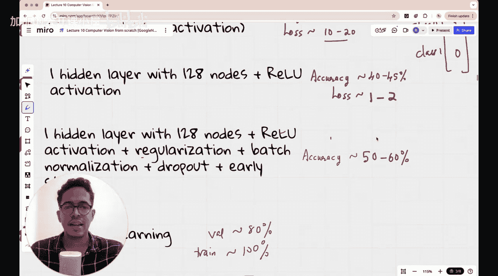

# Vizuara【中英⚡面向新手的计算机视觉｜Computer vision from scratch】 p11 P12 GoogleNet (aka Inception V1) ｜ The legendary CNN model that ranked #1 in Ima [BV1UMxxzPE5Y_p11]

🎼Yeah。

Hi， welcome back to a new lecture from Comp visionion from scratch today we'll be looking at Inception V1 also popularly known as GoogleNe。

This is a con neural network architecture which is very famous。

 it won the first place in the Inet Cha in 2014 and the paper associated with this has achieved truly legendary status with 68。

500 plus citations。😊，This is a super famous architecture which we still use today if you are a person who is working in computer vision。

 I'm 100% sure you have tried inception V1 v2 v3 different models。

And today we'll be spending some time on trying to understand what made GoogleNe so popular。

 what made it so effective and how did it overcome some of the shortcomings that the previous architectures like AlexNe VGG etc had so if you are watching this lecture series for the first time in this video but don't worry like I'll be giving you a proper recap of what exactly are we doing what exactly have we have been doing so far in the lecture series and then today exactly how are we going to construct the GoogleNe for performing a fiveclass classification on the fiveflow dataset set that we have been using throughout this course so with that welcome to the lecture。

In the previous lecture we discussed about the VGG architecture which tried to use very basic three by three convolution filters unlike some of the previous architectures like Alexnet but in general what researchers working in computer vision what they were trying to do was they were trying to build deeper and deeper convolutional neural networks so in general the machine learning community especially the deep learning community involved in C research they wanted to build deeper and deeper CNs because it was very clear by 2014 that depth means you can learn more features in complex images so it was clearly understood by 2014 that if you want to perform multiclass classification on data that is not really distinct then you have to have depth but the problem was the more the depth was it was harder to train the neural networks because simply there will be too many parameters so if you want to update that many parameters when you are back propagating it's very difficult there were challenges like when the depth is too much the。

layersyers will experience vanishing gradient so they will not get updated。

 the weights and biases in the initial layers will not get updated as fast as how the later layers experience the change so these issues were existing and there was also huge computational expense so this was the architecture that we discussed last class in the last lecture about vg where they simplified the whole idea instead of using convolution layers with different convolution filter sizes you look at the convolution filter size here in vg it was all three by three filters Of course there were max pooling and other operations happening in these convol like in between these convolution layers but what this showed is that you don't have to build CNN or convolution filters of varying sizes all you need is pick this size and go for depth so this was a very interesting finding and for this reason vg paper as we discussed in the last lecture it had one the second place into。

14 imagenet challenge but then today we are discussing about Google net which won the first price in the same challenge and we'll discuss why Googlenet was superior compared to VGG we will also run it on our data and well compare the accuracy and the validation and training accuracy and see which one is better for our case and of course well be using transfer learning because well be using pretrain neural network we have learned in the course that starting the training from scratch is not at all easy it's very difficult to train a neural network from scratch because our data set is very limited right so。

The problem with VGG net was the total number of parameters in the VGG architecture was about 138 million which is a massive CNN architecture so although it was simple3 by3 convolution filters the total number of parameters were huge so then the researchers at Google which device this idea of inception so it was initially called as Google net but then later it was renamed as the inception v1 v1 I guess for version1 there are inception v2 v3 etc which you can use if you want to train some of your data but basically the question that they asked was can we design an architecture that has depth but also it's a bit efficient while training right so the answer to this question was Google net what they proposed in 2014- 2015。

So the basic idea was instead of just looking at three by three filters they used multiscale filters within each layer I'll show you exactly what this means while showing you the architecture of inception or Google net but basically they realize that you don't have to just keep using 3 by3 filters unlike what VGi was doing you can actually use filters of different sizes and that is actually beneficial in reducing the number of parameters so that the total neural network architecture is not so huge and this is the one of the first authors I mean this is the first author of the paper Christian Zri I'm pretty sure I'm pronouncing the second name incorrectly but this paper has now 68500 plus citations please do check this this is from his Christian's Google Scholar page。

😊，So。Before we moving ahead further， I want to give you a brief recap of what all we have been doing so far in this course。

 all right。So just to recap we were using the five flowers dataset set which is a set of DC dandelion roses。

 sunflowers tulips set of five flowers and there are approximately  thousand0 images in each class so the task here is a five class classification and for this we are trying to build step by step neural networks of increasing complexity so at the very beginning of the course we started with a linear model with no activation so the structure was something like this we had RGB images so there are three channels red green and blue we converted that into a flattened layer right so this RGB will be this RGB like that so how many other number of pixels are there total that many number of nodes are there after flattening and then we had a fully connected final output layer so this had five nodes because we are performing a five- class classification。

This was fully connected every node in this layer was connected to every node in the final layer。

 the only place where we had an activation function so this overall neural network architecture for linear case had no activation。

 the only case where we had activation was we had a softmax function at the very end for converting the output values into probability distribution。

😊，Then we saw that this linear model was actually not so good it had 40 to 45 percentage accuracy which is not bad。

 we are performing five class classification the worst model performs a random classification it has 20% accuracy right so linear model is not so bad but still it is not like 1995 percentage and the loss was 10 to 20 this was the order of magnitude。

😊，Then what we did is we started looking at， okay， can we？Add hidden layers。

 maybe that will make it better and also add activation so we added 128 node hidden layers in as a new layer right so we flattened then we add the hidden layer and then we have the5 node final output layer and we use rectified linear unit radio activation function This surprisingly did not improve the accuracy accuracy was still 40 to 45 percentage and when I say accuracy here I'm talking about training accuracy validation accuracy was even lesser it was 3540 percentage but the good thing was lost now decreased by almost an order of magnitude it was one to2 instead of 10 to 20 and the reason for this was the classification accuracy did not increase because the percentage of images that we were correctly classifying was pretty much the same but the loss decreased this is surprising like how come loss decreases by an order of magnitude but accuracy does not change this happens because the model is now making more confident predictions。

😊，And because of that the loss associated with every single prediction has decreased so because the prediction let's say you are supposed to predict 10 and in one case you make the prediction like 0。

60。4 here also you are essentially saying you are looking at class 0 because if this is class 0。😊。

And this is class1。And let's say this is the true label and this is the prediction in this case also because06 is greater than 0。

4 you are saying that this image is belonging to clause 0 so prediction is correct but it's less confident whereas if you make a prediction like this it is more confident right if you make a prediction like this then it's more confident and it's correct so this is what was happening but accuracy did not increase then we thought okay maybe we are performing overfitting because training accuracy was 4045 validation accuracy was 3540 so we thought okay how can we minimize overfitting then we decided okay well add regularization batchsh normalization dropout and early stopping so this allowed us to surprisingly increase accuracy by to 50 to 60% this was validation accuracy we also noted that for some cases training accuracy was reaching even up to 7080 percentage close to 70 percentage so that was a good thing but not the best thing why because still not。

😊，Good as what we would like the training to be， because we are expecting we are used to。

Having multiclass classification accuracy of 95%。😊。

