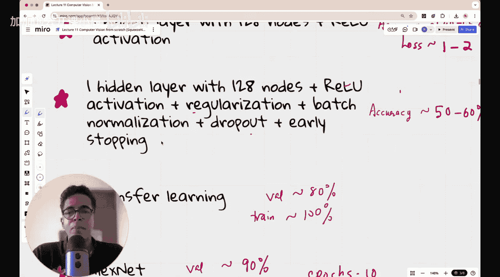

# Vizuara【中英⚡面向新手的计算机视觉｜Computer vision from scratch】 p12 P12 The Story of SqueezeNet： Why Smaller CNNs Can Be Smarter？ ｜ Computer Vision [BV1UMxxzPE5Y_p12]

Hi， welcome back to a new lecture from Comp visionion from scratch Today we'll be understanding about SqueeNe and we'll implement it for our5flow data set。

Squezenet is an amazing very popular neural network architecture。

 which convinced the deep learning researchers probably for the first time that even relatively small parameter neural networks with less megabytes in size can achieve similar accuracy as that of other popular neural networks Con neural networks like Alexnet so Squeenet is very popular and when you implement the Squenet architecture for our data。

 I really want to show you the results and I want to show you the comparison of those results with all the architectures that we have tried so far including ReSnet Alexnet。

 VGG and Inception Vward so with that welcome to today's lecture。

The years 2012 to 2016 was sort of like a crazy period for deep learning research because with the introduction of AlexNet in 2012 it revolutionized the way deep learning was utilized for computer vision because it showed that deep neural networks can actually be trained effectively for making good predictions on images and then models came later there was VGG introduced in 2014-15 and then there was GoogleNe which was also renamed as inception V1 so the question is if so many things were happening around that time in 2015。

 2016 etc， and when these neural networks were performing really well in imagenet challenge for classifying natural images why did researchers introduce Squeenet and what exactly is Senet so we will discuss that in today's lecture？

The main problem researchers were facing especially in the deep learning community in 2016。

2015 time was the models like VG Googlenet were kind of big big meaning big in terms of number of parameters and megabys in size Vgg had around 138 million parameters GoogleNe had around 6。

8 million parameters so GoogleNe was significantly smaller in size compared to VG which was a big deal and as we discussed in the previous lecture GoogleNe won the first place in 2014 imagenet challenge and VGg placed second in the same challenge right so then the question was。

If we are using these big models， it's very difficult to deploy them for small devices like mobile phones or internet of things where you might be deploying small raspberry pie。

Mouleles are low computing devices so at the end of the day if you want edge computing well the model models are embedded within these small devices rather than somewhere in the cloud。

You might need very efficient smaller models but the problem was small models were actually not very good at making classifications right so that is that is a whole reason why Alex networks introduced in 2012 it showed that okay you can have deep neural network and you can train it efficiently and you can make good predictions then vgg took it one more level it was an even bigger architecture which showed that okay you just need simple three by three convolutions you just stack them in series and you can get good results and then Googlenet showed that you don't just use three by three convolutions you use one by one convolution and then later three by three use three by three5 by5 convolutions etca in parallel and then that inception module you repeat in series and then that can do good results so all these things were happening so why did people think of squeezing the size of the convolutional neural networks。

😊，Precisely because they saw that neural networks were getting bigger and bigger and bigger so if you really want to deploy it on devices you have to have small models with very high accuracy so the paper which you can access from archive it was actually titled exactly like this squeezequenet Alexnet level accuracy with 50 x fewer parameters and less than 0。

5 megabytes model size it amazing like I have rarely come across paper titles which are as bold like as this and as interesting as this。

😊，And the first author's name is Forrest and Ian Dola， I hope I'm pronouncing the name correct。

This paper has now almost 11，000 to 12，000 citations and it's a very。

 very good paper so any paper with more than 1000 citations itself is called as an amazing paper。

 anything about 10，000 citations is a really top paper so this paper is super famous and so is the Snet architecture。

😊，So the goal was or what it achieved was Alexnet level accuracy so although Alexnett came four years before in 2012 it it was very popular。

 it is still very popular so beating Alexnet was really a benchmark and the main thing was dramatically fewer number of parameters so I'm going to show you a table not right now in the later part of today's lecture where we compare the number of parameters size here in which it was introduced who built it etc as a table where we compare Alexnet vg inception v which is also called as GoogleNe and finally well also have a squeezenet as the fourth column so we'll go through that but basically this hopefully the good efficient low parameter model will enable on device deployment so that you can run neural networks on your phone rather than calling some API and accessing a model hosted somewhere on the cloud right so。

Before we further go ahead in the lecture， I want to give you a small recap in case you don't remember what happened in the course so far or in case you are watching this lecture for the first time in this course right so I'm going to give you a brief recap if you don't want to go through the recap feel free to skip it but it will not take more than five minutes So in this course so far we are exploring this5 flowers data there are five flower categories D C and Leon roses sunflower tulips and we are trying to perform five class classification using various neural network architectures so there are only thousand images per class so total data set size is not that high it's only 5000 images so it's not a very easy task to do because usually you might need tens of thousands or 10000 plus images for very efficient classifications but this is good because this will really push our。

😊，Experiments to its limits so what we did was we started with the simplest of models like a linear model so we had RGB images and we first converted this into a flattened layer so if we had n number of pixels across three channels total then those n pixels will be converted into n by one sort of like a column vector then after this fully connected after this flattened layer we had a final five node output layer and there was all the nodes in the previous layer was fully connected to the all the nodes in the final layer so there was no activation function except in the last layer we use softmax softmax activation to convert the final output numbers into a probability distribution that's it but that softmax distribution was not affecting the way predictions were made so in effect this was a linear model without any activation。

😊，So when we implemented this model we got around 40 to 45% training accuracy validation accuracy was 35 40 percentage。

 not very high but a random classification model which is the worst model possible it will have only 20 percentage accuracy right because there are five classes so this is better than a random classifier。

😊，Loss was 10 to 20 in terms of magnitude then we decided okay just linear model is not enough let's introduce a hidden layer with 128 nodes so after the after the flattened layer we introduced a hidden layer with 128 nodes with rail activation。

And this model actually did not perform that much better you still had around 445 percentage training accuracy and classification I mean validation accuracy was 3540 percentage but surprisingly loss was one to2 so an order of magnitude less loss but similar accuracy you might be wondering how is this possible this is possible because the model is still making similar number of accurate classifications because if let's say the true label is like this class0 class1 true label is 10 meaning this this whatever is this data point belongs to class 0 and whether you are making this prediction or this prediction accuracy will be the same because06 and point4 says that this prediction says that you are in class0 Similarlyly this also says that you are in class0 but the loss will be lower in this case because here you are making a more confident prediction compared to this case so this is in general what was happening in the hidden a single hidden layer approach plus there was also a little bit of。

😊，Overfitting happening because the training accuracy was on an average。

 10 percentage higher than the validation accuracy， which was not good。😊。

So then we thought okay how can we prevent overfitting so then we introduced regularization batchsh normalization dropout and early stopping early stopping was not needed anyways because we were only running for1po so that was not significant but we anyway implemented it although it was not actually being utilize because we were not seeing accuracy drop because we are overtrain right that was not the case the case was that the model was not good model was there were in few cases model was overfitting but other than that the issues were more related to dropout。

