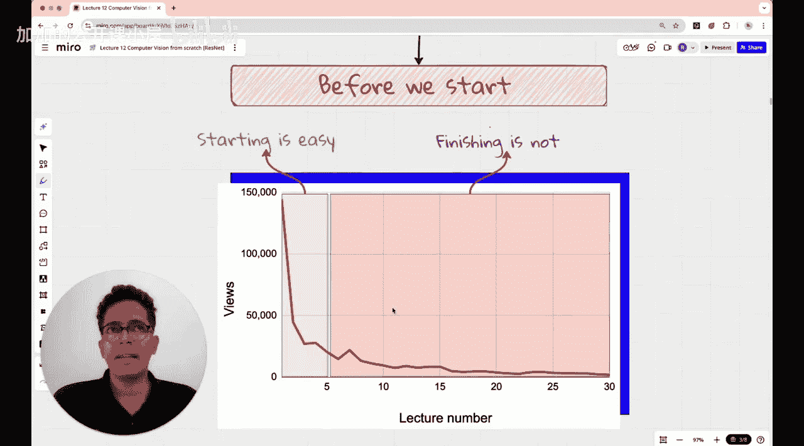

# Vizuara【中英⚡面向新手的计算机视觉｜Computer vision from scratch】 p13 P13 ResNet Explained - Vanishing Gradients, Skip Connections, and Code Implement [BV1UMxxzPE5Y_p13]

Hi and welcome back to a new lecture from Comp Vision from scratch。Today well be implementing ReSNe。

 which is one of the most popular conution neural network architectures。

We will discuss about vanisheding gradient， which was a very challenging issue facedd by the deep learning community until 2015 and how ResNe solved this problem forever。

We will also be discussing about implementation of ResNe and comparison of results with ResNe VGG。

 SquezeNe and AlexXNe， which we have been implementing in this course till now。

 we will compare all the results and see how ResNe Resnet performs compared to other convolution neural network architecture。

With that， let's get into the course。So。There was a problem that deep learning community was facing initially when Alexnet introduced deep neural network for training on image based data in 2012 and when they successfully showed that you can actually train deeper neural networks by also simultaneously implementing radio activation regularization techniques。

 etc， and also GPU based computing， it was actually a revolution but。

When the community was trying to implement models with bigger and bigger layers so Alexnet had eight layers VGG had 16 layers inception V1 which was introduced by Google also called as Google net in 2014 it had 22 layers and then people were trying deeper and deeper neural networks because they knew that deep neural networks could learn more features from the imagebased data but the problem was that it was very difficult to train these deep neural networks if you remember so far in discourse we have tried Alexnet VGg and inception the best accuracy that we have got so far is for AlexNe in the last lecture we drive Senet which had really good accuracy but SeNe was altogether different CNN model but if you compare that deeper and deeper neural networks it was kind of counterintuitive to learn that deeper neural networks for some reason was performing worse meaning it we were finding it difficult to train for VGG。

And inception we saw that validation accuracy was bigger than training accuracy so sort of undertrain was happening overfitting was not happening sort of like underfitting or undertrain was so this was a bit counterintuitive and deeper models were breaking everything it was not working。

😊，But logic tells us that somehow deeper neural networks should be able to learn more things right but the problem was when you have deep neural networks。

 the initial layers in the neural network like these are the initial layers or input layer and this you can call as the initial layer and later layers which are closer and closer towards the output layers output layer you can call as the more and more deeper layers but these shallow initial layers they hardly got updated。

 the weights and biases in these layers hardly got updated in the gradient descent training process。

 so we'll discuss how this issue is mathematically happening。

We will see what did RsNe do something specially to solve this issue and how it changed the course of deep learning altogether and how it completely transformed and revolutionized giish processing using deep neural networks。

 so with that let's actually get into the lecture。The vanishing gradient issue was so big that even when you perform with good initialization parameters。

 even when you perform batchsh normalization or train for more number of epochs。

 sometimes this issue persisted。So before we look at the resnet architecture。

 let's do a brief recap as we do usually what we have been doing so far in this course so that even if you are starting this course with at this lecture。

 ideally you should be able to understand to some extent what has been going on。😊。

So we are trying to classify the five flowerer data set there is Baie dandion roses。

 sunflowers and tulips， there are a thousand images in each of the classes。

 so it's a five class classification problem。We started with the simplest architecture。

 which was in linear model， so we started with RGD images converted into a flatten layer in the output layer there were five nodes because we are performing five class classification。

 but we did not have any activation function。We did use softmax activation at the very out at the last layer just to convert the output numbers into a probability distribution this resulted in 4045 percentage accuracy with a loss of 10 to 20 accuracy was not so bad but also not so great because this is even a random classifier can give you 20 percent accuracy this was 40 to 45 percentage this was training accuracy by the way validation accuracy was 3003540 percentage then we thought okay let's add a hidden layer with 128 nodes with radioactive activation it did not change the accuracy much but it decreased the loss by an order of 9 here this the reason why this decrease was happening which was a bit counterintuitive was because the predictions were becoming more and more confident。

So this was a good thing but we were not happy then we thought okay there is some overfitting happening because validation accuracy 35 40 training is 40 45 sometimes 15 so clearly there is a difference in validation and training accuracy so we thought let's add regularization bash normalization dropout early stopping of epos etc。

So we thought this might help and it indeed help to some extent we would improve the validation accuracy to 5060% but we were not happy that's when we realized that we have been training from scratch so we should be training from instead of training from scratch we should be performing transfer learning where we use pre-train neural networks so we actually tried RNe model in the transfer learning initially and this was for 10 epos and we got 100% training accuracy and 80% validation accuracy this was okay but overfitting was happening that's the reason why there was a huge difference in training and validation accuracy。

Then we thought okay now let's start step by step， maybe we should go in chronological order because start with the earliest of CNNs and then go with increasing complexity and see how well the classification will improve when we are performing it on the same dataset so we had the fiveflow dataset throughout we started with Alexnck the legendary paper that transformed deep learning forever by Alex who was the first author after whom the paper is named Professor Joffrey Hinton who was the 2024 Nobel Prize winner in physics for the introduction of neuralural networks and Ilia Suskever who was also the OpenaiI co founded this paper is so amazing it's been cited 170。

000 times。So we ran for 10 epos， we got 90 percentage validation and 95 percentage training accuracy。

 we became extremely happy this was the first time in this course we received such a good level of accuracy without too much overfitting。

And then we switched to VGG and VGG had more number of parameters。

 it had exactly 138 million parameters， the Lnet had around 60 million parameters。

 so VGG was significantly bigger and even though we ran for 50 epoOs usingBG we got only 75% training accuracy and surprisingly 85 percentage validation accuracy。

 higher validation accuracy than training， which was kind of interesting because it showed that we were under training。

 but we did not want to run for more epos because this itself was taking around four to five hours。

Then we switched to GoogleNe which was inception V1 also call Inception V1 and we ran for 50 epos。

 we got decent accuracy， we got 87 percentage in validation 86 percentage in training。

 I would say no overfitting has happening but accuracy was not as high as what we got in Alexnet。

Then in the last lecture， we switched to S net， which had a very small number of parameters。

 less than 5 million parameters。And we realized that SqueezeNe for 50 e box was performing even better than AlexNe for 10 e box。

 so AlexNe had around 1994 percentage accuracy for validation and training respectively SqueeNe also had kind of similar performance so this was the best model so far I know that it's a bit apple to orange comparison because we are running for more number of epos here obviously but we were happy for the fact that similar neural networks which which were deep in number of layers like Googlenet or VCC could not perform as good as this so with squeezeenet we were very happy。

But this is where we were at a juncture and squeezee networks was introduced so that neural networks could run on edge devices right on mobile phones on IoT devices or even maybe small Arduino microcontrollers。

 so neural networks should be able to run on not so high performance computing systems。

But Resnet did something different， resnet solved a different problem。

 it was not solving the problem of compressing the model。

 but it solved the problem of being able to train big models so what was happening was。

In the year 2015， 2014， bigger and bigger models started to perform not so great compared to smaller models。

So that was a concern and Ranet the people who brought Rusnet into the world they wanted to solve it so we'll discuss that。

 but before we enter into the lecture something that we always do I really want to remind you that starting a course or starting anything is very easy finishing is not at all as you can see from this graph the number of viewers is decreasing with the lectures proceeding so if you are listening to me in this lecture currently where。

