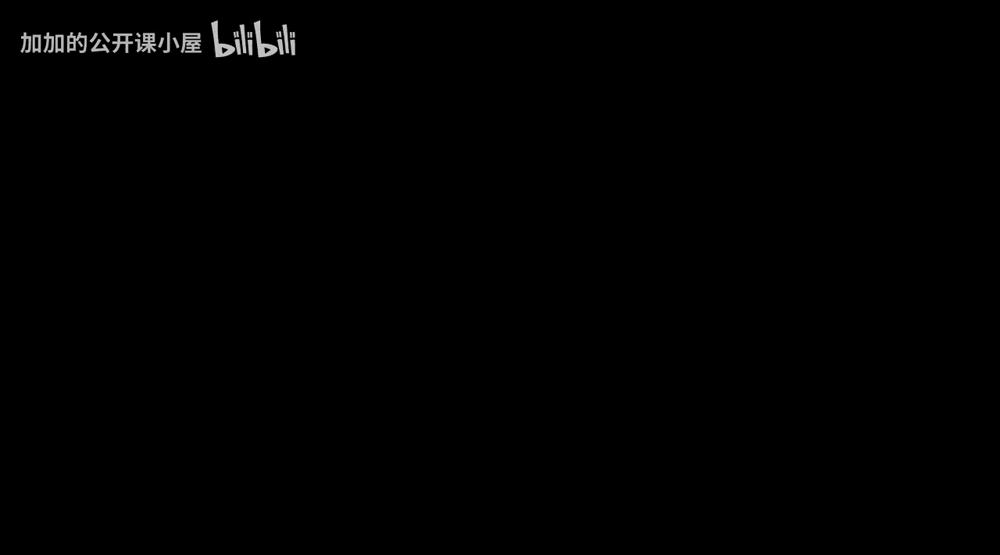
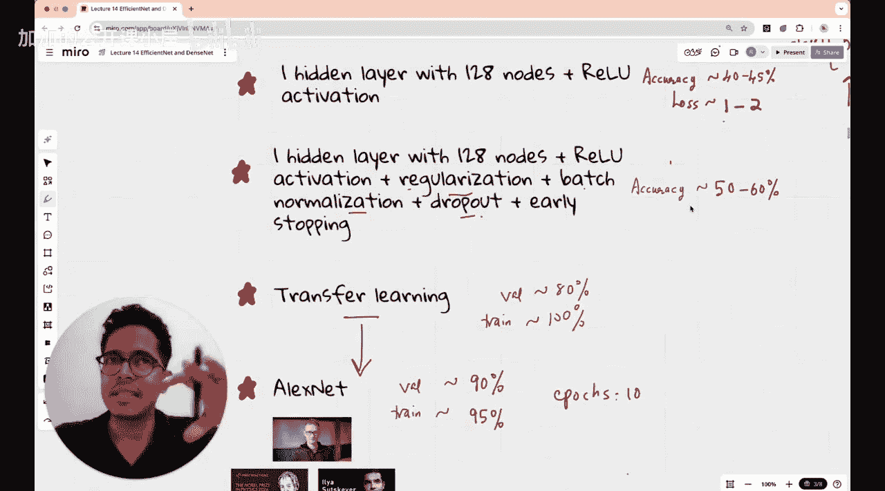

# Vizuara【中英⚡面向新手的计算机视觉｜Computer vision from scratch】 p15 P15 DenseNet and EfficientNet - How CNNs were made better and better ｜ Computer [BV1UMxxzPE5Y_p15]

Hi， welcome to a new lecture from Computer Viion from scratch。

Today well be learning about two convolutional neural network architectures。

 namely dense net and efficientff net。These are very popular models and throughout this course。

 we have been exploring various CNN architecture starting from AlexNe in 2012。

So in today's lecture we'll not only learn about dense net and deficient net。

 we'll also implement it for the fiveflow data set that we have been using throughout this course and of course you will have a fairly good recap at the starting of this lecture so that you can catch up where we have left off。

And in this process of learning about various neural networks。

 you might be wondering how do you classify these different neural networks in your mind？

So there are modular architectures and architectures that are not necessarily modular so we will discuss a little bit about which neural network architectures that we have learned so far are like modulars and what does the module individual module look like and then let's see how to classify densenet efficientnet VGG LXNeRSNe 50 etc that we have learned in the past several lectures into either of these buckets so with that let's get into the lecture。

So as we have been discussing in the last few lectures。😊。

The goal of deep learning researchers especially in the computer vision community was to build better and better cs what do we mean by better smaller CNNs ideally that can perform as good as bigger CNs when as a small it can mean the number of parameters being small or the size of the neural network architecture in megabytes becoming small so we learned that VGG was a huge neural network with 138 million parameters and squeezeenet actually reduced it by a significant two orders of magnitude in fact to almost 1。

2 megabytes。So。But the quest for identifying better CNNs continued and it still continues today and classical CNNs like VGG or AlexNe。

 their sole focus was increasing the depth and enabling the training of neural networks which are very deep and it was kind of like a common consensus at that point of time that deeper CNNs can actually learn patterns in the data like features in the image data。

So increasing the depth and somehow enabling the models to train efficiently to increase accuracy。

 that was the main focus of neural network architectures like classical CNN architectures。😊。

Then people realize that when the size of the neural network increases， especially the depth。😊。

There occurs the problem of vanishing gradient， so the initial shallow layers。

The initial few layers are called shallow layers， later layers which are closer to the output are deeper layers。

 and the problem in vanish gradient is that。When a CNN is being trained。

 most of the changes in one iteration of gradient descent happens to the later layers rather than the shallow layers。

 so this was a problem that was solved very cleverly by the ReNe or residual neural network architecture so we also discussed about ResNe and how the skipP connections introduced in ResNe was a complete revolution this was in the year 2017。

But the problem was。You know deeper models or wider models led to several inefficiencies。

 for example， GoogleNe had a bit wider processing， it had one by one convolution， 3 by3。

5 by5 convolutions， not necessarily in series， its individual inception module。

 which I will show you today had multiple multiple CNN multiple convolution filters working in parallel。

😊，But there was a need for better scaling of the CNN architecture。And also better connectivity。

 So when I say better connectivity， I mean。How do you pass the information from the initial layers very efficiently to the very final layer？

Because by the time the information reaches from the initial layer to the very final layer it has already gone through all the hidden layers in between so there is a drop of information or there is a there is a tremendous transformation of information which might also lead to some loss of information which might also lead to some redundancy。

How do you solve this problem and then SN efficiently solve this problem。

 which we will discuss in the first half of today's lecture？

In the second half of today's lecture we will discuss about efficient net which allowed people to scale the resolution of the input the width of the neural network architecture as well as the depth all these three at the same time so it was almost like a three- dimensionmensional scaling of the neural network then very efficiently that is what efficient net proposed so in the second half of today's lecture we will see how efficient network and in both of these neural network architectures we will implement it in Google collapseab and we will compare the accuracy in the five flowers data set compared to the previous architectures that we have tried so far so and these are relatively lightweight architectures too so we also have a comparison of the size number of parameters number of layers etc compared to all the architectures that we have discussed so far in the post。

😊，So first let's discuss about densenet， the key idea behind densenet was so simple it was to have connections from every every previous layer into the subsequent layer so I will show you the architecture as as a visual。

😊，The paper which introduced Dennet in 2017 titledDensely connected Convolutional Network。

 this was from Ga of Wang and then this paper so far has almost 54，000 citations。

 which is a huge number。The architecture that I discussed earlier connections from all the previous layers into the next layer so here look at the very initial layer。

 this initial layer is connected to the very next layer。

It also has almost like a skip connection kind of its it mimics the skip connection in resNe。

 but it's not exactly that it is connected to the next layer。

 then there are connections going from the initial layer to the third layer and also from initial layer to the final layer。

😊，So what this allows is to have efficient communication of features learned in the previous layers to all the following layers so whatever features this layer is learning it is very efficiently communicated to not just the very immediate layer it is also communicated to the every single layer at the very end so if you look at the final output layer or the layer just before you get the output you can see that you have communication coming from all the previous convolution layers or all the blocks of convolution before that so this leads to an efficient learning of features obviously this is not something which you can。

Hypothesize and and come up with probably I don't know how exactly the people who came up with this kind of an architecture thought about it maybe it to was like a natural progression from what was done before by resect perhaps but in any case this is clever on one hand to think that okay if you want to pass information from the initial layer to the final layer how would you do that by introducing a direct connection from the initial layer to the final layer right and this also will help you eliminate the vanishing gradient problem because of these connections whatever。

Influence output has， whatever influence the previous layers has on the output is directly reflected unlike a traditional。

 let's say BGG network， which is a sequential connection。😊，So this is the basic idea behind Dennet。😊。

Now before we go into the lecture deeper， let's have a brief recap of all the things that we have done so far in the course where I'll also try to give you a fairly good idea about the modular architecture concept in the CNs some of the architectures that we have discussed in this force already are modular so let's briefly discuss what are those as well so just as a recap we have been looking at the fiveflow data Stay d Leon rose sunflowers tulips and we wanted to go sequentially in this force so we started with a linear model in the linear model there was a simple RGB3 channel image converted into a into a flatten layer then there was fully connected connections going from flattened layer to the final output layer which had five notess there was no activation in between but there was the softmax probability distribution calculation at the very end which really did not affect the output prediction。

Now this linear model was not very good accuracy， 14 to 45 percentage loss 10 to 20， not very good。

 not very happy。We introduced then a hidden layer with 128 nodes and also introduced a rail activation。

This resulted in an order of magnitude reduction in loss but it did not help us improve the accuracy because the predictions。

 the number of predictions that were going correct that was still the same although the individual predictions were more confident just like this so 0。

6 and 04 and 0。9。1 both of these predictions prediction number one and prediction number two both are saying the same thing it says the image belongs to class 0 class0 meaning this whichever is the first one。

😊，But this one you can see this second prediction is more confident。

 whereas the first one is not that confident in both of these cases classification accuracy is not affected。

 but loss is affected cross enroppy loss is lower when you make more confident predictions。

We also saw the effect of a little bit of overfitting because as the number of epos increase。

 we noticed that training accuracy was increasing validation accuracy was。😊。

