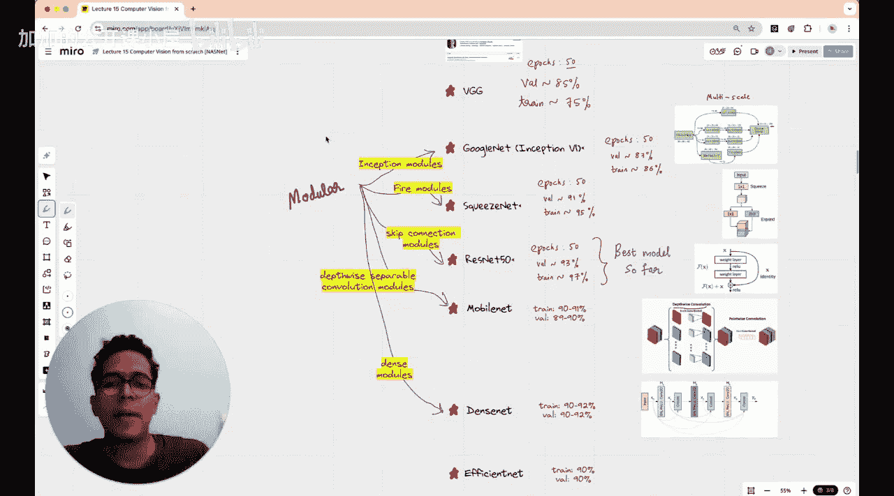

# Vizuara【中英⚡面向新手的计算机视觉｜Computer vision from scratch】 p16 P16 Use Neural Network to find a good CNN Architecture - NASNet ｜ Computer Visio [BV1UMxxzPE5Y_p16]

Hi and welcome back to a new lecture from the course computer vision from scratch Today we'll be discussing about a very famous CNN architecture。

Or CNN architecture building method called as NAS， which stands for neuralral architectureect Search。

So this was a revolutionary idea introduced by Google and the idea was that you allow a neural network to design itself so can you use a neural network to learn what would be the best neural network architecture for classifying images so NASnet was an example of a neural network that was built using the NAS paradigm neural architecture search methods and this NASnet will be implementing today for our fiveflow data but before that we will also discuss about the idea of NAS and how Google implemented NAS and what it accomplished compared to many other architectures that we have been looking at so far in this post so with that let's get into the lecture。

So if we rewind a little bit back to 2012， let's just try to recap what were happening in the deep learning scene Alexnet won the Inet competition this was in 2012 Inet competition and it was a evolution in deep learning as we discussed in the course several times and it showed for the first time to the world that deep neural networks can learn features in the images really really well。

And after that， in the years following， till 2017， VGG came inception which was also from Google called as Google Ne came。

 there was ResNe specifically ResNe 50 we have implemented in this course that came out。

 so all these different architectures were introduced with various advantages。

And this was all done by humans。Handcrafted neural networks so that was the catch the architectures which we discussed like in one of the previous lectures。

 we were saying how come people even came up with this come up how come people come up with this kind of an idea。

So one of the things that I have always wondered is how did deep learning researchers come up with these clever innovations because VGG had just one thing。

 three by three convolutions repeated for many depths in inception they had inception module and that module was repeated many times in reNe they solved the problem of vanishing gradients。

 so some of them sounds intuitive in retrospect， but some of them feel like people came up with it with a lot of trial and error with a lot of intuition and of course with a lot of experience and ingenuity。

But at the end of the day all these were handcrafted neural networks so just like what we are discussing right now。

 maybe people at Google also thought okay， why should we handcraft neural networks why not。

Design an algorithm， which。Can design a neural network architecture。

RightSo that is what NAnet was about， so Google。Brain Google Brain is a team within Google in 2017 a team from Google Brain led by Barret So and the last author of the paper。

 I guess the corresponding author was Kop Li。Their question was can we use a neural network to design another neural network and in the paper that they published in 2017 they showed this idea of using RNNs like Recur and neural networks for building the blocks needed for building another CNN。

 so this was the birth of NASnet neural Archit search Network。

NASNT of course identifying a neural network architecture through computation is very costly that we will discuss in the rest of the lecture lecture today。

 but what we can do in today's lecture is we will implement already pretrain NASNnet specifically NASNnet large so it's a specific new specific CN architecture we will implement that for the fiveflow data set and we will compare the training and validation accuracy that we get today against all the architectures that we have drive so far in the course。

NASnet is very popular I have seen people use NASnet once in a while probably not as frequently as let's say Resnet or VC but the idea behind NASnet is very good so but to implement the building of a CNN using an algorithm like by running a record and neural network its very computationally expensive so obviously today we won' be running the neural architecture search algorithm that is out of scope of this course is very expensive it required if I'm not on 500 GPs running for four days for Google to come up with the architecture that they propose in 2017 it was a very successful architecture but very expensive for people like us to run and come up with。

But what we will do is we'll implement that architecture and we'll see what kind of research we get all right。

 so that's the idea behind neuralral architecture search。😊。

Now before we get into the lecture let's do a quick recap I'm doing this recap lecture after lecture so that all of us can beat on track of how exactly is this course progressing where exactly are we headed and this recap will also help you put the different neural network architectures that you have learned so far in this course into clearly classifiable buckets so that's the reason why I'm doing this recap。

😊，So we started by by looking at the five flowers data set， day tanleon roses， sunflowers。

 and tulips。We thought okay this is a five class classification problem and we have to start with the simplest model。

 so we started with a linear model， not a neural network。

 just something that converts the three RGB channel image into a flattened layer and there was a fully connected set of connections going into a5 node output layer and then there was no activation function till here but at the end there was a softmax activation mainly not as an activation function but as a way to convert the output into probability distribution。

The accuracy we obtained was 40 to 45 percentage for training。

 35 40 percentage for validation loss was 10 to 20。Then you decided okay。

 we need deeper neural network to learn complex patterns in the data set。

 so we added one hidden layer with 128 movess so this is technically not a deep neural network it's a shallow neural network and there was radio activation function rectified linear agreement。

And this architecture again gave us 40， 45% accuracy。

 not much improvement from the previous architecture。

 but loss decrease by an order of magnitude and this as we discussed in the previous lecture is because the predictions became more confident although the number of predictions that were correct did not increase so loss decrease but accuracy remained the same。

Then we thought okay， there is a bit of overfitting happening because as eOs increased。

 training accuracy was increasing， validation accuracy was decreasing。

 so we implemented regularization， bash normalization。

 dropout early stopping and this improved the validation accuracy to 50。

60 percentage and we even bought 70， 75 percentage training accuracy in some cases。😊。

So we were a little bit happy with this but not fully happy that is the point when we decided to switch to transfer learning so until this point we were using Tensorflow cares but then we decided to switch to PythOS because most of the pretrain neural networks that we use in transfer learning are available in Pyths so from this point onwards we switched to PythOS so in the first transfer learning example that we work with we started with Rnet15 but we did not do really good hyperparameter tuning but we managed to get 100 percentd training accuracy 80% validation accuracy not the best but we were very happy because we got a direction that okay training a neural network from scratch is not the right thing to do you use transfer learning。

Then we decided to go sequentially from the year of Alexnet 2012 so we started implementing AlexNe and we got 1995% accuracy for validation and training for just 10 Epos that was very good then we switched to VGG specifically VGG16 which was the runner in the image at 022014 competition for 50 Epos we got 85 percentage validation 75 percentage training surprising because training was accuracy was lesser and this was because of under training it required VGG required a lot more extensive training it had huge number of parameters 138 million parameters。

Then we decided to go with a smaller model。Googlenet Inception V1 which had inception modules so for 50 epos 87 percentage validation 86 percentage training and this was the inception module where in VGG they simply use stacks of three by three convolutions but in inception they cleverly use one by one。

3 by35 by5 convolutions so it could learn multiscale features what do we mean by multiscale features features that are local which are captured using one by one convolution and features that are a bit global captured by5 by5 convolution because5 by5 is looking at 25 pixels at once。

This was also a modular architecture so if I zoom out a little bit here you can see that GoogleNe Senet。

 ReNe， mobileNe and Tennet， all these five architectures that we have tried so far in the course are modular architectures what do we mean by modular architecture modular architecture means if we zoom in into the CNN architecture。

