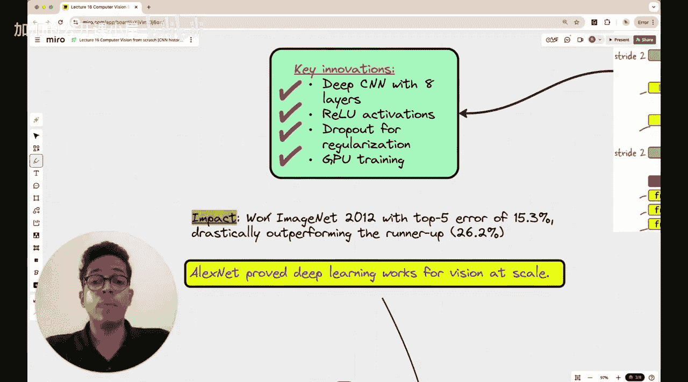

# Vizuara【中英⚡面向新手的计算机视觉｜Computer vision from scratch】 p17 P17 A Historical Journey through CNNs and Modern Computer Vision 2010–2025 ｜ Com [BV1UMxxzPE5Y_p17]

Hi welcome back to a new lecture this lecture is part of our computer vision from Sc series however you don't have to worry about any background knowledge for listening to this lecture because you can treat this almost as a standalone lecture。

Today we'll be discussing about the transition happened to computer vision。

 especially during the years 2010 to 2020， and we'll also briefly discuss about what has been happening in the computer vision seen in the last five years。

Almost a year ago， you might have seen this arguments happening between Lean Lapon and Elon Musk on Twitter or X。

 where Elon Musk were saying that they don't use CNNs anymore in their fully self-driving cars FSD。

 whereas Leon Lapon was saying then how could you possibly do realtime camera image understanding in the fully self-driving cars if they are not using CNNs？

So this was a time when there was a lot of arguments happening between what is better is the traditional CNN better or something like a vision transformer better and people were talking about so many different types of models in the context of computer vision。

You may have heard of models like ResNe， Inet， VCG。

Mobilenet a lot of these models are imaginenet is actually a dataset set but lot of the other models that I mentioned are very popular。

 but people don't know how to place it in a context what was the timeline。

 why were these models developed in the first place what did these models accomplished to become so popular etc。

So at the end of today's lecture， if you can have a very good mental map of the evolution of different models starting from。

 let's say， early 2010。Then that mental map Excel would be the biggest takeaway from today's lecture and if that can be happening at the end of this lecture for you。

 I'll be very happy。So when I say a timewise evolution I'm talking about a timeline like this。

 something that starts from early 1980s， 1990s etc ce with handcrafted models all the radio vision transform them so this lecture does not ill any coding or anything you can just sit back sit back and relax you can just listen to the story of evolution of these different models and if you want to take notes feel free to take notes but my real intention here is to give you an idea about what was the relevance of each of these famous models and how did computer vision evolve to what we see today in fully self-driving cars so with that let's get into the lecture。

So before entering into the specific details of each models just keep keep a brief look at this timeline 1980s to 2010 handcrafted filters I will show you what exactly that means 2012 the most famous model came out called AlexNe in 2014 VGG16 and GoogleNe came and all these three models were first place or VGG16 was actually runnerup in the famous Inet competition or Inet Cha then ResNe 50 came out in 2015 different variants of Resnet are very popular then in 201616 Densnet squeezeenett and Euro V1 came out these are also popular we'll discuss briefly about all these three architectures then there was NASnet mobileNe V1 so these are if you are a complete beginner and if you are listening to these names for the first hand you might feel like these are some random names and you have no idea how to classify these models。

Rring your head。So I'll give you very a very good mental picture of how to classify the significance of these models。

 why was mobileNevi developed and why is the name mobile in the name of this neural network for architecture。

Why was renet developed why is this name re as part of the name of this architecture so all of these questions will be cleared once and for all after the end of the rest lecture so let us divide the timeline。

Of the evolution of computers computer vision into few different parts so part one is clearly in the time before 2012 and this was before the boom of convolutional neural networks so before 2012 people relied on handcrafted filters there were many handcrafted handcrafted filters for identifying different types of patterns in the data sent so in the computer vision course series we have already worked on some handcrafted filters so for example。

This sawbel filter was for identifying bottom edges of the shapes in an image。

 so this this is the original image consisting of circle squarequire triangle and diamond pattern Sobel filter was this 3 by 3 filter。

And using this filter we can detect the bottom edges and we also discuss how you can imagine these filters to be light rays so imagine light ray is going from negative numbers to positive numbers so it's like light is going from bottom to top and if these shapes are projecting out of the paper then these light rays will illuminate the bottom edge of those shapes and that's what you're seeing here so if somebody wanted to process the images such that they for whatever reason they want to detect the bottom edges then you have to handcraft filters such as these。

There were other filters that we discussed like filters for detecting outline so outline means all the edges need to be detected so light rays have to come from either from outside to inside like radially inwards or you imagine a hollow annular shape projecting outside and inside the hollow annular shape imagine a light source to be present such that light rays are going from inside to outside like radially outside and then also you can get all the edges illuminated so this filter you can see that positive numbers is in the middle negative numbers are outside so it's as if light light source in the middle and that illuminates all the edges so this was an edge detection filter again a handcrafted filter so this was what was happening before 2012。

If you look at the traditional or machine learning models。

 they were all traditional models which required extensive features。

 handcrafted feature or hand engineered features like support vector machines。

 random forest or decision trees。Support vector machines could be used for binary classification。

 random forest or decision trees could be used for multiclass classifications。

 but at the end of the day you needed features and their values so that they can be plotted on the axis or features and the thresholds can be used for building the nodes in a decision tree。

So this was the traditional machine learning era。There was also huge constraint due to computational cost。

 it was not easy to perform computation on CPUs even if you use multiple CPUs in parallel so this made training deep neural networks very difficult although the idea of neural network came much before 2012 it was not in prominence it was not prominently used for computer vision tasks simply because to train a computer vision model to let's say perform a simple task like CA versus dog classification it was not at all easy。

That is when after， I mean， in， 2012。Alexnet was introduced。

 which kind of completely revolutionized the way deep learning was used in the context of computer vision。

So in nutshell， what we saw so far is the pre deep learning error in computer vision。

Now we'll go to part two， which is the revolution of convolutional neural networks starting with Alexnet in 2012。

Alexni was by far the most popular CNN architecture introduced by a set of researchers from University of Toronto。

Alex was the first author of this paper associated with this neural network， the neural network。

 AlexNe itself is kind of named after him， but the other two authors you will definitely recognize one is Professor Zoffy Hinton。

 he was the 2024 Nobel Prize winner in physicsy for the invention of artificialial neuralural networks and Elilia Stzkever who was the founding member of Open AI。

This paper has 170，000 plus citations at the moment and it's super famous， highly cited。

 and all these researchers are now extremely popular。Now。

 what were the innovations introduced by Alex N？They had a deep convolutional neural network with eight layers。

 so these were the layers used in the Alexnet architecture this was first convolution layer12，3，45。6。

7，8。Then in between there were max pooling for reducing the dimensionality there were flattening operation but at the end of the day Alexnet had around 60 million parameters right and they introduced simultaneously the usage of radio activation dropout for regularization and parallel processing using GPU to fasten the training of these neural networks。

And Alexnet shattered the competition like the competitors in Imnet Challenge in 2012 and Alexnett was the winner of the Inet 2012 Chaen。

And why was this such a big deal because this was the very first time researchers showed without doubt that deep neural network architectures could be efficiently trained for making good predictions on complex image data？

So Alexnet showed without doubt for the researchers that you don't have to rely on hand engineered features or hand engineered filters。

