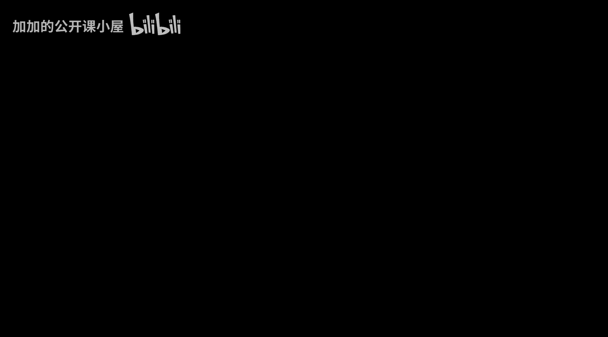
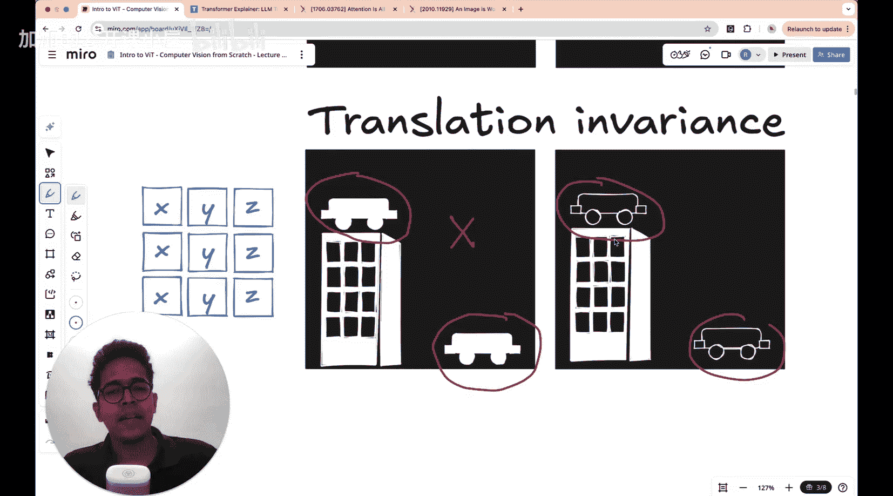

# Vizuara【中英⚡面向新手的计算机视觉｜Computer vision from scratch】 p18 P18 Introduction to Vision Transformer (ViT) ｜ An image is worth 16x16 words ｜ C [BV1UMxxzPE5Y_p18]

Hi， welcome to a new lecture today we'll be learning about vision Transer。

Even if you have not heard of vision Transer or you have heard of vision transformer。

 but you don't have much idea how exactly it works， don't worry this lecture is for you。

This is also part of our computer vision from scratch series， however。

 even if you have not followed the series ever， don't worry this is almost like a standalone lecture。

So I have divided the structure of today's lecture into three sections。

 so first we will be discussing about convolutional neural network and how they were so good for identifying features in images。

 but what are some issues with CNN which eventually Bi transformer could solve。

But since transformer is a major part of vision transformer architecture。

 we should properly understand what exactly is transformer and how exactly a transformer architecture functions。

 so we'll be spending a significant amount of time on transformer architecture itself and then we'll come to vision transformer architecture in the last part of today's lecture。

If you are already fairly familiar with CNNNs and fairly comfortable with the Transer architecture。

 you can skip to the last part of today's lecture， but otherwise if you would like to have a refresher。

 then feel free to follow the lecture sequentially。😊。

Today we won't be implementing the Vi transformer architecture on Google Collab that I have reserved for another separate lecture where I will show you the difference in performance between CNNs and Viion Transer for a given data set。

So with that， let's get into the lecture。😊，So what is convolution operation happening in the CNN architecture convolution operation is fairly simple。

 you have an image， let's say a 2D image which is shown by these set of green pixels and on this image a filter will act so here you have a 3 by 3 filter which is like a matrix。

And this matrix will act on different regions of the image to create this resultant image so this resant image here is a three by3 image whereas the original image was a 5 by5 image you have a  three by3 convolution here and there is something called as padding so here there is an extra set of pixels that are padded on the boundaries of this image there is also another feature called as sp which is how many pixels will this filter jump in each step of convolution so why was this idea so revolutionary because as I will show you sometime later in this lecture these filters depending on the values that are part of this filter matrix it can capture different types of features in the original in the image on which you are convolving。

So that was the basic idea behind convolution operation and CNNs extended this idea by adding convolution operation as part of different layers of a neural network。

😊，And these convolutional neural networks were so successful that the moment they showed promise in 2012 in the form of Alexnet architecture。

 which also won the Inet competition by the way in 2012。😊。

The focus of computer vision or the primary mode in which computer vision was implemented became deep learning until then people focus a lot on handcrafted or hand engineered filters。

 but the moment Alexnet showed promise，It changed the deep learning scene entirely。

Then VGG came in 2014， there was GoogleNe also in 2014。

 which won the second and first place respectively， and then in 2015 ResNet came。

 which again brought a lot of changes in how deep learning is used in computer vision。

So CNNs were so powerful for detecting patterns in images and that is what allowed convolutional neural networks to perform high accuracy classifications on images of。

😊，Even thousand classes。But there were a few problems。

In the basic assumption behind the usage of CNNs so let's discuss what are those three problems or the three features which led to problems in the CNN architecture later so CNNs have these three features and you might read about these features on internet in books etc but it's very difficult to understand just by looking at the terminology but anyways the terminologies are locality translation in variance and weight sharing but let's see logically what these three things mean right so locality is an assumption where CNNs assume that in small regions。

You can find important patterns and what do we mean by small region。

 a region that can be spanned by a small filter so if it if it's a one by one filter then you are just looking at one pixel if it's a  two by two filter you are looking at four pixels three by three means nine pixels and so on but three by three means for a 224 by 224 image 3 by3 filter is a really small section or really small subsection of the image right but the assumption is that these features can capture patterns and and those patterns are local。

Then there is another assumption called translation invariance。

 which assumes that feature if a filter is supposed to capture a certain type of feature。

 then irrespective of the positioning of that feature in the image。

 this filter will capture that and CNs assume that there is no problem in doing this。

 but I'll show you one case where this can be a problem。So first， let's look at how filters work。

 so this is a two by two， I mean3 by3 filter。And this filter is for detecting left hand side edges。

 So see what does translation invariance mean so here。

You can imagine this filter to be something like you have a light ray going from left to right。

 so from this left hand side to the right hand side， a light ray is going。

And if you have an image with two circular shapes and if you also assume that these are cylinders slightly projecting out of the plane of the paper。

 then light ray going from left to right will illuminate the left edge of this shape right so there will be like a semicircle kind of shape forming because this light ray is illuminating the left edge。

 so the way in which this filter will work on this image。

Which you can call as a left hand side edge detector。

Is as if a lighter is falling on an object of this shape。

And see what is happening It doesn't matter where the position of these two circles are the left edge is detector so this circle is on the top left of the image generally the physical location。

 this is on the bottom right and in both of these cases you are detecting the left edge using the same filter now the way I have drawn the filter might make it appear as if the filter is so big compared to the image I mean filter is almost half as big as the image but the image resolution might be 128 by 128 whereas this filter is just 3 by3 so please note that。

In this example， translation invaris were the fact that you have these features。

 left edge features on the top left of the image and on the bottom right of the image is not a problem because yeah you can have two circles like this in an image。

 this is not an issue。😊，But consider this case， let's say you had a filter。😊。

Don't care about what this filter may look like， but let's say you had a filter which is really good at identifying outlines of objects in the shape of a car Okay it's a magical filter let's not go into the details is not important what is important is this filter。

Irrespective of where the car appears in a picture will detect those features so if this filter is supposed to detect the outline of a car。

 so here I have drawn a car object here also there is a car object。

In this case the car is sort of on the ground here it is on top of a building and in both of these cases this filter is detecting the outline of the car。

 so the relative positioning of the car is not even coming into the picture。

And sometimes this is a problem because let's say the task is to。

Identify whether something is real or not。And your task is to identify， okay。

 is this an actual image of a car in a real kind of real world setting。

 then this kind of a setting will never happen or almost never happen in real life because you won't find cars on top of buildings。

But because these filters have the property of translation invaris and if this filter is supposed to capture all the edges of a car like object。

 it won't care whether this car object is on top of a building or it' is in the air。

 it won't matter to this filter。But in reality， the relative positioning of these objects matter。😊。

In actual images， you will not find objects like cars on top of objects like buildings。

 you usually find objects like cars at the bottom part of buildings。So that relative positioning。

 how do you capture that that knowledge in the image that if you are having two objects in an image。

 one is a building and another is a car？How can you teach your neural network that in general cars cannot be found on top of buildings this is this will depend on learning features in the image。

From far away locations， as well。Like if the building is here。

