# Vizuara【中英⚡面向新手的计算机视觉｜Computer vision from scratch】 p19 P19 Coding a Vision Transformer from scratch using PyTorch [BV1UMxxzPE5Y_p19]

Hi， in this lecture， let us implement a simple vision transformer using Pytharch。

We will not be using any pretrained architecture， the entire architecture of the vision transformer will be defined by us in the code。

 we will be using certain useful Pyth libraries to make our full process easier。

But the training of the vision transformer will be done completely from scratch and we will be using the famous MNist handwritten digits dataset set so that it' is very simple。

 so it will be like a 10 class classification using vision transformer。

If you are someone who is having absolutely no idea what a vision transformer is you can still continue following this lecture and try to code with me。

 it will still be very much beginner friendly so I have divided this lecture into two parts the first part will be a brief discussion about the theory of vision transformer how exactly it works and a quick walkthrough through the transformer architecture itself we will also discuss the difference between transformer meant for applications like GT where it's textbased versus the vision transformer where it's main for images so we will discuss all of that briefly but our main purpose of this lecture will be actual coding and I'll be writing every single line of code so that you can follow with me at the same pace and I'll be using Google collab for my coding so it will be very easy for you to start there is nothing no prerequisite just start coding with me so with that let's get into the lecture。

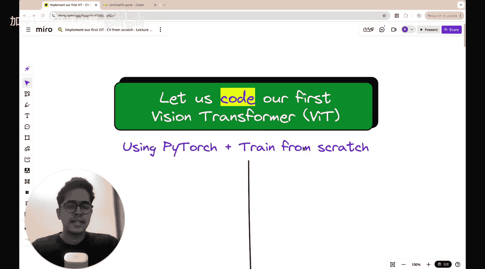

The concept of vision transformer was introduced by a team at Google in this paper titled an imageage is worth 16 by 16 words。

 so here they showed the implementation of transformer architecture for image recognition and task。

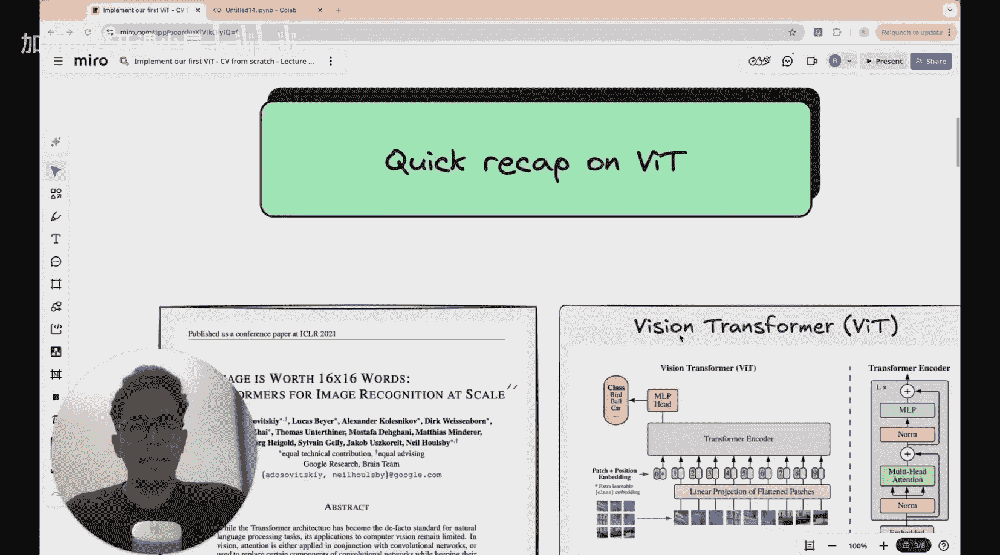

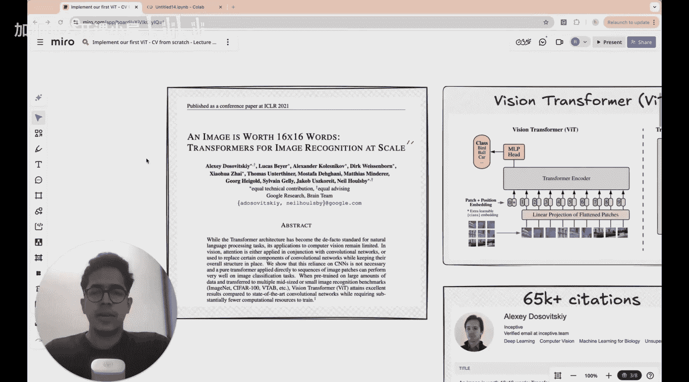

The transform architecture which was introduced in the 2017 paper attention is all you need was also written by another team at Google。

 so it's amazing to see that such similar papers are coming out of Google's AI research。

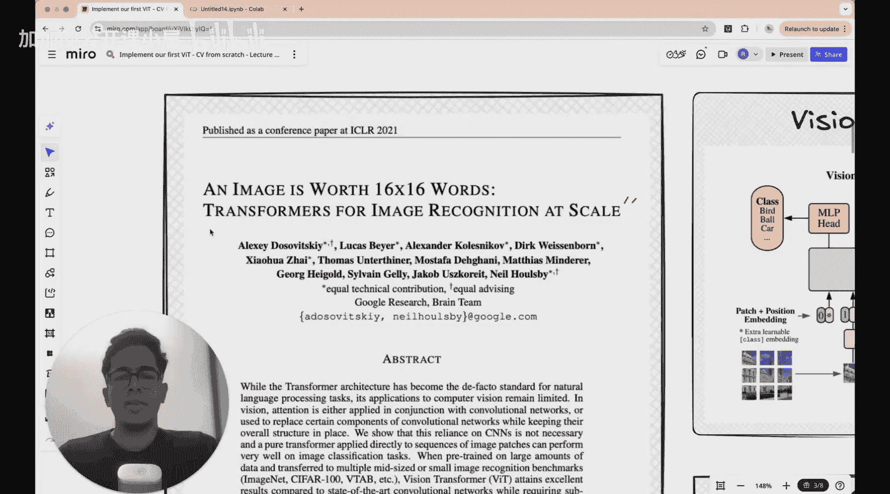

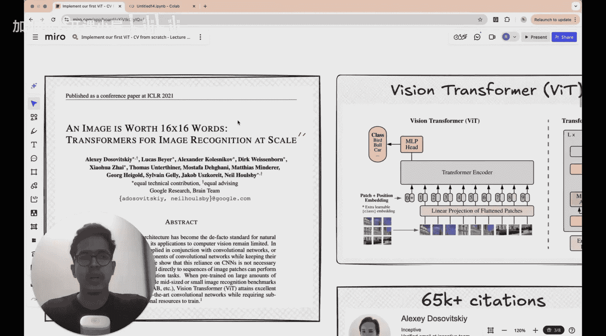

And before getting into the vision transformer architecture itself。

 this is the famous figure that was part of the paper in which they tried to describe how the vision transformer works。

 but I will divide this figure into meaningful easy to understand part so don't worry about this architecture looking like as if it's intimidating the paper already has 65000 citations this was published in 2020 and attention is all you need paper which propose the transformer architecture and that paper that has I think 170 or 180。

000 citations it was introduced in 2017 so three years after this vision transformer paper came it's available in archive if you want to check out。

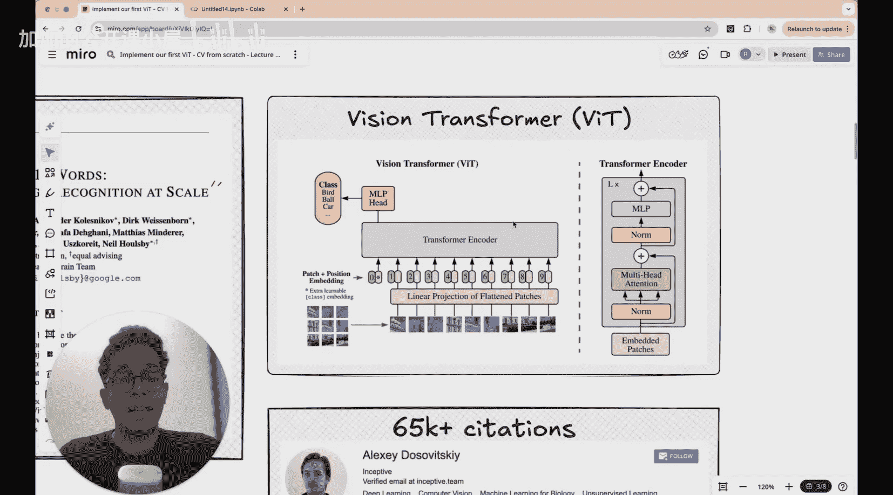

The basic idea is the following in a regular textbased transformer architecture you are dividing sentences into tokens so you can imagine tokens to be like words but here vision transformer inputs are images so what you do is you tokenize the images by dividing it into something called S patches so here let's say the input images like this 48 pixel by 48 pixel image you can divide it into certain number of patches so let's say we are dividing it into a patch of size 16 by 16 which means you have nine such patches how do we get 9 it's 48 by 16 along the length。

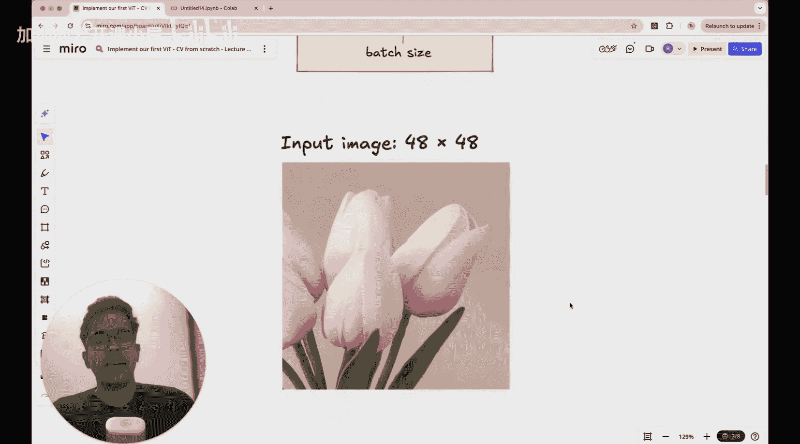

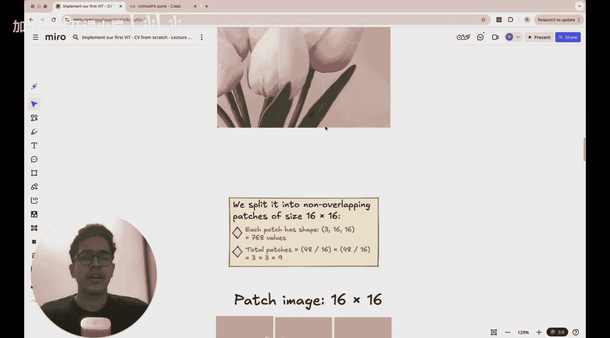

And I mean am the width and 48 by 16 along the height， so this will be3 by 3 multiplied by 3。

 which is9。So just like how sentences are divided into certain fixed number of tokens in。

Text based transformer architecture in vision transformer also the input image is now divided into 9 patches。

 It can be 9。 It can be any other number of patches depending on your pad size and the total number of patches will obviously also depend on the actual image size here。

 we said that the image size is 48 by 48。Now we'll see how this is now fed into a transformer architecture and the transformer architecture here is no different from the transformer architecture that we see in say GT so let's go through it quickly I have made in an elaborate but simple diagram of the transformer architecture but meant for images so we are first converting the images into patches so we have nine pairs in this particular case and if you look at the dimension dimensionality of each input it will look like one comm 9 768 what is one one is the batch size because sometimes we may not be processing just one image at a time we may be processing multiple images in one batch so if we are processing four images in one batch then batch size will be four so this number will be four so this won't be always one please take that into account。

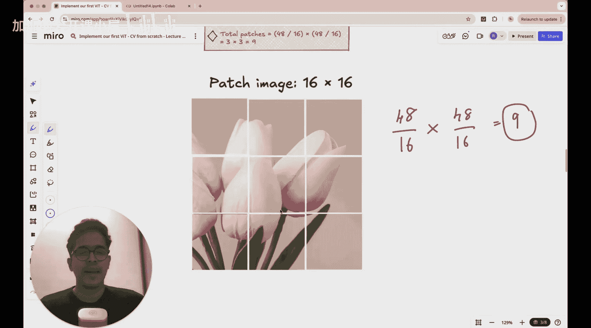

Then we have nine patches right so we the single image is divided into nine subimages。

 so that is this nine。And then 768 is the number of pixels in each patch。

 So what is the number of pixels， It will be 16。Multiplied by 16。Multipliied by3。

 so 16 by 16 is the dimension of each patch and three is the number of channels we have red。

 green and blue RGP， so what is 16 by 16 by 16，256 multiplied by 3 and that is 768。

So this will be the embedding dimension also， so embedding dimension is we are converting these patches into some sort of vector representation。

 just like how words are embedded into certain vector representation in text based GPT here also we do something very similar。

Then what we do is in addition to this input data。We add an additional vector called as CLS token。

 CLS token also known as classification token。So in text based GPT architecture。

 we use the very last token for performing next word prediction。

Here we are not trying to predict the next batch because what is the value in just predicting what is the next batch at least for classification task so here what we are trying to predict is what does this overall image represent so if we are trying to perform1 thousand0 class classification we want a probability distribution for saying okay this image is very likely that of a flower。

If we are trying to perform like a five flower classification from the fiveflow data set。

 we want to be able to say whether the image input image is like a Daisy， dandelion。

 tulips or whatever the image category is。So this CLS token is what will be used for performing the classification。

In the textbased GPT well be using the last token for predicting the next word and then append that next word into the sentence and then use that sentence to predict the next word and so on so that that way you can create sentences Here you make a classification Now where is this CS token added this CS token is appended to the beginning of the input tokens input tokens are these patches so that is what is represented in the original transformer architecture diagram so let me just zoom out and show you the diagram so this vision transformer diagram from the paper it shows okay you take an image right and then you divide it into set of patches so here also they they are showing as if they are dividing into nine patches three patch along three patches along the height3 along the width。

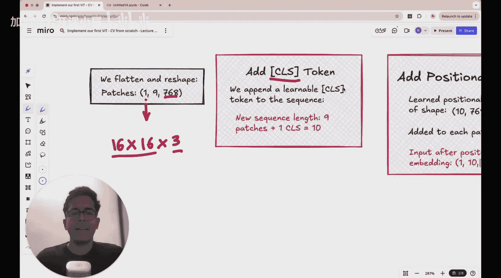

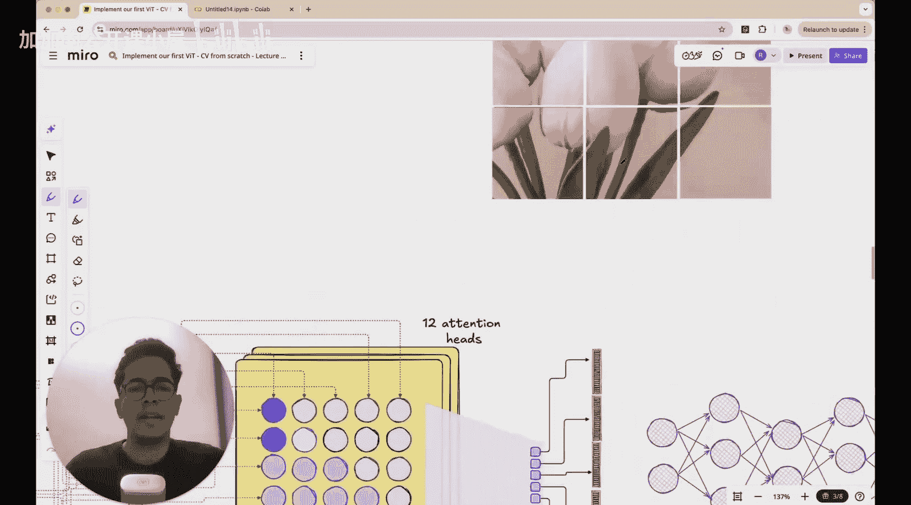

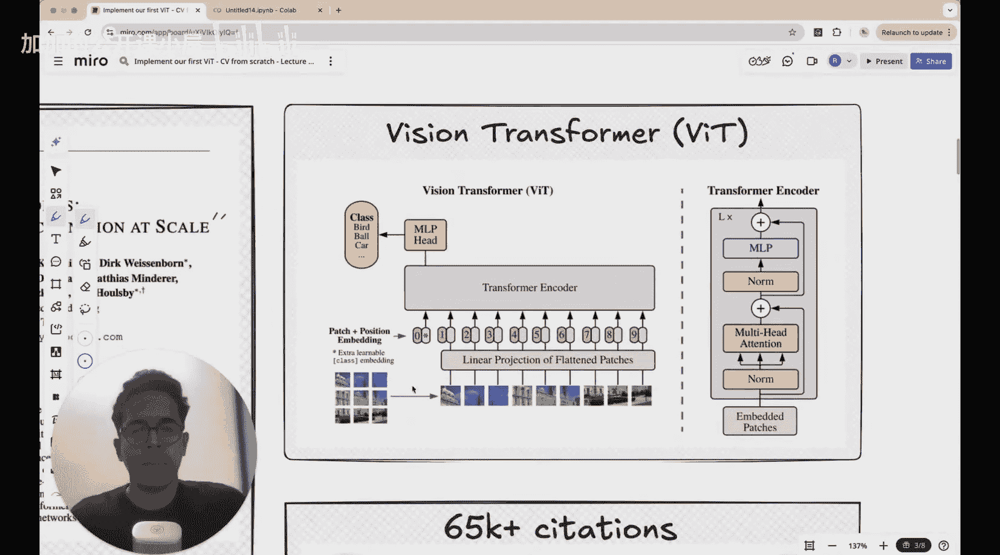

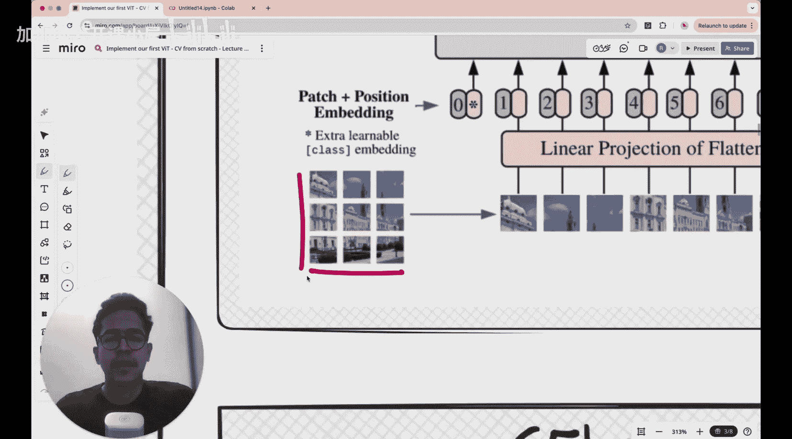

And then。😊，You have these nine vector representations of the input patches plus you are also pending at the zero position。

 the scale is token。

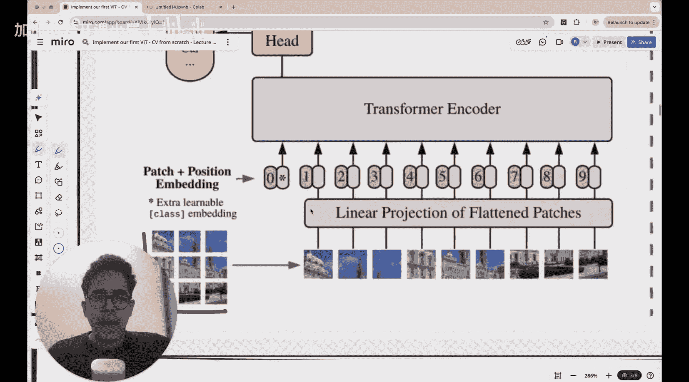

Now in text based transformer along with the vector representation of the tokens。

 we also add something called as position embeddings which represents what is the position of that particular word so if we have a sentence like let's say。

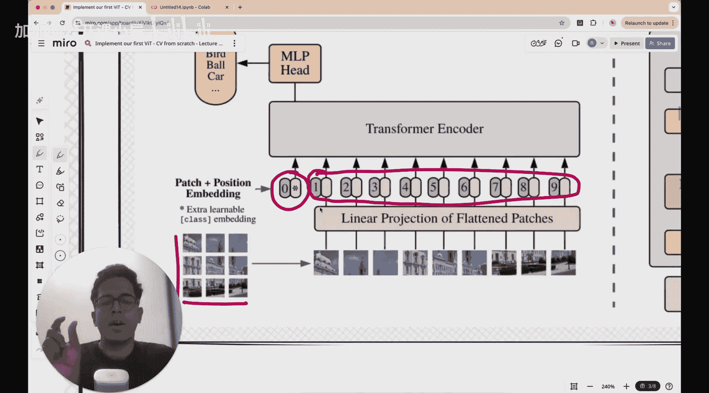

All it。Dogs。Car animals。Versus。好的。Animals。Ourre adults。If you split this sentence into words。

 just ignore the space right now， if you split this into words， there are four words。

 the four words present in both of these sentences are exactly the same。

But the meaning of these two sentences are very different。

 so to capture the meaning you also should know the relative position of those words in the sentence。

 that's why along with the vector embedding of the word dogs or the word animals。

 you are also adding the vector embedding corresponding to a position of this word so here are the dogs this word dogs is in the first position so let's say this is zero position this is one two and three so if let's say a vector embedding of the word dog looks like this。

Onto this vector forget about the exact dimension the x and y axis mean can mean many things and in fact the dimensionality won't be two dimensions。

 it will be multiple dimensions， but I just want to show you the idea so to this dogs or dog vector。

You want to add the fact that it's in position number one right so that will be another small vector added such that overall this vector will slightly change。

 So now this second vector which is the sum of the original docs vector and the position vector。

Ha has two things in it。 It has the information that this vector represents dogs。

It also has the information that the position of this particular word in the sequence is position number one。

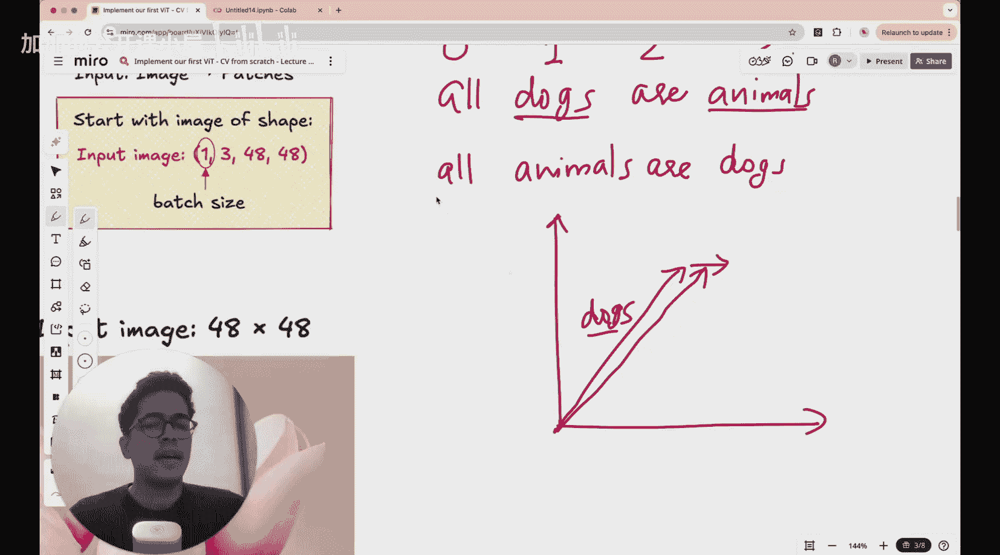

So this is the idea behind text based transformer， same thing goes。

