# Vizuara【中英⚡面向新手的计算机视觉｜Computer vision from scratch】 p20 P20 Hands on Computer Vision Bootcamp ｜ Day 1 [BV1UMxxzPE5Y_p20]

Oh like， awesome， thank you so much。So。Thank you everyone for joining today。

 welcome to the hands on bootcam in computer vision I have a very specific agenda in this boot campm。

Which I will mention what exactly we will be covering in this boot camp， who is this meant for。

 what can you expect to get out of this etc？So before that。

 let's spend a little bit of time I can introduce myself a little bit my name is Sa Panard。

I am one of the co founders of Visra AI Labs。

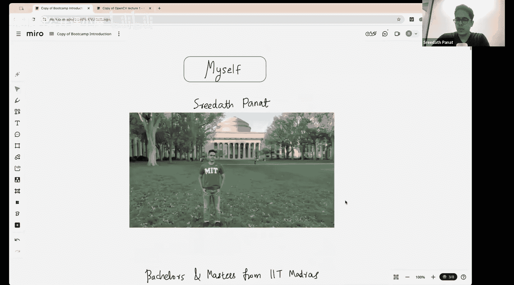

So my education was from my E Mads in 2012 to 2017 and after graduation I went to MIT for my PhD so that was from 2017 to 2022 for five years and then after graduation so my PhD was mostly in interfaciial engineering little bit of electrical engineering little bit of machine learning robotics so it was like an interdisciplinary field of many different things and I had a lot of fun time。

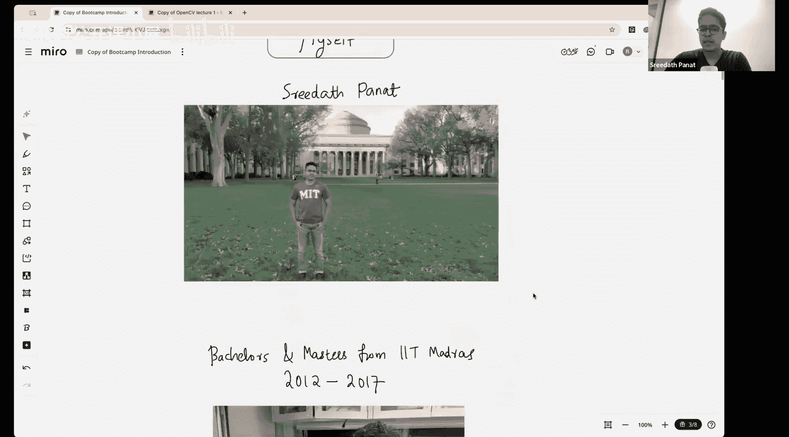

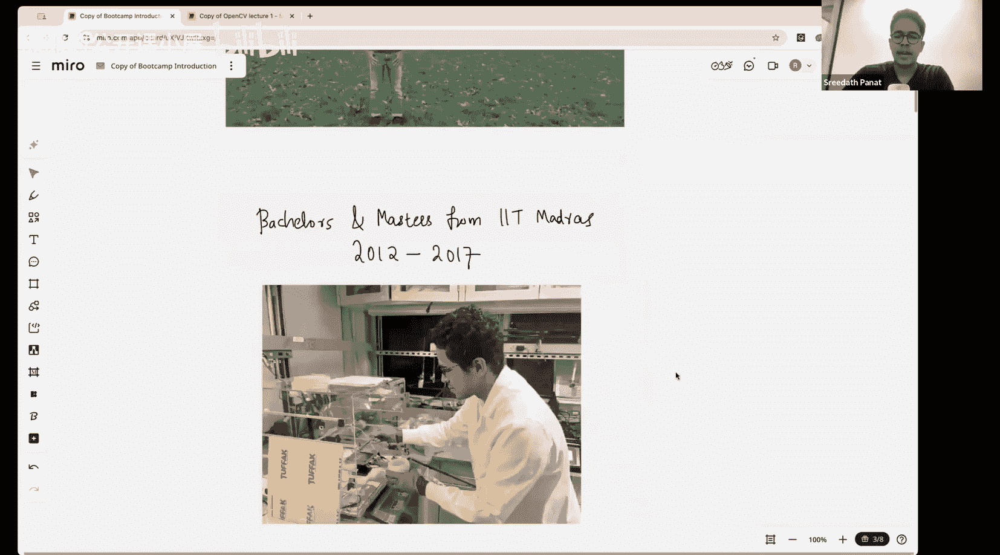

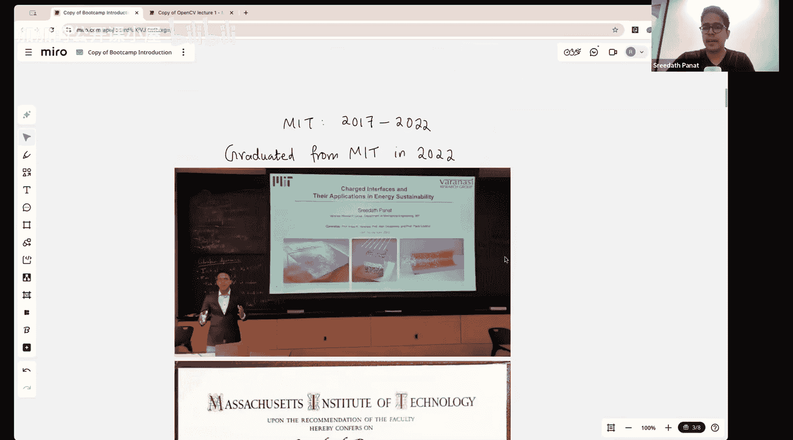

During my PhD。But after that， or I would say slightly before that。

 we ended up working together Raj Rajathan myself， you might be familiar with them through LinkedIn or our YouTube channel。

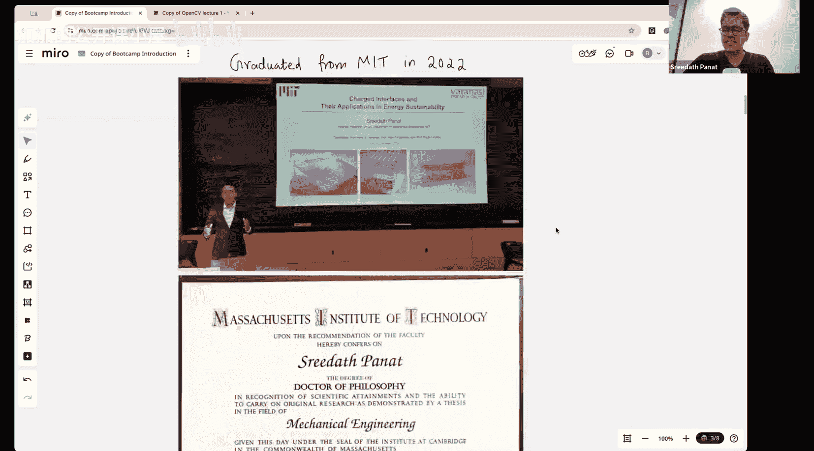

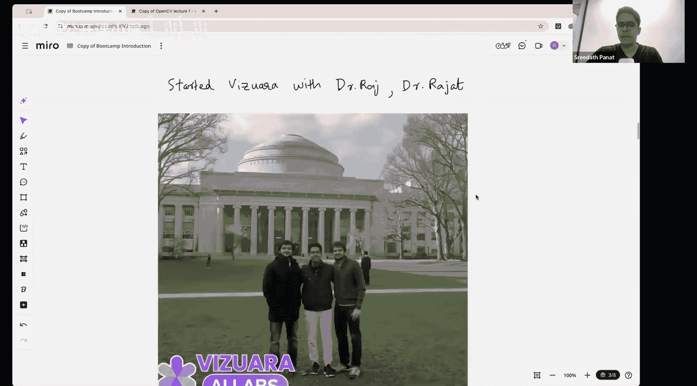

So we decided to start Biswarra to basically do many things in the AI domain。

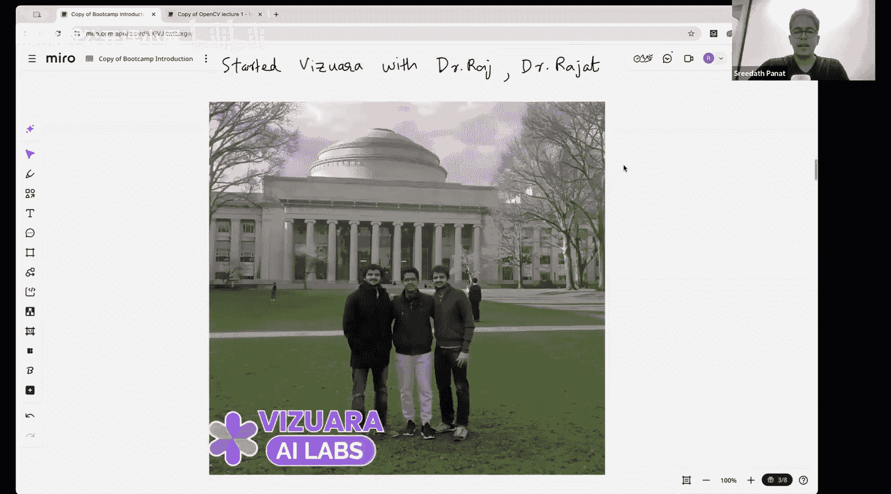

If you are interested you can check out this video this is a three minute video of my PhD thesis work which was published on in desert region MIT's YouTube channel it has almost 300。

000 views now so my basic work was to build a selfcleing solar panel which can remove dust and clean itself and recover almost 95 to 98 percentage of lost power output because when dust is accumulating on solar panels which is very likely in desert settings it can drop the efficiency significantly so this was like a waterless。

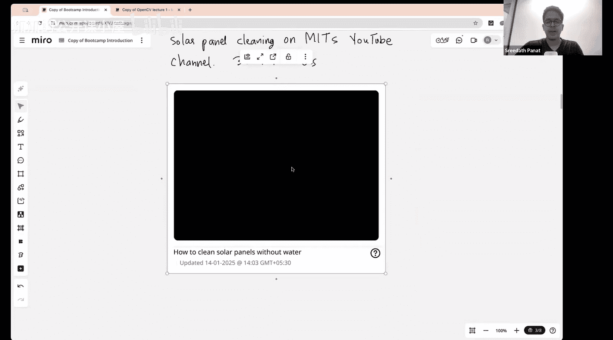

Electrostatic self cleaning robotic system so it can clean solar panels having a without having the need for a single drop of water。

The interesting thing was while working on this project inadvertently machine learning entered the picture because there was something called as dust removal voltage。

 so dust removal voltage was how much voltage per centimeter do you have to apply to repel charge and repel a particular particle of let's say 30 microns in size or 50 microns there are particles of different sizes？

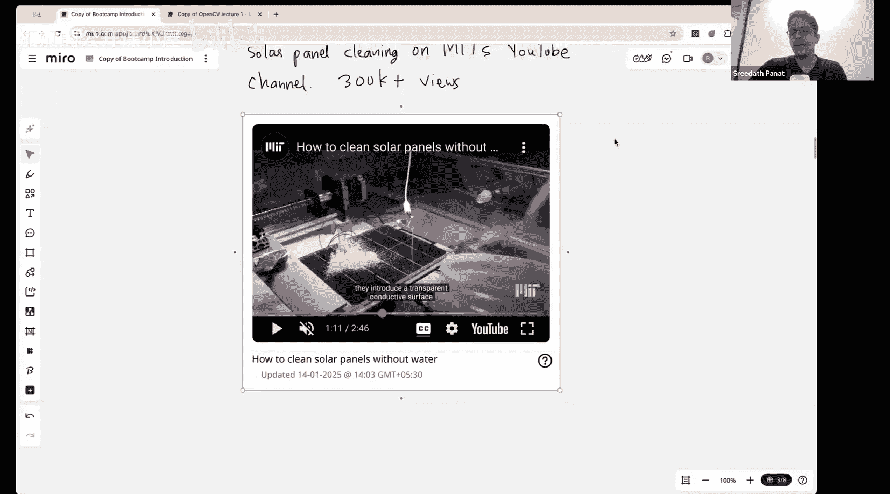

So this dustrimable voltage was completely dependent on the particle size now how do you know the particle size you don't know right you can't take a microscope and check the particle size in every single region of a solar panel so what is a sensible thing to do so I purchased a very cheap camera which could get 50 x to 100 x magnification so it was not as good as a proper microscope but it could magnify a little bit and give me。

Like thousands of dust particles in one single frame now from this single frame I wanted to get a dust particle size distribution。

 especially its mean and standard deviation so that I know that okay most particles are in this size bucket so that the dust removal voltage could be applied whether it is 10 kilowavolt 12 kilowavolt。

 15 kilowavolt， whatever that is。

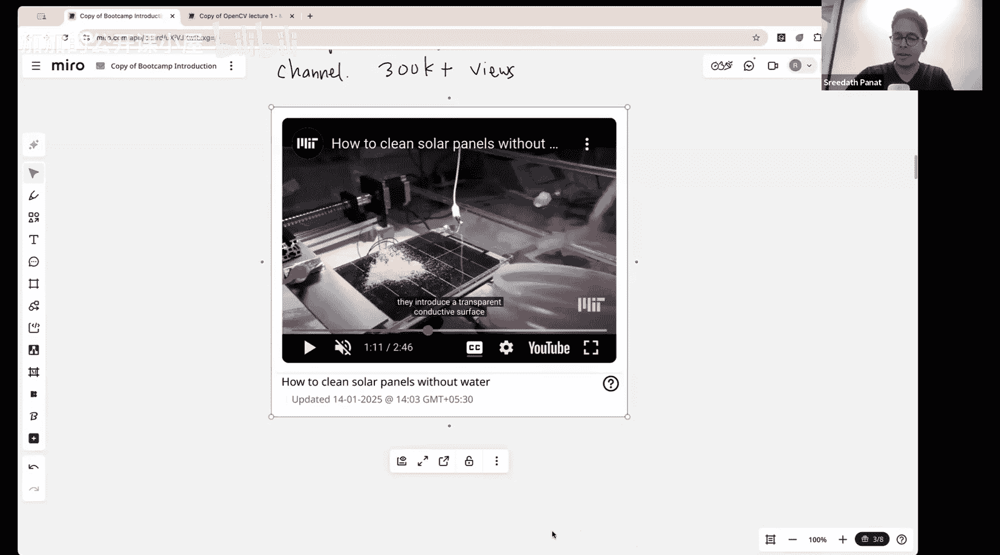

And how would you do this， are you going to count， are you going to fit circles around every single particle and measure the average size distribution。

 no you won't be doing that。Here is where machine learning enters the picture。

 especially computer vision so I implemented a convolutional neural network which could real time process the images coming through camera and then this can classify the dust particle sizes into different buckets so 30 micron bucket 50 micron bucket etc and based on that my autonomous solar panel cleaner could decide what voltage to apply so this was an interesting use case of computer vision or specifically deep learning in computer vision for a complete handson physical experimental setup and a product。

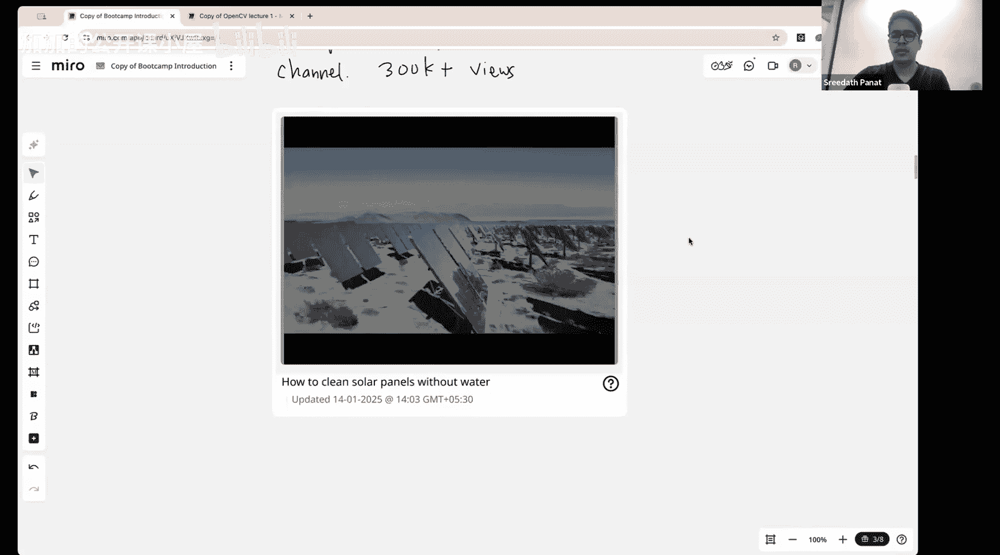

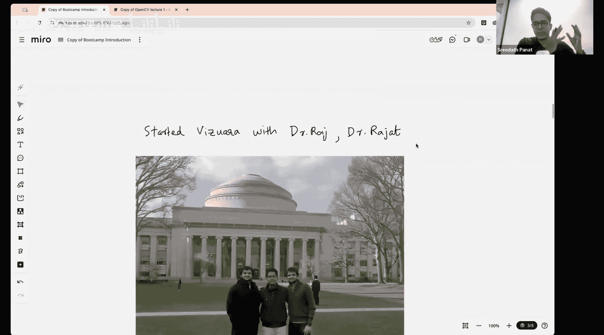

So I just wanted to share this with you because I'm pretty sure that people。In this call。Willll have。

Background not just in computer science i'm sure you are from different backgrounds like mechanical engineering some of you might be from computer science。

 some of you might be from totally different not even engineering background right and you might be wondering。

Why is deep learning computer vision with deep learning relevant to you。

 It's relevant because I just wanted to show you this exactly to show you the relevance。

 but it's anywhere relevant because the。😊，The field of computer vision has penetrated into various domains in various industries I will show you in today's lecture some of the example industries。

😊，So this was just my introduction and I'll also mention one more small story of how what was one of my initial research attempts at traditional computer vision so this was more than 10 years ago when I was an undergraduate student so we were working on a problem for classifying rice grains so if you have a bunch of rice grains on our surface there are many different varieties there is there is Basmey rice。

 jasmine rice， pony Italy rice and there are many， many dozens of varieties of rice grains。

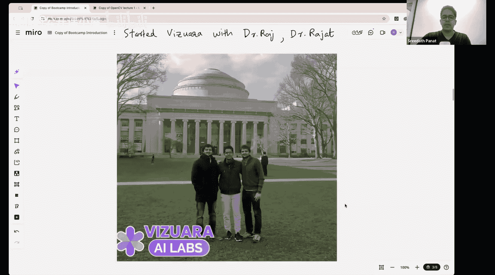

On an average， these grains have an average size， there is a distribution。

 but sizes differ based on what rice grain variety it is。

And there are many configurations in which rice grains could be on a surface。

 sometimes it could be sparse， it could be distributed such that there are only few grains on a surface on any image right or could they could be on a heap so there are many many rice grains touching each other so at that time although deep learning had slightly entered into the scene thanks to Alexnet which we will discuss a little bit。

The traditional computer vision approaches which had nothing to do with deep learning was still prominent so what were we trying to do we were trying to do something like ellipse fitting so let's say you have a ice grain that looks like this。

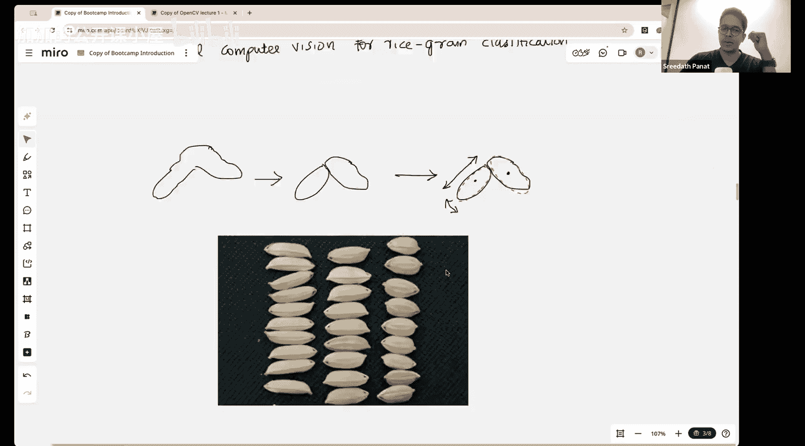

These are actually in the image when you perform some kind of thresholding。

 so when you convert an image into pure black or pure white image。

 you may notice features I mean shapes like this which are。

Not representative of an actual rice grain so what could be happening what could what could be happening is two rice grains are touching each other so you have to first figure out under what conditions what is an algorithm which can detect when two rice grains are touching because their outline will be just one single shape。

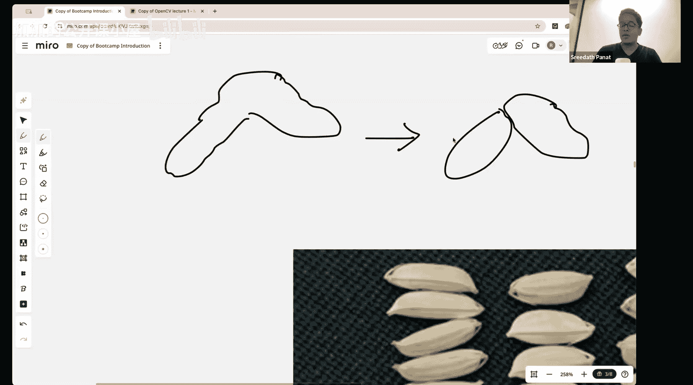

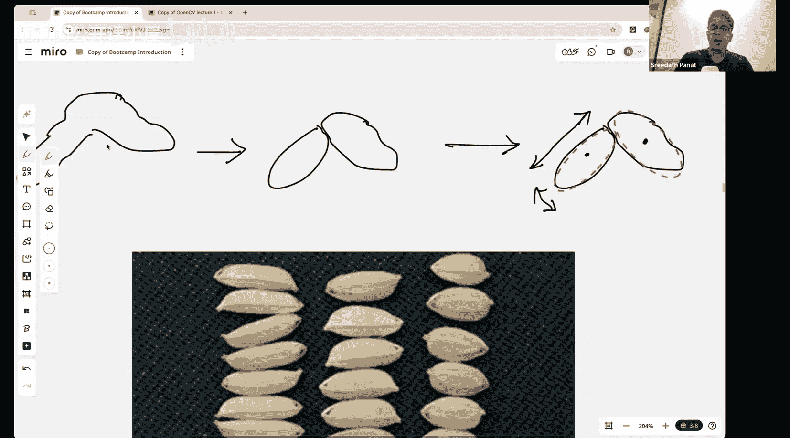

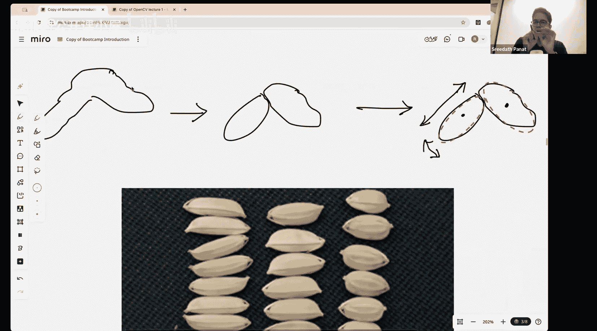

And then divide， split those shapes into two different shapes。

 find the center of mass or center of geometry of those shapes and fit ellipses。

 then calculate the longer the length and the breadth of this ellipse and then plot this size distribution such that this could be the longer axis。

 let's say B and this could be the shorter axis or vice versa and then what will happen is rice grains of similar varieties。

 let's say it rise may be distributed here。

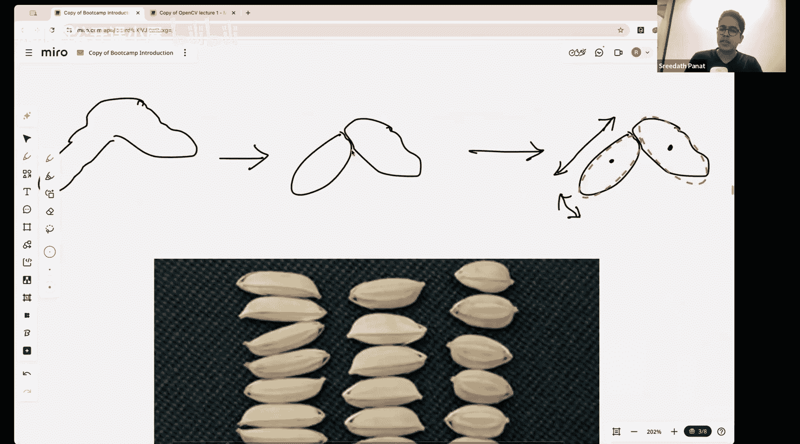

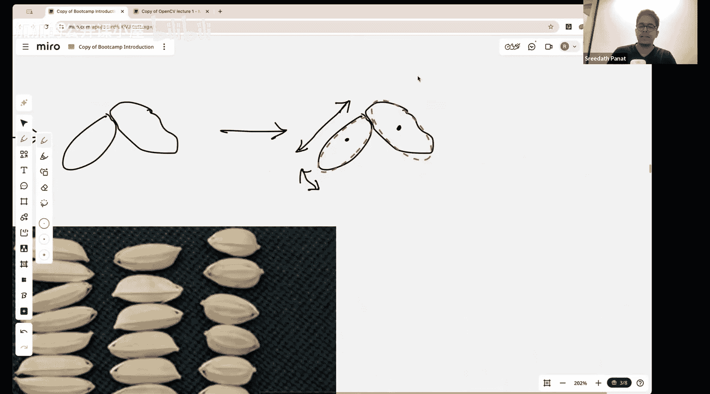

And then maybe another variety of rice may be distributed here。

So this was a pure traditional computer vision approach。

 which had nothing to do with deep learning neural networks were not even in the picture。

But this could have been done with neural networks also right as we famously know now。

 but the good thing is this paper got us a really good exposure into various techniques that were happening in machine vision and computer vision at that time this work was accepted into the ninthth international conference on machinech vision which happened in Nice in France。

😊。

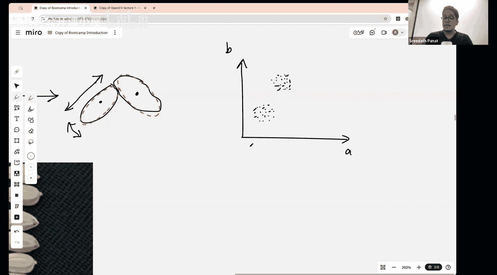

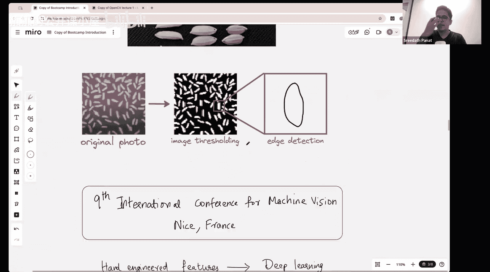

And it was very clear to us when we presented our work in that conference that the research community is entirely going to shift in the near future into deep learning based approaches for computer vision。

 nobody's going to work on hand engineered features and this major shift was I was so lucky to experience this major shift almost in real time。

Of course， there were other shifts that had already happened in in more you know deep communities in computer vision or in computer science。

 so Alexnet was the paper which。Came out in 2012 that showed for the first time that and this was in 2012 and this paper showed for the first time that you could use deep neural networks for training on large data sets of images and they even used GPU for training so it showed for the first time that you can leverage parallel computing to make everything faster and if you look at the NviDs stock right the rise of NviDS stock everything。

If it can't be attributed to one single event but if it can be then this would be one of those events the proposition of Alexnet so Alex was the name of the first author of the paper then there was Professor Jooffrey Hinton who won Nobel Prize in physics for his work in neuralural networks this was in 2024 and Ilia Sakever was also there he' is one of the founders of OpenI。

So this all was happening in 2012 and then people had gradually started to eliminate hand engineered features from their work。

😊。

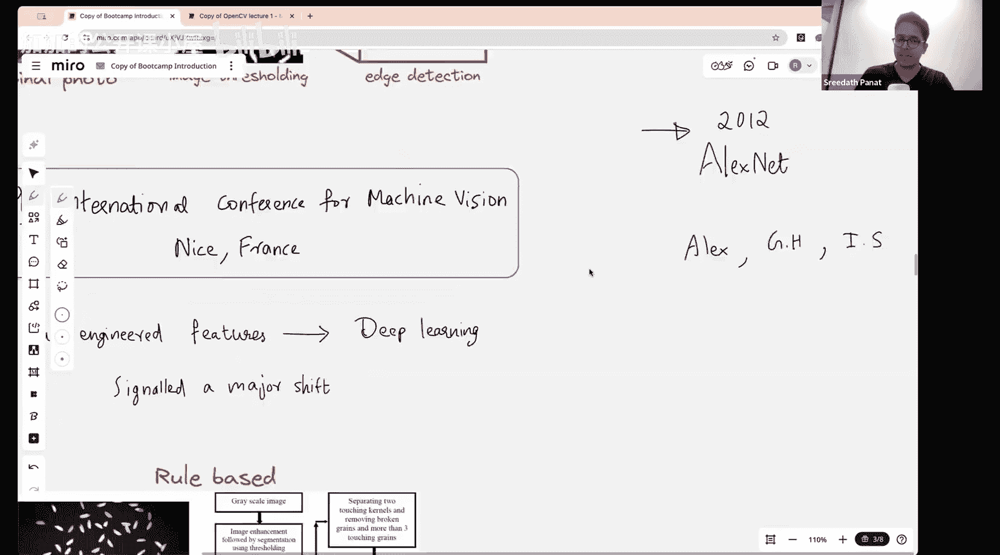

So how does hand engineer features work because we know that in convolutional neural networks they use something called as convolution filters。

 so filters are important， it is just that humans do not define the filter values。

 it is learned in the process of deep learning so it's learned during back propagation。So。

 but before that， what exactly is this filter doing to an image if you had an image and if you had a filter。

 what？😊。

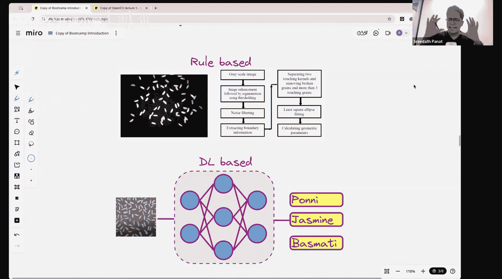