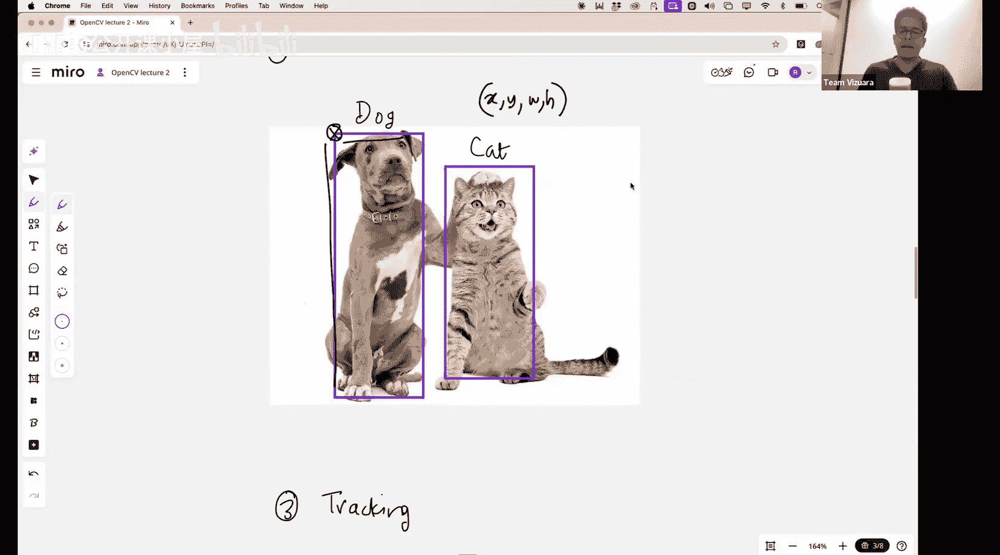
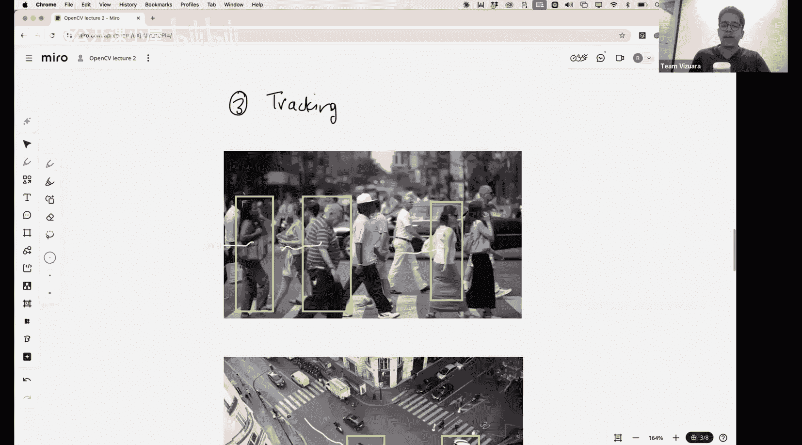
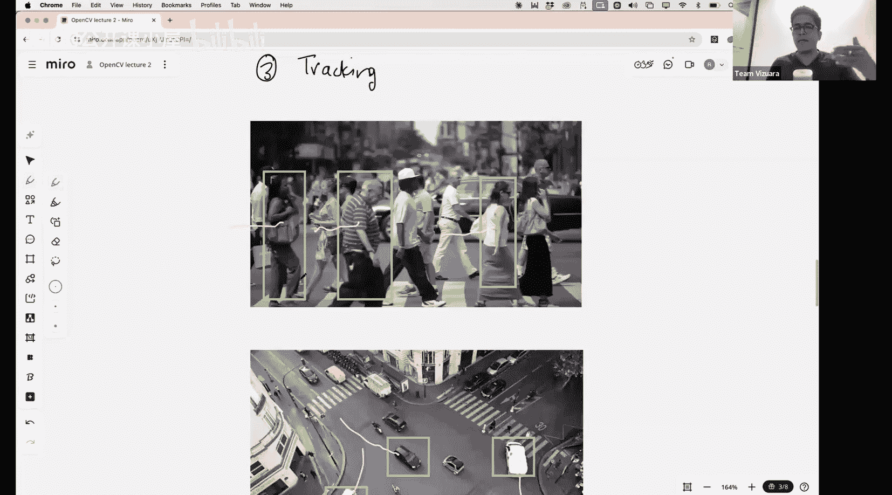
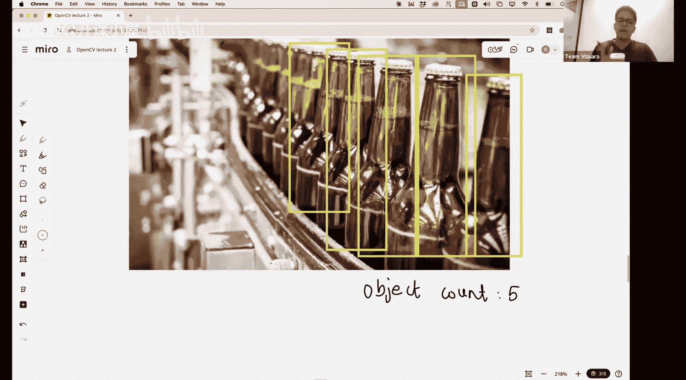
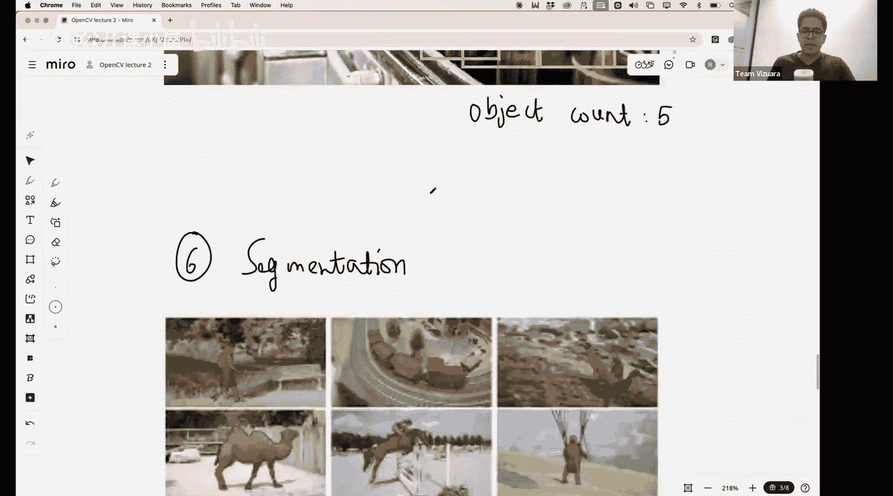
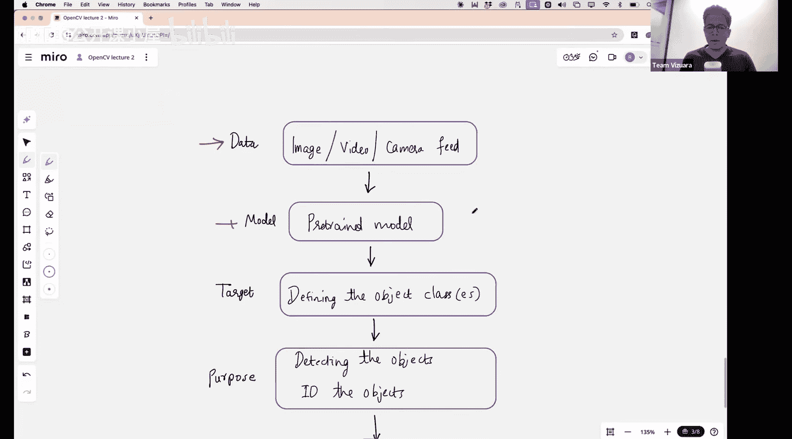

# Vizuara【中英⚡面向新手的计算机视觉｜Computer vision from scratch】 p21 P21 Object tracking and Counting ｜ OpenCV + YOLO ｜ Computer Vision Hands-on boot [BV1UMxxzPE5Y_p21]

Okay， so in the last lecture we got an introduction to open OpenC Library in Python。

 we also discussed a little bit about filters， especially the intuition about filters， right？

And at the end of the last lecture， what we did was we built a simple。burglar detection algorithm。

 which had nothing to do with deep learning， it was a pure logic driven system where we were just looking at the clusters of pixels that were different from one frame to the next frame。

And then what we did was we constructed a bounding rectangle around clusters of pixels whose conour area was greater than certain threshold。

So depending on this threshold value， if we put thousand。

 it meant our system was less sensitive to movement if our threshold was low， it means even。

Smaller changes happening in group of pixels were getting captured in the frame to frame difference。

So today we'll be building more applications using open CV， however， today will be。

Using pre traineded deep learning models。Although we won't be going into the details of those deep learning models today。

 which we are leaving for a later part of the boot camp。

 we will however be building these following things， so we will start with a simple object detection。

So simple object object detection means you are only looking at one single object and that object will be annotated by a bounding rectangle and this will be from an image or it could be from our camera feed it could be from a video so the input can be anything。

Then after this we will today itself， we will build a multi object detection。

 which is just a simple extension of single object detection。😊，Then after detecting an object。

 how do we track these objects from one frame to the next frame because the algorithm has no idea that the object where you are drawing a bounding rectangle。

 it is the same object in frame number 35 and frame number 30 you have no idea。

So if you were to create an ID for the object， how do you ensure that the same ID is being maintained from one frame to another。

 so we will implement that。Then we will also implement an object counting algorithm。

 so object counting algorithm meaning if you have a conveyor belt and there are objects moving through this conveyor belt。

 you could use this algorithm to count the number of objects or if you have a traffic junction and there are n number of vehicles passing through this junction you could count that。

And last if time allows， we will also work on object segmentation。

 so I will also tell you the difference between detection versus segmentation， right？And here。

Object could mean a person， it could mean animal， it could mean just physical things。

 so object is like a general term used in computer vision to represent any of these things。

And as you might have already known， the data that we are using would be videos or images from YouTube or from P or from any stock video sold so you can take whichever video you wish to use I will be sharing the videos that I am using for these projects which are the dataset sets。

The model that we we are using will be Yolo V8 it's a pretrain model that we are going to use so Yolo is an object detection algorithm primarily which expands to you only look once and the reason why it's name like that is because you are just using one forward pass of a neural network to make a prediction I'm not going to go into the details of Yolo today because we have an entire section dedicated to Yolo in this boot camp in the last part so but we'll be using a pretrain Yolo which works really really well for real time object detection and obviously the framework that we are using is openC。

So before going into all of this， let's make sure that all of us understand the difference between image classification。

 this is what is most familiar。Object detection。Bracking。Object counting。

And segmentation because these things are different things， these are five different concepts。

Classification is the easiest and I'm sure all of you know about classification you have image and this image overall is classified into one of the N categories。

😊，If it's a binary classification there will be two classes。

 so if it's a cat versus dog classification you are trying to assign a probability to an image for it being a cat so you might say that this is 99% cat。

So this classification can be done using just a simple convolutional neural network with a soft Matax classifier at the end of it。

In object detection however you perform two things you try to either if it's a single object detection you try to perform a classification but also you try to predict a bounding box so here it's a multi- objectject image there is a dog and a cat and what you are trying to do is you are trying to come up with a bounding rectangle whose coordinates are known so you will know this coordinate you will know its width and you will know its height so x comma y comm with comm a height with just these four parameters you can define a bounding box and you will also say what is there inside this bounding box with what probability so you may say the bounding boxvocation is this and inside the bounding box you have dog with a probability of 98 percent similarly you can draw another bounding box and this bounding box will say that there is a cat and how do you build these bounding boxes that part is taken care of by your。

So Yolo is that algorithm which allows you to construct these bounding boxes。

 which generally encloses the object of interest。Now this might be in just one frame。

 so you are looking at， let's say， frame number 533。

But tracking is different in tracking， you are looking at people or objects or things that are moving from frame to frame。

And in tracking， you could either assign an ID so you could say this person has an ID ID of one。

 this person has an ID or this bounding box has an ID of three。

And if there are three bounding boxes in the current frame in the next frame also there could be three or four or five bounding boxes。

 but at the end of the day， the bounding box that corresponds to this person who is moving should have still have the ID of three。

The ID should not change， so the ID of the bounding box uniquely determines the location of this person。

Now if you want to actually track the movement of this person。

 what you can do is you can define the centroid of the bounding box centroid is nothing but x coordinate of or the width divided by2 and you add that width divided by two to the x coordinate so you will reach this x coordinate similarly you do height divided by  two you add that to the y coordinate then you will move here so basically if x coordinate is this and y coordinate is this you are looking at the centroid。

which is this and then this centroid you can track and annotate from one frame to another and that is how you make sure that you are tracking the movement of the person from frame to frame。

Then this can be applicable for people。Moving， this can be applicable for traffic so if you want to track one single vehicle。

And its movement， you could do that using this tracking mechanism。

Now counting is counting and can also be done using pretty much the same algorithm where you have the object ID。

 so if you have the object ID you could simply say。Okay， I have object ID 31。

Objected E35 like that and you just look at how many unique IDs appeared in your total video so if 15 different unique IDs appeared in your entire video of let's say five seconds then your total object count is 15。

If there are 13 different unique IDs occurring in a current frame。

 that means at the moment you are looking at 13 different objects。

 so object counting happens as a result of you being able to assign unique IDs to objects。

And this can be used for conveyor beltll systems where you are primarily interested in vision rather than sensor based approaches。

So we will also implement this and segmentation is very different So segmentation here you can see that you are getting the contour of this camel you are not just drawing a bounding box and saying the camel is inside this bounding box。

 but rather you are able to meaningfully。

Separate out the pixels that represent camel and this is called often called as semantic segmentation。

Because you you are teaching an algorithm， which we will implement later。

 but you are teaching an algorithm。To understand pixels that have a certain meaning。

 so all the pixels in this red color zone。They they represent this object camel here all these pixels represent a moving car so we are teaching an algorithm to figure out those pixels from a from an entire image so this image can be part of a frame and if you are processing multiple frames very very fast that means you are you are performing this segmentation on a video effectively。

So we'll be implementing this also in today's lecture。

So let's think about the whole setup once so that data that we are using is images or videos or camera feed。

 so please be prepared to do all of these things today。The model we are using is almost always Yo V8。

And we a for version 8 Yolo is。