# Vizuara【中英⚡面向新手的计算机视觉｜Computer vision from scratch】 p22 P22 Object Detection using R-CNN, Fast R-CNN, and Faster R-CNN ｜ Computer Vision [BV1UMxxzPE5Y_p22]

We are in the second part of the course and we'll be discussing about our CNN。

RCNN is primarily used for object detection， but there is a variant of RCNN called mask RCNN。

 which is also used for segmentation。So just to remind everyone。

 one of the primary purposes of this course is to teach you techniques which can do segmentation。

Where you are actually detecting the boundary of the of an object， the coneours of that or。

An easier version of this， which is detection， so you would draw a bounding box。Around the object。

In the last couple of lectures we saw how to implement this using Yolo but we never went into the details of how the models themselves work we were always just looking at the final result and just the in code implementation。

But today we'll be going into the details of how exactly were these models developed what exactly is the theory behind the working of these object detection or imagemate segmentation models starting with RCnN。

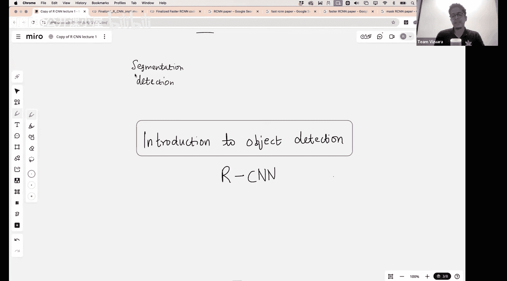

So。The R in our CNN stands for regionsions， and I will tell you exactly why there is a regions term associated with the CNN。

 CNN for simple convolutional neural network。So let's take a step back。

Let's say we were in 2012 or 2013， maybe 10， 12 years back。If we were to develop。An image。

 an object detection algorithm。What might we do right because Alex Ne was already introduced in 2012。

 so by 2012 image classification was something that we could have done very easily。

But right now we are talking about 2013 or 2014， so you know how to do image classification really well using LNe or VGG other models。

 but now the objective is you have to detect。Group of pixels inside which you have。

An object of interest so let's say you have an image like this which has a car and your goal is to detect the bounding box around a car with some sort of probability percentage。

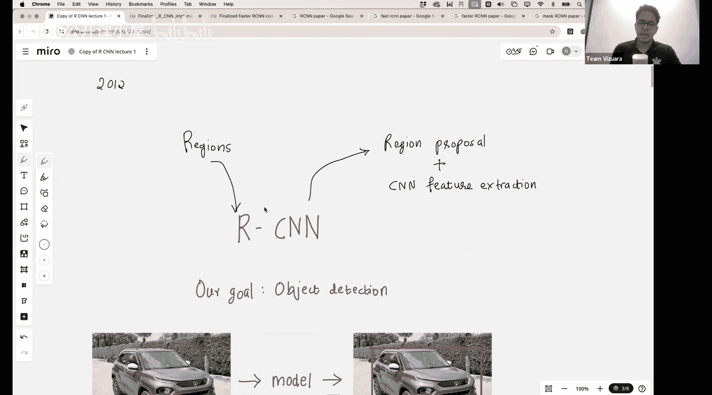

Then the goal is to get something like this， you need a bounding box and you need some sort of like a confidence score。

What would you do if you were building something like this？

Without any additional thought what what is the most rudimentary algorithm that you might try if you have any idea just let me know in the chat so the question is。

If you are building a rudimentary algorithm for detecting the bounding boxes inside which you may identify a particular object。

 it could be car， it could be cat or dog， what is that you would have done？

So while you type the idea I will also just say it but feel free to think on your own of what you could have done so the simplest thing could be something like this you take a random rectangle right which encloses some type of objects inside it sometimes it will be background sometimes a part of the object will be there。

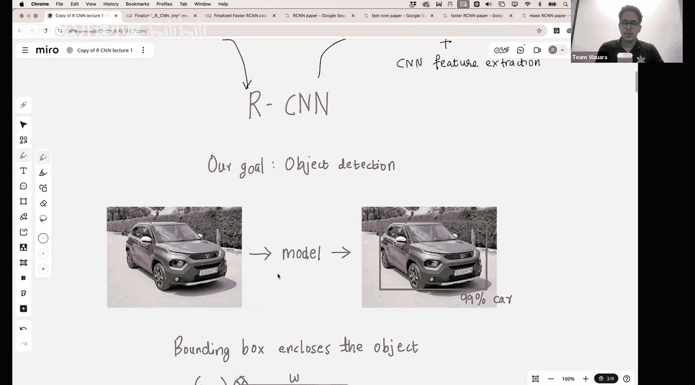

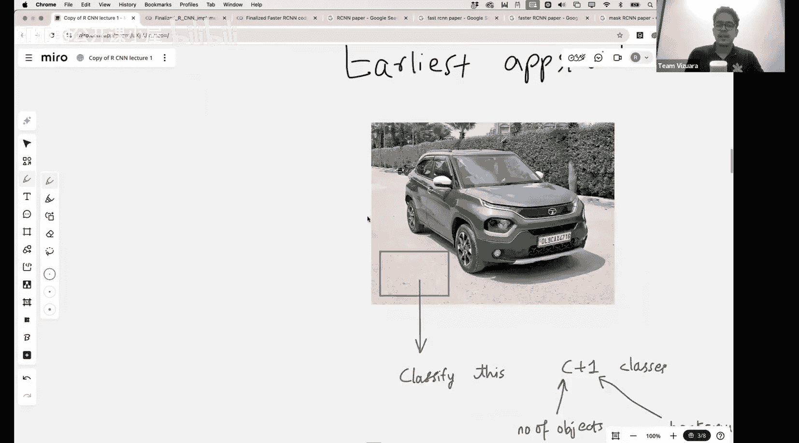

And then let's say you are trying to perform a two class classification where one of the class is a car and another class is struck。

So you say you are now going to classify this particular rectangle into2 plus 1 equal to three classes。

One class corresponds to car。One class corresponds to tu， another class corresponds to background。

 so if you have C classes。You try to classify this randomly generated subsetet of pixels inside this rectangle。

Into one of the three classes。Now if you have Alexnet you can easily classify this right obviously Alexnit will say this is neither car nor truck。

 Alexnet will easily classify this as a background。So done。

 you you searched randomly in one rectangle and you found with pretty good certainty that this is neither truck nor car。

 it's a background。But just think about how many such rectangles are possible。

 let's say the actual width of the image is w and actual height of the image is edge。

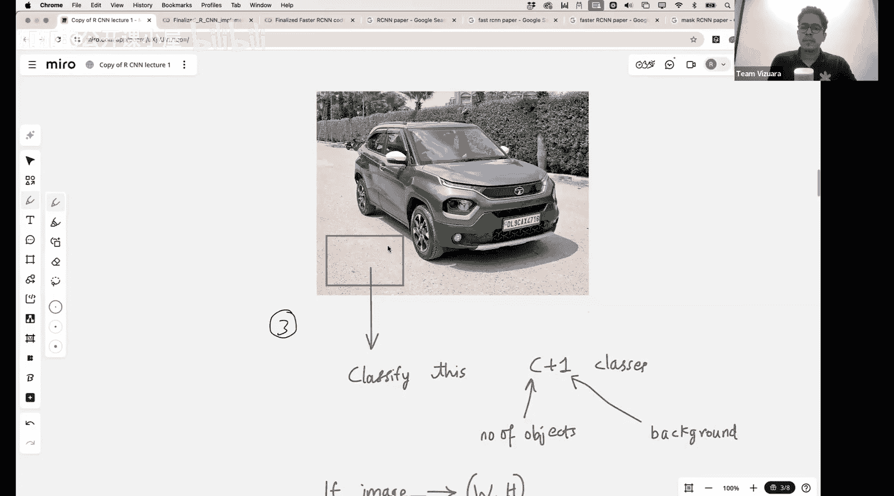

And let's say the width of your small rectangle is small W and the width of your height of your big small rectangle is small edge。

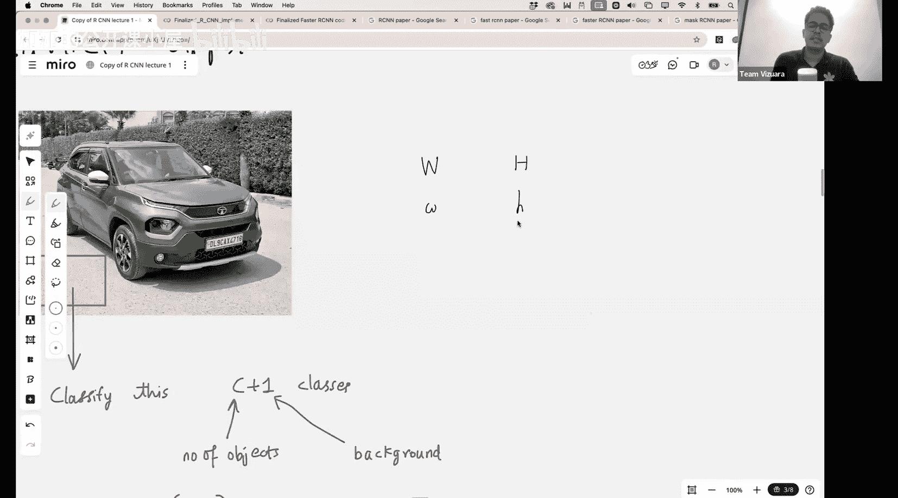

Then basically you could place the rectangle here there are many places where this rectangle could be right you could have the same rectangle placed here I mean let me move it up it could be here it could be here。

 it could be here， it could be anywhere。Without changing the width height itself。

So it actually will have。

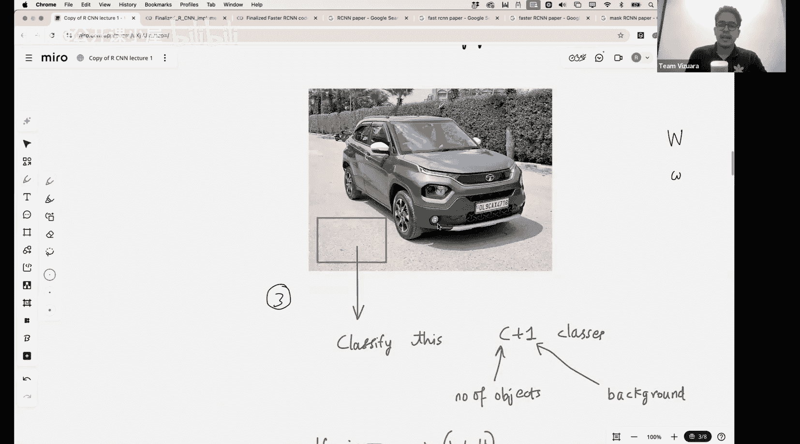

W， capital W minus small W plus 1。These many regions， these many pixels along the width。

Where you can place this rectangle。

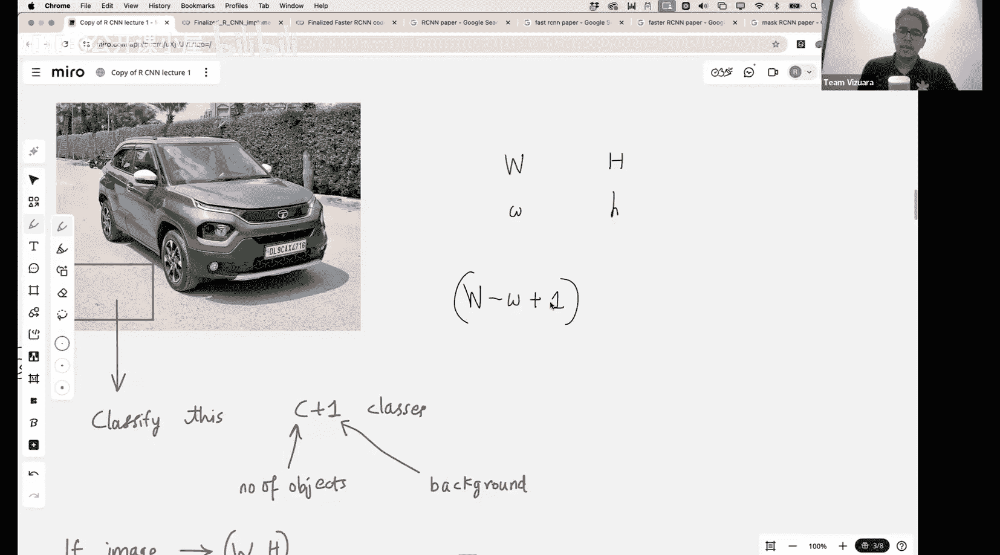

Similarly。You will have capital H， minus small edge plus one， these many pixels along the height。

where you can place the rectangle and since the placement along x axis and placement along y axis are independent of each other。

 you can simply multiply these two so you have these many ways in which you could place this rectangle anywhere on this image。

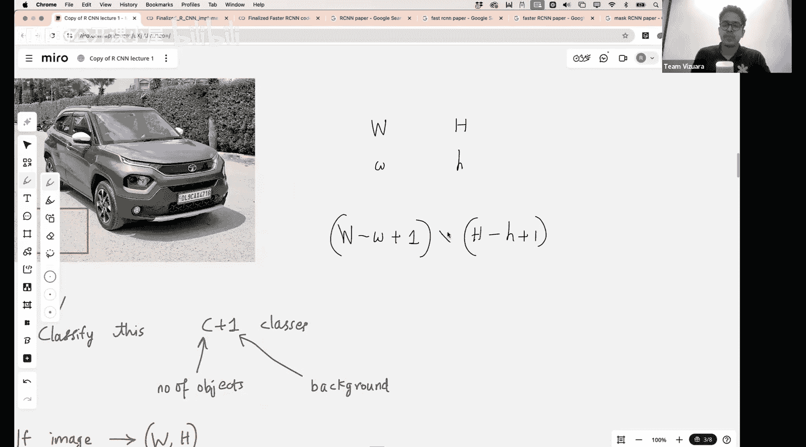

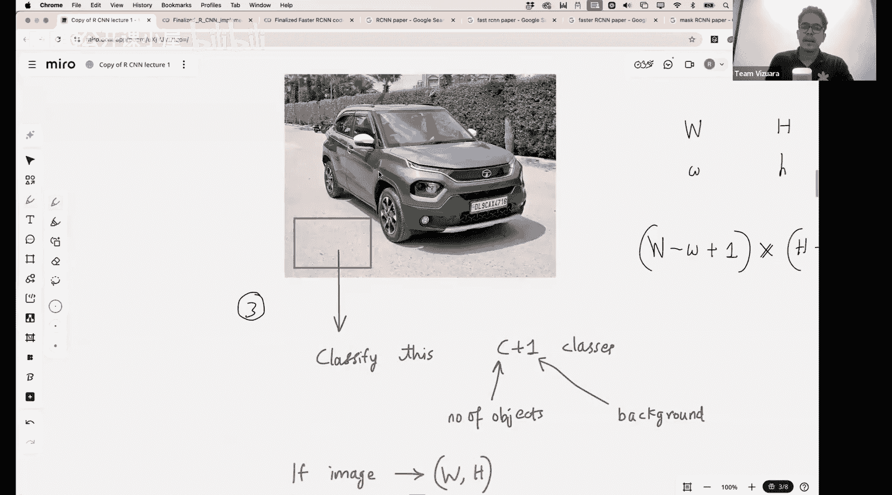

But that is not it。The width and height of the rectangle itself。Are numerous。

 so the width can be anywhere between。One pixel to W pixels。

The height can be anywhere between one pixels to edge pixels because the height maximum height of the image is edge width of the image is w。

😊。

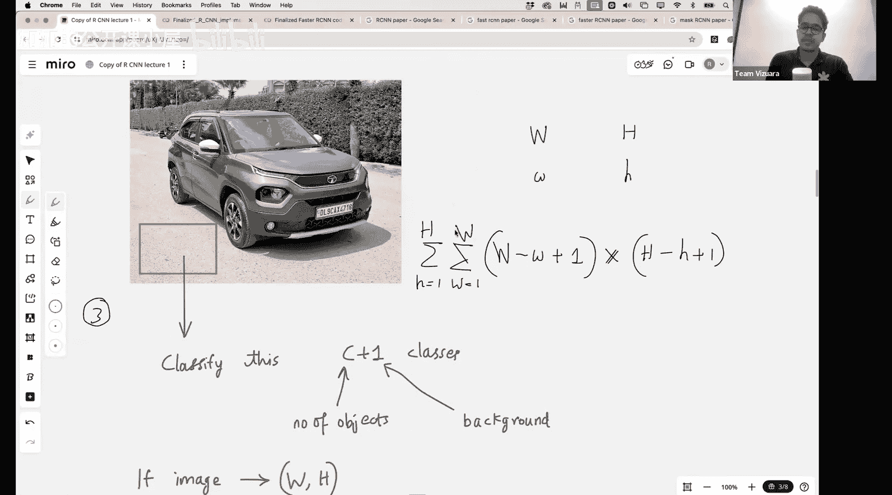

Now， if you look at the total number of rectangles like this that are possible。

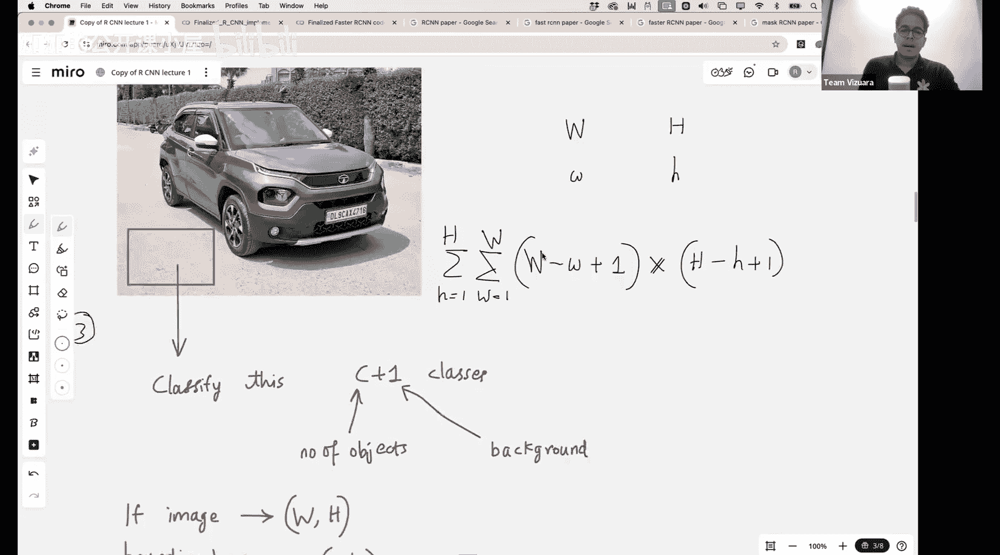

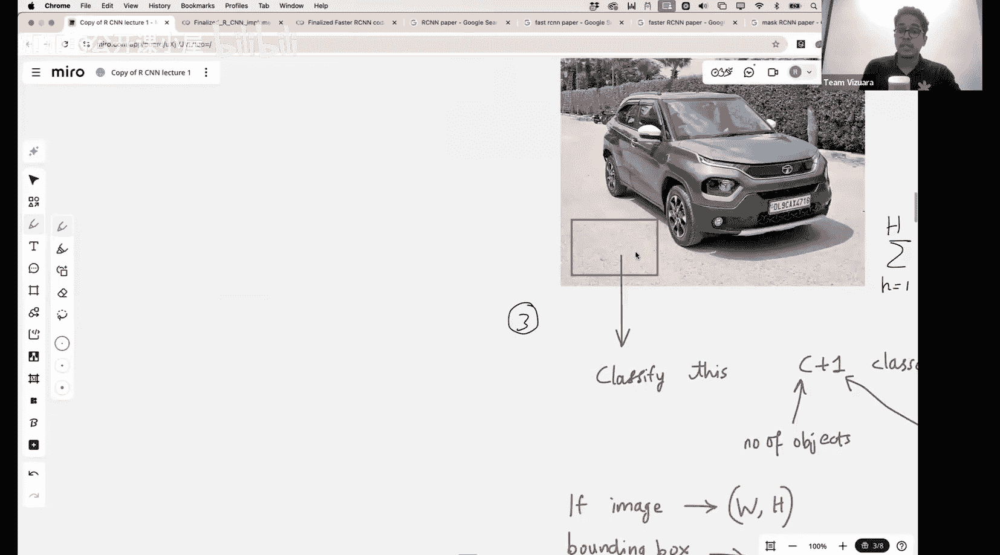

It's huge， so I have made a calculation here。Assume that your width of the image is 224 pixels height is 224 pixels。

 you are now looking at almost 635 million boxes。635 million rectangles。

In which your object object could be there so basically now you will be performing a binary or in fact three class classification of these 635 million boxes so what are the three classes track car or background。

It's so inefficient because it doesn't make any sense to search all the 635 million boxes。

So what is the next best thing to do you only search。At some boxes。

 you only consider some boxes in which you think there might be this object。

Right so those are called as proposal regions， so somehow magically， let's say I told you that。

So in this， where is the car image。

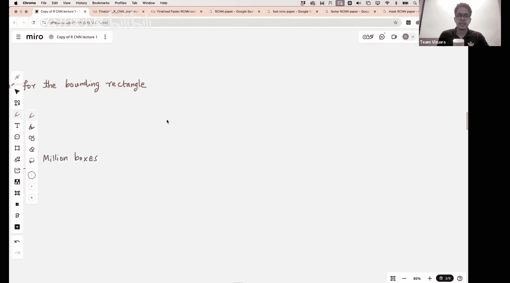

In this car image， let's say I told you that don't look at all the rectangles。Your。

Object is likely found in inside this rectangle or this rectangle or this rectangle or this or this like this I propose you a finite number of rectangles like 2000 rectangles instead of 600 million rectangles and I tell you that these proposed regions have higher likelihood of finding the object so all you need to do is check only inside these 2000 rectangles now your computation becomes much much more reasonable。

And this is exactly what R CNN does are for region。

 so you are instead of looking at the entire image。

 you are just looking at some proposed regions inside the image for the presence or absence of the object of interest。

So now let's see how this is done， so now you understand hopefully what is the difference between the rudimentary approach of searching all the possibilities versus searching some possibilities。

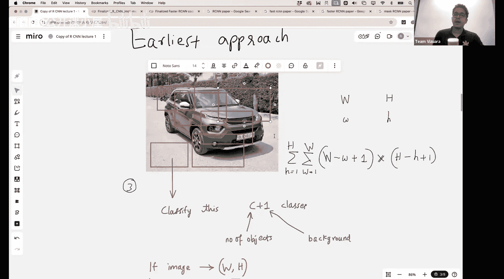

So first what you do is you have an image right， so the image may not be square shaped but most of the neural networks。

 CNNs that we are going to be using in the R CNN architecture will require square shaped input。

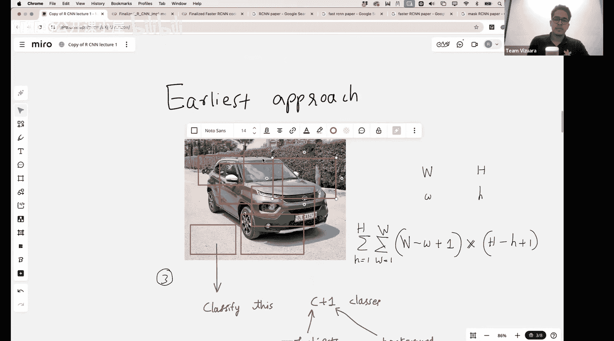

So this RGB image will be converted into square shape so if this was 224 by 440 it will be drop or reshaped into 224 by 224 plus I mean you'll be multiplying it by three because there is red channel green channel and blue channel so as you all know the images are represented by pixel values the red channel will have 224 by 224 values where each pixel value can range from 0 to 255 like that there will be green channel blue channel。

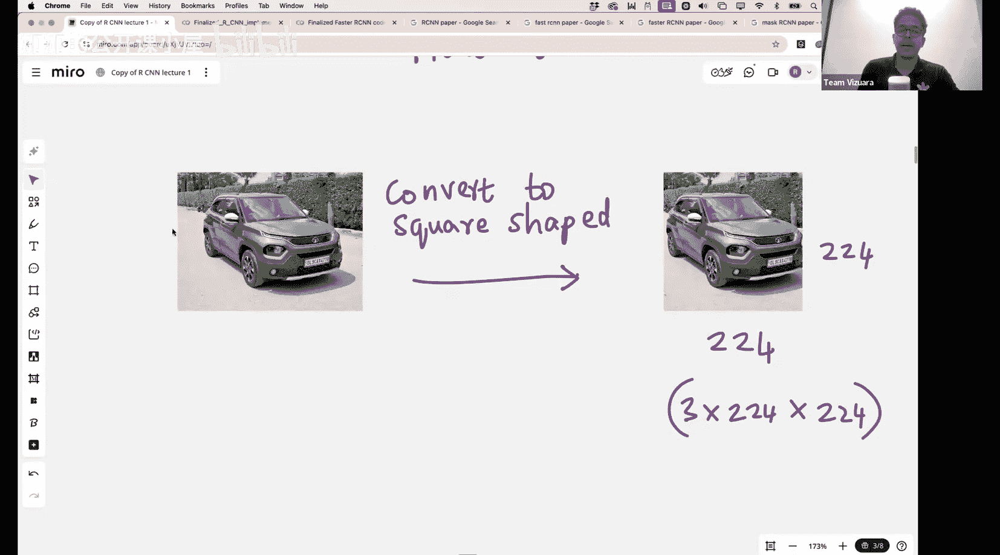

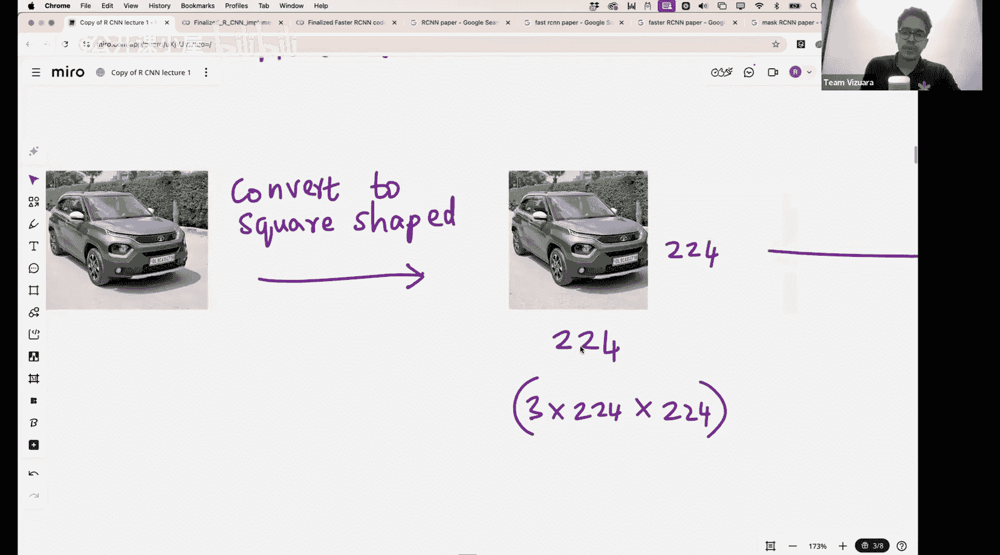

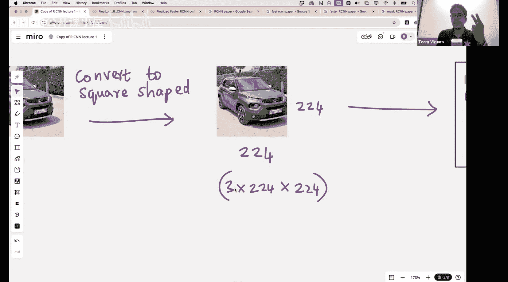

Then what do you do？Then you perform something where。

You somehow magically get the proposed rectangle regions which are those 2000 rectangles。Now。

 how do you get that？So for that， there is there are certain algorithms which are built using handcraft like。

Handcrafted logic。

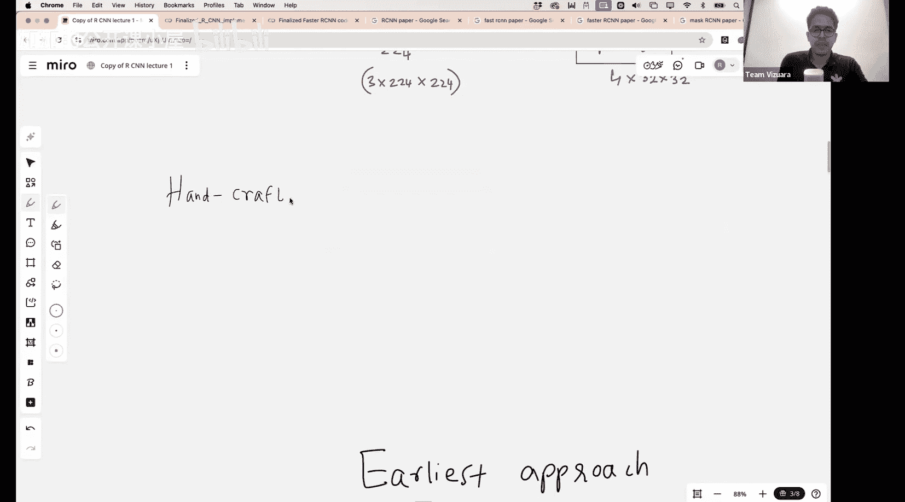

So there is no deep learning involved in identifying these 2000 potential candidates what you look at is you could look at clusters of pixels with similar pixel value。

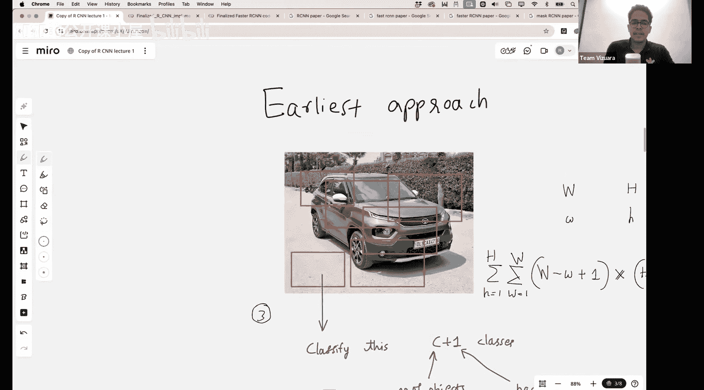

So here， all these pixels have similar kind of similar pixel value， like something like a， you know。

 brown or gray or whatever。All these pixels might have some green values。

 so just by looking at clusters of pixels that may have similar color you could identify or you could propose some regions。

 right？There are also other ways in which using the pixel values。

 you could define the geometry of an object。

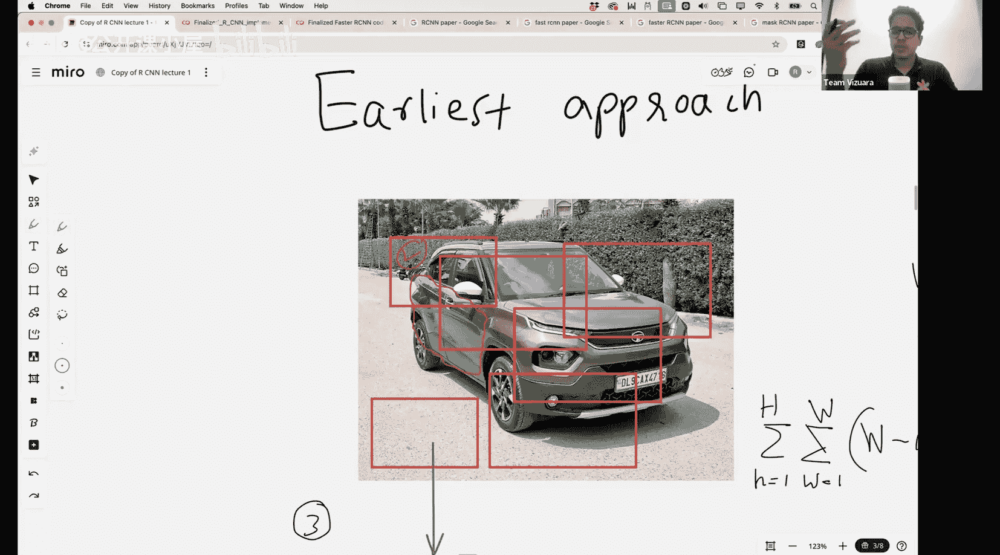