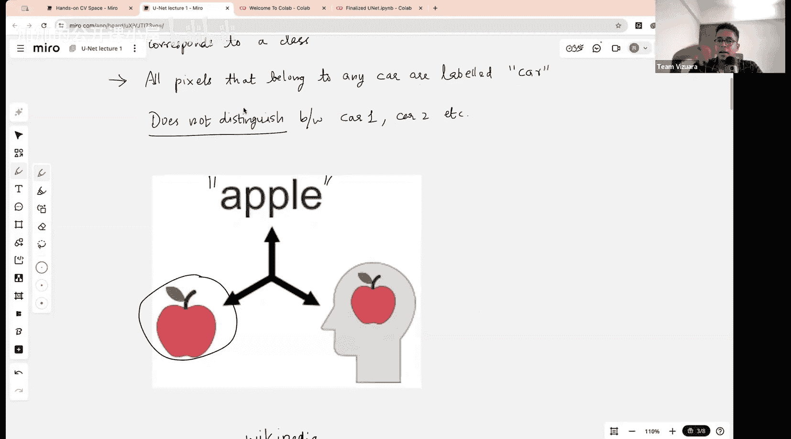
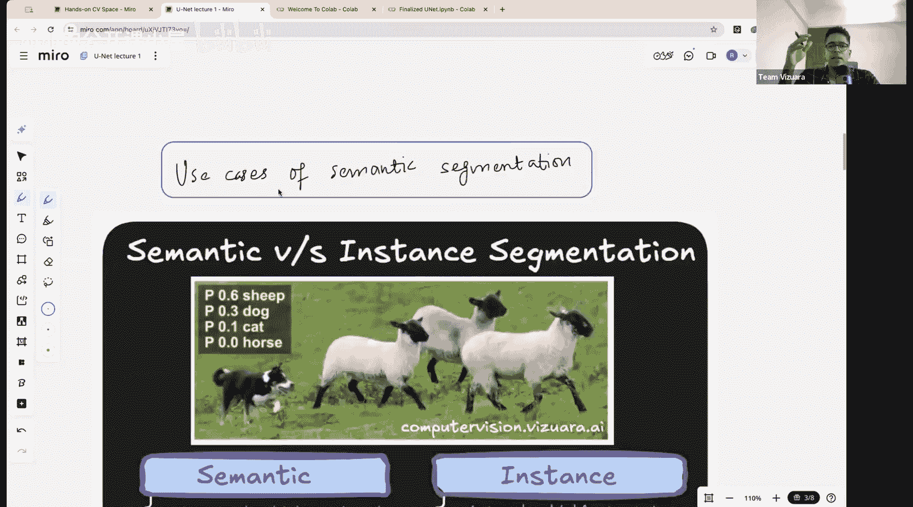
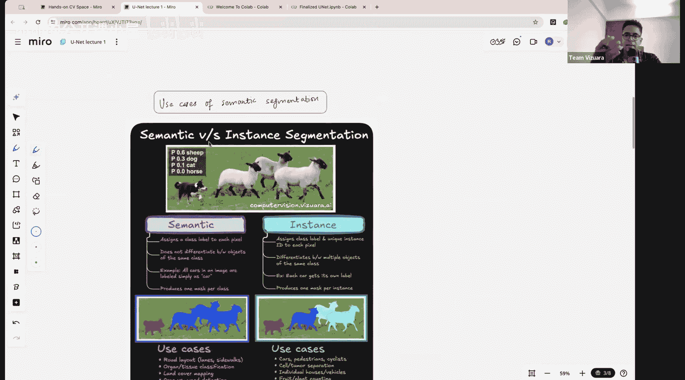
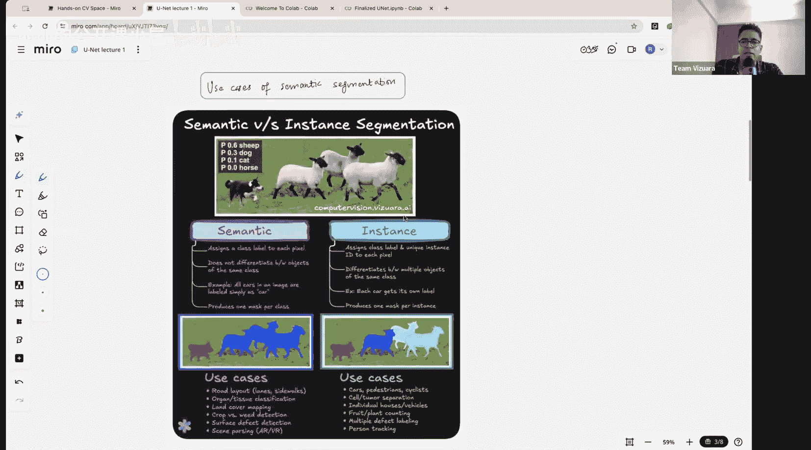
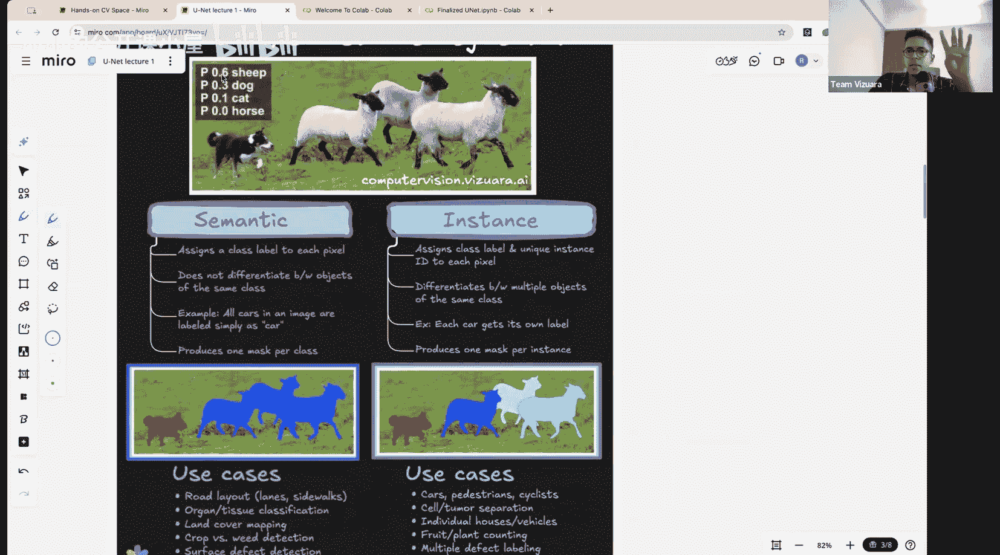
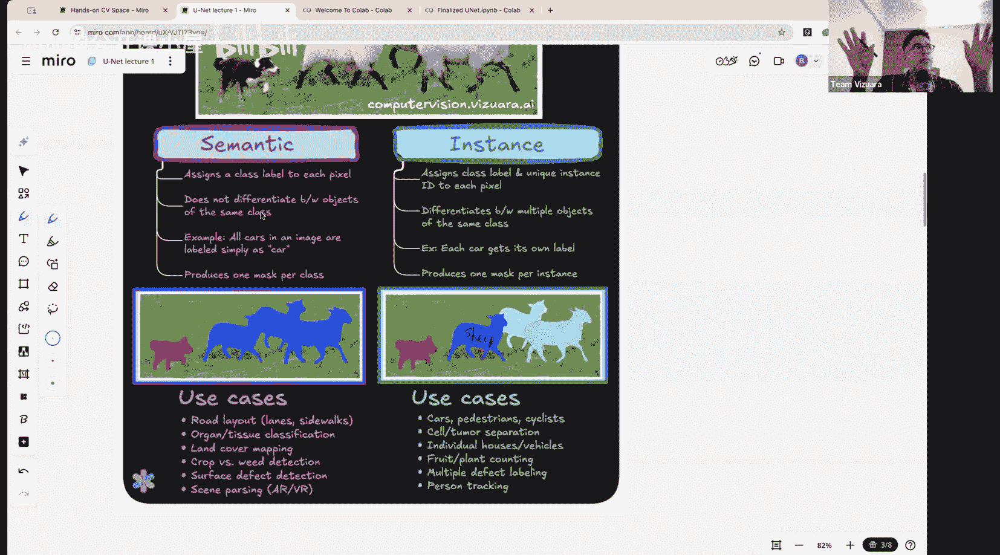
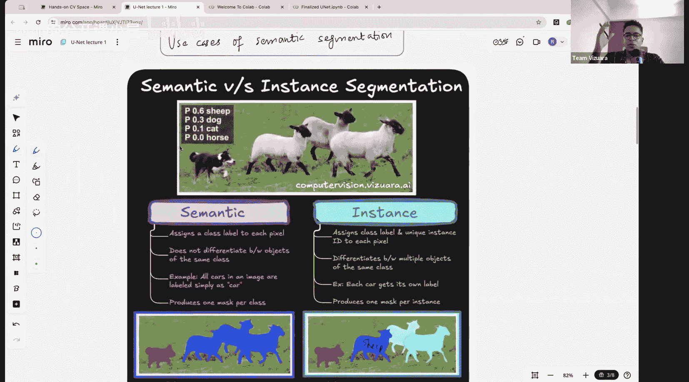
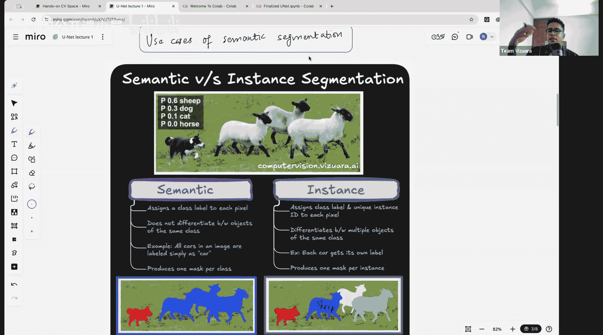
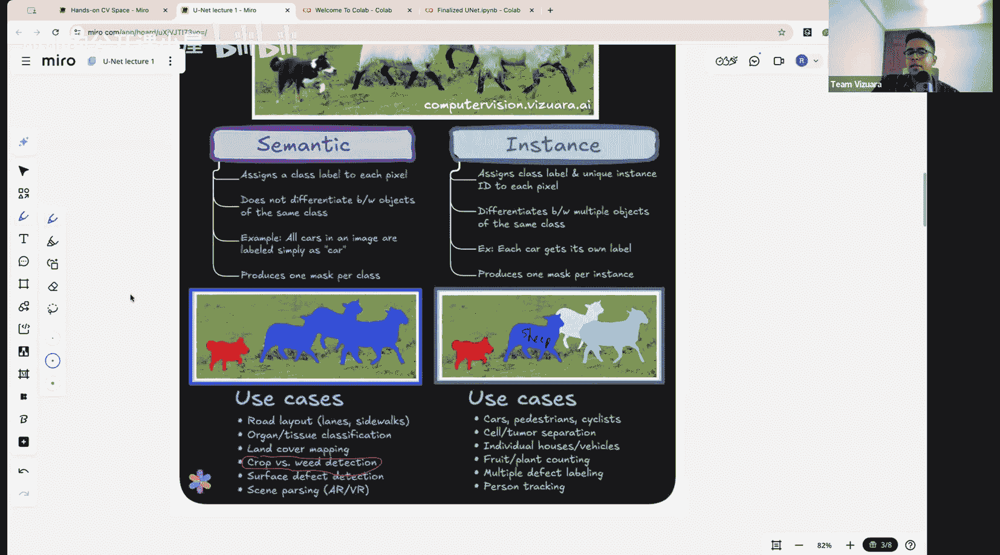
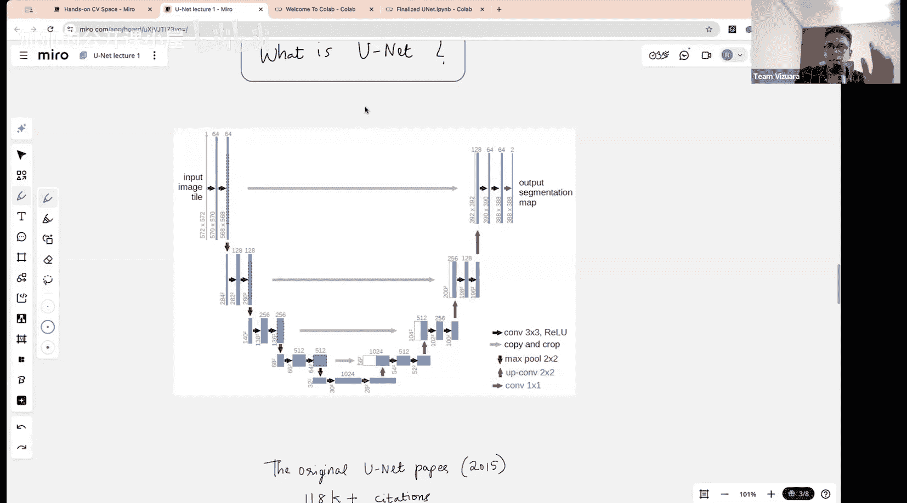

# Vizuara【中英⚡面向新手的计算机视觉｜Computer vision from scratch】 p24 P24 UNet： the 2015 model with 118k+ citations that changed segmentation - And ho [BV1UMxxzPE5Y_p24]

So welcome back to computer vision Bo camp。So。What we are going to do today is we will get ourselves introduced to unit。

And unit is an amazing architecture which you will also come across in generative AI。

 especially in image generation applications， it's a broader architecture which originally started its application in biomedical imaging and later it completely transition to being one of the backbones of something like diffusion models so we will get into unit today we'll discuss in detail about the theory of how exactly does it work and at the end as usual we will implement unit for a particular data set。

And we'll train it and we'll try to perform inference also on unit。

So unit is meant for semantic segmentation， so I will also initially discuss a little bit about what's the difference between semantic segmentation that we are talking about in this lecture versus instant segmentation that we were looking at previously when we were working on mask or CNN so with that let's get into the lecture。

So in semantic segmentation， the basic idea is that every single image。

 every single picture in an image has a class。😊，If if an image has 224 by 224 pixels。

 every single pixel is assigned at class if it is just detection of one object let's say you have a car in an image and if it's just about detecting the car then every single pixel has。

Prob to be car or probability to be background， so then it'll be like a binary classification。

The output we get at the end of semantic segmentation has a lot of similarities with the mask that that we discussed in mask R c so for example。

 if we have。A car as an as the object that we are looking at。

 we will be having a mask that looks like。Mask 1。This is mask1。And mask two。

 so it's like it's like a two channels at the output， you will have two channels。

Where the first channel will be mask one， second channel will be mask 2， and in this mask one。

 you will have the object。Everything other than the object in white color。

 so the object itself will be dark in color， something like this in mask two。

 you will have a mask for the object itself， which means background will be。Will not be highlighted。

 but rather the object will be highlighted。And we will also discuss how exactly are we going to calculate the loss in this case because in semantic segmentation。

 the basic idea is that you construct a mask such that this mask has the exact same shape of the object of interest right so we will discuss about unit architecture but before that the word semantic simply means that。

If you are looking at this text of Apple。Or if you are actually seeing the picture of an apple or actually looking at an apple。

😊，Or if you are imagining an apple at the end of the day。

 all these things mean the same thing right it's just that they are represented in different ways in one case it's a text in another case it's an image in the other case it' it's some other representation inside your brain。

So semantic segmentation means you look at the object from the perspective of its meaning like this all these pixels might be belonging to the object of car and you don't distinguish between car one car2。

 etc， as long as a pixel is a car， it will be assigned one class or it will be assigned one color when we are superimposing the mask。

So。Let's let's kind of bifurcate the segmentation into instant segmentation and semantic segmentation so this picture very nicely captures it so just look at instant segmentation which we were doing last in the last lecture so if this is the input image you have basically four objects here three sheeps and one dog。

But only two classes are there dog and sheep ignore the cat and horse that is mentioned in this image。

 let's let's not take that into an account。So two classes， four objects。

In instance segmentation we try to draw bounding boxes around every single instance of the object and we can define a unique instance ID and if we are using mask R cn we will also be producing masks like this and here what happens is every single object is determined separately but they will be belonging to same object so this will be like sheep1。

So this will be of the sheep class but its ID will be different so this is sheep one sheep2 sheet3 so the three different colors that we have showed here is representing that idea that although these these three objects are of the same class those are three separate instances of that class and this is entirely different class and it's obviously an entirely different instance the dog one。

In semantic segmentation， it it's very different you don't care about。Different instances。

 you just care about whether it's in a class A or class B。

Now you might be wondering what is where is this useful so before I show you the use cases。

 I hope you haven't read it fully but。

Where might where do you think the semantic segmentation actually might be useful because it seems like。

 oh instant segmentation is better because not only it can distinguish the classes。

 it can also distinguish different instances within the same class？

So why do you think semantic segmentation might be useful where in what kind of applications。

 feel free to put in the chat？Traffic counting， you mean。So in traffic counting， okay。

 let's let's see。You are saying in traffic counting， we don't care about the。

The kind of vehicle itself。People count traffic count， okay。

So I'll tell you one day so I'm asking about semantic segmentation right now。

 not instant segmentation， my question is where exactly is semantic segmentation helpful？

I'm not talking about instant segmentation because instance segmentation which we already did in the previous lecture looks like a better thing。

 so why why are we discussing about semantic segmentation？😊。

So think about a case where you have an MRI image of a brain or some other organ and you would like to distinguish all the tissues which are cancerous。

 you don't care about whether it's tissue number one tissue number two， etc。

 you just want all the tissues that are cancerous in one image in one color segmented in one color。

 all the other normal tissues to be in another color。

You don't care about separating those instances you just care about whether it is cancerous or not so that is one example where semantic segmentation is useful Another example is let's say we have a pipe and in this pipe there are cracks or defects or any manufactured products are where there are defects and you don't care about separating out these defects instance by instance you just want to know overall on X percentage of area how much defect is present in that case also semantic segmentation is much more useful so here I have written some use cases in semantic segmentation if we have a aerial map or satellite map as somebody posted in the chat if we are trying to just survey the land and we only care about segmenting river area versus agricultural area versus let's say。

Area where people are living all these into different color in the map then semantic segmentation is useful。

 you don't care about。Identifying individual houses you don't care about identifying individual well let's say farmlands you just care about mapping the entire farmland into one single class right so semantic segmentation has its own uses even in agriculture if you want to simply distinguish crop versus weed and this is very relevant for many companies including。

The one which I showed you the Blue River Company they were spraying when weed was detected。

 they were not spraying when crop was detected so there also if it's an image based segmentation you don't care about the individual weeds being id out separately you just want to know how much weed is there。

So there are many， many different use cases for both it's not that one is superior over other it's just that that if the use cases are entirely different right so that's what I have written here like two examples one is from about the tumor detection where it's not critical to separate the tumor into different IDs but you want it overall or in aerial or satellite imaging。

Now， the whole purpose of unit is to perform semantic segmentation。

By default it does not perform instant segmentation so it is it is in that sense very different from what mask or CNN does and in my opinion it's just my personal opinion I think the unit architecture is much more elegant and you will see soon why it is so it's much more elegant it's much more simple and it it has the exact same。

Architecture， which you will also see in various GenI models。

 So what i'm showing you right now in this picture is the unit architecture and we are going to dive deep into this Okay。

 so i'll be asking you a few questions so that。I can be sure that you know in and out。

 so just keep a pen and paper or whatever， which can help you make perform some calculations ready。

So firstly， unit is called so because this shape， as you can see， it's like a U。Now。

 this can be split into two parts。

If I draw a line like this。Everything here。