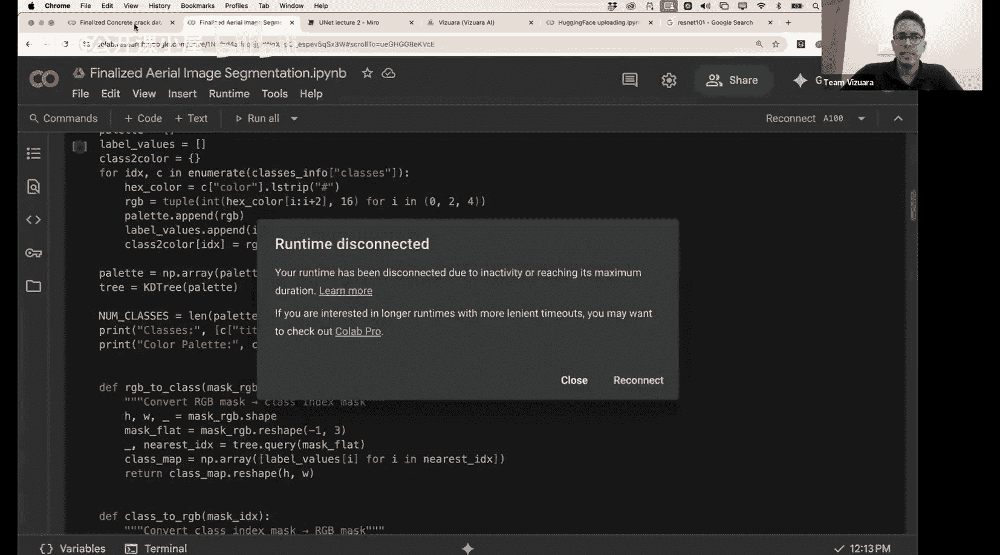
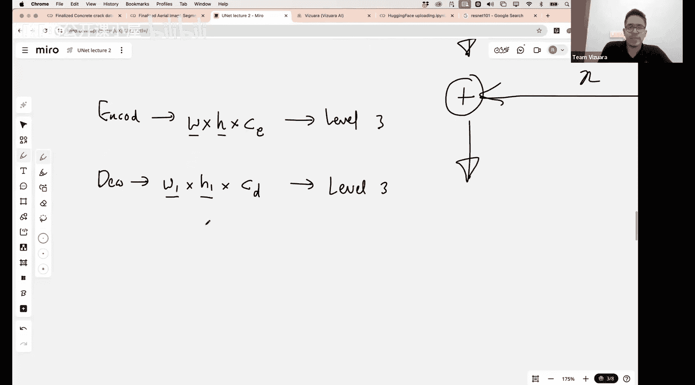

# Vizuara【中英⚡面向新手的计算机视觉｜Computer vision from scratch】 p25 P25 UNet and its Family： UNet++, Residual UNet, and Attention UNet ｜ Computer Vi [BV1UMxxzPE5Y_p25]

Lc from Comp vision bootot campm today we'll be spending some more time on unit and some of the variants of unit。

And basically， the task that we'll be still working on in today's lecture will be image segmentation。

But in addition to what we did in the last lecture。

 which was predominantly dedicated to understanding the architecture of unit in detail。

 this time we'll be coding a unit for two different datas and one additional thing that I decided we could do is。

Post a pretrained unit model weights on agging phase so that anybody could inference from the model。

 basically anybody could use the model for their segmentation task for this specific type of task。

So I'll be also be introducing you to hugging face a little bit in case you are not aware of the platform itself。

 so we'll start as ifP are complete beginners。So starting with the variances that we are briefly going to look at today。

 unit we already discussed in detail in the last picture。

 I will be providing a very brief recap on what we learned。

But today we'll be discussing briefly about three architectures， unit plus plus。

Attention unit and residual unit， but looking at the citations that these papers have the unit paper has almost two orders of magnitude higher number of citations this has 118 k plus but the other papers have in the range of 1k 10k is so from a popularity point of view and from I would say scientific breakthrough point of view nothing beats unit E。

But we'll be looking at what people did in addition to the Van unit architecture。

 which was introduced in 2015 and how did it change？The overall utility of unit。

So just to have a brief recap in unit as we discussed last time unit has mainly four parts to pay attention to first is encoder encoder is everything to the left of this line so it's like a very symmetric architecture。

This is NCOta。And。This， everything on this right side is decoded。

Then what happens in unit is in the encoder part the input image which is originally a grayscale image。

 it will go through certain transformations， many of them are convolution operations so all these are convolution operations because there is no padding the convolution operation reduces the size of the image spatially by a factor of two pixels at a time and then these are max pullinging operations which will directly half half the dimension spatially and by the time you reach the bottom and this part is called bottleneck。

The last layer。You will have an image of 30 by 30 dimensions you had started from 572 by 572。

 but you will have 1 thousand24 channels。And then you will go up along the decoder。

 so encoder tries to make the information as abstract as possible。

 try to reduce the spatial width and height。But decoder tries to bring it back to the original dimension。

 but to avoid the valuable information from the encoder section to be lost you also have these things called as skip connections so these skip connections directly concatenate the encoded features from the encoder part directly to the same layer in the decoder so totally there are four layers or four level this is level1 level2 level three level4 sorry level three four and last minus as bottleneck。

So this was the encoder decoder architecture of unit we also discussed that a similar type of architecture is utilized in。

Stable diffusion in generative AI， which we won't be going into detail today。

Now let's discuss briefly what is the difference between unit and unit plus+。

So the only difference in unit and unit plus+ is in the way you propagate the S connection in unit plus plus you have some intermediate convolution operations shown by these circles。

 so this architecture what you see is a simplified version of unit。

 this is nothing different is just that you are not providing as many details but this is unit and this is unit plus+。

And here the only difference is the intermediate convolution layers which perform additional operations during the skip connection process so that you are not directly passing the encoded features but you are passing them through certain convolution operations before it finally reaches the decoder so this is the difference between one of the differences between unit and unit plus plus and there are several advantages。

 the main disadvantage is that training will be slower because now you have more number of parameters to take care of but the advantage is that when you are performing back propagation you have much more。

Detail connections from your final output to the previous layers。 So here you can see that。

In the final output so this final output is where you add the features from every single layer so the first level of the encoder last level I mean fourth level of the decoder I mean sorry level one and level two level one of the encodeder and decoder I mean to say。

This is level one of encoder， this is also level one of。

Decoder so you can see that in the output there are features coming from both of these levels。

 but also from these intermediate connections in the skip connection region。

 you are having some outputs。But you might be wondering， okay， if there are five outputs like this。

How do we perform classification I mean how do we perform segmentation because we just want one mask ideally right or two masks one for background and one for object so how exactly is it done here so the way it is done is in the training part of the unit plus plus。

We will be considering the outputs from all these nodes and a combined loss function will be created where all these outputs are compared with the ground roof mask。

But during the inferencing you might only look at the output from this node so that whatever mask this node is predicting is being used for the final segmentation process on the input image so that's the main difference between unit and unit plus plus and for certain tasks like biomedical image segmentation apparently unit plus plus have a better accuracy but i'm sure it's also confined for specific data sets we can't make blanket statements but you can see that unit plus plus much more well connectedned architecture much more complex of course inference might be slower training is definitely slower so that's the difference between unit and unit plus plus。

Now in the residual unit。Before we before I even show you the image just by the name we can imagine that there has to be some residual connections residual connections like what residual connections like those in ReNe so in ReNe as we had discussed in the last lecture the residual connection was like this you have an input。

The input will go through some convolution operations。And there will be an output。And if this。

 whatever is coming out here as the output can be called as F of x。And input as x。

You are having something called residual。Where you add this f ofx plus x。

 so the final output from this resonnet block is F ofx。Plus x。So although the output is this。

 the residual block in the reson is not learning f of x plus x。

 it's only learning f of x remaining x is already part of the input。

And the advantage of this is that when you put this。Multiple times as in a series。

 you can eliminate the problem of vanishing gradient because you will have direct connections I mean the inputs are directly propagated to the output and because of that even the earlier layers of the neural network has significant influence on the output。

So back propagation will not cause vanishing gradient because even this layer。

 even if this is the first layer of a101 layer neural network。

 this layer also will influence the neural network output significantly。

 as we had showed in the previous。Lecture， so if we look at the resnet 101 architecture。

We can take any random assessmentment architecture actually so just just take a look at this。

Or let's take a look at this。 So in this architecture。

 you can see that there are receivs going all the way till the output so。

Whatever changes are happening at the input is having a almost direct influence on the output and because of this the loss is not just influenced by the later layers loss is also influenced by initial shallow layers so just based on this knowledge we can already imagine that some residual connections where some addition will happen in the residual unit。

In normal unit， we were not adding the input from encoder into the decoder output。

 we were actually on catch anything so we will have width times。Height times number of channels。

 let's say channels in encoder。And if this is the。This is the situation at a particular layer in the encoder。

Decoder may have a different width W1。I1 times number of channels in decoder。

 so let's say this is level3。And this is also level three。And this is Bcorta。This is N quota。Right。

Then what was done was you were cropping so that this W1 and H1 are matching this W and H。

 so this is first copied and cropped so that this becomes W by H by。

