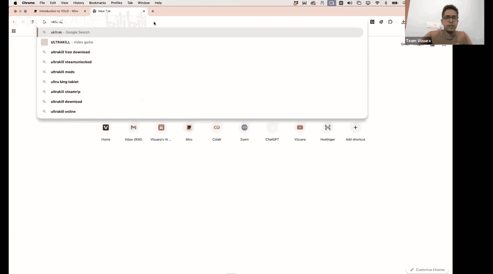
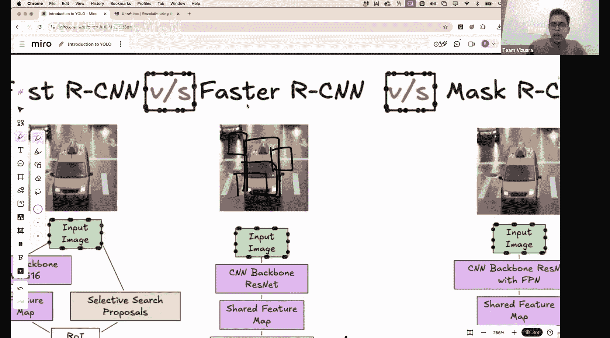

# Vizuara【中英⚡面向新手的计算机视觉｜Computer vision from scratch】 p26 P26 A beginners introduction to YOLO ｜ You Only Look Once ｜ Computer Vision [BV1UMxxzPE5Y_p26]

Thank you。Welcome back to a new lecture today we'll be having an introduction to Yolo Yolo stands for you only look ones personally for me it's one of my favorite models for object detection in this computer vision bootcamp in the past we have already covered few models including RC variants of RC。

And we have discussed about object detection versus instance segmentation versus semantic segmentation。

 so we had implemented segmentation using unit。Yola is very different。It's， in my opinion。

 a much simpler architecture。And it can process objects in real time。Almost real time and at。

Pretty good accuracy。We had if you remember implemented Yolo in one of the earlier lectures where we were trying to implement OpenC but we had implemented a Yolo V83train model nano model right so today what we'll be doing is we'll be going into the depth of theory of how exactly YoO works and how can we implement it for a specific application。

嗯。So。What do we mean by real time object detection？So if we have 24 to 30 frames per second。

If whatever model we have is able to process around these many frames in every single second and detect the objects in those frames。

 we can call them as kind of real time object detection models。

And Yolo different versions of Yolo exist the version which we had used was the version 8 v8 today we'll be discussing about the structure of the original Yolo architecture right so of course there are variations in the Yolo model architecture itself。

There are some models which cannot process 24 to 30 frames。

 they can only process like 15 frames per second。But there are models which can process， I think。

 around 155 frames per second， so these are models which can do real time object detection。

And it can be used for video surveillance you may have seen videos from different companies on physical security systems on the internet where the detective people are coming and sleeping at a private property where they are not supposed to enter and giving realtime feedback to a computer system and some speakers making sounds you can use part of Yolo for self-driving car of course Yolo is not the only thing that is going on in a self-driving car we all know that but Yolo can be used for some basic object detection and annotation。

And during pandemic， there were news articles that I had read where people had implemented real time crowd monitoring system。

 which primarily work based on you。There are certain limitations also for Yolo when it comes to detecting a lot of people in a crowded image or in a crowded frame。

 we will also discuss that in today's lecture。So one of the questions that you may naturally have is here we say you only look once。

 so does it mean that other architectures are looking more than once in the image。

 yes they are and we will also briefly touch upon that which we had discussed earlier in the RC lectures。

So the basic objective of Yolo is annotating objects in an image with these things called as bounding rectangles。

So these bounding rectangles give you a localized position of the image position of the object inside the entire image。

The object themselves will have class， person class， dog class， post class。

 and there will be a confidence score associated with it。

So how exactly does Yolo construct this rectangle？How does it decide whether something is a person or a dog or a horse？

How exactly does it construct the confidence score？We will go through that also indeed。

So the original yo paper， I would say it's a legendary paper， it's been cited more than 65。

000 times now and the first author of the paper is this person Joseph Redmond。And this paper。

 I would say， has entirely transformed the way in which object detection has been implemented ever since Yolo was introduced。

Now there are even more modern versions of Yolo， we have Yo V 11， I think V 12 also has come out。

 but there are no official papers associated with some of the latest Yo models。

 but there is a company called Altralytics， which we had briefly discussed。

In one of the earlier lectures， so this company has many different pre trained Yolo models which you can use for object detection and I'm sure there are other unofficial models of Yolo which are pre trained on various annotated image classes。

Now， this table just shows you how the。Speed of the Yo and accuracy of Yo compares with some of the other models。

So first let us look at that these two things MAP and FPS FPS is simply frames per second how many frames of in a video can this particular model process in one second so if FPS is anything greater than I would say 24 you can call them as real time so all of these models which are denoted as less than real time have a frames per second typically less than 24 so all of these are smaller frames per second models and all of these models which which are listed here have higher frames per second processing capability。

Map stands for Me。Average。Position。You might wonder if the word average is there。

 why do you need mean？So average precision is nothing but。你。Reciition。

Wwhich you get for different recall values so I don't want to go into the details of MA I'm just saying this in two sentences for anybody who's curious so you can calculate precision of your model at different recall values and you can take an average of that that is the average precision or less AP。

And if you have multiple classes in an image like dog cat horse person。

 you can take the mean of the average precision for all the different classes and that value is called mean average precision or MA and this is a number which indicates how good your model is in detecting various objects on on average at a good accuracy so you can see that Yolo has pretty good accuracy 63。

4 this screenshot I took from the original Yolo paper you can also compare it against some other models so here you can see that RC faster RRC faster RC these are the models which we discussed earlier and you will see that faster R CNN and faster RC have in fact better accuracy slightly better accuracy compared to Yolo。

But they are both extremely slow。You can see that they can only process0 five or seven frames per second。

So the main advantage of Yo is that you get almost real time speed in processing without compromising too much on the accuracy。

So just just keep this in mind， like when somebody thinks about your the use case of Yolo。

 this is the use case， you need speed without compromising too much on the accuracy。

So before implementing Europe， which stands for you only look once。

 people were looking not once but more than once right how exactly was that？

So there were two different type of techniques the most primitive technique is using something called us sliding window detectors so let's say we have a person and our goal is to build a detector or a filter which can identify people。

In a photo， right， humans in a photo。What we can do is we can construct different type of filters。

Which when we plot in the form of an image can look at。

Look at various abstractions of the shape of a person and by moving this filter across an entire area of an image。

 you can highlight certain regions where you have very high probability of the presence or absence of a person。

And this is one way in which in olden days people were constructing handcrafted these feature maps for extracting the localized regions where you would find a person or you would find a cat or you would find some other object。

And obviously this does not involve any deep learning。

 this is not a this is not a deep learning based technique。

 this is more like a hand engineered technique。But our CNN。

 which we have discussed in detail in the past lectures is very different。

 so I'll just remind you in our CNN or let's say let's take the example of faster our CNN。

What we do is。One of the neural networks in this entire architecture， so this RPN。

 which is called as region Pro network， will propose around 300 rectangles。

 so 300 rectangles could be like one could be here， one could be here。

 it will propose different rectangles as proposed regions where you might find the image。

Now the purpose of our faster our CNN model is to classify these rectangles。

