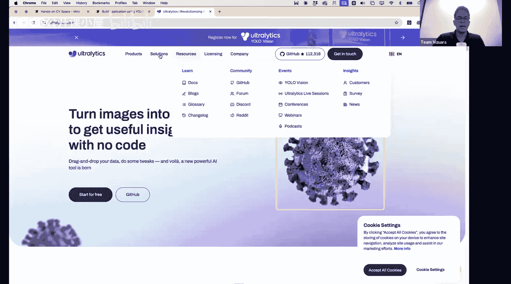
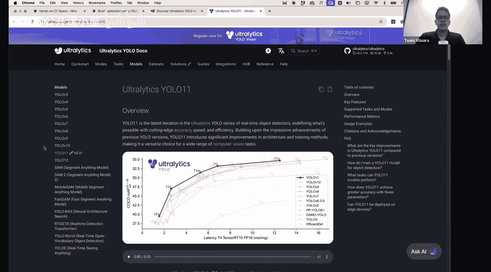
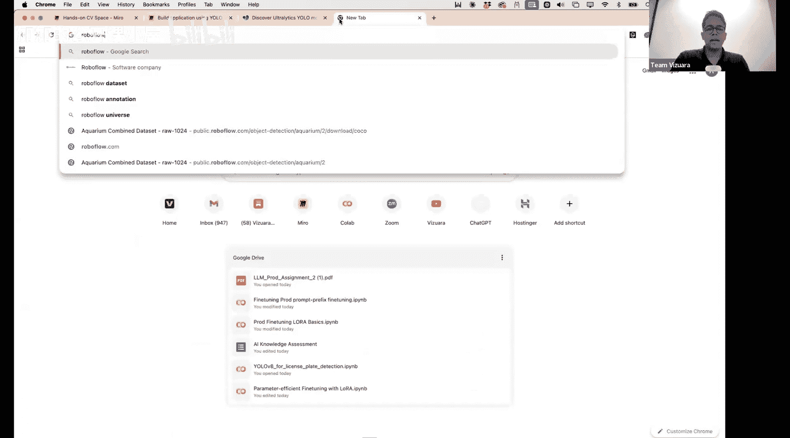
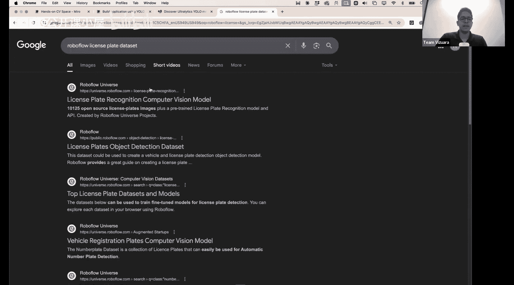
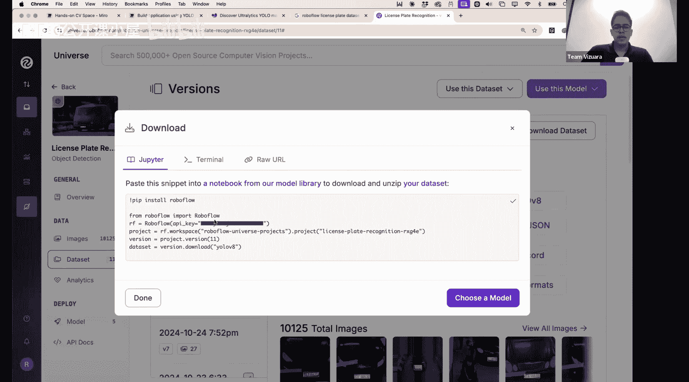
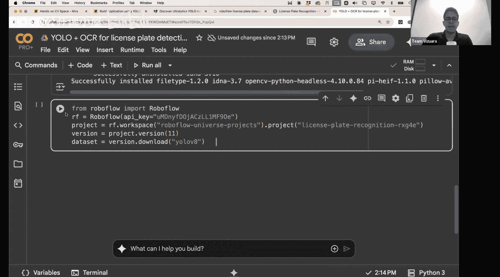

# Vizuara【中英⚡面向新手的计算机视觉｜Computer vision from scratch】 p27 P27 YOLO + OCR for License Plate Recognition ｜ Computer Vision Hands-on Project [BV1UMxxzPE5Y_p27]

Thank you。Welcome back to a new lecture from hands on Computer visionion today we'll be covering Yolo for the second time in the last lecture we discuss the theoretical aspects of Yolo。

 especially the Yolo version one。Today what I want to do is walk you through building an actual very useful euro project which is for number plate recognition so if there are vehicles passing in a video it could be a live video stream it could be a recorded video is there a way we can recognize the number plate of this vehicle and actually rewritten convert it into a digital format。

This will be useful in many cases， you know that there are AI cameras installed throughout the highways that can detect whether the passenger is wearing a seatbelt。

 whether some other speed limit is crossed etc， those are AI cameras equipped with various real time processing modules we are not sure what exactly is the module that they use but what we are going to do today is show that Yolo can be one of such realtime detection modules。

So apart from Yolo we'll also be using one more technology today called OCR。

 also known as optical character recognition， so Yolo will help us extract those pixels which forms a bounding box inside a bounding box for the number plate and OCR will help us read what exactly are those digits inside the。

Bounding box so all of us will be building this together so what we are going to be using is for the first part of the code we will be using Google Collab for the second part of the code we will be using VS code or all right。

So。The basic idea of a number plate recognition system is something like this consider an input video。

 the video is divided into frames there are around 30 frames per second and what we want is we want this bounding box a little bit offset but basically we want the bounding box around the object。

And the object of interest is obviously number blade。And once that bounding box is obtained。

 meaning once the pixels of interest is obtained。The final output that we really want is the actual number plate number。

 right， whatever that is Gx 15， O， G J， whatever it is。So this is the final output that we required。

 and this is the input。So the。Architecture that we are going to follow today is first we will use a yolo pretrain model。

 so pretrain model is available， we have been using the Yolo V8 nano version of the pretrain model in the previous lectures so we'll be using the same model but we'll be doing one additional thing which is fine tuning this on the license plane data I'll tell you exactly by this fine tuning is needed in a moment and then once we have a fine tune model we will save the model so that the weights of those models are accessible to us so we'll be training the model not from scratch it is you can call it as transfer learning so it's a pretrain model you are fine tuning on top of it you can do the same forplexGB if someone has already built a model and if you want to fine tu it on top of it you are not starting with random bits you are starting with very well definedfined ways of the model and then you are slightly modifying it and finally we'll be using OCR but while using OCR we have to。

Add some specific constraints this specific constraint will depend on the kind of data set that we have the video that I'm going to be showcasing you today will have a specific constraint maybe the video that you are going to use for your application may have some other constraints all right。

So the reason why fine tuning is needed is because the pretrain version of yolo that we have available from ultratralytic ultratralytic is the company that。

Has many pretrain Yolo models available for use， if you go to their products here。

 you can see the list of Yolo models that they have， they have everything starting from。

 I think Yolo even all the way till Yolo V12。

So Yoo V 11， so here you can see all their models up to Yoo V12。

 but we' be sticking with YooB and it's very simple to download and it's very simple to use。

But you could also use Yo V11， no problem。Now the issue is that this pretrain EuroV8 model is trained on Coco data。

 this data has 80 object classes and these are the object classes I have just put the object classes into a word cloud。

But the idea is that these object classes does not contain the class called。Number plate。

So it's not possible for the original pretrained Yo V model to detect number plates。

 but it can detect all these things so if our image contained any of these things it could have detected the object but not number plate so this is the reason why we have to pretrain the Yolo model。

And after pretraining we perform fine tuning so what do we need for fine tuning let's let me not show you the screen for a moment。

 can you put in the chat what are things do we need if you want to fine tune an existing model。

 what kind of data do we need in this context okay in the context of this problem what what is the data that we need for fine tuning。

Right， label data and how will it look like， how will this label data look like？

What will be the image and what will how does the how would the label look like？Basically。

 it will be photos or images of number plates and the label is nothing but the bounding box coordinateage correct。

 bounding box center， bounding box width and height。And if we have this data。

 we can call it as a label data and that we can use to train the existing euro model。

So basically to get the label data we can use a platform called Robboflow where there is abundant data set available so after point tuning we will get a model and we have to save that model weights only then we can use it later for inferencing。

So I'll also show you how to save the fine tune model so that you can use it any number of times。

And the reason why I'm using GPU for the first part。

 which is the fine tuning part is because fine tuning is a little bit slow。

 so if we have Google Collab we can use GPU so let's use Google collab for the first part and then for the second part we can run on VS code on our own computer so even if you don't have GPU for inferencing that's fine but for fine tuning GPU will accelerate things very fast。

So this is the fine tuning step。And the data set that we have。

 I notated data is available on Robboflow， so you can just go type Robbo flow。And I。

License plate data set。

And then you will get this link， so I'll share this link directly in the chat。

 so just open this link。Alright， so this is the data set that we will be using and what you can do is go to this section called data and in that at the top you will have different versions I mean on the left side you will have different versions we use the latest version。

And we are going to download this data set， which will be in a very specific format。

So what you can do is select Yoo V8， so obviously you know needless to say you will have to sign in using your Google account or Gitthub on Robflow。

So click Yo V8 and then you are not training from a portion， you are downloading the data。

 so select download data set， then click continue。And what you can do is instead of downloading the zip file to your computer。

 so don't select the download zip to computer option， just select show download code option。

 click continue。And then Robboflow will display a code。

 you see this code Pa install Robflow from Robflow import this this is。

 so just find the code and copy it I'm not going to share the code with you because it has my API key which I will destroy anyway later but you can use the code that you get from your account。

Once you have this code， you can go to Google Collab。

Open a new notebook。Then。Paste the code somewhere in the first cell。And the Pip install alone。

 you can maybe run separately because that you don't have to run all the time So this you can。

Just initially run separately， this will install Robboflow library。And we will need it。

 I have already installed it so this will happen for me pretty fast， I guess， but for you。

 it may take one minute or something。And name it as something elous。OcrR。

 cor rep license plate detection。Alright， so this is。That。

And then here you can see some things this is the API key， which will not work once I delete this。

 but you can use your own API key。Then project version Euro V8 Proboflow Universe projects and the project name is this so it's all automatically fill the project name and everything and I can just run this。

So when I run this， it will download。